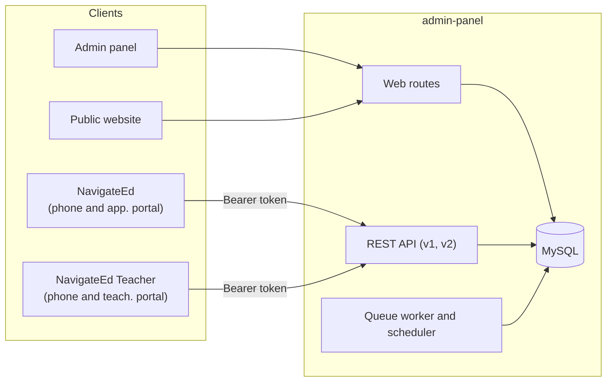

# Eschool

One Laravel application runs the school: the admin panel, the public website, and the API behind two Flutter apps. On a phone those apps are **NavigateEd** (students and parents) and **NavigateEd Teacher**; in a browser the same apps are the web portals at `app.navigateed.co.za` and `teach.navigateed.co.za`.

[](https://github.com/ShawnDaPrawn/Eschool/actions/workflows/ci.yml)
·
[Documentation](https://shawndaprawn.github.io/Eschool/)
·
[Developer wiki](wiki/Home.md)

## How the pieces connect



## Repository

| Directory | What it is | Stack |
| --- | --- | --- |
| [`admin-panel/`](admin-panel) | Admin panel, public website, and API | Laravel 12, PHP 8.3 |
| [`e-school/`](e-school) | Student and parent app. Dart package `eschool`. The name on the phone is NavigateEd. | Flutter 3.44.9 |
| [`e-school-teacher/`](e-school-teacher) | Teacher app. Dart package `eschool_teacher`. The name on the phone is NavigateEd Teacher. | Flutter 3.44.9 |
| [`packages/`](packages) | Dart packages both apps use: [`eschool_core`](packages/eschool_core) (shared widgets, theme, layout, build settings), [`eschool_session`](packages/eschool_session) (sign-in, `/me/context`, force update, deep links), [`eschool_notifications`](packages/eschool_notifications) (push and local notifications), [`eschool_api`](packages/eschool_api) (client generated from `admin-panel/openapi.yaml`) | Flutter 3.44.9 |
| Web portals | Both apps built for the browser (`flutter build web`): the learner and parent portal from `e-school/`, the teacher portal from `e-school-teacher/`, deployed to Firebase Hosting ([`firebase.json`](firebase.json)) | Flutter web |
| [`documentation/`](documentation) | End-user guides, published to GitHub Pages and Firebase Hosting | Docusaurus 3 |
| [`wiki/`](wiki) | Developer wiki. The Wiki tab is published from this folder. | Markdown |
| [`engineering/`](engineering) | How NavigateEd is built: phase plans and questions, feature specs, decision records, runbooks, the security and self-test records, and the living appendices of the Build Bible | Markdown |
| [`infra/`](infra) | Google Cloud provisioning (`infra/gcp/provision.sh` and an env file per environment), the Firebase Hosting deploy script and the post-deploy smoke test | Bash, gcloud |
| [`docker-compose.yml`](docker-compose.yml) | The local stack: MySQL 8, the panel, the queue worker and the scheduler, from the same image as Cloud Run | Docker Compose |
| [`.github/workflows/`](.github/workflows) | Tests, analysis, web builds, app smoke flows, Playwright, the docs build, the dependency audit and secret scan, deploys, and wiki publishing | GitHub Actions |

Each directory is its own project. Run install and start commands inside that directory. Leave the Dart package names as they are. Every import in an app uses them.

## Where to go next

| You want to… | Start here |
| --- | --- |
| Understand the system | [Architecture](wiki/Architecture.md), then [Repository layout](wiki/Repository-Layout.md) |
| Run it locally | [Getting started](wiki/Getting-Started.md) |
| Follow a setup guide | [Documentation site](https://shawndaprawn.github.io/Eschool/) |
| Read what changed | [CHANGELOG.md](CHANGELOG.md) (NavigateEd), [upstream changelog](documentation/changelog/index.md) (eSchool up to 3.5.0) |
| See how it is built and run | [engineering/](engineering/README.md) |
| Change the code | [Contributing](CONTRIBUTING.md) |

## Run it

**Admin panel.** PHP 8.3, Composer, and MySQL or MariaDB.

```bash
cd admin-panel
composer install
cp .env.example .env
php artisan key:generate
```

Set the database credentials in `.env`, then run `php artisan migrate`. Details are in [admin-panel/README.md](admin-panel/README.md).

Or run the whole stack (MySQL, panel, worker and scheduler) with Docker: `docker compose up` from the repository root.

**Mobile apps and web portals.** Flutter 3.44.9. The server address is a build setting; with none, the apps talk to the production server.

```bash
cd e-school
flutter pub get
flutter run --dart-define=API_BASE_URL=http://10.0.2.2:8000 --dart-define=ENV=local   # a local panel, from the Android emulator
flutter build web --release --dart-define-from-file=config/staging.json            # the web portal
```

Use the same commands in `e-school-teacher` for the teacher app. See [Mobile app configuration](wiki/Mobile-App-Configuration.md#build-settings).

**Documentation.** Node.js 20 or newer.

```bash
cd documentation
npm ci
npm start
```

The site is served at `http://localhost:3000/Eschool/`.

### Firebase Hosting

`firebase.json` at the repository root has three Hosting targets: `docs` (the documentation site), `app` (`e-school/build/web`) and `teach` (`e-school-teacher/build/web`). The deploy workflows build the portals and run `infra/firebase/deploy-hosting.sh`. To deploy by hand, build the portals first and run this from the repository root with the [Firebase CLI](https://firebase.google.com/docs/cli):

```bash
firebase login
firebase use --add
firebase deploy --only hosting
```

The predeploy step runs `npm ci` and builds the site for `/`, with links on `https://<project-id>.web.app`. A local `npm start`, and any build without the `DOCS_URL` and `DOCS_BASE_URL` variables, still uses `/Eschool/`.
