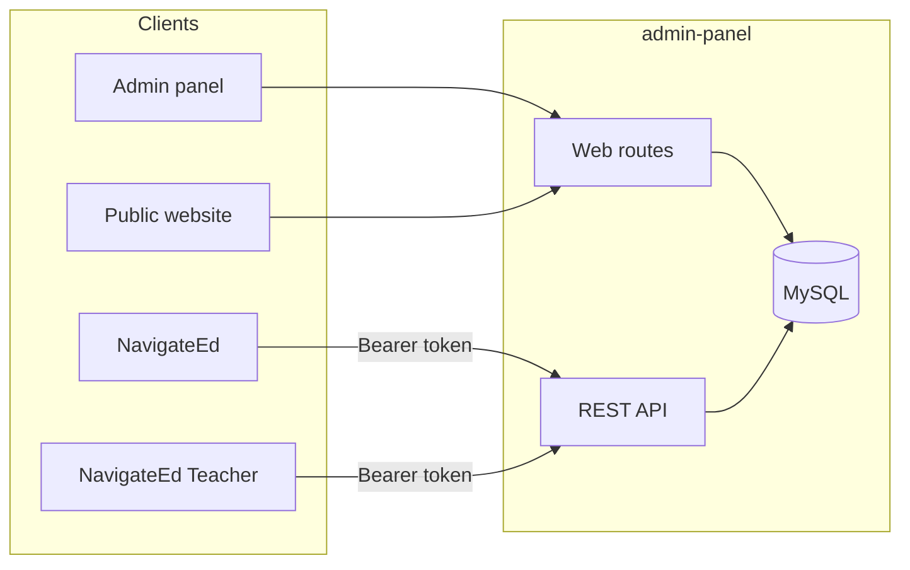

# Eschool

One Laravel application runs the school: the admin panel, the public website, and the API behind two Flutter apps. On a phone those apps are **NavigateEd** (students and parents) and **NavigateEd Teacher**.

[](https://github.com/ShawnDaPrawn/Eschool/actions/workflows/ci.yml)
·
[Documentation](https://shawndaprawn.github.io/Eschool/)
·
[Developer wiki](wiki/Home.md)

## How the pieces connect



## Repository

| Directory | What it is | Stack |
| --- | --- | --- |
| [`admin-panel/`](admin-panel) | Admin panel, public website, and API | Laravel 12, PHP 8.3 |
| [`e-school/`](e-school) | Student and parent app. Dart package `eschool`. The name on the phone is NavigateEd. | Flutter 3.44.9 |
| [`e-school-teacher/`](e-school-teacher) | Teacher app. Dart package `eschool_teacher`. The name on the phone is NavigateEd Teacher. | Flutter 3.44.9 |
| [`documentation/`](documentation) | End-user guides, published to GitHub Pages | Docusaurus 3 |
| [`wiki/`](wiki) | Developer wiki. The Wiki tab is published from this folder. | Markdown |
| [`.github/workflows/`](.github/workflows) | Tests, analysis, the docs build, the dependency audit, and wiki publishing | GitHub Actions |

Each directory is its own project. Run install and start commands inside that directory. Leave the Dart package names as they are. Every import in an app uses them.

## Where to go next

| You want to… | Start here |
| --- | --- |
| Understand the system | [Architecture](wiki/Architecture.md), then [Repository layout](wiki/Repository-Layout.md) |
| Run it locally | [Getting started](wiki/Getting-Started.md) |
| Follow a setup guide | [Documentation site](https://shawndaprawn.github.io/Eschool/) |
| Read what changed | [Changelog](documentation/changelog/index.md) |
| Change the code | [Contributing](CONTRIBUTING.md) |

## Run it

**Admin panel.** PHP 8.3, Composer, and MySQL or MariaDB.

```bash
cd admin-panel
composer install
cp .env.example .env
php artisan key:generate
```

Set the database credentials in `.env`, then run `php artisan migrate`. Details are in [admin-panel/README.md](admin-panel/README.md).

**Mobile apps.** Flutter 3.44.9.

```bash
cd e-school
flutter pub get
flutter run
```

Use the same commands in `e-school-teacher` for the teacher app.

**Documentation.** Node.js 20 or newer.

```bash
cd documentation
npm ci
npm start
```

The site is served at `http://localhost:3000/Eschool/`.

### Firebase Hosting

`firebase.json` at the repository root deploys the documentation site to Firebase Hosting. Run this from the repository root with the [Firebase CLI](https://firebase.google.com/docs/cli):

```bash
firebase login
firebase use --add
firebase deploy --only hosting
```

The predeploy step runs `npm ci` and builds the site for `/`, with links on `https://<project-id>.web.app`. A local `npm start`, and any build without the `DOCS_URL` and `DOCS_BASE_URL` variables, still uses `/Eschool/`.
