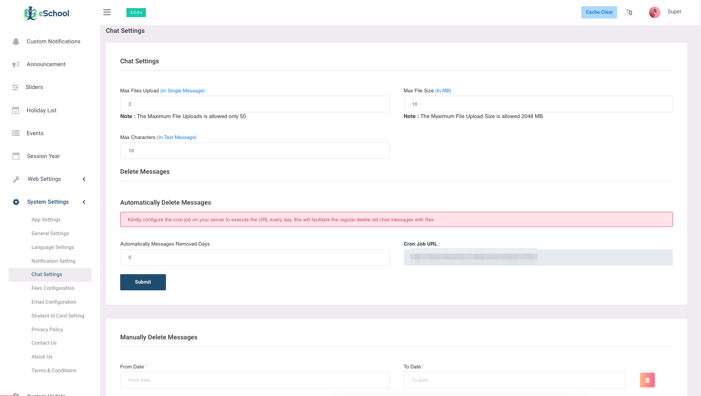

# Chat Settings

Admin settings for chat messages provide essential controls to enhance performance and user experience. By setting the maximum upload file limits, admins can restrict the number of files a user can attach in a single message, which helps manage server load and prevents spam. The maximum file upload size setting allows admins to cap the size of each uploaded file, ensuring that large files do not consume excessive bandwidth or storage space. Additionally, the maximum text message character limits setting defines the maximum length of a text message, promoting readability and preventing overly lengthy messages that could disrupt the conversation flow. These settings are crucial for maintaining a balanced and efficient chat system.



Messages older than the number of days set here are deleted automatically once a day by Laravel's scheduler. For this to run, the server needs the standard Laravel cron entry (replace the path with your installation's path):

```
* * * * * cd /path/to/admin-panel && php artisan schedule:run >> /dev/null 2>&1
```

This keeps storage in check and older messages private without anyone having to delete them by hand.

Admins can delete messages by specifying a "from date" and "to date" and then clicking the delete button. This action removes all messages within the selected date range, allowing for efficient management of chat history and ensuring that outdated or irrelevant messages are cleared out systematically. 