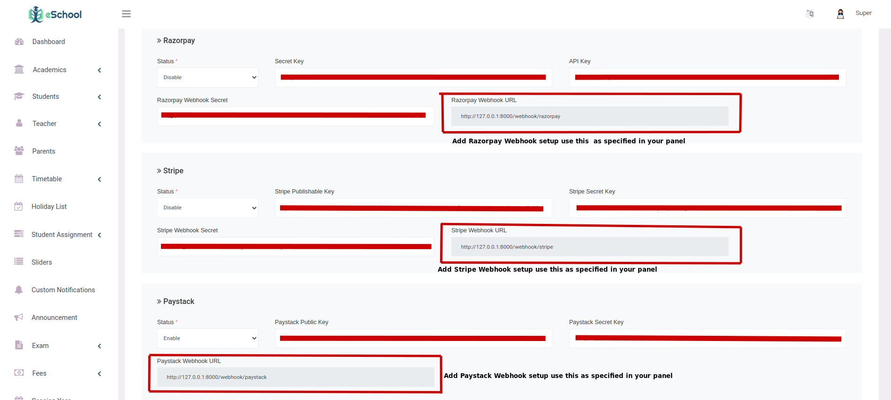

# Fee payment Configurations

Set the Stripe credentials: switch Stripe on, then enter the charge currency (a three-letter code such as ZAR), the publishable key, the secret key and the webhook secret. Payments are confirmed through the webhook; see [Payment Gateway's Webhook Configuration](./webhook-config.md).

Razorpay, Paystack and Flutterwave are no longer supported. Payments already made through them still appear, with their gateway, in the fees transaction logs.

## Correct a posted charge

Finance users granted **Fee credit notes** can select a family account and the
original learner/holder share, enter an amount and reason, then review and confirm
the correction. The original invoice remains intact. Credits reduce unpaid debt
first; a paid correction restores funds to the original holder's receipts, retaining
any learner restriction. The account statement shows original charges, credits,
net charges, remaining debt and held funds. Restored funds can be allocated through
the existing reviewed receipt workflow. This action does not pay out cash or money
from the bank. Parents see their permitted correction category and amounts; the
private Finance explanation remains restricted.
