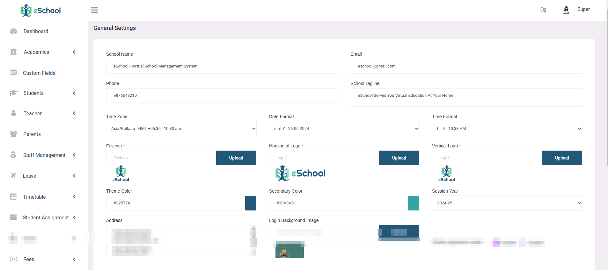

# General Settings

These settings will be used by Admin Panel. You can set your current session year here.

On the branding card, write the school's privacy notice and terms in the school's own words. Parents and teachers accept NavigateEd's terms the first time they sign in, then these. Leave a page blank if you do not need it. The same text is used on the public Privacy Policy and Terms pages.

