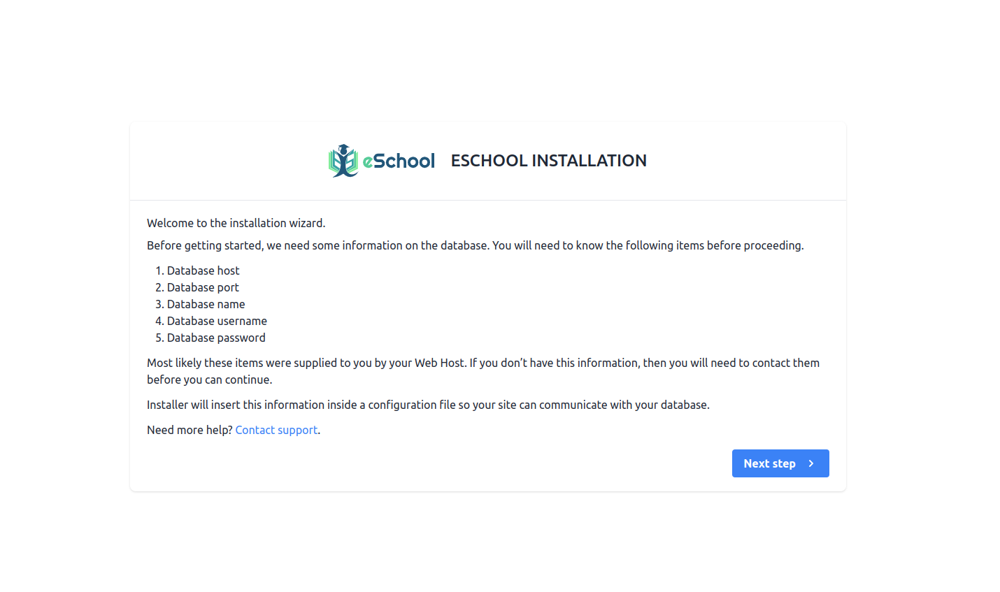
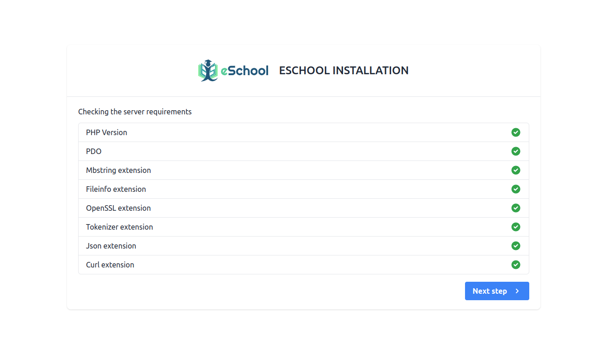
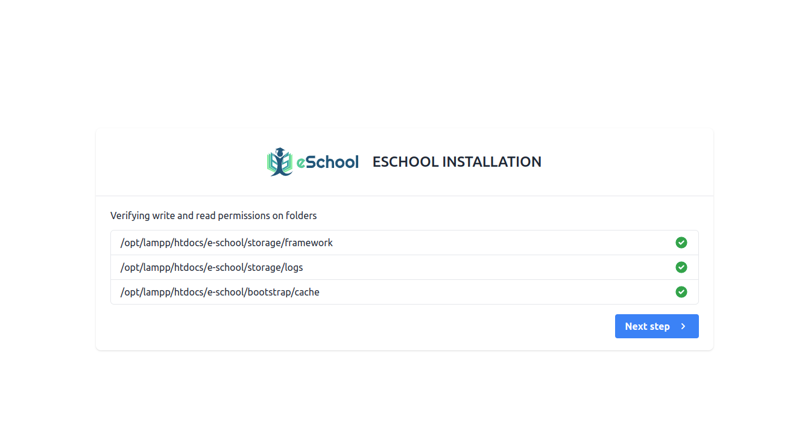
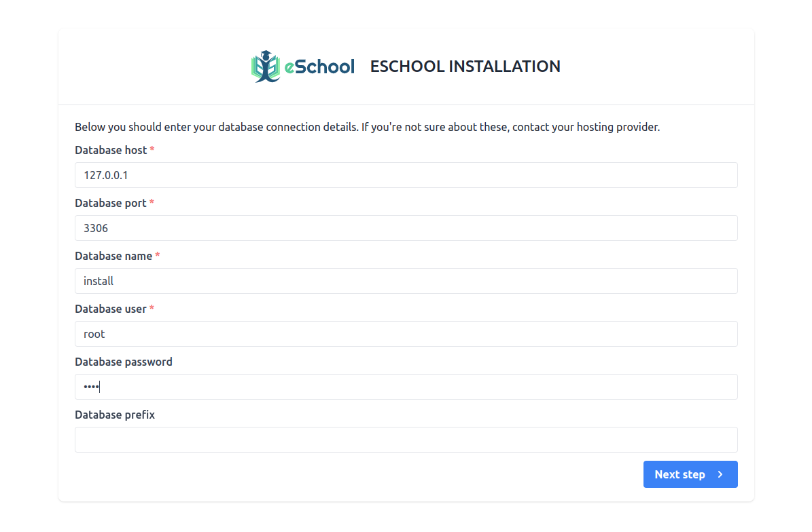
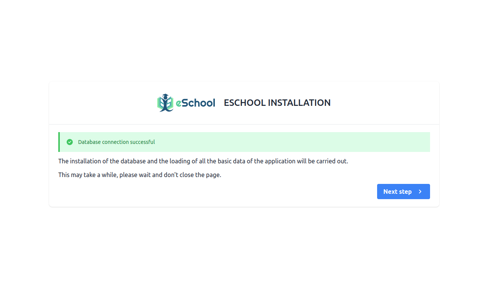
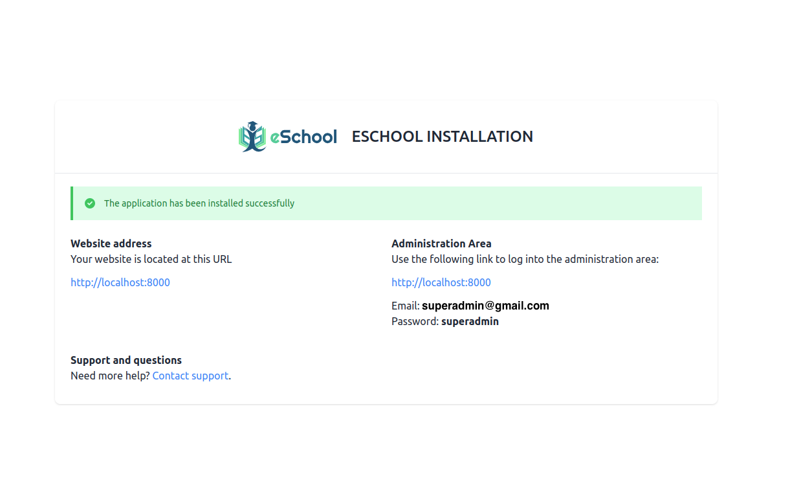

# Installation Steps

## 1. Installation Screen



## 2. Server Requirements & Extensions

If PHP version is lower than 8.3 or any extension is not installed then it will be highlighted using Red color. So you need to make sure that your server meets all requirements.



## 3. Permission Screen

Make sure this folder have read & write permissions. If not then assign this folders read & write permissions.



## 4. Database Configuration Screen



## 5. Database Connection Status



## 6. Final Installation Screen

If everything is configured successfully then your Admin panel has been installed successfully. You can login as Super Admin using the credentials provided here.



## 7. Cache Configuration for Production (Optional)

If you have SSH access, cache the configuration, routes and views to make every page load faster:

```bash
php artisan optimize
```

Run it again after editing `.env` or installing an update. To turn the cache off, run `php artisan optimize:clear` or use **Cache Clear** in the admin panel header.

Settings you change in the admin panel (school name, logos, timezone, email and payment gateways) are saved in the database and apply straight away, even with the cache on.
