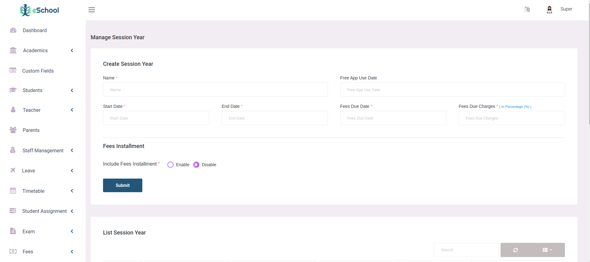

# School years

A school year (previously called a session year) has a name, a first and last day, and its terms. Learners, homerooms, timetables, marks, attendance and fees all belong to a year, so the panel can keep last year's records while you work in this one. Manage the years under **Academics > School year > School years**, and their terms under **Terms**.

One year is the **current year**. It is the year teachers, parents and learners see in the apps, and the only year in which changes can be made.

## Looking at another year

The **School year** box in the header shows the year you are looking at; the current year is marked "(current)". Choose another year to look at it: every list, report and number in the panel follows the year you chose, until you switch back. On a phone, the box is at the top of the menu.

Switching the year in the header changes only what you see. It does not change the current year for anyone else.

## Past years are read-only

While you look at any year other than the current one, a banner at the top of every page says so, for example "2025 is a past year, so it is read-only", with a **Back to 2026** button.

In that year you can look at everything, search, print and export, but buttons that would save, delete or change something are switched off. If a change is sent anyway, the panel refuses it and says which year to switch to; nothing you typed is lost.

A year that has not started yet is read-only in the same way until it becomes the current year. Prepare it with [Start the new school year](./new-year.md), which copies what it needs when you make it current.

These still work while you look at another year: switching back, signing out, your profile and password, school years themselves, and settings that do not belong to a year (the school profile, languages, roles, email templates, website content, ID card design, certificates).

## Changing the current year

At the end of the year, use [Start the new school year](./new-year.md): it creates next year, copies what you choose and makes it current in one go. On the **School years** page you can also make another year current directly, for example to undo a switch.
