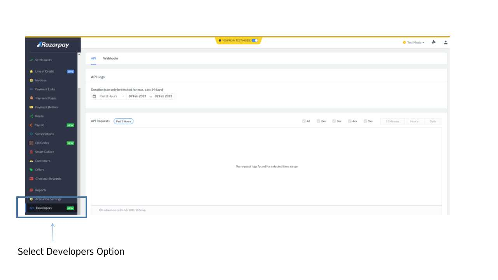
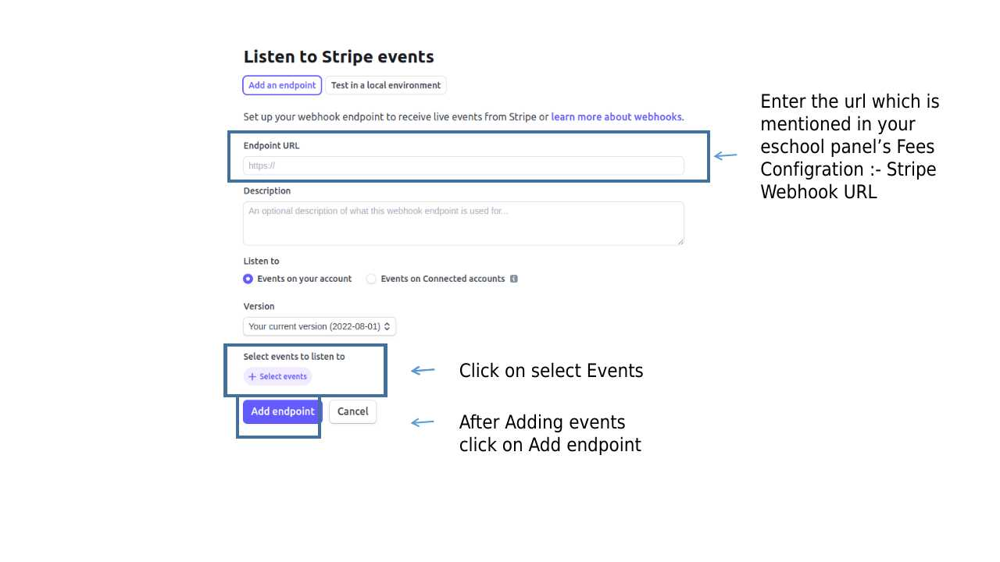
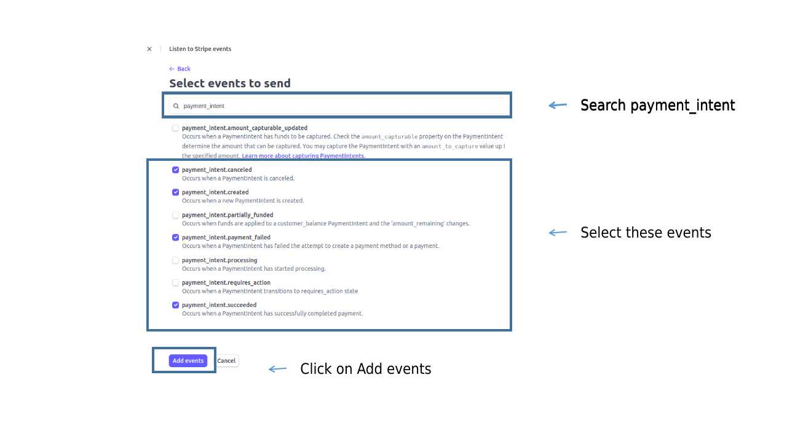
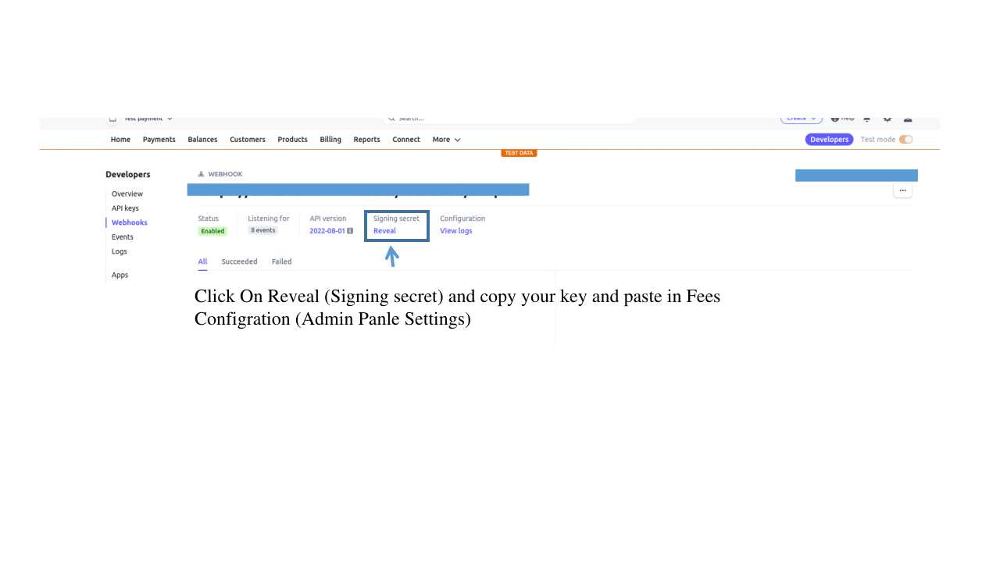

# Payment Gateway's Webhook Configuration

Stripe is the payment gateway for online fee payments. A payment is only marked as paid when Stripe calls the webhook URL shown on the Fees Configuration page, so set the webhook up before switching Stripe on.

## Webhook Configuration for Stripe

Copy the signing secret Stripe shows for the webhook into **Stripe Webhook Secret** on the Fees Configuration page. Without it every payment stays pending.

Razorpay, Paystack and Flutterwave are no longer supported, and their webhook URLs no longer exist.
