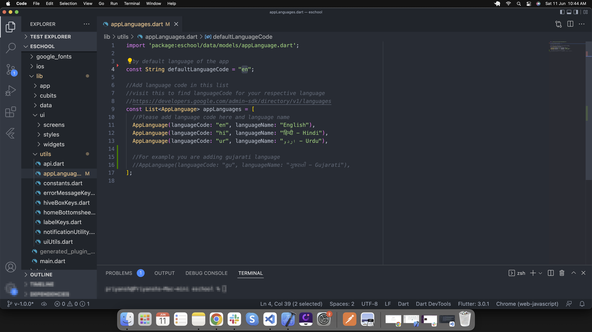
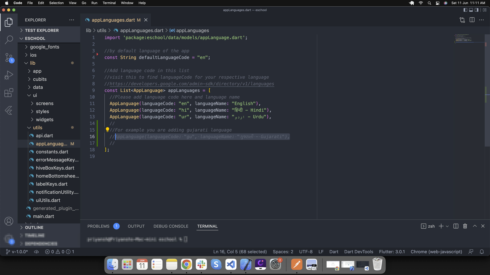
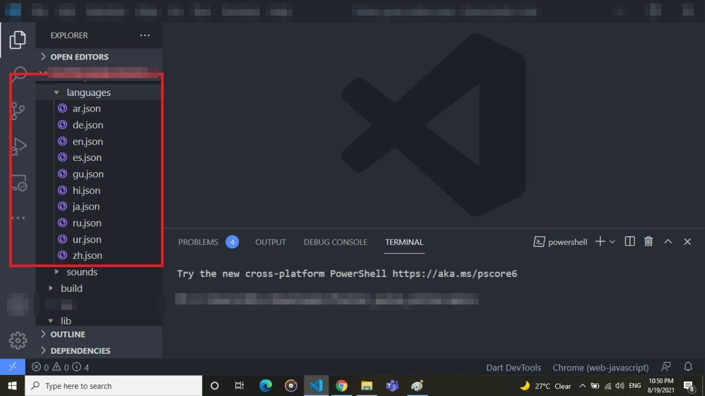
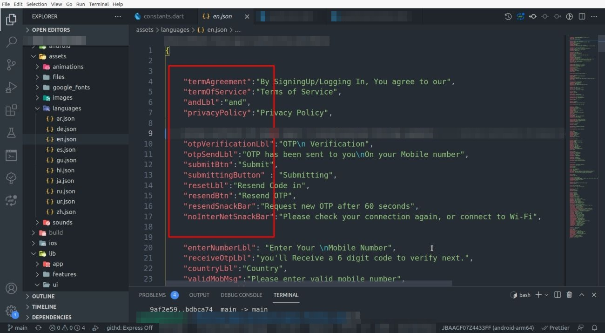

# Change Language

## Default Language

By default, the application language is English. To change the default language:

1. Go to `lib/utils/appLanguages.dart`
2. Add your respective language's code
3. Get your language code from [Google's Language Codes](https://developers.google.com/admin-sdk/directory/v1/languages)



## Adding New Language

If your default language code is not in the app language list:

1. Add language details in the list as shown below
2. Go to `lib/utils/appLanguages.dart`



## Creating Language File

If your default language is not in `assets/languages/[language-code].json`:

1. Create a new file in the same folder with `[language-code].json`
2. Copy all labels from `en.json`
3. Convert label values to your respective language




## Checking Language Files

Each app has a test that checks its language files. From the app's folder, run:

```bash
flutter test test/translations_test.dart
```

It fails if a language in `appLanguages.dart` has no file, if a file has no matching language in the list, or if a file is missing labels from `en.json` (or has labels `en.json` doesn't). A missing label shows its key instead of text in the app.
