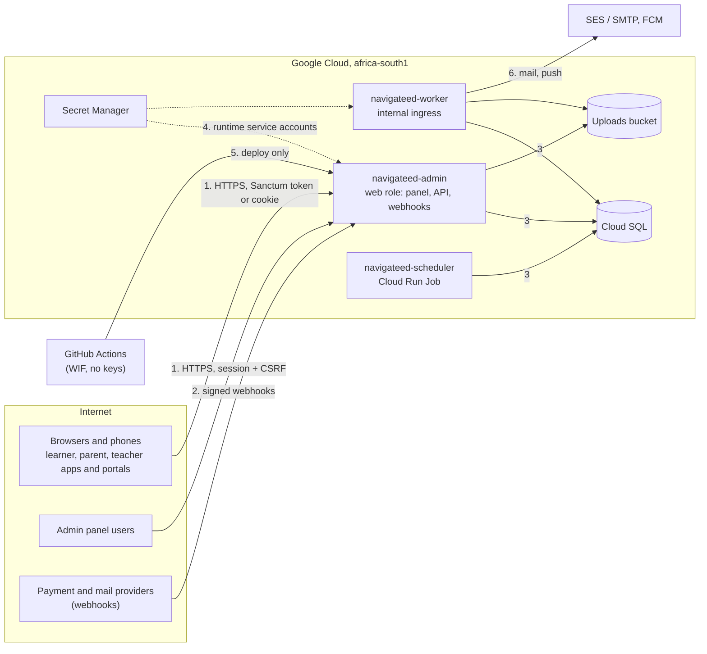

# Threat model

What NavigateEd protects, from whom, where the trust boundaries are, and the threats that matter most with their mitigations. It covers the system as it stands at the end of Phase 0 and names what later phases change. Update it whenever a phase adds a surface (a new client, a webhook, an integration, a new kind of data).

Started in Phase 0 by work stream S4. Status of each mitigation: **in place** (in the code or configuration on the phase branch), **Phase 0** (another Phase 0 stream delivers it), **later** (the phase that delivers it).

## Assets

| Asset | Why it matters | Where it lives |
| --- | --- | --- |
| Learners' records: names, dates of birth, guardians, attendance, marks, reports, discipline, medical notes, photos | Children's personal information under POPIA; harm if exposed or altered | Cloud SQL `navigateed` database; uploads bucket |
| Parents' and staff contact details | Personal information; phishing and fraud target | Cloud SQL |
| Credentials: passwords (hashed), Sanctum tokens (hashed), sessions | Account takeover, impersonating a parent or teacher | Cloud SQL; tokens on phones (Hive) and in browsers |
| Money records: fees, payments, transactions (later the ledger and wallet) | Fraud, disputes, school income | Cloud SQL; payment provider |
| Platform secrets: `APP_KEY`, database password, SMTP/SES, FCM service account, payment keys | Each unlocks data or a channel to real people | Secret Manager (Phase 0 moves the rest out of `settings` rows) |
| Channels to people: e-mail, push, later SMS | Abuse sends messages in the school's name to children and parents | SES/SMTP, FCM |
| The release pipeline and cloud project | Whoever controls them controls everything above | GitHub Actions, GCP IAM |
| Availability during the school day | Registers, timetables and notices are needed in real time | Cloud Run, Cloud SQL |

## Actors

| Actor | Access | Concern |
| --- | --- | --- |
| Learner | own data through the app or portal (after guardian approval from Phase 1) | curious or mischievous; may try to see classmates' marks or change their own |
| Parent | their children's data | may try other children's data (enumeration of `child_id`); account sharing |
| Teacher, grade head, counsellor, facilitator | allocated classes and learners | over-reach beyond allocation; a departed teacher keeping access |
| School admin, finance | their school | mistakes with wide effect; insider misuse; from Phase 1, must never see another school |
| Platform staff (SaaS admin) | no school by default; audited impersonation from Phase 1 | insider misuse |
| Anonymous internet user | public pages, sign-in, webhooks, public API reads | credential stuffing, scraping, injection, upload abuse, denial of service |
| Payment and mail providers | call our webhooks | spoofed callbacks if signatures are not checked |
| Supply chain: Composer, pub, npm packages, Docker base images, GitHub Actions | run inside our build and runtime | a compromised dependency or action |
| Engineers and AI agents with repository and cloud access | broad, by the Bible's mandate | a mistake or leaked credential with production reach |

## Trust boundaries

1. **Clients to the panel and API.** Everything from a browser or app is untrusted: authentication, authorisation, validation and rate limits happen on the server.
2. **Providers to webhooks.** Unauthenticated by design; trust comes only from a verified signature.
3. **Application to database.** The application holds one database user with full rights to its database; isolation between profiles (and from Phase 1, schools) is enforced in the application.
4. **Runtime to secrets.** Each role's service account reads only the secrets it needs.
5. **Pipeline to cloud.** GitHub Actions deploys through Workload Identity Federation, per environment; production needs a reviewer.
6. **Worker to the outside.** The worker sends mail and pushes on behalf of schools.

## Top threats and mitigations

| # | Threat (boundary) | Mitigation | Status |
| --- | --- | --- | --- |
| T1 | A parent, learner or teacher reads or changes another person's records by changing an id (1) | Role groups on every route; `CheckChild`, teacher allocation checks and model scopes; the `*SecurityTest` suites and 162 API snapshots; four tests per endpoint (wrong role, other user's record) | in place; new domains add Policies (later) |
| T2 | A user of one school sees another school's data (1, 3) | `school_id` on every school-owned row, `BelongsToSchool` global scope, school from the membership never from a request parameter; `tests/Feature/Tenancy/` on every API route | scaffold Phase 0 (S7); enforced Phase 1 |
| T3 | Account takeover by credential stuffing or weak passwords (1) | Login throttling (5 a minute per account), lockout, password policy `min(10)->letters()->numbers()->uncompromised()`, tokens revoked at login and password change, inactive teachers refused | throttling in place; policy and revocation Phase 0 (S6) |
| T4 | A learner signs in without an approving guardian (1) | Learner tokens issued only when an approving guardian exists | later (Phase 1) |
| T5 | Malicious upload: script, HTML, SVG with script, path traversal (1) | `RejectDangerousUploads`, SVG sanitising, `sanitizeFileName`, storage outside the web root, `nosniff` and sandboxing CSP on served files; malware and content scanning | in place; scanning later (Phase 2, Files kernel) |
| T6 | Injection and cross-site scripting in the panel (1) | Eloquent and bindings; `data-escape="true"` tables with `escapeHtml()`/`safeUrl()`; CSRF on the web group; CSP (report-only first) | in place; CSP Phase 0 (S6) |
| T7 | Spoofed payment or mail callbacks credit a payment or hide a bounce (2) | Signature verification per provider, idempotency on the provider's event id, amount checked against the transaction; SNS signature verification for SES (ADR 0004) | payments in place; SES Phase 0 (S5) |
| T8 | Secrets leak from code, logs or settings rows (4) | Secret Manager only; `env()` only in `config/`; gitleaks over the whole history in CI; JSON logs keep ids only and mask e-mail, ID and phone numbers; no arguments in traces; no secret in any app build | gitleaks, logging and Secret Manager wiring in place; settings rows moved Phase 0 (S6) |
| T9 | Logs become a store of children's personal data (3) | `LOG_CHANNEL=json` formatter allow-list (ids, numbers, descriptive keys); request bodies never logged as context; Cloud Logging retention at the default 30 days | in place; `ResponseService::logCurlRequest` still writes request bodies into the message text (follow-up for S1/S6) |
| T10 | Mail or push sent to real people from staging, or in a school's name by an attacker (6) | Staging sends from its own subdomain and, while SES is in the sandbox, only to verified addresses; the restore drill cuts staging off from mail, push and payments; mail and push only from queued jobs | in place (runbooks); SES Phase 0 (S5) |
| T11 | A compromised dependency or GitHub Action (supply chain) | Lock files committed and enforced in CI; `composer audit`, `npm audit`, `dart pub outdated`; Dependabot on every project; new workflow actions pinned to commit SHAs; gitleaks binary verified by checksum; base images updated by Dependabot | in place |
| T12 | Pipeline or cloud credentials abused to reach production (5) | No long-lived keys: Workload Identity Federation per GitHub environment; production environment needs the product owner's approval and deploys only `v*` tags; deployer has no access to secrets or data; least-privilege runtime accounts | in place, not yet run |
| T13 | Data loss or corruption (3) | Daily backups (14 in production), 7-day point-in-time recovery, a backup before every production deploy, versioned uploads bucket, additive migrations; restore drill | in place, drill not yet run |
| T14 | Denial of service during the school day (1) | Per-token and per-IP rate limits; Cloud Run autoscaling with a maximum instance count; recommended load balancer with Cloud Armor for the custom domain | limits in place; Cloud Armor with the custom domain (environments.md step 8) |
| T15 | Background work silently stops: mail, pushes, scheduled clean-ups (6) | Worker health check (`/up/worker`), failed-job alert, scheduler failure alert, worker instance alert | in place, not yet run |
| T16 | Insider misuse by staff or platform staff | Audit log on people, marks, money, settings; audited impersonation for platform staff | audit Phase 0 (S5); impersonation Phase 1 |

## Open items

- `ResponseService::logCurlRequest()` puts request parameters (secrets redacted, names and free text not) into the log message on every API error; under the "ids only" rule it should log the route and ids only. Owner: S1 or S6.
- `Log::error($e)` call sites (for example in `LanguageController`, `LeaveController`) log the exception as text, which bypasses the formatter's query-error handling; they should call `report($e)`.
- Firebase client API key restrictions to be confirmed by the product owner ([phase-0.md](phase-0.md)).
- Staging hostnames under the production parent domain receive production's cookies ([ADR 0003](../adr/0003-app-packages-and-web.md)); a separate staging domain is recommended.
- External security test before the pilot (end of Phase 2) and before money features (end of Phase 5).

## See also

- [phase-0.md](phase-0.md)
- [wiki Security-Model](../../wiki/Security-Model.md)
- [runbooks/incident.md](../runbooks/incident.md)
