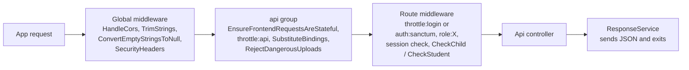

The admin panel serves a JSON REST API under `/api` that both Flutter apps use. Routes are declared in [`routes/api.php`](https://github.com/ShawnDaPrawn/Eschool/blob/main/admin-panel/routes/api.php) and handled by the four controllers in [`app/Http/Controllers/Api/`](https://github.com/ShawnDaPrawn/Eschool/tree/main/admin-panel/app/Http/Controllers/Api). This page covers what every endpoint has in common (base URL, authentication, middleware, response envelope, error codes, limits) and ends with the master index of all 159 v1 routes. Per-role details are on [API-Student](API-Student), [API-Parent](API-Parent) and [API-Teacher](API-Teacher). New endpoints go on [API v2](#api-v2) (`/api/v2`), described by `admin-panel/openapi.yaml`; v1 keeps serving the installed apps unchanged.

## At a glance

| Item | Value |
| --- | --- |
| Base path | `https://<admin-panel-host>/api/` |
| Route file | `admin-panel/routes/api.php` (loaded with prefix `api` and the `api` middleware group) |
| Controllers | `ApiController` (shared/public), and the `Api/Student/`, `Api/Parent/` and `Api/Teacher/` controllers (one per area: `AuthController`, `AssignmentController`, `ExamController` and so on) |
| Framework | Laravel 12 (`laravel/framework` v12.70.0 in `composer.lock`), Sanctum v4.3.3, spatie/laravel-permission 6.25.0 |
| Authentication | Laravel Sanctum personal access tokens, `Authorization: Bearer <token>` |
| Token lifetime | `SANCTUM_EXPIRATION` minutes, default `43200` (30 days) from creation |
| Request bodies | Form fields (`multipart/form-data` from the apps); query string for `GET` |
| Server time | `app.timezone`, which `SettingsConfigService::apply()` (called from `AppServiceProvider`) sets from the `time_zone` setting on every boot, falling back to `TIMEZONE` in `.env` (default `UTC`). Exam windows, due dates and "today" in the API use it, except where the code asks for UTC explicitly. |
| Response | JSON object with `error`, `message`, `data`, `code` (see [Response envelope](#response-envelope)) |
| Route count | 159: 1 logout, 49 student, 43 parent, 53 teacher, 13 general |
| API v2 | `/api/v2/...` from `routes/api_v2.php`, contract `admin-panel/openapi.yaml`, Dart client `packages/eschool_api`; additive context, guardian invitation/approval, enrolment and handle endpoints. See [API v2](#api-v2) |

## Base URL and how the apps build it

Handle identity adds `GET/PUT /api/v2/me/handle` and guardian handle-proposal
listing/decisions. Only a verified authorised guardian can activate an under-18
learner's proposal. Global allocation, term limits and old-name reservations
are enforced by the identity service. `ContextUser.handle` is optional; v1
user fields are unchanged. See the [handle spec](https://github.com/ShawnDaPrawn/Eschool/blob/main/engineering/specs/platform/handles.md).

Phase 1 module availability is additive in `/api/v2/me/context`: `modules`
contains `{key, read_only}` and `feature_flags.module_switches` marks configured
availability. Legacy v1 routes retain their response fields, with module checks
on direct feature routes. Disabled features return 404; retained financial
history remains readable and writes return 403. School-specific silent
`context.changed` pushes ask current apps to refresh their context.

The API is part of the same Laravel application as the admin panel and the public website, so it lives on the same host. Both [`bootstrap/app.php`](https://github.com/ShawnDaPrawn/Eschool/blob/main/admin-panel/bootstrap/app.php) (`withRouting(api: ...)`) and [`app/Providers/RouteServiceProvider.php`](https://github.com/ShawnDaPrawn/Eschool/blob/main/admin-panel/app/Providers/RouteServiceProvider.php) (`Route::prefix('api')->middleware('api')`) register `routes/api.php` under the `api` prefix; both produce the same URLs.

The Flutter apps hard-code the server address in one constant each:

| App | Where the address comes from | Names in the code |
| --- | --- | --- |
| Student/parent (`e-school`) | the `API_BASE_URL` build setting (`--dart-define`, or `config/staging.json` / `config/production.json`), read by `AppConfig` in `eschool_core`; no define means `https://navigateed-admin-972068206844.africa-south1.run.app` | `baseUrl`, `databaseUrl = '$baseUrl/api/'`, `storageUrl = '$baseUrl/storage/'` in `lib/utils/constants.dart`, mapped from `AppConfig` |
| Teacher (`e-school-teacher`) | the same | the same three names |

`API_BASE_URL` must not end with `/` ([Mobile-App-Configuration](Mobile-App-Configuration#build-settings)). Every endpoint is then a static string in the `Api` class of `lib/utils/api.dart`, for example `static String studentLogin = '${databaseUrl}student/login';`. Uploaded files are served from `/storage/...` (the public disk); the apps prefix relative paths with `storageUrl`, while some endpoints (chat attachments, gallery) already return absolute URLs built with `asset()`. Click-by-click setup of `baseUrl` is in the end-user docs: https://shawndaprawn.github.io/Eschool/mobile-app/integrate-admin-panel/ . See also [Mobile-App-Configuration](Mobile-App-Configuration).

## Route groups

| Prefix | Used by | Public endpoints | Authenticated middleware stack | Routes |
| --- | --- | --- | --- | --- |
| `/api/logout` | all apps | none | `auth:sanctum` | 1 |
| `/api/student/*` | e-school, student login | `login`, `forgot-password` | `auth:sanctum`, `role:Student`, `student.session.active` | 49 |
| `/api/parent/*` | e-school, parent login | `login` | `policy-acceptance` is `auth:sanctum` and `role:Parent` only. Every other authenticated parent route adds `parent.children.session.active` and `parent.policy`; child-scoped routes also add `CheckChild` | 43 |
| `/api/teacher/*` | e-school-teacher | `login` | `policy-acceptance` is `auth:sanctum` and `role:Teacher` only. Every other authenticated teacher route also has `teacher.policy`; two routes add `CheckStudent` | 53 |
| `/api/*` (general) | all apps | 12 read-only/info endpoints plus `forgot-password` | `change-password` only: `auth:sanctum` | 13 |

The role middleware was added in commit `439395d`. Before it, teacher endpoints accepted student and parent tokens.

## Request pipeline



### Middleware reference

All aliases are defined in `bootstrap/app.php` (`$middleware->alias([...])`).

| Alias / class | Applied to | What it does | Failure response |
| --- | --- | --- | --- |
| `throttle:api` (`RateLimiter::for('api')`) | every API route | 60 requests per minute keyed by user id, or by IP when not signed in | HTTP 429 |
| `RejectDangerousUploads` | every API route (appended to the `api` group) | Refuses uploads with script/web-page extensions or content and sanitises SVGs (see [File uploads](#file-uploads)) | HTTP 422 `{"error":true,"message":"The file type is not allowed.","code":102}` |
| `throttle:login` | `student/login`, `student/forgot-password`, `parent/login`, `teacher/login`, `forgot-password` | 5 per minute per path and account, 20 per minute per IP | HTTP 429 |
| `auth:sanctum` | every authenticated route | Resolves the bearer token (or a stateful web session) | HTTP 401 `{"message":"Unauthenticated."}` when the request asks for JSON; otherwise a redirect to the `login` route (see [Gotchas](#gotchas)) |
| `role:Student` / `role:Parent` / `role:Teacher` | the three role groups | `Spatie\Permission\Middleware\RoleMiddleware`. Note: the alias `role` is spatie's; the app's own `CheckRole` is aliased `Role` and guards the admin panel, not the API | HTTP 403 (spatie `UnauthorizedException`) |
| `student.session.active` (`EnsureStudentSessionIsActive`) | student group | Requires role Student, `users.status = 1`, a `students` row, and a `student_sessions` row for the current session year with `status != 0` | HTTP 403 `{"error":true,"message":"You Don't have enough permissions.","data":null,"code":403}`; HTTP 401 `{"message":"...","code":"SESSION_NOT_ACTIVE"}` when the session row is missing or inactive |
| `parent.children.session.active` (`EnsureParentChildrenSessionIsActive`) | authenticated parent routes except `policy-acceptance` | Requires a `parents` row; at least one child (as father, mother or guardian) must have a current-year `student_sessions` row, and at least one of those must have `status = 1` | HTTP 403 `{"error":true,"message":...}`; HTTP 401 with `code` `SESSION_NOT_ACTIVE` or `ACCOUNT_DEACTIVATED` |
| `parent.policy` / `teacher.policy` (`RequireParentPolicyAcceptance`) | authenticated parent routes except `policy-acceptance`, and authenticated teacher routes except `policy-acceptance` | The parent or teacher must have accepted NavigateEd once, and the school's privacy notice and terms if those pages already existed on that first sign-in. Later visits, and later edits of the pages, are not asked again | HTTP 403 `{"error":true,"message":"Accept the terms before you continue.","code":"policy_acceptance_required"}` |
| `CheckChild` | parent child-scoped routes | Validates `child_id` as an integer and looks it up through `Parents::children()`; stores the student model on the request as attribute `child` | HTTP 200 `{"error":true,"message":"Invalid Child ID Passed.","code":105}` |
| `CheckStudent` | `teacher/get-student-result`, `teacher/get-student-marks` | `student_id` must be in a class section where the teacher is a class teacher (`class_teachers.class_teacher_id`) | HTTP 200 `{"error":true,"message":"Invalid Student ID Passed.","code":105}` |

`LanguageManager` (session locale) and `DemoMiddleware` (blocks writes with code `112` when `config('app.demo_mode')` is true) are only in the `web` group, so they never run on API routes. `DemoMiddleware` still lists `/api/...` paths in its allow-list, but that list has no effect on the API.

## Authentication

### Logging in

| Role | Endpoint | Credentials | Extra checks before the token is returned |
| --- | --- | --- | --- |
| Student | `POST /api/student/login` | `gr_number`, `password` | `gr_number` is matched against `users.email` (students log in with their GR number). The user must have role `Student`, a `students` row, `status = 1`, and an active `student_sessions` row for the current session year. The token is only created after these pass. |
| Parent | `POST /api/parent/login` | `email`, `password` | Role `Parent`. At least one child must have a current-year session, and at least one must be active. The token is created before the child checks, so a refused login can leave an unused token row. |
| Teacher | `POST /api/teacher/login` | `email`, `password` | Role `Teacher` only. |

All three accept optional `fcm_id` (stored in `users.fcm_id`, used for push notifications) and `device_type` (stored in `users.device_type`). A wrong password or wrong role returns code `101` with message `Invalid Login Credentials`. Logins are rate limited (see [Rate limiting](#rate-limiting)).

### Token issuance and use

The token is created with `$user->createToken($user->first_name)->plainTextToken`, stored hashed in `personal_access_tokens`, and returned as a top-level `token` field next to `data`:

```json
{
  "error": false,
  "message": "User logged-in!",
  "data": { "id": 12, "user_id": 34, "first_name": "...", "class_section_name": "...", "dynamic_fields": null },
  "code": 200,
  "token": "<id>|<plain-text token>"
}
```

The student login returns `code` 200; the parent and teacher logins return `code` 100. The `data` object is the user model flattened into one level by `flattenMyModel()` (see [API-Student](API-Student#login) for the student fields).

Send the token on every authenticated call:

```http
GET /api/student/dashboard HTTP/1.1
Host: school.example.com
Authorization: Bearer <id>|<plain-text token>
Accept: application/json
```

The apps keep the token in Hive (`authBoxKey` box, `jwtTokenKey`) and add it in `Api.headers()`.

### Expiry, logout and password change

| Topic | Behaviour | Source |
| --- | --- | --- |
| Expiry | `'expiration' => env('SANCTUM_EXPIRATION', 60 * 24 * 30)` minutes, counted from token creation (not sliding). `.env.example` sets `SANCTUM_EXPIRATION=43200`. | [`config/sanctum.php`](https://github.com/ShawnDaPrawn/Eschool/blob/main/admin-panel/config/sanctum.php) |
| Pruning | `Schedule::command('sanctum:prune-expired --hours=24')->daily()` deletes expired tokens. Needs the scheduler running (see [Scheduled-Tasks-and-Commands](Scheduled-Tasks-and-Commands)). | [`routes/console.php`](https://github.com/ShawnDaPrawn/Eschool/blob/main/admin-panel/routes/console.php) |
| Logout | `POST /api/logout` sets `users.fcm_id` to `''` and deletes only the current token. | `ApiController::logout` |
| Password change | `POST /api/change-password` updates the password and deletes every other token of the user (other devices are signed out); the current token stays valid. | `ApiController::changePassword` |
| Stateful guard | `config/sanctum.php` has `'guard' => ['web']` and `stateful` domains from `SANCTUM_STATEFUL_DOMAINS` (default localhost variants plus the `APP_URL` host). A browser on a stateful domain with an admin-panel session cookie is also authenticated; the apps only use tokens. | `config/sanctum.php` |

## Required headers

| Header | When | Notes |
| --- | --- | --- |
| `Authorization: Bearer <token>` | every route except the public ones | The only header the apps add (`Api.headers()` in both apps). |
| `Accept: application/json` | recommended for every call | Not sent by the apps. Without it Laravel treats the request as a browser request: authentication failures redirect to `/login`, and 403/429 errors render HTML. |
| `Content-Type: multipart/form-data` | `POST` | The apps send every `POST` as Dio `FormData` with `ListFormat.multiCompatible`, so arrays arrive as `answers_data[0][question_id]`-style fields. Plain `application/x-www-form-urlencoded` or JSON bodies also work because the controllers read `$request->all()`. |
| Language header | none | The API reads no locale header. Messages go through `trans()` with the default locale (`config/app.php` `locale = 'en'`, strings in `resources/lang/en.json`). The apps translate error codes themselves. See [Localization](Localization). |

## Response envelope

Almost every endpoint answers through [`app/Services/ResponseService.php`](https://github.com/ShawnDaPrawn/Eschool/blob/main/admin-panel/app/Services/ResponseService.php):

| Method | JSON produced | Typical use |
| --- | --- | --- |
| `successResponse($message, $data = null, $customData = [], $code = null)` | `{"error": false, "message": trans($message), "data": $data, "code": $code ?? 200}` merged with `$customData` at the top level | normal success; `$customData` carries `token`, `pdf`, `total_questions`, `payment_gateway_details`, fee totals and similar |
| `errorResponse($message, $data = null, $code = null, $e = null)` | `{"error": true, "message": trans($message), "data": $data, "code": $code ?? config('constants.RESPONSE_CODE.EXCEPTION_ERROR'), "details": ...}` | failures; when `$e` is given the exception and a redacted curl reconstruction of the request are logged |
| `validationError($message)` | `errorResponse($message, null, config('constants.RESPONSE_CODE.VALIDATION_ERROR'))` | first validator message |
| `warningResponse(...)` | `{"error": false, "warning": true, "code": ..., "message": ..., "data": ...}` | not used by the API controllers |

Things to know about this envelope:

- **HTTP status is always 200.** `successResponse` and `errorResponse` build `response()->json(...)` without a status, so clients must branch on `error`, not on the status code. Real non-200 statuses only come from middleware (401, 403, 422, 429) and from uncaught framework errors.
- **`config/constants.php` does not exist** in this repo, so `config('constants.RESPONSE_CODE.*')` is `null`. Every `validationError()` and every `errorResponse()` without an explicit code therefore returns `"code": null`. The apps rely on this: when `code` is `null` they show `message` verbatim.
- **`details`** holds the exception message, file and line only when `APP_DEBUG=true`; otherwise it is `""`.
- **The controller returns the response.** The helpers return it and every action does `return ResponseService::...` (a helper that must stop the request throws it in an `HttpResponseException`). The response therefore goes back through the middleware like any other: `HandleCors`, `SecurityHeaders` and the throttle headers apply. Until Phase 0 the helpers sent the response and called `exit()`, so these responses went out without those headers and API tests needed a separate server; they can now call the API in-process (see [Testing-and-CI](Testing-and-CI#testsconcernsrunsappserverphp)).

Examples taken from the code:

```json
{"error": false, "message": "Assignments Deleted Successfully", "data": null, "code": 200}
```

```json
{"error": true, "message": "You already have submitted your assignment.", "data": null, "code": 104, "details": ""}
```

```json
{"error": true, "message": "<first validation message>", "data": null, "code": null, "details": ""}
```

A few endpoints build their own JSON and do not include every field:

| Endpoint | Shape |
| --- | --- |
| `GET /api/get-gallery-albums`, `GET /api/get-gallery-videos` | `{"error": false, "data": {"data": [...], "current_page": n, "last_page": n}}` (no `message`/`code`) |
| `GET /api/get-gallery-images` | `{"error": false, "data": ["<absolute url>", ...]}` |
| `GET` or `POST /api/get-events-details` | `{"error": false, "message": "Events Details Fetched Successfully", "data": [...], "code": 200}` |
| Session middleware | `{"message": "...", "code": "SESSION_NOT_ACTIVE"}` (no `error` key) with HTTP 401 |

## Error codes

The numeric `code` values used by the API controllers and middleware:

| Code | HTTP | Meaning | Where |
| --- | --- | --- | --- |
| `200` | 200 | Success (default) | `successResponse` |
| `100` | 200 | Success (used instead of 200 by a few endpoints) | parent and teacher `login`, teacher `get-user-list` and `get-user-message` |
| `101` | 200 | Invalid login credentials, or the account does not have the role of that app | all three `login` methods |
| `102` | 200 / 422 | Validation failure (only where set explicitly) | student `login`, `get-events-details`; `RejectDangerousUploads` (HTTP 422) |
| `103` | 200 | Generic error: caught exception (`error_occurred`), record not found or not owned, invalid online exam key, invalid transaction | most endpoints |
| `104` | 200 | Assignment already submitted | `student/submit-assignment` |
| `105` | 200 | Online exam already attempted; invalid `child_id` (`CheckChild`); invalid `student_id` (`CheckStudent`) | student online exam, parent, teacher |
| `106` | 200 | Online exam not started yet; invalid subject id; invalid child id in parent announcements | student online exam, `student/announcements`, `Parent\AnnouncementController::getAnnouncements` |
| `110` | 200 | Assignment submission cannot be deleted (already reviewed) | `student/delete-assignment-submission` |
| `113` | 200 | No `student_sessions` row for the requested session year | report and fee endpoints (student and parent) |
| `400` | 200 | Bad request in teacher exam/marks flows (`exam_published`, `exam_not_completed_yet`, marks out of range, `grades_data_does_not_exists`, `Term id required.`) | `Teacher\ExamController` |
| `403` | 200 or 403 | No permission or not assigned to the class/subject (teacher, HTTP 200); inactive or non-student account (`student.session.active`, HTTP 403) | the `Teacher\` controllers, `EnsureStudentSessionIsActive` |
| `422` | 200 | `album_id is required` | `get-gallery-images` |
| `null` | 200 | Any `validationError()` or `errorResponse()` without a code; the message is meant to be shown as is | everywhere |
| `"SESSION_NOT_ACTIVE"` / `"ACCOUNT_DEACTIVATED"` | 401 | Student/parent session checks | session middleware |

How the apps read codes: `lib/utils/errorMessageKeysAndCodes.dart` (both apps) maps `101`, `104`, `105`, `106`, `107`, `108`, `109`, `112`, `113` to translated messages; every other non-null code shows the generic error text, and a `null` code shows the server's message. The app-side mapping is per code, not per endpoint, so code `105` from `CheckChild` is displayed with the student app's "exam already attended" text. Codes `107`, `108`, `109` and `112` are mapped in the apps but not emitted by the current API code.

## Validation errors

Controllers validate with `Validator::make($request->all(), [...])` and on failure send only the first message (`$validator->errors()->first()`), through `validationError()` (code `null`) or, in a few places, `errorResponse(..., 102)`. There is no field-keyed `errors` object. Messages come from `resources/lang/en/validation.php`. For example, `GET /api/settings` without `type` returns exactly:

```json
{"error":true,"message":"The type field is required.","data":null,"code":null,"details":""}
```

Three methods use `$request->validate()` instead. In `student/delete-leave` and `teacher/delete-leave` the call sits inside the `try`, so a failure is caught and answered as `error_occurred` with code `103`. In `teacher/student-leave-status-update` it is outside the `try`, so Laravel's own `ValidationException` handling applies: HTTP 422 `{"message": ..., "errors": {...}}` with `Accept: application/json`, a redirect without it.

`student/apply-leave` is stricter than the rest: it rejects any field other than `reason`, `leave_details` and `files` (`Unknown fields: ...`).

## Pagination

There is no single convention; each endpoint uses one of these:

| Style | Parameters | Response | Examples |
| --- | --- | --- | --- |
| Laravel paginator, 15 per page | `page` | Full paginator object as `data`: `current_page`, `data`, `first_page_url`, `from`, `last_page`, `last_page_url`, `links`, `next_page_url`, `path`, `per_page`, `prev_page_url`, `to`, `total` | `student/assignments`, `student/announcements`, `student/get-notification`, parent assignments/announcements/notifications, several teacher lists |
| Trimmed paginator | `page` | `current_page`, `data`, `from`, `last_page`, `per_page`, `to`, `total` (online exam list also adds `current_date`) | `get-online-exam-list` (15), `get-online-exam-result-list` (10), `fees-transactions-list` (15, rows under `transaction-data`) |
| `per_page` + `page` | `per_page` 1 to 100 (default 10), `page` >= 1 | `{data, current_page, last_page}` | `get-gallery-albums`, `get-gallery-videos` |
| `offset` + `limit` | `offset`, `limit` | `{items, total_items}` (user list also `total_unread_users`) | chat `get-user-list` and `get-user-message` in all three roles. On the student side the user list returns everything when `limit` is absent or not positive, and messages are capped at `limit` 1 to 100 (default 100) |

## Rate limiting

Both limiters are defined in `RouteServiceProvider::configureRateLimiting()`:

```php
RateLimiter::for('api', function (Request $request) {
    return Limit::perMinute(60)->by($request->user()?->id ?: $request->ip());
});

RateLimiter::for('login', function (Request $request) {
    $account = strtolower(trim((string) ($request->input('email') ?? $request->input('gr_number') ?? $request->input('gr_no') ?? '')));

    return [
        Limit::perMinute(5)->by('login:'.$request->path().'|'.$account),
        Limit::perMinute(20)->by('login-ip:'.$request->ip()),
    ];
});
```

- `api` applies to every API route. `login` is added on top for the five login/reset routes, and also on the web `password/email` route.
- The per-account key includes the path, so `student/login` and `student/forgot-password` are counted separately. The comment in the code gives the reason: default passwords are dates of birth.
- Exceeding a limit returns HTTP 429 (`ThrottleRequestsException`), as JSON only when the request sends `Accept: application/json`.
- API v2 adds two limiters on top of `api`, defined in `RouteServiceProvider::configureApiV2RateLimiting()`: `auth` (5 a minute per account, 20 per address) and `money` (30 a minute per token). See [API v2 rate limits](#rate-limits).

## Roles and scoping

- Each group requires its role (`role:Student`, `role:Parent`, `role:Teacher`), so a token from one app cannot call another app's endpoints. Covered by `test_app_tokens_only_work_for_their_own_role` in [`tests/Feature/AccessControlTest.php`](https://github.com/ShawnDaPrawn/Eschool/blob/main/admin-panel/tests/Feature/AccessControlTest.php).
- Inside a role, controllers scope queries to the caller: students to their own `student_sessions` class section, subjects and records; parents to their own children; teachers to their class-teacher and subject-teacher assignments. These checks were added in commits `439395d`, `77fe8ed`, `a09dfe8`, `c890813` and `839c9eb`. Details per endpoint are on the role pages; the overall model is on [Security-Model](Security-Model) and [Roles-and-Permissions](Roles-and-Permissions).
- The "current session year" used everywhere is the `session_year` setting (`getSettings('session_year')['session_year']`).

### The `child_id` convention (parents)

One parent account can have several children. Child-specific parent endpoints take a `child_id` (query string for `GET`, form field for `POST`) and are grouped under `CheckChild`:

1. `CheckChild` reads `$request->child_id`, validates it with `FILTER_VALIDATE_INT`, and looks it up with `$parent->children()->whereKey($childId)`.
2. `Parents::children()` matches students where `father_id`, `mother_id` or `guardian_id` is the parent's id. It was a `UNION` before `439395d`, and a chained `where('id', ...)` only filtered the father branch, so mothers and guardians could pass any `child_id`.
3. The resolved student is stored as request attribute `child`; `Parent\Concerns\ParentAccess::resolveChild()` reuses it (or repeats the lookup for routes outside the group).
4. A missing or foreign `child_id` returns `{"error": true, "message": "Invalid Child ID Passed.", "code": 105}`.

Parent routes without a child (`announcements`, `get-profile-data`, chat, notifications, fee receipt and transactions, `fail-payment-transaction`, `get-payment-status`, `delete-leave`) check ownership inside the controller. See [API-Parent](API-Parent).

## File uploads

| Rule | Where | Detail |
| --- | --- | --- |
| Blocked file types | `RejectDangerousUploads` (all API routes) | Every dot-separated part of the client file name and the detected extension are checked against `BLOCKED_EXTENSIONS` (PHP variants, `phtml`, `phar`, `shtml`, `htaccess`, `ini`, `cgi`, `pl`, `py`, `rb`, `sh`, `asp(x)`, `jsp`, `exe`, `dll`, `bat`, `cmd`, `vbs`, `ps1`, `html`, `htm`, `xhtml`, `js`, `mjs`, `swf`, `xml`, `xsl(t)`, `svgz`, and more). The detected MIME type is also matched against PHP, HTML, JavaScript, shell, Perl, Python, Ruby, executable and XML patterns. |
| SVG | `RejectDangerousUploads` | Allowed, but rewritten with `enshrined/svg-sanitize` (scripts, event handlers and remote references removed). An SVG that cannot be parsed is refused. |
| Refusal | `RejectDangerousUploads` | HTTP 422 `{"error": true, "message": "The file type is not allowed.", "code": 102}` |
| Per-endpoint limits | controllers | e.g. `student/apply-leave` allows only JPEG, PNG, WebP, GIF, BMP, PDF, DOC, DOCX (`mimetypes:` rule); chat `send-message` limits the file count and size to the chat settings (`max_files_or_images_in_one_message`, `max_file_size_in_bytes`). |
| Storage | controllers | Files go to the `public` disk (`storage/app/public`, served under `/storage`), e.g. `assignment/`, `leave/`, `chatfile/<random 32 chars>/`. |

PHP's own `upload_max_filesize` / `post_max_size` and Laravel's `ValidatePostSize` still apply. See [Security-Model](Security-Model) for the upload hardening commits (`9f8911b`, `60615fc`).

## CORS

[`config/cors.php`](https://github.com/ShawnDaPrawn/Eschool/blob/main/admin-panel/config/cors.php) enables CORS for `api/*` and `sanctum/csrf-cookie` with `allowed_origins`, `allowed_methods` and `allowed_headers` all `*`, `supports_credentials` `false` and `max_age` 0. CORS only matters for browser clients; the Flutter apps ignore it. Because `ResponseService` exits before `HandleCors` can add headers to the response (see [Response envelope](#response-envelope)), a browser-based client would get the preflight answer but most actual responses would lack `Access-Control-Allow-Origin`.

## General endpoints (`ApiController`)

All in [`app/Http/Controllers/Api/ApiController.php`](https://github.com/ShawnDaPrawn/Eschool/blob/main/admin-panel/app/Http/Controllers/Api/ApiController.php). Everything except `logout` and `change-password` is public (no token).

### `POST /api/logout`

Middleware `auth:sanctum` (any role). Clears `users.fcm_id`, deletes the current access token, returns `Logout Successfully done.`.

### `POST /api/change-password`

Middleware `auth:sanctum` (any role).

| Field | Rule |
| --- | --- |
| `current_password` | required; must match (`Current password is incorrect.`, code `null`, otherwise) |
| `new_password` | required, min 8 |
| `new_confirm_password` | required, same as `new_password` |

Updates the hash and deletes all of the user's other tokens. Returns `Password changed successfully.`.

### `POST /api/forgot-password`

Middleware `throttle:login`. Field `email` (required, email). Calls `Password::sendResetLink()` (the standard Laravel reset email). It needs a working mail server: the admin panel's email settings are stored in the `settings` table and applied over the `.env` mail config on every boot by `SettingsConfigService::apply()` (see [Configuration](Configuration)). Always answers `If an account exists for this email, a password reset link has been sent.`; mail errors are logged, not shown. Students use `student/forgot-password` instead (see [API-Student](API-Student#forgot-password)).

### `GET /api/settings`

| Param | Rule |
| --- | --- |
| `type` | required, one of `privacy_policy`, `contact_us`, `about_us`, `terms_condition`, `app_settings`, `fees_settings` |

For any type other than `app_settings`, `data` is the raw settings value with that key (or `""`). For `app_settings`, `data` is an object with:

| Key | Content |
| --- | --- |
| `app_link`, `ios_app_link`, `app_version`, `ios_app_version`, `force_app_update`, `app_maintenance` | student/parent app store links, versions and switches |
| `teacher_app_link`, `teacher_ios_app_link`, `teacher_app_version`, `teacher_ios_app_version`, `teacher_force_app_update`, `teacher_app_maintenance` | the same for the teacher app |
| `school_name`, `school_tagline` | school identity |
| `session_year` | the current `session_years` row |
| `online_payment` | setting value, default `"1"` |
| `is_demo` | `config('app.demo_mode')`, defined in `config/app.php` as `(bool) env('DEMO_MODE', false)`, so it is a JSON boolean and survives `php artisan config:cache` |
| `compulsory_fee_payment_mode`, `is_student_can_pay_fees` | fee settings |
| `chat_settings` | `max_files_or_images_in_one_message` (default 10), `max_file_size_in_bytes` (setting in MB times 1,000,000; default 10,000,000), `max_characters_in_text_message` (default 500), `automatically_messages_removed_days` (default 30) |
| `holiday_days` | `leave_masters.holiday_days` for the current session |
| `payment_options` | `currency_code`, `currency_symbol`, optional `fees_due_date` / `fees_due_charges`, and, when Stripe is enabled, `stripe` with only its public key (`stripe_publishable_key`), its status and currency code. `razorpay`, `paystack` and `flutterwave` were removed in Phase 0 and are always left out, as a disabled gateway is |
| `online_exam_terms_condition` | HTML-decoded text |
| `current_term` | the term whose `current` attribute is true, or `null` |
| `term_breaks` | list of `{start, end}` gaps between consecutive terms inside the session year, or `null` |

Secret keys and webhook secrets are never included. Until commit `839c9eb` this public endpoint returned the Razorpay webhook secret; installs that ran older code should rotate it (see [Payments](Payments)). The admin UI for these values: https://shawndaprawn.github.io/Eschool/admin-panel/app-settings/ and https://shawndaprawn.github.io/Eschool/admin-panel/chat-settings/ .

### Other public endpoints

| Method and path | Params | Returns |
| --- | --- | --- |
| `GET /api/holidays` | none | the current session year's `holidays` rows, by date |
| `GET /api/sliders` | none | `sliders` rows with `type` 1 (app) or 3 (both) |
| `GET /api/current-session-year` | none | the `session_years` row named by the `session_year` setting |
| `GET /api/get-session-year` | none | all session years except id 0, newest first |
| `GET /api/get-terms` | none | terms of the current session year, by `start_date` |
| `GET /api/get-events-list` | none | events of the current session year (`id`, `title`, `type`, `start_date`, `end_date`, `start_time`, `end_time`, `image`, `description`, `has_day_schedule`) followed by each per-day schedule row (`id`, `event_id`, `title`, `date`, `start_time`, `end_time`, `description`, `has_day_schedule: 0`) |
| `GET` or `POST /api/get-events-details` | `event_id` (required, integer) | the `multiple_events` rows of that event. Both apps use `GET`; the route accepted only `POST` until `c38b7da`. |
| `GET /api/get-gallery-albums` | `per_page`, `page` | albums (`id`, `title`, `thumbnail_url`) |
| `GET /api/get-gallery-images` | `album_id` (required) | absolute URLs of the album's images |
| `GET /api/get-gallery-videos` | `per_page`, `page` | video URLs (YouTube URL, or an absolute local URL) |

## API v2

New endpoints go on `/api/v2`. v1 stays as it is for the apps already installed: its routes, fields and error bodies never change, and fields are only added. v2 keeps v1's envelope, so the apps' `ApiClient` can read both, and adds real HTTP statuses, string error codes, one list convention, idempotent writes and a machine-checked contract.

### Base path and route file

| Item | Value |
| --- | --- |
| Base path | `https://<admin-panel-host>/api/v2/` |
| Route file | [`routes/api_v2.php`](https://github.com/ShawnDaPrawn/Eschool/blob/main/admin-panel/routes/api_v2.php), loaded by `bootstrap/app.php` (`withRouting(then: ...)`) with prefix `api/v2` and the same `api` middleware group as v1 |
| Route names | `api.v2.<area>.<action>`, for example `api.v2.me.context` |
| Contract | [`admin-panel/openapi.yaml`](https://github.com/ShawnDaPrawn/Eschool/blob/main/admin-panel/openapi.yaml) (OpenAPI 3.1) |
| Dart client | [`packages/eschool_api`](https://github.com/ShawnDaPrawn/Eschool/tree/main/packages/eschool_api), generated from the contract |
| Authentication | Sanctum bearer tokens for the apps (the token from the v1 sign-in); Sanctum's cookie mode for the web portals |

Every route sits in a role group:

| Group | Middleware | Who gets in |
| --- | --- | --- |
| every profile | `auth:sanctum`, `role.any` | any signed-in user with at least one role |
| `student/*` | `auth:sanctum`, `role:Student`, `student.session.active` | learners, as in v1 |
| `parent/*` | `auth:sanctum`, `role:Parent`, `parent.children.session.active`, `parent.policy` | parents, as in v1 |
| `teacher/*` | `auth:sanctum`, `role:Teacher`, `teacher.policy` | teachers, as in v1 |
| `staff/*` | `auth:sanctum`, `staff` | the Super Admin, Teachers and every role a school creates (any role except Parent and Student, the panel's rule) |
| `auth/*` | `throttle:auth` | sign-in, one-time codes and resets (Phase 1) |

Every authenticated group also has `idempotent` (see [Idempotency](#idempotency)). Money writes go in a nested group with `throttle:money` and `idempotent:required` inside their profile's group. `role.any` (`EnsureUserHasAnyRole`) and `staff` (`EnsureUserIsStaff`) answer 403 like Spatie's `role:`.

### Envelope and errors

Every answer is `{error, message, data, code}`, as in v1. Unlike v1:

- **Real HTTP statuses.** Success is 2xx with `code: 200`; a failure is 4xx or 5xx with `error: true`. Check the status (or `error`), as before.
- **String error codes**, rendered for every exception under `/api/v2` by `App\Exceptions\ApiV2ExceptionRenderer` (registered in `bootstrap/app.php`; v1 errors keep Laravel's own bodies):

| HTTP | `code` | When |
| --- | --- | --- |
| 400 | `bad_request`, `idempotency_key_missing`, `idempotency_key_invalid` | unreadable request; a money write without an `Idempotency-Key`; a malformed key |
| 401 | `unauthenticated` | no token, or an expired or revoked one (the apps sign out) |
| 403 | `forbidden` | outside the route's role group, or a policy says no |
| 404 | `not_found` | no such endpoint or record (also another school's record, from Phase 1) |
| 405 | `method_not_allowed` | wrong method |
| 409 | `idempotency_key_in_progress`, `conflict` | the first request with this key is still running; a concurrent change |
| 422 | `validation_failed`, `idempotency_key_reused` | invalid input (`message` is the first error, `data.errors` has every message by field); a key reused for another request |
| 429 | `too_many_requests` | over a limit; `Retry-After` says how long to wait |
| 500 | `server_error` | a bug; no exception text unless `APP_DEBUG` is on (then in `details`) |

Any other status comes with `http_error`. Clients must accept codes they do not know. A response a helper throws on purpose (`HttpResponseException`) passes through unchanged. Messages are labels (`api_*` in `resources/lang/*.json`).

Note: the v1 session and policy middleware on the student, parent and teacher groups still answer in their v1 shapes (`SESSION_NOT_ACTIVE`, `policy_acceptance_required`). No v2 route sits in those groups yet; when the first does, give those answers the v2 envelope for `/api/v2` paths.

### `GET /api/v2/me/context`

Apps fetch it when they start, after signing in and when the user changes school, and keep the last answer. Every profile may call it (`role.any`). Controller `Api/V2/Platform/ContextController`, service `Services/Platform/ContextService`, resources in `Http/Resources/Platform/`. Budget 150 ms at p95: 7 queries for a teacher, 10 for a parent, whatever the number of children (`ContextTest` counts them).

| Field | Content |
| --- | --- |
| `user` | `id`, `first_name`, `last_name`, `name`, `email` (a learner's GR number), `image` (URL or null), `roles` |
| `schools` | `[{school: {id, name, short_name, crest_url}, roles}]`: one school (id 1) until Phase 1 adds memberships |
| `current_school` | `id`, `name`, `short_name` (setting `school_short_name`), `crest_url` (setting `logo1`, null when none), `tagline`, `branding` (`theme_color`, `secondary_color` as stored), `timezone` (setting `time_zone`), `session_year` (the `session_year` setting's year with its `terms`: the terms, each with `current`), or null when no year is set |
| `modules`, `notification_rules` | `[]` until Phase 1 |
| `feature_flags` | `{}` until Phase 1 (always an object) |
| `sign_in_methods` | `["password"]`; passkeys, Google, Microsoft and email links arrive in Phase 1 |
| `children` | a parent's children (as father, mother or guardian): `id` (the v1 `child_id`), `user_id`, names, `image`, `school`; `[]` for everyone else |

### List conventions

Every v2 list endpoint takes the same query parameters, defined once in `openapi.yaml` under `components/parameters`:

| Parameter | Meaning |
| --- | --- |
| `page` | page number, from 1 |
| `per_page` | 1 to 100, default 20 |
| `sort` | comma-separated fields, `-` for descending: `-created_at,name` |
| `filter[<field>]` | exact filters, for example `filter[status]=active`; each list documents its fields |
| `q` | free-text search |

and answers `data: {items: [...], pagination: {page, per_page, total, last_page}}` (`Pagination` in the spec).

### Idempotency

Writes accept an `Idempotency-Key` header (a UUID is best; 1 to 255 visible ASCII characters). `App\Http\Middleware\HandleIdempotencyKey` (alias `idempotent`) with `App\Services\Platform\IdempotencyService` follows the IETF Idempotency-Key draft:

- the first request with a key runs, and its answer is stored in `idempotency_keys` (user, key, route, request hash, status, headers, body) for 24 hours;
- the same key with the same request (method, path, input and uploaded files) gets the stored answer again with `Idempotent-Replayed: true`, and the work does not run again;
- the same key with a different request: 422 `idempotency_key_reused`; while the first request is still running: 409 `idempotency_key_in_progress`;
- answers that may be retried are not stored (5xx, 401, 403, 409, 429), so a retry runs again;
- keys are per user; requests without a signed-in user and reads pass straight through;
- `idempotent:required` (money writes) refuses a write without a key: 400 `idempotency_key_missing`.

Expired rows are deleted daily by `model:prune` (`routes/console.php`).

### Rate limits

| Limiter | Limit | Applies to |
| --- | --- | --- |
| `api` | 60 a minute per user (per address when signed out) | every v1 and v2 route (the `api` group) |
| `auth` | 5 a minute per account (`email`, `handle` or `gr_number`) and 20 per address | the v2 `auth` group |
| `money` | 30 a minute per token (per session for the portals) | the v2 money groups |

A 429 carries `Retry-After` and the `X-RateLimit-*` headers, in the error envelope.

### OpenAPI is the contract

`admin-panel/openapi.yaml` describes every v2 route, schema and error. It is checked three ways:

- CI's **OpenAPI contract (lint)** job runs Redocly CLI (`redocly.yaml`: `recommended-strict`, so any warning fails);
- `tests/Feature/Contracts` fails when a v2 route has no operation in the spec (or an operation has no route), when a route has no scenario there, and when any response does not match: every v2 response in a test using `ValidatesOpenApiResponses` is validated with `league/openapi-psr7-validator`. Response objects set `additionalProperties: false`, so a new field fails until the spec has it;
- CI regenerates `packages/eschool_api` and fails if the committed client differs.

`ApiContractTest` also snapshots the v2 context for each app, like every v1 call. See [Testing-and-CI](Testing-and-CI#contracts-suite).

### Adding a v2 endpoint

Follow the domain recipe (the Build Bible, section 3.2), for example for a `Money` endpoint:

1. Migration with `school_id` (from Phase 1), model in `app/Models/Money/`, policy in `app/Policies/Money/` registered in `AuthServiceProvider`.
2. A FormRequest per write in `app/Http/Requests/Money/`; the rules in a service in `app/Services/Money/`, inside `DB::transaction`.
3. A thin controller in `app/Http/Controllers/Api/V2/Money/`: request, policy, service, then `return ResponseService::successResponse('...', new SomethingResource($model));` with a JSON Resource from `app/Http/Resources/Money/`. Errors are exceptions (`ValidationException`, `AuthorizationException`, `ModelNotFoundException`); the renderer turns them into the envelope.
4. The route in `routes/api_v2.php` inside the right role group (money writes in the nested money group), with a name `api.v2....`.
5. The operation and schemas in `openapi.yaml`; lists use the shared parameters and `Pagination`, writes the `IdempotencyKey` parameter.
6. Run `packages/eschool_api/tool/generate.sh` and commit the regenerated client.
7. Tests in `tests/Feature/Money/` (wrong role, another user's record, the happy path, the policy) using `ValidatesOpenApiResponses`, and the endpoint's scenarios in `OpenApiContractTest::scenarios()`. The Tenancy and Authorization suites pick the route up from the router.

## Master route index

Every route in `routes/api.php`, in file order. All paths are relative to `/api/`. The route-specific middleware column lists what is added on top of the `api` group; the stacks are:

| Stack | Middleware |
| --- | --- |
| **S** | `auth:sanctum`, `role:Student`, `student.session.active` |
| **P** | `auth:sanctum`, `role:Parent`, `parent.children.session.active`, `parent.policy` |
| **P+C** | **P** plus `CheckChild` (the inner group repeats `auth:sanctum`; Laravel de-duplicates it) |
| **T** | `auth:sanctum`, `role:Teacher`, `teacher.policy` |
| **T+S** | **T** plus `CheckStudent` (same de-duplication) |

The table matches `php artisan route:list --path=api`, which reports 159 routes; `GET` routes also answer `HEAD`.

Controller names are shortened: `Api` = `ApiController`, `Student\Area`, `Parent\Area` and `Teacher\Area` = `Api/<Role>/AreaController`.

### Logout

| Method | Path | Controller@method | Middleware |
| --- | --- | --- | --- |
| POST | `logout` | `Api@logout` | `auth:sanctum` |

### Student (`/api/student/...`) — details on [API-Student](API-Student)

| Method | Path | Controller@method | Middleware |
| --- | --- | --- | --- |
| POST | `student/login` | `Student\Auth@login` | `throttle:login` |
| POST | `student/forgot-password` | `Student\Auth@forgotPassword` | `throttle:login` |
| GET | `student/dashboard` | `Student\Dashboard@dashboard` | S |
| GET | `student/subjects` | `Student\Subject@subjects` | S |
| GET | `student/class-subjects` | `Student\Subject@classSubjects` | S |
| POST | `student/select-subjects` | `Student\Subject@selectSubjects` | S |
| GET | `student/parent-details` | `Student\Profile@getParentDetails` | S |
| GET | `student/timetable` | `Student\Timetable@getTimetable` | S |
| GET | `student/lessons` | `Student\Lesson@getLessons` | S |
| GET | `student/lesson-topics` | `Student\Lesson@getLessonTopics` | S |
| GET | `student/assignments` | `Student\Assignment@getAssignments` | S |
| POST | `student/submit-assignment` | `Student\Assignment@submitAssignment` | S |
| POST | `student/delete-assignment-submission` | `Student\Assignment@deleteAssignmentSubmission` | S |
| GET | `student/attendance` | `Student\Attendance@getAttendance` | S |
| GET | `student/attendance-report` | `Student\Attendance@attendanceReport` | S |
| GET | `student/announcements` | `Student\Announcement@getAnnouncements` | S |
| GET | `student/get-exam-list` | `Student\Exam@getExamList` | S |
| GET | `student/get-exam-details` | `Student\Exam@getExamDetails` | S |
| GET | `student/exam-marks` | `Student\Exam@getExamMarks` | S |
| GET | `student/offline-exam-report` | `Student\Report@offlineExamReport` | S |
| GET | `student/online-exam-report` | `Student\Report@onlineExamReport` | S |
| GET | `student/id-card-pdf` | `Student\Profile@getIdCardPdf` | S |
| GET | `student/get-online-exam-list` | `Student\OnlineExam@getOnlineExamList` | S |
| GET | `student/get-online-exam-questions` | `Student\OnlineExam@getOnlineExamQuestions` | S |
| POST | `student/submit-online-exam-answers` | `Student\OnlineExam@submitOnlineExamAnswers` | S |
| GET | `student/get-online-exam-result-list` | `Student\OnlineExam@getOnlineExamResultList` | S |
| GET | `student/get-online-exam-result` | `Student\OnlineExam@getOnlineExamResult` | S |
| GET | `student/get-profile-data` | `Student\Profile@getProfileDetails` | S |
| GET | `student/get-notification` | `Student\Notification@getNotifications` | S |
| GET | `student/get-user-list` | `Student\Chat@getChatUserList` | S |
| POST | `student/send-message` | `Student\Chat@sendMessage` | S |
| POST | `student/get-user-message` | `Student\Chat@getUserChatMessage` | S |
| POST | `student/read-all-message` | `Student\Chat@readAllMessages` | S |
| GET | `student/fees-details` | `Student\Fees@getFeesDetails` | S |
| POST | `student/add-fees-transaction` | `Student\Fees@storeFeesTransaction` | S |
| POST | `student/store-fees` | `Student\Fees@storeFees` | S |
| GET | `student/fees-paid-list` | `Student\Fees@feesPaidList` | S |
| GET | `student/fees-paid-receipt-pdf` | `Student\Fees@feesPaidReceiptPDF` | S |
| GET | `student/fees-transactions-list` | `Student\Fees@getFeesPaymentTransactions` | S |
| POST | `student/fail-payment-transaction` | `Student\Fees@failPaymentTransactionStatus` | S |
| GET | `student/fees-report` | `Student\Report@getFeesReport` | S |
| GET | `student/leave-report` | `Student\Report@leaveReport` | S |
| GET | `student/assignment-report` | `Student\Report@assignmentReport` | S |
| GET | `student/academic-calendar-pdf` | `Student\Calendar@getAcademicCalendarPdf` | S |
| GET | `student/send-fee-notification` | `Student\Fees@sendFeeNotification` | S |
| POST | `student/apply-leave` | `Student\Leave@applyLeave` | S |
| POST | `student/get-leave-list` | `Student\Leave@getMyLeave` | S |
| POST | `student/delete-leave` | `Student\Leave@deleteLeave` | S |
| POST | `student/get-payment-status` | `Parent\Fees@getPaymentStatus` | S |

### Parent (`/api/parent/...`) — details on [API-Parent](API-Parent)

| Method | Path | Controller@method | Middleware |
| --- | --- | --- | --- |
| POST | `parent/login` | `Parent\Auth@login` | `throttle:login` |
| GET | `parent/policy-acceptance` | `Parent\Policy@show` | `auth:sanctum`, `role:Parent` |
| POST | `parent/policy-acceptance` | `Parent\Policy@store` | `auth:sanctum`, `role:Parent` |
| GET | `parent/announcements` | `Parent\Announcement@getAnnouncements` | P |
| GET | `parent/fees-paid-receipt-pdf` | `Parent\Fees@feesPaidReceiptPDF` | P |
| GET | `parent/fees-transactions-list` | `Parent\Fees@getFeesPaymentTransactions` | P |
| GET | `parent/get-profile-data` | `Parent\Profile@getProfileDetails` | P |
| POST | `parent/fail-payment-transaction` | `Parent\Fees@failPaymentTransactionStatus` | P |
| GET | `parent/get-notification` | `Parent\Notification@getNotifications` | P |
| POST | `parent/get-payment-status` | `Parent\Fees@getPaymentStatus` | P |
| GET | `parent/get-user-list` | `Parent\Chat@getChatUserList` | P |
| POST | `parent/send-message` | `Parent\Chat@sendMessage` | P |
| POST | `parent/get-user-message` | `Parent\Chat@getUserChatMessage` | P |
| POST | `parent/read-all-message` | `Parent\Chat@readAllMessages` | P |
| GET | `parent/subjects` | `Parent\Subject@subjects` | P+C |
| GET | `parent/class-subjects` | `Parent\Subject@classSubjects` | P+C |
| GET | `parent/timetable` | `Parent\Timetable@getTimetable` | P+C |
| GET | `parent/lessons` | `Parent\Lesson@getLessons` | P+C |
| GET | `parent/lesson-topics` | `Parent\Lesson@getLessonTopics` | P+C |
| GET | `parent/assignments` | `Parent\Assignment@getAssignments` | P+C |
| GET | `parent/attendance` | `Parent\Attendance@getAttendance` | P+C |
| GET | `parent/attendance-report` | `Parent\Attendance@attendanceReport` | P+C |
| GET | `parent/teachers` | `Parent\Teacher@getTeachers` | P+C |
| GET | `parent/get-exam-list` | `Parent\Exam@getExamList` | P+C |
| GET | `parent/get-exam-details` | `Parent\Exam@getExamDetails` | P+C |
| GET | `parent/exam-marks` | `Parent\Exam@getExamMarks` | P+C |
| GET | `parent/offline-exam-report` | `Parent\Report@offlineExamReport` | P+C |
| GET | `parent/online-exam-report` | `Parent\Report@onlineExamReport` | P+C |
| GET | `parent/fees-details` | `Parent\Fees@getFeesDetails` | P+C |
| POST | `parent/add-fees-transaction` | `Parent\Fees@storeFeesTransaction` | P+C |
| POST | `parent/store-fees` | `Parent\Fees@storeFees` | P+C |
| GET | `parent/fees-paid-list` | `Parent\Fees@feesPaidList` | P+C |
| GET | `parent/fees-report` | `Parent\Report@getFeesReport` | P+C |
| GET | `parent/leave-report` | `Parent\Report@leaveReport` | P+C |
| GET | `parent/assignment-report` | `Parent\Report@assignmentReport` | P+C |
| GET | `parent/get-online-exam-list` | `Parent\OnlineExam@getOnlineExamList` | P+C |
| GET | `parent/get-online-exam-result-list` | `Parent\OnlineExam@getOnlineExamResultList` | P+C |
| GET | `parent/get-online-exam-result` | `Parent\OnlineExam@getOnlineExamResult` | P+C |
| GET | `parent/academic-calendar-pdf` | `Parent\Calendar@getAcademicCalendarPdf` | P+C |
| GET | `parent/id-card-pdf` | `Parent\Profile@getIdCardPdf` | P+C |
| POST | `parent/apply-leave` | `Parent\Leave@applyLeave` | P+C |
| POST | `parent/get-leave-list` | `Parent\Leave@getMyLeave` | P+C |
| POST | `parent/delete-leave` | `Parent\Leave@deleteLeave` | P (checks the leave belongs to one of the parent's children; the app sends no `child_id`) |

### Teacher (`/api/teacher/...`) — details on [API-Teacher](API-Teacher)

| Method | Path | Controller@method | Middleware |
| --- | --- | --- | --- |
| POST | `teacher/login` | `Teacher\Auth@login` | `throttle:login` |
| GET | `teacher/policy-acceptance` | `Parent\Policy@show` | `auth:sanctum`, `role:Teacher` |
| POST | `teacher/policy-acceptance` | `Parent\Policy@store` | `auth:sanctum`, `role:Teacher` |
| GET | `teacher/dashboard` | `Teacher\Dashboard@dashboard` | T |
| GET | `teacher/classes` | `Teacher\Class@classes` | T |
| GET | `teacher/subjects` | `Teacher\Class@subjects` | T |
| GET | `teacher/get-assignment` | `Teacher\Assignment@getAssignment` | T |
| POST | `teacher/create-assignment` | `Teacher\Assignment@createAssignment` | T |
| POST | `teacher/update-assignment` | `Teacher\Assignment@updateAssignment` | T |
| POST | `teacher/delete-assignment` | `Teacher\Assignment@deleteAssignment` | T |
| GET | `teacher/get-assignment-submission` | `Teacher\Assignment@getAssignmentSubmission` | T |
| POST | `teacher/update-assignment-submission` | `Teacher\Assignment@updateAssignmentSubmission` | T |
| POST | `teacher/delete-file` | `Teacher\Lesson@deleteFile` | T |
| POST | `teacher/update-file` | `Teacher\Lesson@updateFile` | T |
| GET | `teacher/get-lesson` | `Teacher\Lesson@getLesson` | T |
| POST | `teacher/create-lesson` | `Teacher\Lesson@createLesson` | T |
| POST | `teacher/update-lesson` | `Teacher\Lesson@updateLesson` | T |
| POST | `teacher/delete-lesson` | `Teacher\Lesson@deleteLesson` | T |
| GET | `teacher/get-topic` | `Teacher\Lesson@getTopic` | T |
| POST | `teacher/create-topic` | `Teacher\Lesson@createTopic` | T |
| POST | `teacher/update-topic` | `Teacher\Lesson@updateTopic` | T |
| POST | `teacher/delete-topic` | `Teacher\Lesson@deleteTopic` | T |
| GET | `teacher/get-announcement` | `Teacher\Announcement@getAnnouncement` | T |
| POST | `teacher/send-announcement` | `Teacher\Announcement@sendAnnouncement` | T |
| POST | `teacher/update-announcement` | `Teacher\Announcement@updateAnnouncement` | T |
| POST | `teacher/delete-announcement` | `Teacher\Announcement@deleteAnnouncement` | T |
| GET | `teacher/get-attendance` | `Teacher\Attendance@getAttendance` | T |
| POST | `teacher/submit-attendance` | `Teacher\Attendance@submitAttendance` | T |
| GET | `teacher/get-exam-list` | `Teacher\Exam@getExamList` | T |
| GET | `teacher/get-exam-details` | `Teacher\Exam@getExamDetails` | T |
| POST | `teacher/submit-exam-marks/subject` | `Teacher\Exam@submitExamMarksBySubjects` | T |
| POST | `teacher/submit-exam-marks/student` | `Teacher\Exam@submitExamMarksByStudent` | T |
| GET | `teacher/get-student-result` | `Teacher\Exam@GetStudentExamResult` | T+S |
| GET | `teacher/get-student-marks` | `Teacher\Exam@GetStudentExamMarks` | T+S |
| GET | `teacher/student-list` | `Teacher\Class@getStudentList` | T |
| GET | `teacher/student-details` | `Teacher\Class@getStudentDetails` | T |
| GET | `teacher/academic-calendar-pdf` | `Teacher\Calendar@getAcademicCalendarPdf` | T |
| GET | `teacher/teacher_timetable` | `Teacher\Timetable@getTeacherTimetable` | T |
| GET | `teacher/get-profile-details` | `Teacher\Auth@getProfileDetails` | T |
| GET | `teacher/get-notification` | `Teacher\Notification@getNotifications` | T |
| GET | `teacher/get-user-list` | `Teacher\Chat@getChatUserList` | T |
| POST | `teacher/send-message` | `Teacher\Chat@sendMessage` | T |
| POST | `teacher/get-user-message` | `Teacher\Chat@getUserChatMessage` | T |
| POST | `teacher/read-all-message` | `Teacher\Chat@readAllMessages` | T |
| GET | `teacher/get-student-result-pdf` | `Teacher\Exam@getStudentResultPdf` | T |
| POST | `teacher/apply-leave` | `Teacher\Leave@applyLeave` | T |
| POST | `teacher/get-leave-list` | `Teacher\Leave@getMyLeave` | T |
| POST | `teacher/delete-leave` | `Teacher\Leave@deleteLeave` | T |
| POST | `teacher/get-student-leave-list` | `Teacher\Leave@getStudentLeaveList` | T |
| POST | `teacher/student-leave-status-update` | `Teacher\Leave@studentLeaveStatusUpdate` | T |
| POST | `teacher/update-timetable-link` | `Teacher\Timetable@updateTimetableLink` | T |
| GET | `teacher/id-card-pdf` | `Teacher\Auth@getIdCardPdf` | T |
| GET | `teacher/attendance-report` | `Teacher\Attendance@getAttendanceReport` | T |

### General (`/api/...`) — details in [General endpoints](#general-endpoints-apicontroller)

| Method | Path | Controller@method | Middleware |
| --- | --- | --- | --- |
| GET | `holidays` | `Api@getHolidays` | none |
| GET | `sliders` | `Api@getSliders` | none |
| GET | `current-session-year` | `Api@getCurrentSessionYear` | none |
| GET | `settings` | `Api@getSettings` | none |
| POST | `forgot-password` | `Api@forgotPassword` | `throttle:login` |
| GET | `get-events-list` | `Api@getEvents` | none |
| GET, POST | `get-events-details` | `Api@getEventsDetails` | none |
| GET | `get-session-year` | `Api@getSessionYear` | none |
| GET | `get-terms` | `Api@getTerms` | none |
| GET | `get-gallery-albums` | `Api@getGalleryAlbums` | none |
| GET | `get-gallery-images` | `Api@getGalleryImages` | none |
| GET | `get-gallery-videos` | `Api@getGalleryVideos` | none |
| POST | `change-password` | `Api@changePassword` | `auth:sanctum` |

### API v2 (`/api/v2/...`) — details in [API v2](#api-v2)

| Method | Path | Controller@method | Middleware |
| --- | --- | --- | --- |
| GET | `v2/me/context` | `V2\Platform\Context@show` | `auth:sanctum`, `role.any`, `idempotent` |

Several "read" endpoints are `POST` (`get-user-message`, `get-leave-list`, `get-payment-status`, `get-student-leave-list`) and one `GET` writes data (`student/send-fee-notification`); keep the method as listed. `get-events-details` accepts both `GET` and `POST` (`Route::match`).

## Gotchas

- **API errors are always JSON.** `bootstrap/app.php` renders exceptions as JSON for `api/*` (`shouldRenderJsonWhen`), and `Authenticate::redirectTo` never redirects an API request, so a missing, invalid or expired token gets HTTP 401 `{"message":"Unauthenticated."}` with or without `Accept: application/json` (the apps' "log out on 401" branch depends on it). Both apps now also send `Accept: application/json`.
- **Check `error`, not the HTTP status.** Business errors come back with HTTP 200.
- **`code: null` is normal** for validation errors because `config/constants.php` is missing.
- **No current session year, no API.** Most endpoints, including the public `settings`, read the `session_year` setting and the matching `session_years` row; if it is missing they fail with `error_occurred` (code `103`), and student/parent logins are refused until students are promoted into the current session (see [Academic-Structure](Academic-Structure)).
- **Browser clients and response headers.** Responses sent by `ResponseService` carry no `Access-Control-Allow-Origin`, `X-RateLimit-*`, `X-Frame-Options`, `X-Content-Type-Options` or `Referrer-Policy` headers, while `response()->json(...)` responses do (checked against a local `php -S` server: `GET /api/settings` vs `GET /api/get-gallery-images`).
- **Token rows pile up** if the scheduler is not running, because only `sanctum:prune-expired` deletes expired tokens.

## See also

- [API-Student](API-Student), [API-Parent](API-Parent), [API-Teacher](API-Teacher)
- [Security-Model](Security-Model)
- [Roles-and-Permissions](Roles-and-Permissions)
- [Mobile-Apps-Overview](Mobile-Apps-Overview) and [Mobile-App-Configuration](Mobile-App-Configuration)
- [Payments](Payments)
- [Chat](Chat) and [Notifications](Notifications)
- [Testing-and-CI](Testing-and-CI)
- [Troubleshooting-and-FAQ](Troubleshooting-and-FAQ)

### Guardian onboarding and approval

The additive v2 endpoints now serve the shared people screens:

| Method | Path | Access |
| --- | --- | --- |
| GET | `/guardian/approvals` | Parent; own linked learners at the selected school |
| POST | `/guardian/approvals/{learner}` | Verified parent with an active approval right |
| GET | `/guardian/invitations/{token}` | Private expiring invitation secret |
| POST | `/guardian/invitations/{token}/accept` | Consumes the invitation once; verifies mailbox and signs in |
| POST | `/guardians/{guardian}/invitations` | Staff with learner-create permission; linked guardian at this school |

The staff issue response never contains the invitation secret. Tokens are
hashed for lookup and encrypted at rest and in the delivery queue. Invitations
do not constitute learner consent. `approval` in `/me/context` is additive.
Expired, replaced and used invitations return 404. Guardian approval requires
the current consent version; withdrawal revokes learner tokens and sessions.
Explicit ended guardian links override legacy family columns. `can_see_fees`
is enforced separately from academic child access.

Deployment: `LEARNER_APPROVAL_ENFORCED=true` activates the new learner access
checks at sign-in and on requests, after existing families have been onboarded.
Keep it disabled until that transition is verified; no consent is fabricated by
the relationship migration. `LEARNER_PORTAL_URL` selects invitation links.

### Personal notification preferences

Authenticated GET/PUT `/api/v2/me/notification-preferences` read or change only
the caller's preferences in the authorised current school. PUT takes `type`,
`channel` (`push`, `email`, `in_app`) and boolean `enabled`; locked or unavailable
channels return 422. OpenAPI DTOs and contract scenarios cover both endpoints.

## Configurable profile API

Authenticated v2 clients can read/write `me/profile` or `people/{person}/profile`,
with optional `profile_type` selected from the person's active school roles.
`profile-fields` and its category/definition CRUD endpoints require the existing
form-field permissions. Definitions and person values are always school scoped.
The OpenAPI contract defines the form/configuration operations, file uploads and their generated Dart models.

Reads return authorised categories/fields and typed value envelopes (`text`,
`choices` or `flag`). Writes send a partial `values` map with exactly one member
per value; `{clear: true}` explicitly clears an optional value. A successful
write returns `data: null`, keeping private values out of idempotency response
storage. Fetch the authorised form again to read updated values. Profile lists
and legacy forms are not automatically migrated by this API slice.

### My school

`GET /api/v2/schools/{school}/my-school` returns the current school's public
contacts, published policy documents and current-year term dates. The URL school
must match the authenticated request school. Multi-school clients explicitly
send `X-School-Id` for the school chosen on this screen. Document links are
published public PDFs; this endpoint is not a private person-file service.
The response is in the v2 envelope and its DTOs are generated from OpenAPI.

### Private profile files

`POST /api/v2/me/profile/fields/{field}/file` and the corresponding
`people/{person}` route accept multipart `profile_type` and `document` (PDF,
PNG or JPEG, up to 5 MB). Success acknowledges with `data: null`. Read the form
again for authorised `value.file` metadata. Generic profile writes cannot assign
attachment IDs; optional files can be cleared with `{clear: true}`.

`GET /protected/profile-files/me/{file}` or `people/{person}/{file}` serves bytes
outside the JSON v2 API. Send the same cookie/bearer authentication and school
header. Each read checks person/field rights and the current attachment
reference. Old links stop working after replacement, clearing or field removal.
Clients construct the known protected asset route; never attach credentials to
an arbitrary metadata URL. These assets are private/no-store. The legacy public
file migration remains separate.

## Academic reference API

`GET /api/v2/academics/reference` provides shared R–12 grades, school phases and
seven-point rating thresholds to active school members. Rating thresholds use
integer basis points from 0 to 10000. They do not change existing mark results.

`GET /api/v2/academics/classes/{class}/grade-level` requires class-list or class-edit
in the selected school. `PUT` requires class-edit and accepts
`{"grade_level_id": <reference id>}` or `{"grade_level_id": null}` to clear it.
The response contains class_id, grade_level_id and nullable grade_level. Foreign or
deleted classes are inaccessible; only the grade mapping is written. The routes
use the academics module, v2 envelope and no-store headers; writes accept an
Idempotency-Key. OpenAPI and the generated SDK describe the complete contract.
