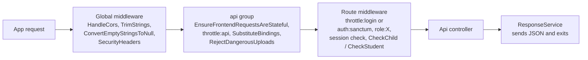

The admin panel serves a JSON REST API under `/api` that both Flutter apps use. Routes are declared in [`routes/api.php`](https://github.com/ShawnDaPrawn/Eschool/blob/main/admin-panel/routes/api.php) and handled by the four controllers in [`app/Http/Controllers/Api/`](https://github.com/ShawnDaPrawn/Eschool/tree/main/admin-panel/app/Http/Controllers/Api). This page covers what every endpoint has in common (base URL, authentication, middleware, response envelope, error codes, limits) and ends with the master index of all 155 routes. Per-role details are on [API-Student](API-Student), [API-Parent](API-Parent) and [API-Teacher](API-Teacher).

## At a glance

| Item | Value |
| --- | --- |
| Base path | `https://<admin-panel-host>/api/` |
| Route file | `admin-panel/routes/api.php` (loaded with prefix `api` and the `api` middleware group) |
| Controllers | `ApiController` (shared/public), `StudentApiController`, `ParentApiController`, `TeacherApiController` |
| Framework | Laravel 12 (`laravel/framework` v12.70.0 in `composer.lock`), Sanctum v4.3.3, spatie/laravel-permission 6.25.0 |
| Authentication | Laravel Sanctum personal access tokens, `Authorization: Bearer <token>` |
| Token lifetime | `SANCTUM_EXPIRATION` minutes, default `43200` (30 days) from creation |
| Request bodies | Form fields (`multipart/form-data` from the apps); query string for `GET` |
| Response | JSON object with `error`, `message`, `data`, `code` (see [Response envelope](#response-envelope)) |
| Route count | 155: 1 logout, 49 student, 41 parent, 51 teacher, 13 general |

## Base URL and how the apps build it

The API is part of the same Laravel application as the admin panel and the public website, so it lives on the same host. Both [`bootstrap/app.php`](https://github.com/ShawnDaPrawn/Eschool/blob/main/admin-panel/bootstrap/app.php) (`withRouting(api: ...)`) and [`app/Providers/RouteServiceProvider.php`](https://github.com/ShawnDaPrawn/Eschool/blob/main/admin-panel/app/Providers/RouteServiceProvider.php) (`Route::prefix('api')->middleware('api')`) register `routes/api.php` under the `api` prefix; both produce the same URLs.

The Flutter apps hard-code the server address in one constant each:

| App | File | Constants |
| --- | --- | --- |
| Student/parent (`e-school`) | [`lib/utils/constants.dart`](https://github.com/ShawnDaPrawn/Eschool/blob/main/e-school/lib/utils/constants.dart) | `baseUrl = 'https://my-server.com'`, `databaseUrl = '$baseUrl/api/'`, `storageUrl = '$baseUrl/storage/'` |
| Teacher (`e-school-teacher`) | [`lib/utils/constants.dart`](https://github.com/ShawnDaPrawn/Eschool/blob/main/e-school-teacher/lib/utils/constants.dart) | same three constants |

`baseUrl` must not end with `/`. Every endpoint is then a static string in the `Api` class of `lib/utils/api.dart`, for example `static String studentLogin = '${databaseUrl}student/login';`. Uploaded files are served from `/storage/...` (the public disk); the apps prefix relative paths with `storageUrl`, while some endpoints (chat attachments, gallery) already return absolute URLs built with `asset()`. Click-by-click setup of `baseUrl` is in the end-user docs: https://shawndaprawn.github.io/Eschool/mobile-app/integrate-admin-panel/ . See also [Mobile-App-Configuration](Mobile-App-Configuration).

## Route groups

| Prefix | Used by | Public endpoints | Authenticated middleware stack | Routes |
| --- | --- | --- | --- | --- |
| `/api/logout` | all apps | none | `auth:sanctum` | 1 |
| `/api/student/*` | e-school, student login | `login`, `forgot-password` | `auth:sanctum`, `role:Student`, `student.session.active` | 49 |
| `/api/parent/*` | e-school, parent login | `login` | `auth:sanctum`, `role:Parent`, `parent.children.session.active`; child-scoped routes add `CheckChild` | 41 |
| `/api/teacher/*` | e-school-teacher | `login` | `auth:sanctum`, `role:Teacher`; two routes add `CheckStudent` | 51 |
| `/api/*` (general) | all apps | 12 read-only/info endpoints plus `forgot-password` | `change-password` only: `auth:sanctum` | 13 |

The role middleware was added in commit `439395d`. Before it, teacher endpoints accepted student and parent tokens.

## Request pipeline



### Middleware reference

All aliases are defined in `bootstrap/app.php` (`$middleware->alias([...])`).

| Alias / class | Applied to | What it does | Failure response |
| --- | --- | --- | --- |
| `throttle:api` (`RateLimiter::for('api')`) | every API route | 60 requests per minute keyed by user id, or by IP when not signed in | HTTP 429 |
| `RejectDangerousUploads` | every API route (appended to the `api` group) | Refuses uploads with script/web-page extensions or content and sanitises SVGs (see [File uploads](#file-uploads)) | HTTP 422 `{"error":true,"message":"The file type is not allowed.","code":102}` |
| `throttle:login` | `student/login`, `student/forgot-password`, `parent/login`, `teacher/login`, `forgot-password` | 5 per minute per path and account, 20 per minute per IP | HTTP 429 |
| `auth:sanctum` | every authenticated route | Resolves the bearer token (or a stateful web session) | HTTP 401 `{"message":"Unauthenticated."}` when the request asks for JSON; otherwise a redirect to the `login` route (see [Gotchas](#gotchas)) |
| `role:Student` / `role:Parent` / `role:Teacher` | the three role groups | `Spatie\Permission\Middleware\RoleMiddleware`. Note: the alias `role` is spatie's; the app's own `CheckRole` is aliased `Role` and guards the admin panel, not the API | HTTP 403 (spatie `UnauthorizedException`) |
| `student.session.active` (`EnsureStudentSessionIsActive`) | student group | Requires role Student, `users.status = 1`, a `students` row, and a `student_sessions` row for the current session year with `status != 0` | HTTP 403 `{"error":true,"message":"You Don't have enough permissions.","data":null,"code":403}`; HTTP 401 `{"message":"...","code":"SESSION_NOT_ACTIVE"}` when the session row is missing or inactive |
| `parent.children.session.active` (`EnsureParentChildrenSessionIsActive`) | parent group | Requires a `parents` row; at least one child (as father, mother or guardian) must have a current-year `student_sessions` row, and at least one of those must have `status = 1` | HTTP 403 `{"error":true,"message":...}`; HTTP 401 with `code` `SESSION_NOT_ACTIVE` or `ACCOUNT_DEACTIVATED` |
| `CheckChild` | parent child-scoped routes | Validates `child_id` as an integer and looks it up through `Parents::children()`; stores the student model on the request as attribute `child` | HTTP 200 `{"error":true,"message":"Invalid Child ID Passed.","code":105}` |
| `CheckStudent` | `teacher/get-student-result`, `teacher/get-student-marks` | `student_id` must be in a class section where the teacher is a class teacher (`class_teachers.class_teacher_id`) | HTTP 200 `{"error":true,"message":"Invalid Student ID Passed.","code":105}` |

`LanguageManager` (session locale) and `DemoMiddleware` (demo-mode write block, code `112`) are only in the `web` group, so they never run on API routes. `DemoMiddleware` still lists `/api/...` paths in its allow-list, but that list has no effect on the API.

## Authentication

### Logging in

| Role | Endpoint | Credentials | Extra checks before the token is returned |
| --- | --- | --- | --- |
| Student | `POST /api/student/login` | `gr_number`, `password` | `gr_number` is matched against `users.email` (students log in with their GR number). The user must have role `Student`, a `students` row, `status = 1`, and an active `student_sessions` row for the current session year. The token is only created after these pass. |
| Parent | `POST /api/parent/login` | `email`, `password` | Role `Parent`. At least one child must have a current-year session, and at least one must be active. The token is created before the child checks, so a refused login can leave an unused token row. |
| Teacher | `POST /api/teacher/login` | `email`, `password` | Role `Teacher` only. |

All three accept optional `fcm_id` (stored in `users.fcm_id`, used for push notifications) and `device_type` (stored in `users.device_type`). A wrong password or wrong role returns code `101` with message `Invalid Login Credentials`. Logins are rate limited (see [Rate limiting](#rate-limiting)).

### Token issuance and use

The token is created with `$user->createToken($user->first_name)->plainTextToken`, stored hashed in `personal_access_tokens`, and returned as a top-level `token` field next to `data`:

```json
{
  "error": false,
  "message": "User logged-in!",
  "data": { "id": 12, "user_id": 34, "first_name": "...", "class_section_name": "...", "dynamic_fields": null },
  "code": 200,
  "token": "<id>|<plain-text token>"
}
```

The student login returns `code` 200; the parent and teacher logins return `code` 100. The `data` object is the user model flattened into one level by `flattenMyModel()` (see [API-Student](API-Student#login) for the student fields).

Send the token on every authenticated call:

```http
GET /api/student/dashboard HTTP/1.1
Host: school.example.com
Authorization: Bearer <id>|<plain-text token>
Accept: application/json
```

The apps keep the token in Hive (`authBoxKey` box, `jwtTokenKey`) and add it in `Api.headers()`.

### Expiry, logout and password change

| Topic | Behaviour | Source |
| --- | --- | --- |
| Expiry | `'expiration' => env('SANCTUM_EXPIRATION', 60 * 24 * 30)` minutes, counted from token creation (not sliding). `.env.example` sets `SANCTUM_EXPIRATION=43200`. | [`config/sanctum.php`](https://github.com/ShawnDaPrawn/Eschool/blob/main/admin-panel/config/sanctum.php) |
| Pruning | `Schedule::command('sanctum:prune-expired --hours=24')->daily()` deletes expired tokens. Needs the scheduler running (see [Scheduled-Tasks-and-Commands](Scheduled-Tasks-and-Commands)). | [`routes/console.php`](https://github.com/ShawnDaPrawn/Eschool/blob/main/admin-panel/routes/console.php) |
| Logout | `POST /api/logout` sets `users.fcm_id` to `''` and deletes only the current token. | `ApiController::logout` |
| Password change | `POST /api/change-password` updates the password and deletes every other token of the user (other devices are signed out); the current token stays valid. | `ApiController::changePassword` |
| Stateful guard | `config/sanctum.php` has `'guard' => ['web']` and `stateful` domains from `SANCTUM_STATEFUL_DOMAINS` (default localhost variants plus the `APP_URL` host). A browser on a stateful domain with an admin-panel session cookie is also authenticated; the apps only use tokens. | `config/sanctum.php` |

## Required headers

| Header | When | Notes |
| --- | --- | --- |
| `Authorization: Bearer <token>` | every route except the public ones | The only header the apps add (`Api.headers()` in both apps). |
| `Accept: application/json` | recommended for every call | Not sent by the apps. Without it Laravel treats the request as a browser request: authentication failures redirect to `/login`, and 403/429 errors render HTML. |
| `Content-Type: multipart/form-data` | `POST` | The apps send every `POST` as Dio `FormData` with `ListFormat.multiCompatible`, so arrays arrive as `answers_data[0][question_id]`-style fields. Plain `application/x-www-form-urlencoded` or JSON bodies also work because the controllers read `$request->all()`. |
| Language header | none | The API reads no locale header. Messages go through `trans()` with the default locale (`config/app.php` `locale = 'en'`, strings in `resources/lang/en.json`). The apps translate error codes themselves. See [Localization](Localization). |

## Response envelope

Almost every endpoint answers through [`app/Services/ResponseService.php`](https://github.com/ShawnDaPrawn/Eschool/blob/main/admin-panel/app/Services/ResponseService.php):

| Method | JSON produced | Typical use |
| --- | --- | --- |
| `successResponse($message, $data = null, $customData = [], $code = null)` | `{"error": false, "message": trans($message), "data": $data, "code": $code ?? 200}` merged with `$customData` at the top level | normal success; `$customData` carries `token`, `pdf`, `total_questions`, `payment_gateway_details`, fee totals and similar |
| `errorResponse($message, $data = null, $code = null, $e = null)` | `{"error": true, "message": trans($message), "data": $data, "code": $code ?? config('constants.RESPONSE_CODE.EXCEPTION_ERROR'), "details": ...}` | failures; when `$e` is given the exception and a redacted curl reconstruction of the request are logged |
| `validationError($message)` | `errorResponse($message, null, config('constants.RESPONSE_CODE.VALIDATION_ERROR'))` | first validator message |
| `warningResponse(...)` | `{"error": false, "warning": true, "code": ..., "message": ..., "data": ...}` | not used by the API controllers |

Things to know about this envelope:

- **HTTP status is always 200.** `successResponse` and `errorResponse` call `response()->json(...)->send()` without a status, so clients must branch on `error`, not on the status code. Real non-200 statuses only come from middleware (401, 403, 422, 429) and from uncaught framework errors.
- **`config/constants.php` does not exist** in this repo, so `config('constants.RESPONSE_CODE.*')` is `null`. Every `validationError()` and every `errorResponse()` without an explicit code therefore returns `"code": null`. The apps rely on this: when `code` is `null` they show `message` verbatim.
- **`details`** holds the exception message, file and line only when `APP_DEBUG=true`; otherwise it is `""`.
- **The script exits inside the controller.** Both helpers end with `exit()`. The response is sent before the middleware stack unwinds, so after-middleware does not touch it: CORS headers from `HandleCors`, the `SecurityHeaders` headers and throttle headers are not added to these responses. Endpoints that `return response()->json(...)` instead (gallery, `get-events-details`, the middleware errors above) go through the full stack. For the same reason the feature tests cannot call these endpoints in-process; they serve the app from a separate `php -S` process ([`tests/Concerns/RunsAppServer.php`](https://github.com/ShawnDaPrawn/Eschool/blob/main/admin-panel/tests/Concerns/RunsAppServer.php), see [Testing-and-CI](Testing-and-CI)).

Examples taken from the code:

```json
{"error": false, "message": "Assignments Deleted Successfully", "data": null, "code": 200}
```

```json
{"error": true, "message": "You already have submitted your assignment.", "data": null, "code": 104, "details": ""}
```

```json
{"error": true, "message": "<first validation message>", "data": null, "code": null, "details": ""}
```

A few endpoints build their own JSON and do not include every field:

| Endpoint | Shape |
| --- | --- |
| `GET /api/get-gallery-albums`, `GET /api/get-gallery-videos` | `{"error": false, "data": {"data": [...], "current_page": n, "last_page": n}}` (no `message`/`code`) |
| `GET /api/get-gallery-images` | `{"error": false, "data": ["<absolute url>", ...]}` |
| `POST /api/get-events-details` | `{"error": false, "message": "Events Details Fetched Successfully", "data": [...], "code": 200}` |
| Session middleware | `{"message": "...", "code": "SESSION_NOT_ACTIVE"}` (no `error` key) with HTTP 401 |

## Error codes

The numeric `code` values used by the API controllers and middleware:

| Code | HTTP | Meaning | Where |
| --- | --- | --- | --- |
| `200` | 200 | Success (default) | `successResponse` |
| `100` | 200 | Success (used instead of 200 by a few endpoints) | parent and teacher `login`, teacher `get-user-list` and `get-user-message` |
| `101` | 200 | Invalid login credentials, or the account does not have the role of that app | all three `login` methods |
| `102` | 200 / 422 | Validation failure (only where set explicitly) | student `login`, `get-events-details`; `RejectDangerousUploads` (HTTP 422) |
| `103` | 200 | Generic error: caught exception (`error_occurred`), record not found or not owned, invalid online exam key, invalid transaction | most endpoints |
| `104` | 200 | Assignment already submitted | `student/submit-assignment` |
| `105` | 200 | Online exam already attempted; invalid `child_id` (`CheckChild`); invalid `student_id` (`CheckStudent`) | student online exam, parent, teacher |
| `106` | 200 | Online exam not started yet; invalid subject id; invalid child id in parent announcements | student online exam, `student/announcements`, `ParentApiController::getAnnouncements` |
| `110` | 200 | Assignment submission cannot be deleted (already reviewed) | `student/delete-assignment-submission` |
| `113` | 200 | No `student_sessions` row for the requested session year | report and fee endpoints (student and parent) |
| `400` | 200 | Bad request in teacher exam/marks flows (`exam_published`, `exam_not_completed_yet`, marks out of range, `grades_data_does_not_exists`, `Semester id required.`) | `TeacherApiController` |
| `403` | 200 or 403 | No permission or not assigned to the class/subject (teacher, HTTP 200); inactive or non-student account (`student.session.active`, HTTP 403) | `TeacherApiController`, `EnsureStudentSessionIsActive` |
| `422` | 200 | `album_id is required` | `get-gallery-images` |
| `null` | 200 | Any `validationError()` or `errorResponse()` without a code; the message is meant to be shown as is | everywhere |
| `"SESSION_NOT_ACTIVE"` / `"ACCOUNT_DEACTIVATED"` | 401 | Student/parent session checks | session middleware |

How the apps read codes: `lib/utils/errorMessageKeysAndCodes.dart` (both apps) maps `101`, `104`, `105`, `106`, `107`, `108`, `109`, `112`, `113` to translated messages; every other non-null code shows the generic error text, and a `null` code shows the server's message. The app-side mapping is per code, not per endpoint, so code `105` from `CheckChild` is displayed with the student app's "exam already attended" text. Codes `107`, `108`, `109` and `112` are mapped in the apps but not emitted by the current API code.

## Validation errors

Controllers validate with `Validator::make($request->all(), [...])` and on failure send only the first message (`$validator->errors()->first()`), through `validationError()` (code `null`) or, in a few places, `errorResponse(..., 102)`. There is no field-keyed `errors` object. Messages come from `resources/lang/en/validation.php`. For example, `GET /api/settings` without `type` returns exactly:

```json
{"error":true,"message":"The type field is required.","data":null,"code":null,"details":""}
```

Three methods use `$request->validate()` instead. In `student/delete-leave` and `teacher/delete-leave` the call sits inside the `try`, so a failure is caught and answered as `error_occurred` with code `103`. In `teacher/student-leave-status-update` it is outside the `try`, so Laravel's own `ValidationException` handling applies: HTTP 422 `{"message": ..., "errors": {...}}` with `Accept: application/json`, a redirect without it.

`student/apply-leave` is stricter than the rest: it rejects any field other than `reason`, `leave_details` and `files` (`Unknown fields: ...`).

## Pagination

There is no single convention; each endpoint uses one of these:

| Style | Parameters | Response | Examples |
| --- | --- | --- | --- |
| Laravel paginator, 15 per page | `page` | Full paginator object as `data`: `current_page`, `data`, `first_page_url`, `from`, `last_page`, `last_page_url`, `links`, `next_page_url`, `path`, `per_page`, `prev_page_url`, `to`, `total` | `student/assignments`, `student/announcements`, `student/get-notification`, parent assignments/announcements/notifications, several teacher lists |
| Trimmed paginator | `page` | `current_page`, `data`, `from`, `last_page`, `per_page`, `to`, `total` (online exam list also adds `current_date`) | `get-online-exam-list` (15), `get-online-exam-result-list` (10), `fees-transactions-list` (15, rows under `transaction-data`) |
| `per_page` + `page` | `per_page` 1 to 100 (default 10), `page` >= 1 | `{data, current_page, last_page}` | `get-gallery-albums`, `get-gallery-videos` |
| `offset` + `limit` | `offset`, `limit` | `{items, total_items}` (user list also `total_unread_users`) | chat `get-user-list` and `get-user-message` in all three roles. On the student side the user list returns everything when `limit` is absent or not positive, and messages are capped at `limit` 1 to 100 (default 100) |

## Rate limiting

Both limiters are defined in `RouteServiceProvider::configureRateLimiting()`:

```php
RateLimiter::for('api', function (Request $request) {
    return Limit::perMinute(60)->by($request->user()?->id ?: $request->ip());
});

RateLimiter::for('login', function (Request $request) {
    $account = strtolower(trim((string) ($request->input('email') ?? $request->input('gr_number') ?? $request->input('gr_no') ?? '')));

    return [
        Limit::perMinute(5)->by('login:'.$request->path().'|'.$account),
        Limit::perMinute(20)->by('login-ip:'.$request->ip()),
    ];
});
```

- `api` applies to every API route. `login` is added on top for the five login/reset routes, and also on the web `password/email` route.
- The per-account key includes the path, so `student/login` and `student/forgot-password` are counted separately. The comment in the code gives the reason: default passwords are dates of birth.
- Exceeding a limit returns HTTP 429 (`ThrottleRequestsException`), as JSON only when the request sends `Accept: application/json`.

## Roles and scoping

- Each group requires its role (`role:Student`, `role:Parent`, `role:Teacher`), so a token from one app cannot call another app's endpoints. Covered by `test_app_tokens_only_work_for_their_own_role` in [`tests/Feature/AccessControlTest.php`](https://github.com/ShawnDaPrawn/Eschool/blob/main/admin-panel/tests/Feature/AccessControlTest.php).
- Inside a role, controllers scope queries to the caller: students to their own `student_sessions` class section, subjects and records; parents to their own children; teachers to their class-teacher and subject-teacher assignments. These checks were added in commits `439395d`, `77fe8ed`, `a09dfe8`, `c890813` and `839c9eb`. Details per endpoint are on the role pages; the overall model is on [Security-Model](Security-Model) and [Roles-and-Permissions](Roles-and-Permissions).
- The "current session year" used everywhere is the `session_year` setting (`getSettings('session_year')['session_year']`).

### The `child_id` convention (parents)

One parent account can have several children. Child-specific parent endpoints take a `child_id` (query string for `GET`, form field for `POST`) and are grouped under `CheckChild`:

1. `CheckChild` reads `$request->child_id`, validates it with `FILTER_VALIDATE_INT`, and looks it up with `$parent->children()->whereKey($childId)`.
2. `Parents::children()` matches students where `father_id`, `mother_id` or `guardian_id` is the parent's id. It was a `UNION` before `439395d`, and a chained `where('id', ...)` only filtered the father branch, so mothers and guardians could pass any `child_id`.
3. The resolved student is stored as request attribute `child`; `ParentApiController::resolveChild()` reuses it (or repeats the lookup for routes outside the group).
4. A missing or foreign `child_id` returns `{"error": true, "message": "Invalid Child ID Passed.", "code": 105}`.

Parent routes without a child (`announcements`, `get-profile-data`, chat, notifications, fee receipt and transactions, `fail-payment-transaction`, `get-payment-status`, `delete-leave`) check ownership inside the controller. See [API-Parent](API-Parent).

## File uploads

| Rule | Where | Detail |
| --- | --- | --- |
| Blocked file types | `RejectDangerousUploads` (all API routes) | Every dot-separated part of the client file name and the detected extension are checked against `BLOCKED_EXTENSIONS` (PHP variants, `phtml`, `phar`, `shtml`, `htaccess`, `ini`, `cgi`, `pl`, `py`, `rb`, `sh`, `asp(x)`, `jsp`, `exe`, `dll`, `bat`, `cmd`, `vbs`, `ps1`, `html`, `htm`, `xhtml`, `js`, `mjs`, `swf`, `xml`, `xsl(t)`, `svgz`, and more). The detected MIME type is also matched against PHP, HTML, JavaScript, shell, Perl, Python, Ruby, executable and XML patterns. |
| SVG | `RejectDangerousUploads` | Allowed, but rewritten with `enshrined/svg-sanitize` (scripts, event handlers and remote references removed). An SVG that cannot be parsed is refused. |
| Refusal | `RejectDangerousUploads` | HTTP 422 `{"error": true, "message": "The file type is not allowed.", "code": 102}` |
| Per-endpoint limits | controllers | e.g. `student/apply-leave` allows only JPEG, PNG, WebP, GIF, BMP, PDF, DOC, DOCX (`mimetypes:` rule); chat `send-message` limits the file count and size to the chat settings (`max_files_or_images_in_one_message`, `max_file_size_in_bytes`). |
| Storage | controllers | Files go to the `public` disk (`storage/app/public`, served under `/storage`), e.g. `assignment/`, `leave/`, `chatfile/<random 32 chars>/`. |

PHP's own `upload_max_filesize` / `post_max_size` and Laravel's `ValidatePostSize` still apply. See [Security-Model](Security-Model) for the upload hardening commits (`9f8911b`, `60615fc`).

## CORS

[`config/cors.php`](https://github.com/ShawnDaPrawn/Eschool/blob/main/admin-panel/config/cors.php) enables CORS for `api/*` and `sanctum/csrf-cookie` with `allowed_origins`, `allowed_methods` and `allowed_headers` all `*`, `supports_credentials` `false` and `max_age` 0. CORS only matters for browser clients; the Flutter apps ignore it. Because `ResponseService` exits before `HandleCors` can add headers to the response (see [Response envelope](#response-envelope)), a browser-based client would get the preflight answer but most actual responses would lack `Access-Control-Allow-Origin`.

## General endpoints (`ApiController`)

All in [`app/Http/Controllers/Api/ApiController.php`](https://github.com/ShawnDaPrawn/Eschool/blob/main/admin-panel/app/Http/Controllers/Api/ApiController.php). Everything except `logout` and `change-password` is public (no token).

### `POST /api/logout`

Middleware `auth:sanctum` (any role). Clears `users.fcm_id`, deletes the current access token, returns `Logout Successfully done.`.

### `POST /api/change-password`

Middleware `auth:sanctum` (any role).

| Field | Rule |
| --- | --- |
| `current_password` | required; must match (`Current password is incorrect.`, code `null`, otherwise) |
| `new_password` | required, min 8 |
| `new_confirm_password` | required, same as `new_password` |

Updates the hash and deletes all of the user's other tokens. Returns `Password changed successfully.`.

### `POST /api/forgot-password`

Middleware `throttle:login`. Field `email` (required, email). Calls `Password::sendResetLink()` (the standard Laravel reset email; needs mail configured, see [Configuration](Configuration)). Always answers `If an account exists for this email, a password reset link has been sent.`; mail errors are logged, not shown. Students use `student/forgot-password` instead (see [API-Student](API-Student#forgot-password)).

### `GET /api/settings`

| Param | Rule |
| --- | --- |
| `type` | required, one of `privacy_policy`, `contact_us`, `about_us`, `terms_condition`, `app_settings`, `fees_settings` |

For any type other than `app_settings`, `data` is the raw settings value with that key (or `""`). For `app_settings`, `data` is an object with:

| Key | Content |
| --- | --- |
| `app_link`, `ios_app_link`, `app_version`, `ios_app_version`, `force_app_update`, `app_maintenance` | student/parent app store links, versions and switches |
| `teacher_app_link`, `teacher_ios_app_link`, `teacher_app_version`, `teacher_ios_app_version`, `teacher_force_app_update`, `teacher_app_maintenance` | the same for the teacher app |
| `school_name`, `school_tagline` | school identity |
| `session_year` | the current `session_years` row |
| `online_payment` | setting value, default `"1"` |
| `is_demo` | `env('DEMO_MODE')` |
| `compulsory_fee_payment_mode`, `is_student_can_pay_fees` | fee settings |
| `chat_settings` | `max_files_or_images_in_one_message` (default 10), `max_file_size_in_bytes` (setting in MB times 1,000,000; default 10,000,000), `max_characters_in_text_message` (default 500), `automatically_messages_removed_days` (default 30) |
| `holiday_days` | `leave_masters.holiday_days` for the current session |
| `payment_options` | `currency_code`, `currency_symbol`, optional `fees_due_date` / `fees_due_charges`, and one object per enabled gateway with only its public key: `razorpay` (`razorpay_api_key`), `stripe` (`stripe_publishable_key`), `paystack` (`paystack_public_key`), `flutterwave` (`flutterwave_public_key`), each with its status and currency code |
| `online_exam_terms_condition` | HTML-decoded text |
| `current_semester` | the semester whose `current` attribute is true, or `null` |
| `semester_breaks` | list of `{start, end}` gaps between consecutive semesters inside the session year, or `null` |

Secret keys and webhook secrets are never included. Until commit `839c9eb` this public endpoint returned the Razorpay webhook secret; installs that ran older code should rotate it (see [Payments](Payments)). The admin UI for these values: https://shawndaprawn.github.io/Eschool/admin-panel/app-settings/ and https://shawndaprawn.github.io/Eschool/admin-panel/chat-settings/ .

### Other public endpoints

| Method and path | Params | Returns |
| --- | --- | --- |
| `GET /api/holidays` | none | every `holidays` row (all session years) |
| `GET /api/sliders` | none | `sliders` rows with `type` 1 (app) or 3 (both) |
| `GET /api/current-session-year` | none | the `session_years` row named by the `session_year` setting |
| `GET /api/get-session-year` | none | all session years except id 0, newest first |
| `GET /api/get-semesters` | none | semesters of the current session year, by `start_date` |
| `GET /api/get-events-list` | none | events of the current session year (`id`, `title`, `type`, `start_date`, `end_date`, `start_time`, `end_time`, `image`, `description`, `has_day_schedule`) followed by each per-day schedule row (`id`, `event_id`, `title`, `date`, `start_time`, `end_time`, `description`, `has_day_schedule: 0`) |
| `POST /api/get-events-details` | `event_id` (required, integer) | the `multiple_events` rows of that event |
| `GET /api/get-gallery-albums` | `per_page`, `page` | albums (`id`, `title`, `thumbnail_url`) |
| `GET /api/get-gallery-images` | `album_id` (required) | absolute URLs of the album's images |
| `GET /api/get-gallery-videos` | `per_page`, `page` | video URLs (YouTube URL, or an absolute local URL) |

## Master route index

Every route in `routes/api.php`, in file order. All paths are relative to `/api/`. The route-specific middleware column lists what is added on top of the `api` group; the stacks are:

| Stack | Middleware |
| --- | --- |
| **S** | `auth:sanctum`, `role:Student`, `student.session.active` |
| **P** | `auth:sanctum`, `role:Parent`, `parent.children.session.active` |
| **P+C** | **P** plus `CheckChild` (the inner group repeats `auth:sanctum`; Laravel de-duplicates it) |
| **T** | `auth:sanctum`, `role:Teacher` |
| **T+S** | **T** plus `CheckStudent` (same de-duplication) |

The table matches `php artisan route:list --path=api`, which reports 155 routes; `GET` routes also answer `HEAD`.

Controller names are shortened: `Api` = `ApiController`, `Student` = `StudentApiController`, `Parent` = `ParentApiController`, `Teacher` = `TeacherApiController`.

### Logout

| Method | Path | Controller@method | Middleware |
| --- | --- | --- | --- |
| POST | `logout` | `Api@logout` | `auth:sanctum` |

### Student (`/api/student/...`) — details on [API-Student](API-Student)

| Method | Path | Controller@method | Middleware |
| --- | --- | --- | --- |
| POST | `student/login` | `Student@login` | `throttle:login` |
| POST | `student/forgot-password` | `Student@forgotPassword` | `throttle:login` |
| GET | `student/dashboard` | `Student@dashboard` | S |
| GET | `student/subjects` | `Student@subjects` | S |
| GET | `student/class-subjects` | `Student@classSubjects` | S |
| POST | `student/select-subjects` | `Student@selectSubjects` | S |
| GET | `student/parent-details` | `Student@getParentDetails` | S |
| GET | `student/timetable` | `Student@getTimetable` | S |
| GET | `student/lessons` | `Student@getLessons` | S |
| GET | `student/lesson-topics` | `Student@getLessonTopics` | S |
| GET | `student/assignments` | `Student@getAssignments` | S |
| POST | `student/submit-assignment` | `Student@submitAssignment` | S |
| POST | `student/delete-assignment-submission` | `Student@deleteAssignmentSubmission` | S |
| GET | `student/attendance` | `Student@getAttendance` | S |
| GET | `student/attendance-report` | `Student@attendanceReport` | S |
| GET | `student/announcements` | `Student@getAnnouncements` | S |
| GET | `student/get-exam-list` | `Student@getExamList` | S |
| GET | `student/get-exam-details` | `Student@getExamDetails` | S |
| GET | `student/exam-marks` | `Student@getExamMarks` | S |
| GET | `student/offline-exam-report` | `Student@offlineExamReport` | S |
| GET | `student/online-exam-report` | `Student@onlineExamReport` | S |
| GET | `student/id-card-pdf` | `Student@getIdCardPdf` | S |
| GET | `student/get-online-exam-list` | `Student@getOnlineExamList` | S |
| GET | `student/get-online-exam-questions` | `Student@getOnlineExamQuestions` | S |
| POST | `student/submit-online-exam-answers` | `Student@submitOnlineExamAnswers` | S |
| GET | `student/get-online-exam-result-list` | `Student@getOnlineExamResultList` | S |
| GET | `student/get-online-exam-result` | `Student@getOnlineExamResult` | S |
| GET | `student/get-profile-data` | `Student@getProfileDetails` | S |
| GET | `student/get-notification` | `Student@getNotifications` | S |
| GET | `student/get-user-list` | `Student@getChatUserList` | S |
| POST | `student/send-message` | `Student@sendMessage` | S |
| POST | `student/get-user-message` | `Student@getUserChatMessage` | S |
| POST | `student/read-all-message` | `Student@readAllMessages` | S |
| GET | `student/fees-details` | `Student@getFeesDetails` | S |
| POST | `student/add-fees-transaction` | `Student@storeFeesTransaction` | S |
| POST | `student/store-fees` | `Student@storeFees` | S |
| GET | `student/fees-paid-list` | `Student@feesPaidList` | S |
| GET | `student/fees-paid-receipt-pdf` | `Student@feesPaidReceiptPDF` | S |
| GET | `student/fees-transactions-list` | `Student@getFeesPaymentTransactions` | S |
| POST | `student/fail-payment-transaction` | `Student@failPaymentTransactionStatus` | S |
| GET | `student/fees-report` | `Student@getFeesReport` | S |
| GET | `student/leave-report` | `Student@leaveReport` | S |
| GET | `student/assignment-report` | `Student@assignmentReport` | S |
| GET | `student/academic-calendar-pdf` | `Student@getAcademicCalendarPdf` | S |
| GET | `student/send-fee-notification` | `Student@sendFeeNotification` | S |
| POST | `student/apply-leave` | `Student@applyLeave` | S |
| POST | `student/get-leave-list` | `Student@getMyLeave` | S |
| POST | `student/delete-leave` | `Student@deleteLeave` | S |
| POST | `student/get-payment-status` | `Parent@getPaymentStatus` | S |

### Parent (`/api/parent/...`) — details on [API-Parent](API-Parent)

| Method | Path | Controller@method | Middleware |
| --- | --- | --- | --- |
| POST | `parent/login` | `Parent@login` | `throttle:login` |
| GET | `parent/announcements` | `Parent@getAnnouncements` | P |
| GET | `parent/fees-paid-receipt-pdf` | `Parent@feesPaidReceiptPDF` | P |
| GET | `parent/fees-transactions-list` | `Parent@getFeesPaymentTransactions` | P |
| GET | `parent/get-profile-data` | `Parent@getProfileDetails` | P |
| POST | `parent/fail-payment-transaction` | `Parent@failPaymentTransactionStatus` | P |
| GET | `parent/get-notification` | `Parent@getNotifications` | P |
| POST | `parent/get-payment-status` | `Parent@getPaymentStatus` | P |
| GET | `parent/get-user-list` | `Parent@getChatUserList` | P |
| POST | `parent/send-message` | `Parent@sendMessage` | P |
| POST | `parent/get-user-message` | `Parent@getUserChatMessage` | P |
| POST | `parent/read-all-message` | `Parent@readAllMessages` | P |
| GET | `parent/subjects` | `Parent@subjects` | P+C |
| GET | `parent/class-subjects` | `Parent@classSubjects` | P+C |
| GET | `parent/timetable` | `Parent@getTimetable` | P+C |
| GET | `parent/lessons` | `Parent@getLessons` | P+C |
| GET | `parent/lesson-topics` | `Parent@getLessonTopics` | P+C |
| GET | `parent/assignments` | `Parent@getAssignments` | P+C |
| GET | `parent/attendance` | `Parent@getAttendance` | P+C |
| GET | `parent/attendance-report` | `Parent@attendanceReport` | P+C |
| GET | `parent/teachers` | `Parent@getTeachers` | P+C |
| GET | `parent/get-exam-list` | `Parent@getExamList` | P+C |
| GET | `parent/get-exam-details` | `Parent@getExamDetails` | P+C |
| GET | `parent/exam-marks` | `Parent@getExamMarks` | P+C |
| GET | `parent/offline-exam-report` | `Parent@offlineExamReport` | P+C |
| GET | `parent/online-exam-report` | `Parent@onlineExamReport` | P+C |
| GET | `parent/fees-details` | `Parent@getFeesDetails` | P+C |
| POST | `parent/add-fees-transaction` | `Parent@storeFeesTransaction` | P+C |
| POST | `parent/store-fees` | `Parent@storeFees` | P+C |
| GET | `parent/fees-paid-list` | `Parent@feesPaidList` | P+C |
| GET | `parent/fees-report` | `Parent@getFeesReport` | P+C |
| GET | `parent/leave-report` | `Parent@leaveReport` | P+C |
| GET | `parent/assignment-report` | `Parent@assignmentReport` | P+C |
| GET | `parent/get-online-exam-list` | `Parent@getOnlineExamList` | P+C |
| GET | `parent/get-online-exam-result-list` | `Parent@getOnlineExamResultList` | P+C |
| GET | `parent/get-online-exam-result` | `Parent@getOnlineExamResult` | P+C |
| GET | `parent/academic-calendar-pdf` | `Parent@getAcademicCalendarPdf` | P+C |
| GET | `parent/id-card-pdf` | `Parent@getIdCardPdf` | P+C |
| POST | `parent/apply-leave` | `Parent@applyLeave` | P+C |
| POST | `parent/get-leave-list` | `Parent@getMyLeave` | P+C |
| POST | `parent/delete-leave` | `Parent@deleteLeave` | P (checks the leave belongs to one of the parent's children; the app sends no `child_id`) |

### Teacher (`/api/teacher/...`) — details on [API-Teacher](API-Teacher)

| Method | Path | Controller@method | Middleware |
| --- | --- | --- | --- |
| POST | `teacher/login` | `Teacher@login` | `throttle:login` |
| GET | `teacher/dashboard` | `Teacher@dashboard` | T |
| GET | `teacher/classes` | `Teacher@classes` | T |
| GET | `teacher/subjects` | `Teacher@subjects` | T |
| GET | `teacher/get-assignment` | `Teacher@getAssignment` | T |
| POST | `teacher/create-assignment` | `Teacher@createAssignment` | T |
| POST | `teacher/update-assignment` | `Teacher@updateAssignment` | T |
| POST | `teacher/delete-assignment` | `Teacher@deleteAssignment` | T |
| GET | `teacher/get-assignment-submission` | `Teacher@getAssignmentSubmission` | T |
| POST | `teacher/update-assignment-submission` | `Teacher@updateAssignmentSubmission` | T |
| POST | `teacher/delete-file` | `Teacher@deleteFile` | T |
| POST | `teacher/update-file` | `Teacher@updateFile` | T |
| GET | `teacher/get-lesson` | `Teacher@getLesson` | T |
| POST | `teacher/create-lesson` | `Teacher@createLesson` | T |
| POST | `teacher/update-lesson` | `Teacher@updateLesson` | T |
| POST | `teacher/delete-lesson` | `Teacher@deleteLesson` | T |
| GET | `teacher/get-topic` | `Teacher@getTopic` | T |
| POST | `teacher/create-topic` | `Teacher@createTopic` | T |
| POST | `teacher/update-topic` | `Teacher@updateTopic` | T |
| POST | `teacher/delete-topic` | `Teacher@deleteTopic` | T |
| GET | `teacher/get-announcement` | `Teacher@getAnnouncement` | T |
| POST | `teacher/send-announcement` | `Teacher@sendAnnouncement` | T |
| POST | `teacher/update-announcement` | `Teacher@updateAnnouncement` | T |
| POST | `teacher/delete-announcement` | `Teacher@deleteAnnouncement` | T |
| GET | `teacher/get-attendance` | `Teacher@getAttendance` | T |
| POST | `teacher/submit-attendance` | `Teacher@submitAttendance` | T |
| GET | `teacher/get-exam-list` | `Teacher@getExamList` | T |
| GET | `teacher/get-exam-details` | `Teacher@getExamDetails` | T |
| POST | `teacher/submit-exam-marks/subject` | `Teacher@submitExamMarksBySubjects` | T |
| POST | `teacher/submit-exam-marks/student` | `Teacher@submitExamMarksByStudent` | T |
| GET | `teacher/get-student-result` | `Teacher@GetStudentExamResult` | T+S |
| GET | `teacher/get-student-marks` | `Teacher@GetStudentExamMarks` | T+S |
| GET | `teacher/student-list` | `Teacher@getStudentList` | T |
| GET | `teacher/student-details` | `Teacher@getStudentDetails` | T |
| GET | `teacher/academic-calendar-pdf` | `Teacher@getAcademicCalendarPdf` | T |
| GET | `teacher/teacher_timetable` | `Teacher@getTeacherTimetable` | T |
| GET | `teacher/get-profile-details` | `Teacher@getProfileDetails` | T |
| GET | `teacher/get-notification` | `Teacher@getNotifications` | T |
| GET | `teacher/get-user-list` | `Teacher@getChatUserList` | T |
| POST | `teacher/send-message` | `Teacher@sendMessage` | T |
| POST | `teacher/get-user-message` | `Teacher@getUserChatMessage` | T |
| POST | `teacher/read-all-message` | `Teacher@readAllMessages` | T |
| GET | `teacher/get-student-result-pdf` | `Teacher@getStudentResultPdf` | T |
| POST | `teacher/apply-leave` | `Teacher@applyLeave` | T |
| POST | `teacher/get-leave-list` | `Teacher@getMyLeave` | T |
| POST | `teacher/delete-leave` | `Teacher@deleteLeave` | T |
| POST | `teacher/get-student-leave-list` | `Teacher@getStudentLeaveList` | T |
| POST | `teacher/student-leave-status-update` | `Teacher@studentLeaveStatusUpdate` | T |
| POST | `teacher/update-timetable-link` | `Teacher@updateTimetableLink` | T |
| GET | `teacher/id-card-pdf` | `Teacher@getIdCardPdf` | T |
| GET | `teacher/attendance-report` | `Teacher@getAttendanceReport` | T |

### General (`/api/...`) — details in [General endpoints](#general-endpoints-apicontroller)

| Method | Path | Controller@method | Middleware |
| --- | --- | --- | --- |
| GET | `holidays` | `Api@getHolidays` | none |
| GET | `sliders` | `Api@getSliders` | none |
| GET | `current-session-year` | `Api@getCurrentSessionYear` | none |
| GET | `settings` | `Api@getSettings` | none |
| POST | `forgot-password` | `Api@forgotPassword` | `throttle:login` |
| GET | `get-events-list` | `Api@getEvents` | none |
| POST | `get-events-details` | `Api@getEventsDetails` | none |
| GET | `get-session-year` | `Api@getSessionYear` | none |
| GET | `get-semesters` | `Api@getSemesters` | none |
| GET | `get-gallery-albums` | `Api@getGalleryAlbums` | none |
| GET | `get-gallery-images` | `Api@getGalleryImages` | none |
| GET | `get-gallery-videos` | `Api@getGalleryVideos` | none |
| POST | `change-password` | `Api@changePassword` | `auth:sanctum` |

Several "read" endpoints are `POST` (`get-user-message`, `get-leave-list`, `get-events-details`, `get-payment-status`, `get-student-leave-list`) and one `GET` writes data (`student/send-fee-notification`); keep the method as listed.

## Gotchas

- **Send `Accept: application/json` when testing.** Without it (or with `Accept: */*`) a missing, invalid or expired token is answered by HTTP 302 to `/login` (`App\Http\Middleware\Authenticate::redirectTo`) instead of HTTP 401 `{"message":"Unauthenticated."}`, and role failures render an HTML 403 page. The shipped apps do not send this header (`Api.headers()` returns only `Authorization`), so their "log out on 401" branch fires for the session-check middleware (which always returns JSON 401) but not for an expired token.
- **Check `error`, not the HTTP status.** Business errors come back with HTTP 200.
- **`code: null` is normal** for validation errors because `config/constants.php` is missing.
- **No current session year, no API.** Most endpoints, including the public `settings`, read the `session_year` setting and the matching `session_years` row; if it is missing they fail with `error_occurred` (code `103`), and student/parent logins are refused until students are promoted into the current session (see [Academic-Structure](Academic-Structure)).
- **Browser clients and response headers.** Responses sent by `ResponseService` carry no `Access-Control-Allow-Origin`, `X-RateLimit-*`, `X-Frame-Options`, `X-Content-Type-Options` or `Referrer-Policy` headers, while `response()->json(...)` responses do (checked against a local `php -S` server: `GET /api/settings` vs `GET /api/get-gallery-images`).
- **Token rows pile up** if the scheduler is not running, because only `sanctum:prune-expired` deletes expired tokens.

## See also

- [API-Student](API-Student), [API-Parent](API-Parent), [API-Teacher](API-Teacher)
- [Security-Model](Security-Model)
- [Roles-and-Permissions](Roles-and-Permissions)
- [Mobile-Apps-Overview](Mobile-Apps-Overview) and [Mobile-App-Configuration](Mobile-App-Configuration)
- [Payments](Payments)
- [Chat](Chat) and [Notifications](Notifications)
- [Testing-and-CI](Testing-and-CI)
- [Troubleshooting-and-FAQ](Troubleshooting-and-FAQ)
