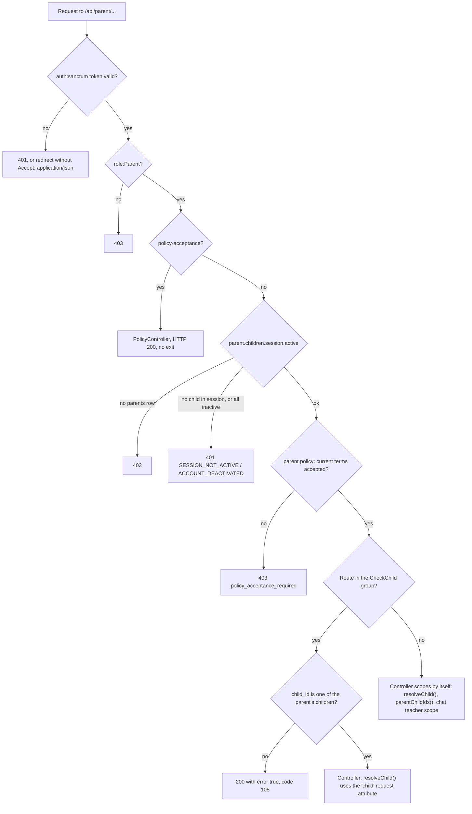
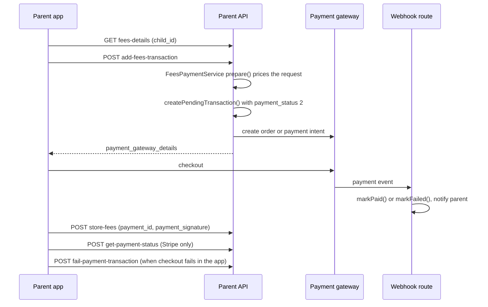

This page documents every endpoint under `/api/parent/`, all served by the controllers in [`Api/Parent/`](https://github.com/ShawnDaPrawn/Eschool/tree/main/admin-panel/app/Http/Controllers/Api/Parent), one per area and registered in [`routes/api.php`](https://github.com/ShawnDaPrawn/Eschool/blob/main/admin-panel/routes/api.php). It covers how a parent signs in, how a child is chosen with `child_id`, how each call is limited to the parent's own children, and what each endpoint takes, returns and changes. The route index for all roles and the shared (non-prefixed) endpoints is on [API Overview](API-Overview); gateway and webhook internals are on [Payments](Payments).

## Base URL, middleware and response format

All paths below are relative to `{APP_URL}/api/parent/`. The Flutter app builds this from `baseUrl` in `e-school/lib/utils/constants.dart` (`databaseUrl = '$baseUrl/api/'`).

Every parent route passes through these layers, in order:

| Layer | Where it is defined | Effect |
|---|---|---|
| `api` middleware group | `bootstrap/app.php` | Sanctum `EnsureFrontendRequestsAreStateful`, `throttle:api` (60 requests a minute per user id, or per IP when signed out, from `RouteServiceProvider::configureRateLimiting()`), `SubstituteBindings`, and `RejectDangerousUploads` (refuses script/web-page uploads with HTTP 422, `code` 102). |
| `throttle:login` | `login` route only | 5 attempts a minute per path and email, plus 20 a minute per IP. |
| `auth:sanctum` | all routes except `login` | Needs `Authorization: Bearer <token>`. `App\Http\Middleware\Authenticate` redirects to the web `login` route unless the request expects JSON, so send `Accept: application/json` to get a 401 instead. |
| `role:Parent` | all routes except `login` | Spatie `RoleMiddleware`. Student and teacher tokens get HTTP 403 (asserted in `tests/Feature/AccessControlTest.php`). |
| `parent.children.session.active` | every authenticated route except `policy-acceptance` | [`EnsureParentChildrenSessionIsActive`](https://github.com/ShawnDaPrawn/Eschool/blob/main/admin-panel/app/Http/Middleware/EnsureParentChildrenSessionIsActive.php), described below. A parent can accept the terms before this check runs. |
| `parent.policy` | every authenticated route except `policy-acceptance` | [`RequireParentPolicyAcceptance`](https://github.com/ShawnDaPrawn/Eschool/blob/main/admin-panel/app/Http/Middleware/RequireParentPolicyAcceptance.php). HTTP 403, `code` `policy_acceptance_required`, until the parent's first sign-in has accepted NavigateEd and, when the school had already written one, the school privacy notice and terms. Opening the app later does not ask again. See [Terms a parent must accept](#terms-a-parent-must-accept). |
| [`CheckChild`](https://github.com/ShawnDaPrawn/Eschool/blob/main/admin-panel/app/Http/Middleware/CheckChild.php) | the child-scoped group | Requires a `child_id` that belongs to the parent. Described below. |

Controllers answer through [`ResponseService`](https://github.com/ShawnDaPrawn/Eschool/blob/main/admin-panel/app/Services/ResponseService.php). Success and error bodies share one envelope, almost always with HTTP 200:

```json
{
  "error": false,
  "message": "Lessons Fetched Successfully",
  "data": [],
  "code": 200
}
```

Some endpoints add extra top-level keys next to `data` (for example `token`, `pdf`, `payment_gateway_details`, or the fee arrays of `fees-details`). Errors set `"error": true` and add `details`, which holds the exception text only when `APP_DEBUG` is on. Controllers `return` what `successResponse()` and `errorResponse()` build, so nothing after them runs. `resolveChild()` ends the request when a child id is wrong by throwing its error response (an `HttpResponseException`); the catch blocks pass it to `errorResponse()`, which returns it unchanged.

| `code` | Meaning on the parent API |
|---|---|
| `100` | Login succeeded. |
| `101` | Invalid login credentials, or the account is not a Parent. |
| `103` | Caught exception (`error_occurred`), or a record was not found for this parent ("No Payment Transaction Found", "No Fees Paid Found", "No Online Exam Found", "You can not send a message to this user"). |
| `105` | `Invalid Child ID Passed.`: the `child_id` is missing, not an integer, or not one of the parent's children. |
| `106` | `Invalid Child ID Passed.` or `Invalid Child ID` from `announcements`, which resolves the child with code 106. The "Invalid Subject ID" branch there uses 106 too, but it can never fire: it tests `empty()` on a Collection. |
| `113` | "No session found for this student in the current session year": the child has no `student_sessions` row for the requested session year. |
| `200` | Success. |
| `null` | Validation errors. `ResponseService::validationError()` uses `config('constants.RESPONSE_CODE.VALIDATION_ERROR')`, and there is no `config/constants.php`, so the code is `null`. The two "account not active" login errors are also `null`. Accepting the wrong document or a stale version also returns `code` `null` with HTTP 200, so the app shows that `message`. |
| `policy_acceptance_required` | HTTP 403 from `parent.policy`: accept NavigateEd, and the school's notice and terms when they exist, before calling anything else. |

The e-school app maps codes to text in `e-school/lib/utils/errorMessageKeysAndCodes.dart`. Its `105` and `106` mean "online exam already attended" and "online exam not started yet", so an invalid-child error on the parent API shows one of those online-exam messages.

## How parent auth works

1. `POST login` with the parent's `email` and `password` (the email is on the `users` row linked from `parents.user_id`). On success the response has a Sanctum plain-text token in the top-level `token` key, plus the parent's profile and the list of children.
2. The app stores the token and sends `Authorization: Bearer <token>` on every later call (`Api.headers()` in `e-school/lib/utils/api.dart`). Tokens expire after `SANCTUM_EXPIRATION` minutes (default `60 * 24 * 30`, 30 days, in `config/sanctum.php`).
3. If the app gets HTTP 401 on any call, it signs the user out (`Api.logoutUser()`).
4. `POST /api/logout` (shared, `ApiController::logout`) clears `users.fcm_id` and deletes the current token. `POST /api/change-password` deletes the user's other tokens. Both are on [API Overview](API-Overview).

Login refuses the account when the parent has no child with a `student_sessions` row for the current session year (the `session_year` setting), or when every such row has `status` other than 1. `parent.children.session.active` repeats that check on every authenticated call:

| Situation | Response |
|---|---|
| The token's user has no `parents` row | HTTP 403, `message` = `no_permission_message` |
| No child has a `student_sessions` row for the current session year (promotion not done) | HTTP 401, `code` = `"SESSION_NOT_ACTIVE"` |
| Children have rows, but none with `status` = 1 | HTTP 401, `code` = `"ACCOUNT_DEACTIVATED"` |

Because the app signs out on 401, a parent is logged out of the app as soon as the school rolls over to a new session year before promoting their children.



## How child selection works

A parent's children are the `students` rows whose `father_id`, `mother_id` or `guardian_id` equals the parent's `parents.id`. `Parents::children()` builds this as one `OR` query. Before commit [439395d](https://github.com/ShawnDaPrawn/Eschool/commit/439395d) it was a `UNION`, and a chained `where('id', ...)` only filtered the father branch, so a mother or guardian could pass any `child_id`.

The app gets the children list from `login` or `get-profile-data` (there is no separate children endpoint), keeps the selected child's `id`, and sends it as `child_id` on child-specific calls: in the query string for `GET`, in the form body for `POST`.

**Inside the `CheckChild` group** (28 routes), `CheckChild` reads `child_id` with `filter_var(..., FILTER_VALIDATE_INT)` and looks it up through `$parent->children()`. If nothing is found it returns `{"error": true, "message": "Invalid Child ID Passed.", "code": 105}`. Otherwise it stores the `Students` model on the request as the `child` attribute.

**In the controller**, every child-specific action calls the private `resolveChild(Request $request, int $errorCode = 105)` (in the `Parent\Concerns\ParentAccess` trait). If the `child` attribute is present and the parent is that student's father, mother or guardian, it is used. Otherwise `child_id` is looked up through `$parent->children()`, and only a scalar made of digits is accepted, because an array would let `whereKey()` match several ids. This second path is what protects the routes outside the `CheckChild` group.

**Outside the group**, endpoints scope themselves:

| Endpoint | How it is limited to the parent |
|---|---|
| `announcements` | `resolveChild($request, 106)` unless `type=noticeboard` |
| `fees-transactions-list` | Optional `child_id` through `resolveChild()`, otherwise all ids from `parentChildIds()` |
| `fees-paid-receipt-pdf`, `fail-payment-transaction` | The record's `student_id` must be in `parentChildIds()` |
| `get-payment-status` | The transaction with that `order_id` must belong to `payerStudentIds()`: the parent's children, or the student themselves on `/api/student/get-payment-status`, which uses this same method |
| `get-user-list`, `send-message` | The chat teacher scope (`chatTeacherScope()` / `chatAllowedUserIds()`) |
| `get-user-message`, `read-all-message` | Only rows where the signed-in user is the sender or the receiver |
| `delete-leave` | The leave's `user_id` must be one of the children's `user_id`s, and the leave must be pending |
| `get-profile-data`, `get-notification` | The signed-in user only |

Commit [c890813](https://github.com/ShawnDaPrawn/Eschool/commit/c890813) ("Limit parent API calls to the parent's own children and records") added `resolveChild()`, `parentChildIds()`, `payerStudentIds()` and the chat scope helpers, and moved `delete-leave` out of the `CheckChild` group, because the app sends no `child_id` for it and parent leave deletion always failed. [`tests/Feature/ParentApiSecurityTest.php`](https://github.com/ShawnDaPrawn/Eschool/blob/main/admin-panel/tests/Feature/ParentApiSecurityTest.php) covers these rules with two families: `test_child_endpoints_refuse_another_familys_child`, `test_fee_receipt_and_payment_endpoints_refuse_another_familys_records`, `test_teacher_payloads_have_no_date_of_birth`, `test_chat_messages_only_go_to_the_childs_teachers` and `test_only_own_pending_leaves_can_be_deleted`.

Two limits of the child check:

- Neither `CheckChild` nor the children list looks at `student_sessions.status`. An inactive child can still be queried while the parent has at least one active child.
- Most child endpoints read the child's `student_sessions` row for the current session year. For a child who has no such row, they fail with code 103, or 113 where the controller checks for it.

## Endpoint index

| Method | Path | `child_id` | Controller method | Section |
|---|---|---|---|---|
| POST | `login` | no | `login` | [Auth and profile](#auth-and-profile) |
| GET | `policy-acceptance` | no | `show` | [Terms a parent must accept](#terms-a-parent-must-accept) |
| POST | `policy-acceptance` | no | `store` | [Terms a parent must accept](#terms-a-parent-must-accept) |
| GET | `get-profile-data` | no | `getProfileDetails` | [Auth and profile](#auth-and-profile) |
| GET | `subjects` | required | `subjects` | [Subjects, lessons and study material](#subjects-lessons-and-study-material) |
| GET | `class-subjects` | required | `classSubjects` | [Subjects, lessons and study material](#subjects-lessons-and-study-material) |
| GET | `lessons` | required | `getLessons` | [Subjects, lessons and study material](#subjects-lessons-and-study-material) |
| GET | `lesson-topics` | required | `getLessonTopics` | [Subjects, lessons and study material](#subjects-lessons-and-study-material) |
| GET | `timetable` | required | `getTimetable` | [Timetable](#timetable) |
| GET | `assignments` | required | `getAssignments` | [Assignments](#assignments) |
| GET | `assignment-report` | required | `assignmentReport` | [Assignments](#assignments) |
| GET | `attendance` | required | `getAttendance` | [Attendance](#attendance) |
| GET | `attendance-report` | required | `attendanceReport` | [Attendance](#attendance) |
| GET | `get-exam-list` | required | `getExamList` | [Exams and results](#exams-and-results) |
| GET | `get-exam-details` | required | `getExamDetails` | [Exams and results](#exams-and-results) |
| GET | `exam-marks` | required | `getExamMarks` | [Exams and results](#exams-and-results) |
| GET | `offline-exam-report` | required | `offlineExamReport` | [Exams and results](#exams-and-results) |
| GET | `get-online-exam-list` | required | `getOnlineExamList` | [Online exams](#online-exams) |
| GET | `get-online-exam-result-list` | required | `getOnlineExamResultList` | [Online exams](#online-exams) |
| GET | `get-online-exam-result` | required | `getOnlineExamResult` | [Online exams](#online-exams) |
| GET | `online-exam-report` | required | `onlineExamReport` | [Online exams](#online-exams) |
| GET | `fees-details` | required | `getFeesDetails` | [Fees and payments](#fees-and-payments) |
| POST | `add-fees-transaction` | required | `storeFeesTransaction` | [Fees and payments](#fees-and-payments) |
| POST | `store-fees` | required | `storeFees` | [Fees and payments](#fees-and-payments) |
| POST | `fail-payment-transaction` | no | `failPaymentTransactionStatus` | [Fees and payments](#fees-and-payments) |
| POST | `get-payment-status` | no | `getPaymentStatus` | [Fees and payments](#fees-and-payments) |
| GET | `fees-transactions-list` | optional | `getFeesPaymentTransactions` | [Fees and payments](#fees-and-payments) |
| GET | `fees-paid-list` | required | `feesPaidList` | [Fees and payments](#fees-and-payments) |
| GET | `fees-paid-receipt-pdf` | no | `feesPaidReceiptPDF` | [Fees and payments](#fees-and-payments) |
| GET | `fees-report` | required | `getFeesReport` | [Fees and payments](#fees-and-payments) |
| GET | `announcements` | unless `type=noticeboard` | `getAnnouncements` | [Announcements](#announcements) |
| GET | `get-notification` | no | `getNotifications` | [Notifications](#notifications) |
| GET | `teachers` | required | `getTeachers` | [Teacher list](#teacher-list) |
| GET | `get-user-list` | no | `getChatUserList` | [Chat with teachers](#chat-with-teachers) |
| POST | `send-message` | no | `sendMessage` | [Chat with teachers](#chat-with-teachers) |
| POST | `get-user-message` | no | `getUserChatMessage` | [Chat with teachers](#chat-with-teachers) |
| POST | `read-all-message` | no | `readAllMessages` | [Chat with teachers](#chat-with-teachers) |
| POST | `apply-leave` | required | `applyLeave` | [Leave applications](#leave-applications) |
| POST | `get-leave-list` | required | `getMyLeave` | [Leave applications](#leave-applications) |
| POST | `delete-leave` | no | `deleteLeave` | [Leave applications](#leave-applications) |
| GET | `leave-report` | required | `leaveReport` | [Leave applications](#leave-applications) |
| GET | `academic-calendar-pdf` | required | `getAcademicCalendarPdf` | [Documents](#documents-academic-calendar-and-id-card) |
| GET | `id-card-pdf` | required | `getIdCardPdf` | [Documents](#documents-academic-calendar-and-id-card) |

"required" means the route is in the `CheckChild` group. The parent API has no dashboard, holiday, event, gallery or slider endpoints. The app uses the shared endpoints listed under [Shared endpoints the parent app uses](#shared-endpoints-the-parent-app-uses) for those, and builds the child's home screen from the calls above.

## Auth and profile

### POST `login`

Signs a parent in. No token needed. Throttled by `throttle:login`.

| Parameter | Type | Required | Notes |
|---|---|---|---|
| `email` | string | yes | Checked with `Auth::attempt()`. |
| `password` | string | yes | |
| `fcm_id` | string | no | Saved to `users.fcm_id` for push notifications. |
| `device_type` | string | no | Saved to `users.device_type`. Push is only sent to `android` or `ios` (see `sendSimpleNotification()` in `app/Helpers/notification_helper.php`). |

Response: `code` 100, the token in the top-level `token` key, and `data` set to the parent profile:

- The `users` row and its loaded relations, flattened into one level by `flattenMyModel()`. The `parent` relation is walked last, so `id` is the `parents.id` and `user_id` is the `users.id`. The app's `Parent.fromJson` reads them that way.
- `dynamic_fields`: the parent's custom form fields as a key/value object, or `null`.
- `children`: an array of [child objects](#the-child-object).

Errors: code 101 for bad credentials or a non-Parent account. Code `null` with "Your account is not active for the current academic year because promotion to the next class has not been completed. Please contact the administration." when no child has a current-session row, or "Your account is deactivated. Please contact admin for further help." when none of those rows is active.

Side effects: updates `fcm_id` and `device_type`. The Sanctum token is created *before* the session checks, so a refused login still leaves an unused row in `personal_access_tokens`.

Login does not record that the parent accepted anything. On the first sign-in the app opens `ParentPolicyScreen` and calls `policy-acceptance` before `get-profile-data`. A later launch goes to the parent home when that acceptance is already stored. An app that skips the screen on the first sign-in gets HTTP 403 `policy_acceptance_required` on every other parent route. Ship the parent app and this server together: an older app keeps its token but cannot load a parent home until it is updated. Teachers use the same acceptance on `teacher/policy-acceptance`.

### Terms a parent must accept

`auth:sanctum` and `role:Parent` only. No child-session check and no `parent.policy`. [`PolicyController`](https://github.com/ShawnDaPrawn/Eschool/blob/main/admin-panel/app/Http/Controllers/Api/Parent/PolicyController.php) returns `response()->json()` directly instead of going through `ResponseService` like the other parent controllers.

GET returns `code` 200 and `data` from `ParentPolicyService::status()`:

| Field | Meaning |
|---|---|
| `school_name` | The `school_name` setting. |
| `navigateed.required` | Always true. |
| `navigateed.accepted` | A `policy_acceptances` row exists for document `navigateed`. The stored version does not have to match the text shown today. |
| `navigateed.version` | SHA-256 of the fixed NavigateEd text. The school cannot edit that text. |
| `navigateed.title`, `navigateed.body` | The title and the text the app shows. |
| `school.required` | True when `privacy_policy` or `terms_condition` has text or an image. A blank page is left out and does not block the parent. |
| `school.accepted` | True when the school requires nothing, or a `school` acceptance row exists. Accepting NavigateEd while both pages are blank also writes that row, so a page added later does not ask again. |
| `school.version` | SHA-256 of the privacy HTML, a separator and the terms HTML, or `null` when neither has content. The first sign-in posts this value. Editing either page changes the hash and does not ask again. |
| `school.privacy_policy`, `school.terms` | The HTML the school saved, or `""` when that page has no content. |

POST body: `document` (`navigateed` or `school`) and `version` (the version from the GET). The school document is refused until NavigateEd is accepted. A version that does not match the current text returns HTTP 200, `error: true`, `code: null`, and the message "These terms have changed. Please read them again." A matching version writes one `policy_acceptances` row per user and document (`version`, `accepted_at`) and returns the new status with `error: false`.

The school writes the two pages in General Settings, on the branding card, or on the Privacy Policy and Terms pages. Both save `POST /setting-update`. An empty save is allowed for these two types only.

### GET `get-profile-data`

Returns the same parent profile as `login`, without a token. No parameters. In each child, `is_new_admission` is cast to an integer and `height` and `weight` to strings (`login` does not cast these). Response `code` 200.

### The child object

`login` and `get-profile-data` return every child of the parent that has a `student_sessions` row for the current session year (any status). Each child has the `students` columns (minus `deleted_at`, `created_at`, `updated_at`), with the `user` and `class_section` relations removed, plus:

| Field | Source |
|---|---|
| `first_name`, `last_name`, `image`, `dob`, `current_address`, `permanent_address` | The child's `users` row |
| `class_id`, `class_section_id` | The current session's `student_sessions` class section. Falls back to `students.class_section_id` if there is no session row. |
| `class_section_name` | `"{class} {section}"`, plus `" {stream}"` when the class has a stream |
| `medium_name` | The class's medium |
| `shift_id`, `shift` | The class's shift (`shifts` row or `null`) |
| `is_term_on_in_class` | `ClassSchool::getIncludeTermsForSession()` for the current session year |
| `category_name` | The student category's name |
| `dynamic_fields` | The child's custom fields as an object, or `null` |
| `is_fee_payment_due` | `1` or `0`, worked out as below |

`is_fee_payment_due` is always 0 unless the `compulsory_fee_payment_mode` setting is 1. When it is 1:

- If the session year has a `free_app_use_date` that has not arrived yet, it is 0.
- If compulsory fees are fully paid (`fees_paids.is_fully_paid` = 1), it is 0.
- Otherwise it is 1 once the session year's `fee_due_date` has passed. When `include_fee_installments` is on, the date used is the due date of the first unpaid `installment_fees` row instead.

Without a `free_app_use_date`, and with installments off, a child with no `fees_paids` row at all is reported as not due. The installment list and `$due_date` are not reset between children inside the loop, so with several children a later child can get a due date taken from an earlier child's installments.

In the app's parent home screen (`e-school/lib/ui/screens/parentHomeScreen.dart`), when compulsory fee mode is on, tapping a child whose `is_fee_payment_due` is 1 opens the fees screen instead of the child's details. See [Student and Parent App](Student-Parent-App).

## Subjects, lessons and study material

### GET `subjects`

The child's subjects for the current session year.

| Parameter | Type | Required |
|---|---|---|
| `child_id` | numeric | yes |

Response `data` is `Students::subjects()`:

- `core_subject`: the class's `class_subjects` rows of type `Compulsory` for the current session year (and the current term when the class uses terms), each with `subject` and `term`.
- `elective_subject`: the child's `student_subjects` rows (`subject_id`, `term_id`, `subject`), or `[]` when the class has no elective groups.

The class section comes from the child's current `student_sessions` row.

### GET `class-subjects`

All subjects offered to the child's class, rather than the ones the child takes. `child_id` (numeric) is required. `data` is `Students::classSubjects()`: `core_subject` (compulsory `class_subjects`) and `elective_subject_group` (`elective_subject_groups` with `electiveSubjects.subject`), both filtered by session year and current term. This method reads the class from `students.class_section_id`, not from `student_sessions`. The e-school app does not call this route; it only uses `student/class-subjects`.

### GET `lessons`

| Parameter | Type | Required | Notes |
|---|---|---|---|
| `child_id` | numeric | yes | |
| `subject_id` | any | yes | Lessons of this subject in the child's class section |
| `lesson_id` | numeric | no | Return only this lesson |

Response: `lessons` rows for the child's current class section and `subject_id`, each with `topic` and `file`. When the class uses terms and there is a current term, only lessons of that term are returned. `subject_id` is not checked against the child's own subjects.

### GET `lesson-topics`

| Parameter | Type | Required |
|---|---|---|
| `child_id` | numeric | yes |
| `lesson_id` | numeric | yes |
| `topic_id` | numeric | no |

Response: `lesson_topics` of the lesson, each with `file` and `lesson`. A topic is only returned when its lesson belongs to the child's current class section, and, for term classes, to the current term or no term. The class-section restriction was added in c890813; before that any lesson's topics could be read.

## Timetable

### GET `timetable`

`child_id` (numeric) is required. Returns the child's class-section timetable for the current session year (and the current term when the class uses terms), ordered by `day` and `start_time`. Only slots whose subject is one of the child's subjects are kept. `data` is a `TimetableCollection`, with one object per slot:

| Field | Notes |
|---|---|
| `start_time`, `end_time`, `day`, `day_name` | From `timetables` |
| `link_name`, `live_class_url` | Online class link set by the teacher |
| `subject` | The `subjects` row |
| `teacher_first_name`, `teacher_last_name` | The subject teacher |

If the class uses terms and no term is current, this endpoint fails with 103.

## Assignments

### GET `assignments`

| Parameter | Type | Required | Notes |
|---|---|---|---|
| `child_id` | numeric | yes | |
| `assignment_id` | numeric | no | One assignment |
| `subject_id` | numeric | no | Filter by subject |
| `is_submitted` | numeric | no | `1`: only assignments the child has submitted. `0`: only those the child has not submitted (the app's "Assigned" tab). Until c38b7da `0` was ignored. |
| `session_year_id` | integer | no | Defaults to the current session year |
| `page` | integer | no | Laravel paginator page |

Response: a Laravel paginator (15 per page, newest first) of `assignments` for the child's class section in that session year, limited to the child's subjects and, for term classes, the session year's current term. Each item has `file`, `subject`, and `submission`, which is the child's own `assignment_submissions` row (with `file`) or `null`.

### GET `assignment-report`

| Parameter | Type | Required |
|---|---|---|
| `child_id` | integer | yes |
| `session_year_id` | integer | yes |
| `subject_id` | integer | no |

`data` from `AssignmentReportService::getStatistics()`:

- `average_completion_rate`: the percentage of assignments submitted
- `total_assignments`
- `pass_count`: submission `status` 1
- `pending_count`: submission status 0 or 3
- `missed_count`: not submitted and past the due date
- `on_time_submission`, `late_submission`

Returns code 113 when the child had no session in that year.

## Attendance

### GET `attendance`

| Parameter | Type | Required |
|---|---|---|
| `child_id` | numeric | yes |
| `month` | numeric | no |
| `year` | numeric | no |

`data` is `Attendance::monthlyReport()` for the current session year:

| Field | Meaning |
|---|---|
| `total_present`, `total_absent` | Full days plus 0.5 for each half-day absence |
| `full_day_present`, `full_day_absent`, `first_half_absent`, `second_half_absent` | Day counts |
| `attendance` | `[{date, type}]`, where `type` is 0 = present or holiday, 1 = absent, 2 = first half absent, 3 = second half absent |

Approved leaves (`leaves.status` = 1) override or fill in attendance for their dates. See [`Attendance.php`](https://github.com/ShawnDaPrawn/Eschool/blob/main/admin-panel/app/Models/Attendance.php).

### GET `attendance-report`

| Parameter | Type | Required |
|---|---|---|
| `child_id` | integer | yes |
| `session_year_id` | integer | yes |
| `month` | integer 1–12 | yes |

Same payload as `attendance`, for one month of the given session year. Returns code 113 when the child had no session in that year.

## Exams and results

### GET `get-exam-list`

Offline (written) exams for the child's class.

| Parameter | Type | Required | Notes |
|---|---|---|---|
| `child_id` | — | yes | Validated as `required\|nullable` |
| `status` | — | no | `0` all, `1` upcoming, `2` ongoing, `3` completed. The rule string `nullable:digits:0,1,2,3` is malformed, so values are not actually validated. Any value other than 0–2 behaves as "completed". |
| `get_timetable` | — | no | `1` adds `exam_timetable` to each exam |
| `term_id` | numeric, exists in `terms` | no | Defaults to the current term of the session year |

Response `data`: `[{id, name, description, publish, session_year, exam_starting_date, exam_ending_date, exam_status, exam_timetable?}]`. Each `exam_timetable` row also has `starting_time` and `ending_time`, copies of `start_time` and `end_time` (appended by the `ExamTimetable` model; the app reads these names).

- Exams are the `exam_classes` rows for the child's current class that have at least one timetable row for one of the child's subjects. For term classes they are also limited to the term.
- `exam_status` is a string: `"0"` upcoming, `"1"` ongoing, `"2"` completed. It is computed from the earliest and latest timetable dates for the class. Note that these values are numbered differently from the `status` filter.
- `exam_timetable` holds every timetable row of the exam, with `subject`, across all classes. Use `get-exam-details` for the child's own timetable.
- Unpublished exams are included; the `publish` flag is returned for the app to check.

### GET `get-exam-details`

| Parameter | Type | Required |
|---|---|---|
| `child_id` | — | yes |
| `exam_id` | — | yes |

Response `data`: the exam's `exam_timetables` rows for the child's class and subjects, with `subject`, ordered by `date`, or `[]`. Each row has `start_time` and `end_time` plus the copies `starting_time` and `ending_time` that the app reads. For term classes the exam must belong to the current term.

### GET `exam-marks`

The child's offline exam results. These come from `exam_results` rows, which `Exam\PublishController` inserts when an exam's results are published and deletes when they are unpublished.

| Parameter | Type | Required | Notes |
|---|---|---|---|
| `child_id` | numeric, exists in `students` | yes | |
| `session_year_id` | integer | no | Defaults to the current session year |
| `term_id` | numeric, exists in `terms` | no | Must belong to the session year (validation error otherwise). Only used when the class uses terms. |

Term filtering for term classes:

- With `term_id`, only that term.
- Without `term_id` and without `session_year_id`, the current term. A validation error is returned if there is none.
- With `session_year_id` but no `term_id`, all terms of that year.

Response `data`: an array of `{result, exam_marks}`, one per result:

- `result`: `result_id`, `exam_id`, `exam_name`, `class_name`, `student_name`, `exam_date` (first timetable date), `total_marks`, `obtained_marks`, `percentage`, `grade`, `session_year`
- `exam_marks`: an array of `{marks_id, subject_name, subject_type, total_marks, passing_marks, obtained_marks, teacher_review, grade}`

Returns code 113 when the child had no session in that year. Grading is described in [Exams and Grading](Exams-and-Grading).

### GET `offline-exam-report`

| Parameter | Type | Required |
|---|---|---|
| `child_id` | — | yes |
| `session_year_id` | integer | yes |

`data` from `ExamReportService::getOfflineStatistics()`: `average_percentage`, `avg_grade`, `total_exams` (published exams timetabled for the class), `pass_percentage`, `pass_count`, `fail_count`, `missed_count`, `best_exam_name`, `best_exam_percentage`, `worst_exam_name`, `worst_exam_percentage`. An exam counts as passed only when every subject's `exam_marks.passing_status` is 1. Returns code 113 when the child had no session in that year.

## Online exams

Parents can only see online exams and their results. Taking an exam (`get-online-exam-questions`, `submit-online-exam-answers`) exists on the student API only.

### GET `get-online-exam-list`

| Parameter | Type | Required |
|---|---|---|
| `child_id` | numeric | yes |
| `subject_id` | numeric | no |

Lists online exams the child has not attempted yet, whose `end_date` has not passed, for the current session year (and current term for term classes). The exams are those set for the child's class section (`model_type` `App\Models\ClassSection`) or the whole class (`App\Models\ClassSchool`). Without `subject_id`, only exams in the child's subjects are listed.

`data` is `{current_page, data, from, last_page, per_page, to, total}`, 15 per page, ordered by `start_date`. Each item is `{exam_id, class: {id, name}, subject: {id, name}, title, duration, start_date, end_date, total_marks}`. The `exam_key` is deliberately not sent; the teacher gives it to students when the exam starts.

### GET `get-online-exam-result-list`

| Parameter | Type | Required |
|---|---|---|
| `child_id` | numeric | yes |
| `subject_id` | numeric | no |
| `session_year_id` | integer | no (defaults to current) |

Lists online exams the child has attempted (a `student_online_exam_statuses` row). `data` is paginated (10 per page) with items `{online_exam_id, subject: {id, name}, title, obtained_marks, total_marks, exam_submitted_date}`. Marks come from `OnlineExamScoringService`: a question counts only when exactly its correct options were picked. Returns code 113 when the child had no session in that year.

### GET `get-online-exam-result`

| Parameter | Type | Required |
|---|---|---|
| `child_id` | numeric | yes |
| `online_exam_id` | integer | yes |

The exam must be set for a class section or class the child has studied in. Those are taken from all of the child's `student_sessions` rows plus `students.class_section_id`, including soft-deleted class sections. Otherwise the endpoint returns code 103, "No Online Exam Found".

`data`:

- `total_questions`
- `correct_answers`: `{total_questions, question_data: [{question_id, marks}]}`
- `in_correct_answers`: the same shape; unanswered questions count as incorrect
- `total_obtained_marks`, `total_marks`

The `question_id` values are `online_exam_question_choices.id`, not `online_exam_questions.id`.

### GET `online-exam-report`

| Parameter | Type | Required |
|---|---|---|
| `child_id` | — | yes |
| `session_year_id` | integer | yes |
| `subject_id` | integer | no |

`data` from `ExamReportService::getOnlineStatistics()`: `average_percentage`, `total_exams`, `attempted_percentage`, `attempted_count`, `missed_count`, `best_exam_name`, `best_exam_percentage`, `worst_exam_name`, `worst_exam_percentage`. Returns code 113 when the child had no session in that year.

## Fees and payments

Fees are set per class and session year in `fees_classes`:

- `choiceable` = 0 rows are compulsory fees; `choiceable` = 1 rows are optional fees.
- Installments are `installment_fees` rows for the session year.
- Due charges are percentages: `session_years.fee_due_charges` for full payment, `installment_fees.due_charges` per installment.

`payment_transactions.payment_status` is 0 for failed, 1 for succeeded, 2 for pending. Payments are only marked paid by the gateway webhook (`/webhook/stripe`; the Razorpay, Paystack and Flutterwave webhooks were removed in Phase 0) through `FeesPaymentService::markPaid()`. No parent endpoint can mark a payment paid. See [Payments](Payments) for gateways, webhooks and settings, and https://shawndaprawn.github.io/Eschool/admin-panel/fee-payment/ for the admin configuration screens.



### GET `fees-details`

`child_id` is required. Returns the child's fee position for the current session year. `data` is `null`; the payload is in these top-level keys:

| Key | Content |
|---|---|
| `compulsory_fees_data` | `[{id (fees_type_id), name, amount, is_paid, paid_on}]`, plus a `{id: "", name: "Due Charges", amount, is_paid: 1}` row when due charges were paid with a full payment |
| `optional_fees_data` | `[{id (fees_type_id), name, amount, is_paid, paid_date}]` |
| `installment_data` | `[{id, name, due_date, due_charges (percent), is_paid, paid_date, paid_due_charges}]` |
| `compulsory_fees_total`, `optional_fees_total` | Sums of `fees_classes.amount` |
| `compulsory_due_date`, `compulsory_due_charges` | `session_years.fee_due_date` and `fee_due_charges` (percent) |
| `current_date` | Server time in UTC |
| `is_fee_pending` | 1 when the child's latest transaction is still pending |

Side effect: if the child's latest transaction has been pending for more than an hour, it is set to failed (`payment_status` 0) before the response is built. Returns code 113 when the child has no current session.

### POST `add-fees-transaction`

Starts an online payment: prices it on the server, stores a pending transaction and creates the gateway order.

| Parameter | Type | Required | Notes |
|---|---|---|---|
| `child_id` | — | yes | |
| `payment_method` | `1`–`4` | yes | 2 Stripe. Refused with "The selected payment method is not available." unless it is 2 and `stripe_status` is on; 1 (Razorpay), 3 (Paystack) and 4 (Flutterwave) were removed and are always refused that way. |
| `type_of_fee` | `0`, `1`, `2` | yes | 0 compulsory in full, 1 installments, 2 optional fees (`FeesPaymentService::COMPULSORY`, `INSTALLMENTS`, `OPTIONAL`) |
| `amount` | numeric | yes | The total the app showed. It must match the server's total within 0.02, or the request fails with "The fee amount has changed. Please refresh and try again." |
| `installment_data` | array | for type 1 | Items with `id` = `installment_fees.id`. Other keys the app sends (`name`, `amount`, `due_charges`) are ignored. |
| `optional_fees_data` | array | for type 2 | Items with `id` = `fees_type_id`. `amount` is ignored. |
| `is_fully_paid` | `0`/`1` | no | Still sent by the app, ignored; the server works it out. |

`FeesPaymentService::prepare()` refuses these requests with a validation error:

- Paying compulsory fees that are already fully paid.
- Paying in full after installments have started.
- An unknown, duplicate or already-paid installment or optional fee.
- An empty selection, or a total of zero.

For boundary due dates (the day before or the day of), it accepts the total with or without due charges, whichever matches `amount`, because the app may be in another timezone.

Side effects, in one database transaction:

- A `payment_transactions` row with `parent_id`, `mode` 2, `type_of_fee`, `payment_gateway`, `payment_status` 2, `total_amount`, `date` and `session_year_id`.
- One `fees_choiceables` row with `status` 0 per optional fee, or one `paid_installment_fees` row with `status` 0 per installment, each linked by `payment_transaction_id`.
- A gateway order or intent, created by `PaymentService::create($payment_method)->createAndFormatPaymentIntent()`, whose id is saved to `payment_transactions.order_id`.

Response: `data` = `[]` and top-level `payment_gateway_details` = `{id, amount, currency, metadata, status, payment_gateway_response, payment_transaction_id}`. `id` is the Stripe PaymentIntent id.

### POST `store-fees`

Records the gateway's payment identifiers after checkout. This does not mark the payment as paid.

| Parameter | Type | Required |
|---|---|---|
| `child_id` | — | yes (route is in the `CheckChild` group) |
| `transaction_id` | integer | yes |
| `payment_id` | string, max 191 | no |
| `payment_signature` | string, max 191 | no |

The transaction must belong to one of the parent's children (any child, not necessarily `child_id`) and be pending or succeeded. Succeeded is allowed because the webhook often settles the transaction first. `payment_id` and `payment_signature` are only written when the column is still empty. Error: code 103, "No Payment Transaction Found".

### POST `fail-payment-transaction`

Marks one of the parent's children's transactions as failed when checkout fails in the app.

| Parameter | Type | Required |
|---|---|---|
| `payment_transaction_id` | integer | yes |

Only a transaction that is still pending (`payment_status` 2) can be failed; a settled one returns code 103. Side effects:

- Sets `payment_status` to 0. This does not go through `FeesPaymentService::markFailed()`, so the pending `fees_choiceables` and `paid_installment_fees` rows stay, with `status` 0.
- Creates a `notifications` row (`send_to` 2, title "Payment Failed", message `Amount :- {total_amount}`, `type` `online`) and a `user_notifications` row for the parent.
- Sends an FCM push to the parent.

### POST `get-payment-status`

Asks Stripe for the status of a payment intent.

| Parameter | Type | Required |
|---|---|---|
| `payment_intent_id` | string, max 191, matching `^pi_[A-Za-z0-9_]+$` | yes |

The intent must be the `order_id` of a transaction of one of the parent's children, and `stripe_status` must be on. Response `data` is Stripe's raw status string, for example `succeeded`. Nothing is written. `/api/student/get-payment-status` is routed to this same method.

### GET `fees-transactions-list`

| Parameter | Type | Required |
|---|---|---|
| `child_id` | — | no (all children when omitted) |
| `session_year_id` | — | no |
| `page` | integer | no |

`data` = `{current_page, "transaction-data", from, last_page, per_page, to, total}`, 15 per page, newest first. Each transaction is a `payment_transactions` row with `session_year` and `student` (`id`, `user_id`, `user.first_name`, `user.last_name`). Side effect: any transaction on the page that has been pending for over an hour is set to failed.

### GET `fees-paid-list`

`child_id` is required. Returns all `fees_paids` rows of the child, across all session years, with `session_year` (`id`, `name`) and `class.medium`. Fields include `total_amount`, `is_fully_paid`, `due_charges`, `mode`, `date` and `payment_transaction_id`.

### GET `fees-paid-receipt-pdf`

| Parameter | Type | Required |
|---|---|---|
| `fees_paid_id` | integer | yes |

The `fees_paids` row must belong to one of the parent's children; otherwise code 103, "No Fees Paid Found". The `fees.fees_receipt` view is rendered with DomPDF and returned base64-encoded in the top-level `pdf` key. The receipt lists paid installments, paid optional fees and compulsory fee types, with the `school_address` and `currency_symbol` settings. The logo comes from the `logo2` setting (`schoolSetting('logo2')`) and the school name from `config('app.name')`. `SettingsConfigService` fills that config value from the `school_name` setting.

### GET `fees-report`

| Parameter | Type | Required |
|---|---|---|
| `child_id` | — | yes |
| `session_year_id` | integer | yes |

`data` from `FeesReportService::getStatistics()`:

- `total_fee_payable`: compulsory fees
- `total_paid`: successful transactions of `type_of_fee` 0 and 1
- `total_pending`, `last_payment_date`, `next_due_date`
- `instalments`: `{total, completed, pending}`, or `null` when there are no installments

Returns code 113 when the child had no session in that year.

## Announcements

### GET `announcements`

| Parameter | Type | Required | Notes |
|---|---|---|---|
| `type` | `subject`, `noticeboard`, `class` | no | |
| `child_id` | numeric | when `type` is `subject` or `class` | Also needed when `type` is omitted, because the controller resolves the child for every type except `noticeboard` (error code 106). Ignored with `noticeboard`. |
| `subject_id` | numeric | when `type` is `subject` | |
| `page` | integer | no | |

Response: a paginator (15 per page, newest first) of `announcements` for the current session year, each with `file`. What is returned depends on `type`:

| `type` | Announcements returned |
|---|---|
| `noticeboard` | School-wide announcements (`table_type` = `''`), plus those for the classes (`App\Models\ClassSchool`) and class sections (`App\Models\ClassSection`) of all the parent's children, from their `student_sessions` rows in the current session year |
| `class` | Announcements for the child's class (`table_type` `App\Models\ClassSchool`, `table_id` = class id from `students.class_section_id`) |
| `subject` | Announcements on the `subject_teachers` rows for `subject_id` in the child's current class section (`table_type` `App\Models\SubjectTeacher`). Limited to the current term for term classes. |
| omitted | What the child may see, as on the student API: school-wide, the child's class, the child's class section, and the `subject_teachers` rows of the child's subjects in that class section (`App\Models\SubjectTeacher`). Until c38b7da this returned every announcement of the session year. |

The app sends `type=noticeboard` without `child_id` for the general notice board, and `type=subject` with `child_id` and `subject_id` for subject announcements. The admin side of announcements is described at https://shawndaprawn.github.io/Eschool/features/announcements/.

## Notifications

### GET `get-notification`

No parameters except `page`. Returns a paginator (15 per page, newest first) of `notifications` in the current session year that are either linked to the parent's user through `user_notifications`, or have `send_to` 1 (all users) or 4 (parents). The parent API itself creates notifications in two places: `fail-payment-transaction` (to the parent) and `apply-leave` (to the class teachers). The payment webhooks also notify the parent with "Payment Success" or "Payment Failed". Push delivery is covered in [Notifications](Notifications).

## Teacher list

### GET `teachers`

`child_id` (numeric) is required. Lists the child's class teachers and subject teachers for the child's subjects, in the child's current class section and session year (current term for term classes). `data`: `[{id, user_id, first_name, last_name, qualification, email, image, mobile_no, subjects}]`, where `subjects` is a comma-separated string of the subjects the teacher takes in that class section. Teachers' `dob` is not returned, because a teacher's date of birth is their default password (removed in c890813).

## Chat with teachers

A parent may chat only with the teachers that `chatTeacherScope()` returns: the class teachers and subject teachers (for the children's subjects) of every child's current class section, term-aware. Chat storage and limits are described in [Chat](Chat); the admin chat settings are at https://shawndaprawn.github.io/Eschool/admin-panel/chat-settings/.

### GET `get-user-list`

| Parameter | Type | Required | Notes |
|---|---|---|---|
| `offset` | integer | no | |
| `limit` | integer | no | No limit when omitted |
| `search` | string | no | Matches teacher first or last name |

`data` = `{items, total_items, total_unread_users}`. `items` is sorted by last message date, newest first, and each item has:

| Field | Content |
|---|---|
| `id`, `user_id`, `first_name`, `last_name`, `qualification`, `email`, `image`, `mobile_no` | The teacher |
| `class_teacher` | Names of the children's class sections where this teacher is class teacher |
| `subjects` | `[{id, name}]`: all of the teacher's subject assignments |
| `student_name` | The parent's children this teacher teaches |
| `last_message` | `{id, body, date, file, files}` or `null`. `files` holds the attachment URLs. |
| `unread_message` | Unread count, from `read_messages.last_read_message_id` |

`total_items` counts the returned page only. No `dob` is sent.

### POST `send-message`

| Parameter | Type | Required | Notes |
|---|---|---|---|
| `receiver_id` | integer | yes | The teacher's `users.id` |
| `message` | string | unless `file` is sent | The `max_characters_in_text_message` setting is not enforced here |
| `file` | array of files | no | At most `max_files_or_images_in_one_message` files (default 10), each at most `max_file_size_in_bytes` MB (default 10; despite the name the setting holds megabytes) |

A `receiver_id` outside the chat scope returns code 103, "You can not send a message to this user". Side effects:

- Creates a `chat_messages` row (`modal_type` `App/Models/User`).
- Stores each file on the public disk as `chatfile/{random 32 chars}/{cleaned original name}` with a `chat_files` row (`file_type` 1).
- Creates the `read_messages` row for the pair if it is missing.
- Sends an FCM push of type `chat` to the teacher. The push's `sender_info` carries the parent's details, each child with their subjects, the message and an unread count.

Response `data`: `{id, sender_id, body, date, files: [url, ...]}`.

### POST `get-user-message`

| Parameter | Type | Required |
|---|---|---|
| `user_id` | integer | yes (not validated) |
| `offset`, `limit` | integer | no |

Returns only the messages between the parent and `user_id`, newest first: `data` = `{items: [{id, sender_id, body, date, files: [url]}], total_items}`.

### POST `read-all-message`

`user_id` (the teacher's `users.id`) is required, though not validated. Sets `read_messages.last_read_message_id` (where `modal_id` is the parent and `user_id` is the teacher) to the teacher's latest message to the parent. Nothing changes if that `read_messages` row does not exist. If the row exists but the teacher has never messaged the parent, `$message_id` is undefined and the call returns 103. Response: `"Message Read"`.

## Leave applications

Parents apply for leave on behalf of a child. The leave is stored against the child's `users.id`, so it shows up wherever the child's own leaves do. Teachers approve or reject leaves on the teacher API ([API Teacher](API-Teacher)); the admin side is at https://shawndaprawn.github.io/Eschool/features/leave-management/.

### POST `apply-leave`

| Parameter | Type | Required | Notes |
|---|---|---|---|
| `child_id` | numeric | yes | |
| `reason` | string | yes | |
| `leave_details` | array | yes in practice | Each item `{date, type}`; the app sends `type` as `Full`, `First Half` or `Second Half`. Only `leave_details.*` is validated (`required\|array`), so leaving the array out fails with 103 instead of a validation message. |
| `files` | array of files | no | JPEG, PNG, WebP, GIF, BMP, PDF, DOC or DOCX |

Any other request key (query string included) is refused with "Unknown fields: ...". The child is looked up again through the parent's `father`, `mother` or `guardian` relation. Side effects:

- Creates a `leaves` row: child's `user_id`, `reason`, `from_date` and `to_date` (earliest and latest date), `status` 0 (pending), `leave_master_id` null, current `session_year_id`.
- Creates one `leave_details` row per date.
- Stores files under `leave/` on the public disk, with `files` rows (`modal_type` `App\Models\Leave`, `type` 1).
- Notifies the class teachers of the child's current class section with a `notifications` row (`send_to` 3, title "Leave Alert", `type` `leave`), `user_notifications` rows and an FCM push.

Holidays in the session year are loaded but not used to check the requested dates. Response `data` is the new `leaves` row.

### POST `get-leave-list`

| Parameter | Type | Required |
|---|---|---|
| `child_id` | numeric | yes |
| `month` | 1–12 | no |
| `status` | `0` pending, `1` approved, `2` rejected | no |
| `session_year_id` | integer | no (defaults to current) |

`data` = `{taken_leaves, leave_details}`:

- `leave_details`: the child's leaves, newest first, each with `leave_detail`, `file`, `full_leave`, `half_leave` and `days`. `days` is `full_leave` plus half of `half_leave`.
- `taken_leaves`: the sum of `days` over approved leaves.

### POST `delete-leave`

| Parameter | Type | Required |
|---|---|---|
| `leave_id` | integer | yes |

Not in the `CheckChild` group; the app sends no `child_id`. The leave must belong to one of the parent's children and still be pending (`status` 0). Otherwise the response is the validation error "Leave not found or unauthorized." (code `null`). The `leaves` row is soft-deleted.

### GET `leave-report`

| Parameter | Type | Required |
|---|---|---|
| `child_id` | integer | yes |
| `session_year_id` | integer | yes |

`data` from `LeaveReportService::getStatistics()`: `total_leaves`, `completed` (approved), `pending`, `rejected`. These count leave requests, not days. Returns code 113 when the child had no session in that year.

## Documents: academic calendar and ID card

### GET `academic-calendar-pdf`

`child_id` is required. `AcademicCalendarService::generate()` builds a PDF of the current session year's holidays, term breaks, events and the child's class exams, grouped by month. It is returned base64-encoded in the top-level `pdf` key (`data` is `null`).

### GET `id-card-pdf`

`child_id` (numeric) is required. `IdCardService::buildPdf([$child->id])` renders the student ID card with the ID card settings (`student_id_card_fields`, `card_width`, `card_height`, `signature`, `background_image`), returned base64-encoded in the top-level `pdf` key. It fails with 103 if `student_id_card_fields` has never been saved.

## Shared endpoints the parent app uses

These live in `ApiController` without the `parent/` prefix and are documented on [API Overview](API-Overview). Only `logout` and `change-password` need a token; none of them take `child_id` or are scoped to a child.

| Method | Path | Used for |
|---|---|---|
| POST | `/api/logout` | Sign out (revoke the current token, clear `fcm_id`) |
| POST | `/api/change-password` | `current_password`, `new_password` (min 8), `new_confirm_password`; other tokens are revoked |
| POST | `/api/forgot-password` | `email`; always answers with the same message |
| GET | `/api/settings` | `type` = `privacy_policy`, `contact_us`, `about_us`, `terms_condition`, `app_settings` or `fees_settings` |
| GET | `/api/holidays` | The current session year's holidays |
| GET | `/api/get-events-list` | Events of the current session year |
| GET | `/api/get-events-details` | An event's day schedule (`event_id`); POST is also accepted |
| GET | `/api/sliders` | App sliders |
| GET | `/api/current-session-year`, `/api/get-session-year`, `/api/get-terms` | Session year and term pickers used by the report endpoints |
| GET | `/api/get-gallery-albums`, `/api/get-gallery-images`, `/api/get-gallery-videos` | School gallery (`per_page`, `page`, `album_id`) |

## Known quirks

- Validation errors carry `"code": null`, because `config/constants.php` does not exist.
- Invalid-child errors use codes 105 and 106, which the app translates as online-exam messages.
- Login creates a token before refusing an inactive account.
- The child loop in `login` and `get-profile-data` carries installment data and `$due_date` over from one child to the next.
- `get-exam-list` does not validate `status`, and its `exam_timetable` is not filtered to the child's class.
- `fail-payment-transaction` and the one-hour pending timeout set `payment_status` 0 without removing the pending `fees_choiceables` and `paid_installment_fees` rows. The webhook's `markFailed()` does remove them.

## See also

- [API Overview](API-Overview)
- [API Student](API-Student)
- [API Teacher](API-Teacher)
- [Payments](Payments)
- [Notifications](Notifications)
- [Chat](Chat)
- [Security Model](Security-Model)
- [Student and Parent App](Student-Parent-App)
- [Roles and Permissions](Roles-and-Permissions)
- [Testing and CI](Testing-and-CI)


## Private ledger fee statements (API v2)

`GET /api/v2/parent/fees/accounts` accepts `page` and `per_page` (maximum50).
`GET /api/v2/parent/fees/accounts/{account}/statement` accepts independent
`charges_page` / `receipts_page` and `per_page`. Both require bearer authentication,
explicit current school, fresh active Parent role/membership and fee-visible
canonical guardian links. They are `private, no-store`; there are no parent writes.
The generated SDK exposes `FeeStatementsApi` with closed parent-only DTOs.

Every envelope binds `school_id` and `holder_user_id`. Summary totals cover all
permitted rows, independent of pagination. Charges expose only the actor's shares;
receipts omit bank references, ledger IDs and every other holder. Receipts involving
hidden learners are withheld entirely. Account/charge/receipt pagination metadata
is explicit. `scope=your_visible_ledger_records` distinguishes this ledger from
legacy history. Outstanding invoice debt and held credit are separate amounts;
`net_cents` must not be presented as automatically payable debt. Missing/foreign
accounts return404 without disclosure; revoked authorization returns403.
