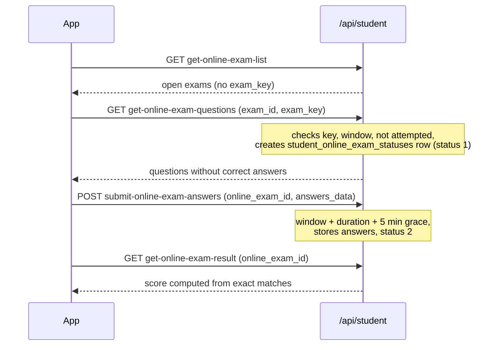
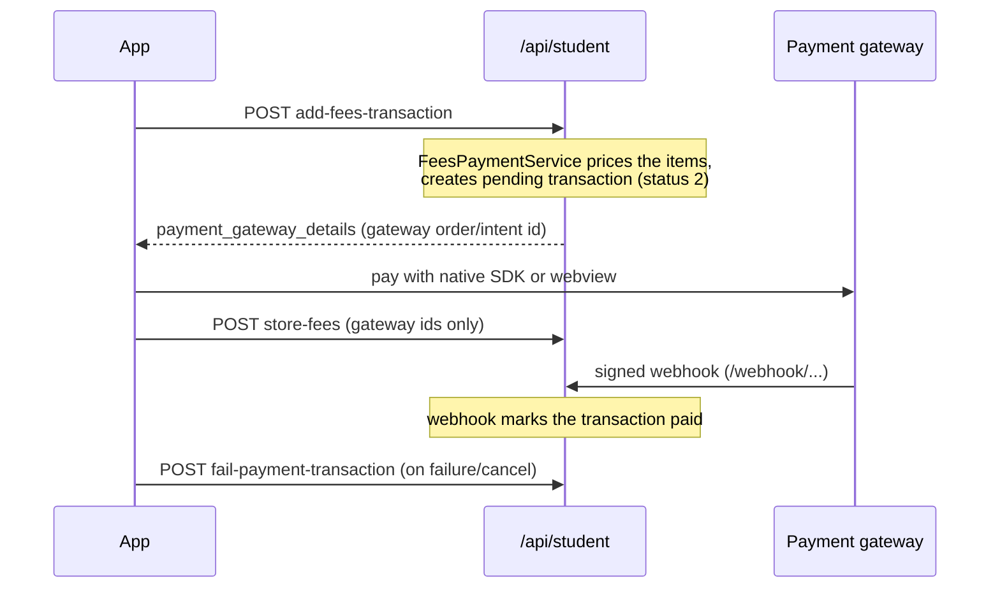

This page documents every endpoint under `/api/student/`, served by the controllers in [`Api/Student/`](https://github.com/ShawnDaPrawn/Eschool/tree/main/admin-panel/app/Http/Controllers/Api/Student), one per area (plus one route handled by `Parent\FeesController`). For each endpoint it lists the method and path, the request parameters from the validators, the main response fields, what data the student is allowed to see, and side effects. Shared conventions (envelope, error codes, headers, rate limits) are on [API-Overview](API-Overview); the student/parent app that calls these endpoints is described on [Student-Parent-App](Student-Parent-App).

## Common behaviour

| Topic | Rule |
| --- | --- |
| Middleware | `login` and `forgot-password` are public with `throttle:login`. Every other route requires `auth:sanctum`, `role:Student` and `student.session.active` (`EnsureStudentSessionIsActive`): the user must have role Student, `users.status = 1`, a `students` row, and a `student_sessions` row for the current session year whose `status` is not 0. See [API-Overview](API-Overview#middleware-reference) for the failure responses. |
| Current session year | `getSettings('session_year')['session_year']`. Most endpoints work only on this year; a few accept a `session_year_id` override (assignments, exam marks, online exam results, reports, leave list, transactions). |
| Class section | Taken from the student's `student_sessions` row for the session year (not `students.class_section_id`), except where noted (`class-subjects`, `select-subjects`, parts of `announcements`). |
| Student's subjects | `Students::subjects()`: the class's core subjects for the session (and current semester when the class uses semesters) plus the elective subjects the student picked (`student_subjects`). The private helper `studentSubjectIds()` merges both lists; many queries filter on it. |
| Semesters | When the class has semesters for the session (`ClassSessionConfig::classHasSemester()`), lists are filtered to the current semester (`Semester::current`, computed from today's date). |
| Request format | `GET` parameters in the query string, `POST` as form fields. Arrays use `name[0][field]` notation. |
| Response | `ResponseService` envelope: `{error, message, data, code}`; some endpoints put extra keys at the top level (noted below). |

Tests for the scoping rules are in [`tests/Feature/StudentApiSecurityTest.php`](https://github.com/ShawnDaPrawn/Eschool/blob/main/admin-panel/tests/Feature/StudentApiSecurityTest.php) and [`tests/Feature/AccessControlTest.php`](https://github.com/ShawnDaPrawn/Eschool/blob/main/admin-panel/tests/Feature/AccessControlTest.php).

## Endpoint index

| Feature | Method | Path | Method in controller |
| --- | --- | --- | --- |
| [Auth and profile](#auth-and-profile) | POST | `student/login` | `login` |
| | POST | `student/forgot-password` | `forgotPassword` |
| | GET | `student/get-profile-data` | `getProfileDetails` |
| | GET | `student/parent-details` | `getParentDetails` |
| [Dashboard](#dashboard) | GET | `student/dashboard` | `dashboard` |
| [Subjects](#subjects) | GET | `student/subjects` | `subjects` |
| | GET | `student/class-subjects` | `classSubjects` |
| | POST | `student/select-subjects` | `selectSubjects` |
| [Timetable](#timetable) | GET | `student/timetable` | `getTimetable` |
| [Lessons and study material](#lessons-and-study-material) | GET | `student/lessons` | `getLessons` |
| | GET | `student/lesson-topics` | `getLessonTopics` |
| [Assignments](#assignments) | GET | `student/assignments` | `getAssignments` |
| | POST | `student/submit-assignment` | `submitAssignment` |
| | POST | `student/delete-assignment-submission` | `deleteAssignmentSubmission` |
| | GET | `student/assignment-report` | `assignmentReport` |
| [Attendance](#attendance) | GET | `student/attendance` | `getAttendance` |
| | GET | `student/attendance-report` | `attendanceReport` |
| [Announcements](#announcements) | GET | `student/announcements` | `getAnnouncements` |
| [Exams and results](#exams-and-results) | GET | `student/get-exam-list` | `getExamList` |
| | GET | `student/get-exam-details` | `getExamDetails` |
| | GET | `student/exam-marks` | `getExamMarks` |
| | GET | `student/offline-exam-report` | `offlineExamReport` |
| [Online exams](#online-exams) | GET | `student/get-online-exam-list` | `getOnlineExamList` |
| | GET | `student/get-online-exam-questions` | `getOnlineExamQuestions` |
| | POST | `student/submit-online-exam-answers` | `submitOnlineExamAnswers` |
| | GET | `student/get-online-exam-result-list` | `getOnlineExamResultList` |
| | GET | `student/get-online-exam-result` | `getOnlineExamResult` |
| | GET | `student/online-exam-report` | `onlineExamReport` |
| [Fees and payments](#fees-and-payments) | GET | `student/fees-details` | `getFeesDetails` |
| | POST | `student/add-fees-transaction` | `storeFeesTransaction` |
| | POST | `student/store-fees` | `storeFees` |
| | POST | `student/get-payment-status` | `Parent\Fees@getPaymentStatus` |
| | POST | `student/fail-payment-transaction` | `failPaymentTransactionStatus` |
| | GET | `student/fees-transactions-list` | `getFeesPaymentTransactions` |
| | GET | `student/fees-paid-list` | `feesPaidList` |
| | GET | `student/fees-paid-receipt-pdf` | `feesPaidReceiptPDF` |
| | GET | `student/fees-report` | `getFeesReport` |
| | GET | `student/send-fee-notification` | `sendFeeNotification` |
| [Notifications](#notifications) | GET | `student/get-notification` | `getNotifications` |
| [Chat](#chat) | GET | `student/get-user-list` | `getChatUserList` |
| | POST | `student/send-message` | `sendMessage` |
| | POST | `student/get-user-message` | `getUserChatMessage` |
| | POST | `student/read-all-message` | `readAllMessages` |
| [Leave](#leave) | POST | `student/apply-leave` | `applyLeave` |
| | POST | `student/get-leave-list` | `getMyLeave` |
| | POST | `student/delete-leave` | `deleteLeave` |
| | GET | `student/leave-report` | `leaveReport` |
| [Documents](#documents-id-card-and-academic-calendar) | GET | `student/id-card-pdf` | `getIdCardPdf` |
| | GET | `student/academic-calendar-pdf` | `getAcademicCalendarPdf` |

The student app also calls the general endpoints (`settings`, `sliders`, `holidays`, `get-events-list`, `get-events-details`, `get-session-year`, `get-semesters`, `get-gallery-*`, `logout`, `change-password`); they are documented on [API-Overview](API-Overview#general-endpoints-apicontroller).

## Auth and profile

### Login

`POST /api/student/login` — public, `throttle:login`.

| Field | Type | Required | Notes |
| --- | --- | --- | --- |
| `gr_number` | string | yes | GR/admission number. It is checked against `users.email`: `Student\StudentController` stores the admission number in `users.email` for student accounts. |
| `password` | string | yes | The initial password, and the one set by a staff reset, is the date of birth as `ddmmyyyy` (see [forgot-password](#forgot-password)). |
| `fcm_id` | string | no | Saved to `users.fcm_id` for push notifications. |
| `device_type` | string | no | Saved to `users.device_type`. |

Checks, in order: validator (failure: code `102`), `Auth::attempt`, role `Student` and a `students` row (code `101` otherwise), `users.status = 1`, a `student_sessions` row for the current year, and that row's `status != 0`. Only then is a Sanctum token created (since `839c9eb`), so a refused login never hands out a token.

Response: `data` is the user model, with `student` loaded, flattened by `flattenMyModel()` into one object. Nested keys overwrite outer ones, so `id` is `students.id` and `user_id` is `users.id`. Notable fields:

| Field | Source |
| --- | --- |
| `id`, `user_id`, `admission_no`, `roll_number`, `father_id`, `mother_id`, `guardian_id`, `admission_date`, `blood_group`, `height`, `weight`, `is_new_admission`, ... | `students` row |
| `first_name`, `last_name`, `email`, `mobile`, `image`, `dob`, `gender`, `current_address`, `permanent_address`, `full_name`, ... | `users` row (password and timestamps are hidden) |
| `class_id`, `class_section_id` | overridden from the current `student_sessions` row |
| `class_section_name` | `"<class> <section>"` plus the stream name when the class has one |
| `medium_name`, `category_name` | class medium and student category |
| `shift_id`, `shift` | the class's shift (`shift` is the `shifts` row object) |
| `is_semester_on_in_class` | whether the class uses semesters this session |
| `is_fee_payment_due` | 1 when `compulsory_fee_payment_mode` is 1, the compulsory fees are not fully paid and the due date has passed (`session_years.fee_due_date`, or with installments the first unpaid installment's due date). When `session_years.free_app_use_date` is set, nothing is due before that date; when it is not set and the student has no `fees_paids` row yet (no installments), the flag stays 0. The app uses it to lock features until fees are paid. |
| `dynamic_fields` | the student's custom form fields as a key/value object, or `null` |

The token is the top-level `token` key; `code` is 200.

### Forgot password

`POST /api/student/forgot-password` — public, `throttle:login`.

| Field | Type | Required |
| --- | --- | --- |
| `gr_no` | string | yes (matched against `students.admission_no`) |
| `dob` | date | yes (matched against `users.dob`) |

When both match, the user gets `users.reset_request = 1`. Nothing is emailed: staff see the request in the admin panel's student reset-password list (permission `student-reset-password`), and resetting sets the password to the date of birth in `dmY` format (`Student\PasswordController::change_password`). The response is always `Request Send Successfully`, matched or not (since `839c9eb`), so the endpoint cannot be used to test GR numbers and birth dates.

### Profile

`GET /api/student/get-profile-data` — no parameters.

Returns the same flattened object as login (without a token), with the same `is_fee_payment_due` calculation and type fixes (`is_new_admission` as int, `height`/`weight` as strings). If the account or session is inactive it returns `error: false` with an explanatory `message` and `data: null`. Note: in compulsory-fee mode, after the free-use date, without installments, the code assigns to an undefined `$child` variable, so that branch ends in `error_occurred` (code `103`) instead of a profile.

### Parent details

`GET /api/student/parent-details` — no parameters.

Returns the student's own `father`, `mother` and `guardian` (`parents` rows), each with `dynamic_fields`. The keys returned depend on which exist: all three when all three exist; `father` and `mother` when both exist; otherwise only `guardian` (an empty object if there is none). So a student with only a father, or a father and a guardian, gets only `guardian`. The dynamic-field array is not reset between parents, so later parents also carry earlier parents' custom fields.

## Dashboard

`GET /api/student/dashboard` — no parameters. `data` is an object:

| Key | Content |
| --- | --- |
| `sliders` | `sliders` with `type` 1 (app) or 3 (both) |
| `subjects` | `Students::subjects()`: `core_subject` list and `elective_subject` (`null` when none) |
| `announcements` | latest 3 noticeboard announcements (`table_type = ''`) of the session, with `file` |
| `assignments` | next 2 assignments of the student's class section and subjects with `due_date` after now and no submission by the student (current semester when applicable), with `subject` and `file` |
| `timetables` | today's periods (`day_name` = today) for the student's subjects, as `TimetableCollection` rows (see [Timetable](#timetable)) |
| `exams` | from the first 10 `exams` rows (the limit is applied before any class filter), those not yet completed for the student's class: `id`, `name`, `description`, `publish`, `session_year`, `exam_starting_date`, `exam_ending_date`, `exam_status` (`"0"` upcoming, `"1"` ongoing), `exam_timetable` (today and later papers for the student's subjects) |
| `events` | next 3 events by `start_date` (start or end today or later), with `has_day_schedule` |
| `gallery` | `GalleryService::getGallery(5)`: `{albums, videos}` or `null` |

## Subjects

### `GET /api/student/subjects`

No parameters. Returns `{core_subject: [...], elective_subject: [...] | null}` from `Students::subjects()`. Core entries are class-subject rows; elective entries are `student_subjects` rows (`subject_id`, `semester_id`, `subject`).

### `GET /api/student/class-subjects`

No parameters. Returns `{core_subject, elective_subject_group}` from `Students::classSubjects()`: the class's core subjects and its elective groups with `electiveSubjects.subject`, for the session (and current semester). Uses `students.class_section_id`. The app shows this list when the student has to pick electives.

### `POST /api/student/select-subjects`

| Field | Type | Required |
| --- | --- | --- |
| `subject_group` | array | yes |
| `subject_group.*.id` | integer | yes, an `elective_subject_groups.id` |
| `subject_group.*.subject_id` | array of integers | yes |

Rules (added in `839c9eb`): each group must be one of the class's elective groups for the session (and current semester when the class uses semesters), listed once; each subject must belong to that group, without duplicates; and the student's existing picks in the group plus the new ones may not exceed `total_selectable_subjects` (`You can select only N subjects in this group.`). Failures use `validationError` (code `null`).

Effect: inserts `student_subjects` rows (`student_id`, `subject_id`, `semester_id`, `class_section_id`, `session_year_id`) for subjects not already selected. `data` is the list of inserted rows. There is no endpoint to unselect.

## Timetable

`GET /api/student/timetable` — no parameters.

Returns the whole week for the student's class section and session (current semester when applicable), only for periods whose subject teacher teaches one of the student's subjects, ordered by `day` and `start_time`. Each row:

| Field | Content |
| --- | --- |
| `start_time`, `end_time`, `day`, `day_name` | period time and weekday |
| `link_name`, `live_class_url` | online class link set by the teacher (`teacher/update-timetable-link`) |
| `subject` | the subject object |
| `teacher_first_name`, `teacher_last_name` | the subject teacher |

## Lessons and study material

### `GET /api/student/lessons`

| Param | Type | Required |
| --- | --- | --- |
| `subject_id` | id | yes |
| `lesson_id` | numeric | no, returns only that lesson |

Lessons of the student's current class section for that subject (current semester when the class uses semesters), with `topic` and `file` (study material) relations.

### `GET /api/student/lesson-topics`

| Param | Type | Required |
| --- | --- | --- |
| `lesson_id` | numeric | yes |
| `topic_id` | numeric | no |

Topics of the lesson, with `lesson` and `file`, but only when the lesson belongs to the student's current class section (since `839c9eb`; another section's lesson returns an empty list). With semesters on, lessons of the current semester or with no semester are included. The `file` rows are the study material attached by teachers; the end-user view of lessons and topics is at https://shawndaprawn.github.io/Eschool/features/lessons-topics/ .

## Assignments

### `GET /api/student/assignments`

| Param | Type | Required | Notes |
| --- | --- | --- | --- |
| `assignment_id` | numeric | no | one assignment |
| `subject_id` | numeric | no | one subject |
| `is_submitted` | 0 or 1 | no | 1: only submitted by this student; 0: only not submitted |
| `session_year_id` | integer | no | default current session |
| `page` | integer | no | Laravel paginator, 15 per page |

Assignments of the student's class section in that session, for the student's subjects (current semester when applicable), newest first. Each has `file`, `subject` and `submission` (the student's own submission with its `file`, or `null`). Submission `status`: 0 pending review, 1 accepted, 2 rejected, 3 resubmitted.

### `POST /api/student/submit-assignment`

| Field | Type | Required |
| --- | --- | --- |
| `assignment_id` | numeric | yes |
| `subject_id` | numeric | no (ignored) |
| `text_submission` | string | required without `files` |
| `files` | array of files | required without `text_submission` |

Scoping: the assignment must be in the student's current class section, the current session and one of the student's subjects (since `839c9eb`; otherwise `Invalid assignment`, code `103`).

Behaviour:

- No earlier submission: creates an `assignment_submissions` row (status default, i.e. pending).
- Earlier submission rejected (`status = 2`) and the assignment allows resubmission (`assignments.resubmission`): sets `status = 3`, replaces the text, deletes the old files from the public disk and the `files` rows.
- Otherwise: `You already have submitted your assignment.`, code `104`.
- Files are stored on the `public` disk under `assignment/` as `files` rows (`type = 1`, polymorphic to the submission). Upload type checks are the global `RejectDangerousUploads` rules only.
- Creates a `notifications` row (`type = assignment_submission`, `send_to = 2`) with `user_notifications` for the subject teachers of that subject in the class section, and sends them a push (`sendSimpleNotification`).
- The assignment's due date is not checked on the server.

`data` is the submission with its `file` list.

### `POST /api/student/delete-assignment-submission`

| Field | Type | Required |
| --- | --- | --- |
| `assignment_submission_id` | numeric | yes |

Deletes the student's own submission and its files only while `status = 0` (not yet reviewed). Otherwise `You can not delete assignment`, code `110`.

### `GET /api/student/assignment-report`

| Param | Type | Required |
| --- | --- | --- |
| `session_year_id` | integer | yes |
| `subject_id` | integer | no |

`AssignmentReportService::getStatistics()`: `average_completion_rate`, `total_assignments`, `pass_count`, `pending_count`, `missed_count`, `on_time_submission`, `late_submission`. Code `113` when the student has no session in that year.

## Attendance

### `GET /api/student/attendance`

| Param | Type | Required |
| --- | --- | --- |
| `month` | numeric | no |
| `year` | numeric | no |

`Attendance::monthlyReport()` for the student and the current session, optionally limited to a month/year:

| Field | Meaning |
| --- | --- |
| `total_present`, `total_absent` | full days plus 0.5 for each half-day absence |
| `full_day_present`, `full_day_absent`, `first_half_absent`, `second_half_absent` | day counts |
| `attendance` | list of `{date, type}` with app-side `type`: 0 present or holiday, 1 absent, 2 first-half absent, 3 second-half absent |

Approved leaves (`leaves.status = 1`) override or fill in the recorded attendance for their dates.

### `GET /api/student/attendance-report`

| Param | Type | Required |
| --- | --- | --- |
| `session_year_id` | integer | yes |
| `month` | integer 1 to 12 | yes |

Same payload as above for that session and month. Code `113` if the student has no session in that year.

## Announcements

`GET /api/student/announcements`

| Param | Type | Required | Notes |
| --- | --- | --- | --- |
| `type` | `subject`, `noticeboard` or `class` | no | omit for everything visible |
| `subject_id` | numeric | when `type=subject` | |
| `page` | integer | no | Laravel paginator, 15 per page |

Announcements of the current session with `file`, newest first:

| `type` | Returned |
| --- | --- |
| omitted | school-wide (`table_type = ''`), the student's class (`App\Models\ClassSchool`), the student's class section (`App\Models\ClassSection`) and the subject-teacher rows of the student's own subjects in their section (`App\Models\SubjectTeacher`). This filter was added in `839c9eb`; before it, every announcement of the session was returned. |
| `noticeboard` | school-wide (`table_type = ''`) plus the student's class (`App\Models\ClassSchool`) and class section (`App\Models\ClassSection`). Until `c38b7da` only `table_type = ''`, so class and class-section announcements never reached the app's notice board. |
| `class` | only announcements for the student's class (`ClassSchool`) |
| `subject` | announcements for the subject-teacher rows of `subject_id` in the student's class section; current semester when the class uses semesters |

The `Invalid Subject ID` branch (code `106`) cannot trigger, because it tests `empty()` on a collection; an unknown subject simply returns an empty page.

## Exams and results

Offline (written) exams are set up in the admin panel; see [Exams-and-Grading](Exams-and-Grading).

### `GET /api/student/get-exam-list`

| Param | Type | Required | Notes |
| --- | --- | --- | --- |
| `status` | 0, 1, 2 or 3 | no | 0 or omitted: all; 1: upcoming; 2: ongoing; 3: completed |
| `get_timetable` | 0 or 1 | no | 1 adds `exam_timetable` |
| `semester_id` | numeric, must exist | no | default: current semester of the session |

Exams assigned to the student's class (`exam_classes`) with at least one paper in the student's subjects (semester-filtered when the class uses semesters). Each item: `id`, `name`, `description`, `publish`, `session_year`, `exam_starting_date`, `exam_ending_date` (min/max paper date for the class), `exam_status` (`"0"` upcoming, `"1"` ongoing, `"2"` completed). With `get_timetable=1`, `exam_timetable` is the exam's full `timetable` relation with `subject`, which is not filtered to the student's class or subjects. Each row has `start_time`/`end_time` and the copies `starting_time`/`ending_time` (appended by the `ExamTimetable` model).

### `GET /api/student/get-exam-details`

| Param | Type | Required |
| --- | --- | --- |
| `exam_id` | numeric | yes |

The exam's papers for the student's class and subjects, by date: `id`, `total_marks`, `passing_marks`, `date`, `starting_time`, `ending_time`, `subject {id, name, bg_color, image, type}`. Unknown exam: code `103`.

### `GET /api/student/exam-marks`

| Param | Type | Required | Notes |
| --- | --- | --- | --- |
| `session_year_id` | integer | no | default current session |
| `semester_id` | numeric, must exist | no | must belong to the session; default current semester when no `session_year_id` is given |

Reads the student's own `exam_results` rows. These rows exist only while an exam is published (publishing in `Exam\PublishController` creates them, unpublishing deletes them), so unpublished results never appear. Each item:

- `result`: `result_id`, `exam_id`, `exam_name`, `class_name`, `student_name`, `exam_date` (first paper), `total_marks`, `obtained_marks`, `percentage`, `grade`, `session_year`
- `exam_marks`: per subject `marks_id`, `subject_name`, `subject_type`, `total_marks`, `passing_marks`, `obtained_marks`, `teacher_review`, `grade`

### `GET /api/student/offline-exam-report`

| Param | Type | Required |
| --- | --- | --- |
| `session_year_id` | integer | yes |

`ExamReportService::getOfflineStatistics()`: `average_percentage`, `avg_grade`, `total_exams`, `pass_percentage`, `pass_count`, `fail_count`, `missed_count`, `best_exam_name`, `best_exam_percentage`, `worst_exam_name`, `worst_exam_percentage`. Code `113` without a session in that year.

## Online exams

Online exams are MCQ exams created by staff or teachers for a class section or a whole class. Scoring is in [`OnlineExamScoringService`](https://github.com/ShawnDaPrawn/Eschool/blob/main/admin-panel/app/Services/OnlineExamScoringService.php); see [Exams-and-Grading](Exams-and-Grading). Two ids are easy to confuse: the `id` of a question in this API, and `online_exam_student_answers.question_id`, are `online_exam_question_choices.id` (the question as placed in this exam), not `online_exam_questions.id`.

An exam "the student may take" (`findStudentOnlineExam()`) is one of the current session, in one of the student's subjects, assigned to the student's class section (`model_type = App\Models\ClassSection`) or class (`App\Models\ClassSchool`), and in the current semester when the class uses semesters.

### `GET /api/student/get-online-exam-list`

| Param | Type | Required |
| --- | --- | --- |
| `subject_id` | numeric | no |
| `page` | integer | no (15 per page) |

Exams of the student's class section or class, in the student's subjects (or the given subject), with `end_date` not yet passed and no attempt by this student; class-section exams must have at least one question. `data`: `current_page`, `data`, `current_date` (now, UTC), `from`, `last_page`, `per_page`, `to`, `total`. Each exam: `exam_id`, `class {id, name}`, `subject {id, name: "<name> - <type>"}`, `title`, `duration` (minutes), `start_date`, `end_date`, `total_marks`. The `exam_key` is not sent (since `839c9eb`); the teacher gives it to students.

If an exam on the page has no questions (possible for class-wide exams, which skip the question check), the code resets the collected list to empty, which drops the exams before it on that page.

### `GET /api/student/get-online-exam-questions`

| Param | Type | Required |
| --- | --- | --- |
| `exam_id` | numeric | yes |
| `exam_key` | scalar | yes |

Checks: the exam must be one the student may take and the key must match (`hash_equals`), else `Invalid Exam Key`, code `103`; no earlier `student_online_exam_statuses` row (else `student_already_attempted_exam`, code `105`); `start_date` reached (else `exam_not_started_yet`, code `106`); `end_date` not passed (`This exam has ended.`).

Side effect: creates the `student_online_exam_statuses` row with `status = 1`. This starts the attempt: a second call is refused with `105`, and the duration timer counts from this row's `created_at`.

Response: `data` is the question list, plus top-level `total_questions` and `total_marks`. Each question: `id` (choice id), `question`, `question_type`, `options [{id, option}]`, `answers_count`, `answers` (placeholders `{id: 0, option_id: 0, answer: ""}`, one per correct answer, kept for older app builds), `marks`, `image`, `note`. The correct answers are never sent (since `839c9eb`).

### `POST /api/student/submit-online-exam-answers`

| Field | Type | Required |
| --- | --- | --- |
| `online_exam_id` | numeric | yes |
| `answers_data` | array | yes |
| `answers_data.*.question_id` | numeric (choice id) | yes |
| `answers_data.*.option_id` | array of option ids | no (0 or empty means unanswered) |

Checks (all added or tightened in `839c9eb`):

- The exam must be one the student may take (`invalid_online_exam_id`, code `103`).
- Now must be between `start_date` and `end_date` plus 5 minutes (`ONLINE_EXAM_GRACE_MINUTES`).
- `OnlineExamScoringService::validateSubmission()`: every `question_id` must be a choice of this exam, sent once; every option must belong to that question, without repeats.
- Inside a transaction with a row lock on the status row: the questions must have been fetched (`Start the exam before submitting answers.`), the exam not already submitted (`Answers already submitted`), and, when `duration > 0`, now must be within the status row's `created_at` plus duration plus 5 minutes (`The time for this exam is over.`).

Effect: one `online_exam_student_answers` row per picked option (`question_id` = choice id, `option_id`, `submitted_date`), and the status row set to `2`. Success message `data_store_successfully`.

### `GET /api/student/get-online-exam-result-list`

| Param | Type | Required |
| --- | --- | --- |
| `session_year_id` | integer | no |
| `subject_id` | numeric | no |
| `page` | integer | no (10 per page) |

Exams of the student's class section or class that the student started (they have a `student_online_exam_statuses` row). Each: `online_exam_id`, `subject {id, name}`, `title`, `obtained_marks`, `total_marks`, `exam_submitted_date` (falls back to the exam end date). Marks count a question only when the picked options are exactly the correct set; picking every option scores nothing (fixed in `839c9eb` at all six scoring sites).

### `GET /api/student/get-online-exam-result`

| Param | Type | Required |
| --- | --- | --- |
| `online_exam_id` | numeric | yes |

`data`: `total_questions`, `correct_answers {total_questions, question_data [{question_id, marks}]}`, `in_correct_answers {...}` (wrong and unanswered), `total_obtained_marks`, `total_marks`. Always computed from the caller's own answers; the exam id itself is not checked against the student's class.

### `GET /api/student/online-exam-report`

| Param | Type | Required |
| --- | --- | --- |
| `session_year_id` | integer | yes |
| `subject_id` | integer | no |

`ExamReportService::getOnlineStatistics()`: `average_percentage`, `total_exams`, `attempted_percentage`, `attempted_count`, `missed_count`, `best_exam_name`, `best_exam_percentage`, `worst_exam_name`, `worst_exam_percentage`. Code `113` without a session in that year.

## Fees and payments

The fee model (compulsory fees, installments, optional fees, due charges) and the webhook side are on [Payments](Payments). Admin setup: https://shawndaprawn.github.io/Eschool/admin-panel/fee-payment/ . Values used below: `type_of_fee` 0 = compulsory in full, 1 = installments, 2 = optional fees; `payment_method` 1 = Razorpay, 2 = Stripe, 3 = Paystack, 4 = Flutterwave; `payment_transactions.payment_status` 0 = failed, 1 = paid, 2 = pending.

### `GET /api/student/fees-details`

No parameters. `data` is `null`; the payload is at the top level:

| Key | Content |
| --- | --- |
| `compulsory_fees_data` | per compulsory fee type: `id` (fees type id), `name`, `amount`, `is_paid`, `paid_on`; plus a `Due Charges` entry when due charges were paid |
| `optional_fees_data` | per optional fee type: `id`, `name`, `amount`, `is_paid`, `paid_date` |
| `installment_data` | per installment of the session: `id`, `name`, `due_date`, `due_charges` (percentage), `is_paid`, `paid_date`, `paid_due_charges` |
| `compulsory_fees_total`, `optional_fees_total` | sums of `fees_classes.amount` for the class and session |
| `compulsory_due_date`, `compulsory_due_charges` | `session_years.fee_due_date` and `fee_due_charges` (percentage) |
| `current_date` | now (UTC) |
| `is_fee_pending` | 1 when the latest transaction is still pending |

Side effect: if the latest transaction has been pending for more than an hour it is set to failed (`payment_status = 0`). Code `113` without a current session.

### `POST /api/student/add-fees-transaction`

| Field | Type | Required | Notes |
| --- | --- | --- | --- |
| `payment_method` | 1, 2, 3 or 4 | yes | the gateway must be enabled (`<gateway>_status` setting), else `The selected payment method is not available.` |
| `amount` | numeric | yes | the total the app shows; must equal the server's total within 0.02 |
| `type_of_fee` | 0, 1 or 2 | yes | |
| `installment_data` | array of `{id, ...}` | for type 1 | `installment_fees.id` values; other keys are ignored |
| `optional_fees_data` | array of `{id, ...}` | for type 2 | `fees_types.id` values of the class's optional fees |
| `is_fully_paid` | 0 or 1 | no | still sent by the app; ignored |

Since `839c9eb` the server prices the payment itself in `FeesPaymentService::prepare()`: it refuses compulsory payments that are already paid or already started as installments, unknown or already-paid installments or optional fees, duplicates and empty selections; it computes the base amounts and due charges (accepting either side of the due date when the app may be in another time zone) and rejects a mismatching `amount` (`The fee amount has changed. Please refresh and try again.`). All of these come back as `validationError` (code `null`).

Effect (in one DB transaction): a pending `payment_transactions` row (`mode = 2` online, `payment_status = 2`, `parent_id` = father, else guardian), `fees_choiceables` / `paid_installment_fees` rows with `status = 0` linked by `payment_transaction_id`, and a gateway order or payment intent for the server total. The gateway id is saved as `payment_transactions.order_id`.

Response: top-level `payment_gateway_details`: `id`, `amount`, `currency`, `metadata`, `status` (`pending`/`succeed`/`failed`), `payment_gateway_response` (the gateway object), `payment_transaction_id`.

The server does not check the `is_student_can_pay_fees` or `online_payment` settings; the app reads them from `settings` to decide whether to show the pay button.

### `POST /api/student/store-fees`

| Field | Type | Required |
| --- | --- | --- |
| `transaction_id` | id | yes (`payment_transactions.id`) |
| `payment_id` | string | no |
| `payment_signature` | string | no |

Only the student's own transaction while it is pending (else `Invalid transaction`, code `103`). It only stores `payment_id` / `payment_signature` when they are still empty; it does not mark anything paid. Payments are recorded only by the signed gateway webhooks (see [Payments](Payments#webhooks)). Before `839c9eb` this endpoint could be used to mark fees paid.

### `POST /api/student/get-payment-status`

Routed to `Parent\FeesController::getPaymentStatus` (an unrouted copy of it in the student controller was removed).

| Field | Type | Required |
| --- | --- | --- |
| `payment_intent_id` | string matching `^pi_[A-Za-z0-9_]+$`, max 191 | yes |

The id must be the `order_id` of one of the student's own transactions (`No Payment Transaction Found`, code `103`) and Stripe must be enabled. `data` is Stripe's PaymentIntent `status` (for example `succeeded`), fetched from Stripe.

### `POST /api/student/fail-payment-transaction`

| Field | Type | Required |
| --- | --- | --- |
| `payment_transaction_id` | id | expected (no validator; a missing id gives `Invalid transaction`) |

Sets the student's own pending transaction to failed with a conditional update, so a webhook that marked it paid in the meantime wins (`Invalid transaction`, code `103`, otherwise). Creates a `Payment Failed` notification (`user_notifications` row for the student) and a push of type `online`.

### `GET /api/student/fees-transactions-list`

| Param | Type | Required |
| --- | --- | --- |
| `session_year_id` | id | no |
| `page` | integer | no (15 per page) |

The student's `payment_transactions` with `session_year` and `student.user`, newest first. `data`: `current_page`, `transaction-data`, `from`, `last_page`, `per_page`, `to`, `total`. Side effect: pending transactions older than an hour on the page are set to failed.

### `GET /api/student/fees-paid-list`

No parameters. The student's `fees_paids` rows for the current session with `session_year` and `class.medium`.

### `GET /api/student/fees-paid-receipt-pdf`

No parameters. Renders `resources/views/fees/fees_receipt.blade.php` with DomPDF and returns it base64-encoded in the top-level `pdf` key. It uses the first `fees_paids` row of the student (any session; `No Fees Paid Found`, code `103`, if none), the `logo2` setting (`schoolSetting('logo2')`, a path on the public disk), `config('app.name')` (the `school_name` setting when set, applied by `SettingsConfigService`; otherwise `APP_NAME`) and the `school_address` setting. Before `e13ac7d` it read `env('LOGO2')` and `env('APP_NAME')`, which return `null` once the config is cached.

### `GET /api/student/fees-report`

| Param | Type | Required |
| --- | --- | --- |
| `session_year_id` | integer | yes |

`FeesReportService::getStatistics()`: `total_fee_payable`, `total_paid`, `total_pending`, `last_payment_date`, `next_due_date`, `instalments` (`total`, `completed`, `pending`). Code `113` without a session in that year.

### `GET /api/student/send-fee-notification`

No parameters (a `GET` with side effects). Sends the push "Fees are dues" (`<name> wants to keep learning! Please pay the overdue fees as soon as possible.`, type `fees-due`, payload = student id) to the student's father, mother and guardian accounts, and stores a `notifications` row (`send_to = 2`) without `user_notifications` rows, so it does not appear in the parents' in-app notification list. There is no rate limit beyond `throttle:api`.

## Notifications

`GET /api/student/get-notification` — `page` optional (Laravel paginator, 15 per page).

Notifications of the current session that are linked to the user through `user_notifications`, plus those with `send_to` 1 (sent to everyone) or 4, newest first. See [Notifications](Notifications) for how they are created and pushed.

## Chat

Chat is between a student and their teachers only. The allowed teachers (`chatTeacherIds()`) are the class teachers of the student's current class section and the subject teachers of the student's subjects in that section, for the session and current semester. See [Chat](Chat) for storage and cleanup, and https://shawndaprawn.github.io/Eschool/admin-panel/chat-settings/ for the limits.

### `GET /api/student/get-user-list`

| Param | Type | Required | Notes |
| --- | --- | --- | --- |
| `search` | string | no | first or last name contains |
| `offset` | integer | no | default 0 |
| `limit` | integer | no | when absent or not positive, all teachers are returned |

`data`: `items`, `total_items`, `total_unread_users`. Each item: `id` (teacher id), `user_id`, `first_name`, `last_name`, `email`, `qualification`, `image`, `mobile_no`, `subjects [{id, name}]`, `last_message` (`id`, `body`, `date`, `file`, and `files`: the attachments' absolute URLs) and `unread_message`, sorted by the last message date.

### `POST /api/student/send-message`

| Field | Type | Required | Notes |
| --- | --- | --- | --- |
| `receiver_id` | integer | yes | the teacher's `users.id`; must be one of the allowed teachers (`You can not send a message to this user`, code `103`) |
| `message` | string | required without `file` | the length limit (`max_characters_in_text_message`) is not enforced on the server |
| `file` | array of files | no | at most `max_files_or_images_in_one_message` files (default 10), each at most `max_file_size_in_bytes` MB (default 10) |

Effect: a `chat_messages` row (`modal_type = 'App/Models/User'`, `modal_id` = receiver), one `chat_files` row per file stored at `chatfile/<32 random chars>/<sanitised original name>` on the public disk (since `839c9eb`, so names cannot collide or escape the folder), a `read_messages` row for the receiver if missing, and a push of type `chat` to the receiver carrying the student's info (`id`, `user_id`, names, `image`, `roll_no`, `admission_no`, `class_name`, `subjects`, `last_message`, `isParent: 0`, `unread_message`). `data`: `{id, sender_id, body, date, files: [absolute URLs]}`.

### `POST /api/student/get-user-message`

| Field | Type | Required |
| --- | --- | --- |
| `user_id` | integer | expected (the other user) |
| `offset` | integer | no, default 0 |
| `limit` | integer | no, 1 to 100, default 100 |

Messages between the caller and `user_id`, newest first. `data`: `items [{id, sender_id, body, date, files: [absolute URLs]}]`, `total_items`.

### `POST /api/student/read-all-message`

| Field | Type | Required |
| --- | --- | --- |
| `user_id` | integer | expected (the teacher's user id) |

Sets the caller's `read_messages.last_read_message_id` for that teacher to the teacher's latest message. If the teacher has never sent a message but a `read_messages` row exists, the code reads an undefined variable and returns `error_occurred`.

## Leave

Leave requests from students are approved by class teachers (`teacher/student-leave-status-update`) or staff. `leaves.status` as the code uses it: 0 pending, 1 approved, 2 rejected (the column comment in `2024_05_29_172900_create_all_leave_manage_table.php` says 3 for rejected, but validators and `LeaveReportService` use 2). See https://shawndaprawn.github.io/Eschool/features/leave-management/ .

### `POST /api/student/apply-leave`

Only `reason`, `leave_details` and `files` are accepted; any other field is refused with `Unknown fields: ...`.

| Field | Type | Required | Notes |
| --- | --- | --- | --- |
| `reason` | string | yes | |
| `leave_details` | array | yes in practice | each item `{date: "YYYY-MM-DD", type}` where `type` is `Full`, `First Half` or `Second Half` |
| `files` | array of files | no | each JPEG, PNG, WebP, GIF, BMP, PDF, DOC or DOCX (`mimetypes:` rule) |

Effect: a `leaves` row (`user_id`, `reason`, `from_date` = earliest date, `to_date` = latest, `status = 0`, `session_year_id`), one `leave_details` row per day, `files` rows under `leave/` on the public disk, and a `Leave Alert` notification (`send_to = 3`) with `user_notifications` and a push (type `leave`) to the class teachers of the student's class section. Push errors are ignored. `data` is the `leaves` row. Dates are not checked against holidays or the session range.

### `POST /api/student/get-leave-list`

| Field | Type | Required |
| --- | --- | --- |
| `session_year_id` | integer | no, default current |
| `status` | 0, 1 or 2 | no |
| `month` | 1 to 12 | no (any detail day in that month) |

`data`: `taken_leaves` (approved days, half days count 0.5) and `leave_details` (the user's `leaves` with `leave_detail`, `file`, `full_leave`, `half_leave` and computed `days`), newest first.

### `POST /api/student/delete-leave`

| Field | Type | Required |
| --- | --- | --- |
| `leave_id` | integer | yes |

Deletes the caller's own leave (`Leave not found or unauthorized.` otherwise). There is no status check, so approved and rejected leaves can be deleted too. A missing `leave_id` returns `error_occurred` (code `103`) because `$request->validate()` runs inside the `try`.

### `GET /api/student/leave-report`

| Param | Type | Required |
| --- | --- | --- |
| `session_year_id` | integer | yes |

`LeaveReportService::getStatistics()`: `total_leaves`, `completed` (approved), `pending`, `rejected`. Code `113` without a session in that year.

## Documents: ID card and academic calendar

### `GET /api/student/id-card-pdf`

No parameters. `IdCardService::buildPdf([student id])`, base64 in the top-level `pdf` key. Fails with `error_occurred` when the `student_id_card_fields` setting has not been saved in the admin panel.

### `GET /api/student/academic-calendar-pdf`

No parameters. `AcademicCalendarService::generate([class id])` for the class of the student's current session: holidays, semester breaks, events and that class's exams, grouped by month, rendered with DomPDF and returned base64 in the top-level `pdf` key. The header uses `config('app.name')` and the `logo2` setting (since `e13ac7d`; previously `env()` values).

## Hardening history

| Commit | Change on the student API |
| --- | --- |
| `2de82e8` | Sanctum tokens expire after `SANCTUM_EXPIRATION` (30 days); expired tokens pruned daily. |
| `439395d` | Student routes require `role:Student`; `login` and `forgot-password` limited by `throttle:login`. |
| `839c9eb` | Login checks account and session before issuing a token; `student.session.active` refuses inactive and non-student accounts; forgot-password answers the same either way; password change signs out other devices; online exams: no answers or exam key sent, submissions limited to the student's own exam, window, duration and one attempt, exact-set scoring; elective selection limited to the class's groups and counts; lesson topics, announcements and assignment submissions limited to the student's class section and subjects; chat only to the student's teachers, with the chat-setting limits and safe file names; fee payments priced by the server, `store-fees` and `fail-payment-transaction` limited to the student's own pending transactions; chat message pages capped at 100. |

## Known quirks

- `get-profile-data` fails with `error_occurred` in compulsory-fee mode without installments after the free-use date (undefined `$child`).
- `parent-details` returns only `guardian` unless both father and mother exist.
- `announcements` never returns code `106` for an unknown subject.
- `get-exam-list` with `get_timetable=1` includes papers of other classes.
- `get-online-exam-list` can drop exams from a page when a class-wide exam has no questions.
- `fees-paid-receipt-pdf` always uses the student's first `fees_paids` row, whatever the session.
- `send-fee-notification` is a `GET` that sends pushes.
- `delete-leave` deletes leaves in any status.

## See also

- [API-Overview](API-Overview)
- [API-Parent](API-Parent)
- [Student-Parent-App](Student-Parent-App)
- [Payments](Payments)
- [Exams-and-Grading](Exams-and-Grading)
- [Chat](Chat)
- [Notifications](Notifications)
- [Security-Model](Security-Model)
