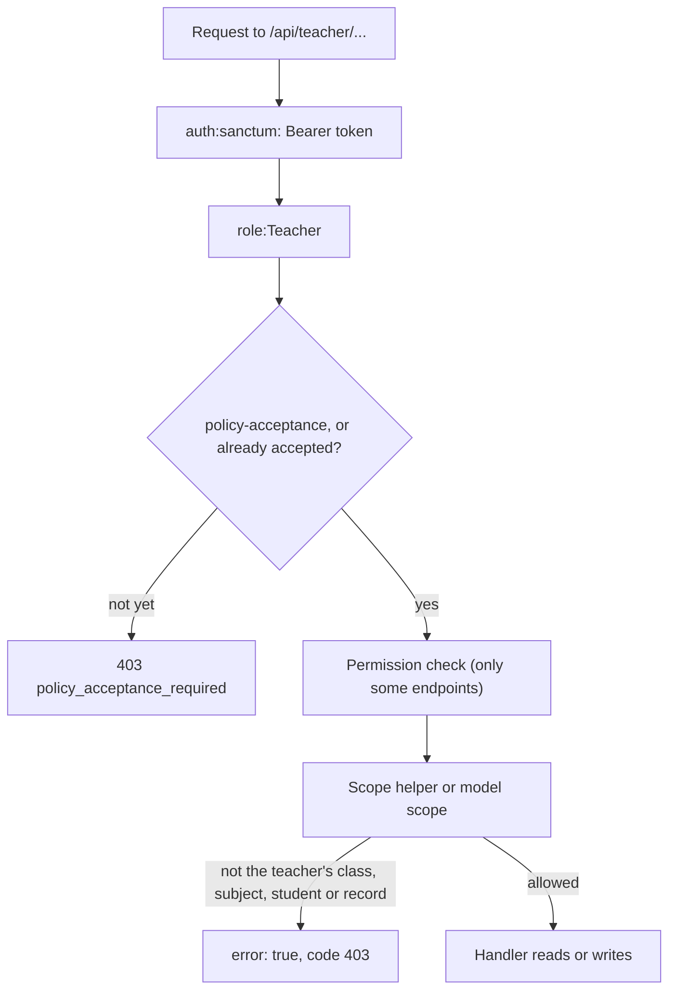

This page documents every endpoint under `/api/teacher/`, all served by the controllers in [`Api/Teacher/`](https://github.com/ShawnDaPrawn/Eschool/tree/main/admin-panel/app/Http/Controllers/Api/Teacher), one per area (auth, dashboard, classes, assignments, lessons, announcements, attendance, timetable, exams, chat, leaves, calendar, notifications) and used by the `e-school-teacher` Flutter app. It starts with how the controller decides which classes, subjects, students and records a teacher may touch, because that is the part most changes have to respect. The master route index for all API groups is on [API-Overview](API-Overview#master-route-index).

## How teacher scope is determined

A teacher is linked to classes through two tables. Nearly every scope check in the teacher API reads one or both of them.

| Table | Columns that matter | Meaning |
|---|---|---|
| `class_teachers` | `class_section_id`, `class_teacher_id` (a `teachers.id`), `session_year_id`, `semester_id` (nullable), soft deletes | The teacher is **class teacher** of that section |
| `subject_teachers` | `class_section_id`, `subject_id`, `teacher_id`, `session_year_id`, `semester_id` (nullable), soft deletes | The teacher is **subject teacher** of that subject in that section |

"Current session year" always means `getSettings('session_year')['session_year']`, the session year selected in the admin panel's settings. A `semester_id` of `NULL` on either table means "all semesters". When it runs on an install that has a current semester, the `2026_04_28_165603_semester_id_backfill` migration pins the current session year's `NULL` rows to semesters (subject teachers to the current semester, class teachers to every semester). See [Academic-Structure](Academic-Structure) for sessions, semesters and class sections.

### Controller helpers

These private methods hold the scope rules. The shared ones (`currentTeacher()` through `applySemesterFilter()`) are in the `Teacher\Concerns\TeacherAccess` trait that every `Teacher\` controller uses; `canManageFile()` is in `LessonController`, `canChatWith()` in `ChatController`, and `obtainedMarksOutOfRange()` in `ExamController`. They were added in commit `77fe8ed` ("Limit teacher API actions to the teacher's own classes and subjects"). Before that commit, most endpoints accepted any `class_section_id`, `student_id` or record id.

| Helper | Rule |
|---|---|
| `currentTeacher()` | Returns `Auth::user()->teacher`. A Teacher-role user without a `teachers` row is refused with `no_permission_message` and code 403, rather than continuing with `null`. |
| `currentSessionYearId()` | The current session year from settings. |
| `isClassTeacherOf($classSectionId, $sessionYearId = null)` | A `class_teachers` row exists for this teacher, section and session year (current by default). Semester is not checked. |
| `teachesSubject($classSectionId, $subjectId, $semesterId = null)` | A `subject_teachers` row exists for this teacher and this exact section and subject in the current session year. When `$semesterId` is given, the row's `semester_id` must equal it or be `NULL`. |
| `teacherClassSectionIds()` | Union of sections where the teacher is class teacher or subject teacher in the current session year. |
| `studentClassSectionIds($student, $sessionYearId = null)` | The student's `students.class_section_id` plus every `student_sessions.class_section_id` for the session year. |
| `teachesStudent($studentId)` | The student's sections (above) intersect `teacherClassSectionIds()`. Class teachers and subject teachers both pass. |
| `allStudentsInClassSection($studentIds, $classSectionId)` | Every id belongs to the section, either currently or through a `student_sessions` row for the current session year. Used so a teacher cannot write attendance or marks for students of another class. |
| `ownsLesson($lesson)` | `teachesSubject($lesson->class_section_id, $lesson->subject_id)`. |
| `ownsAnnouncement($announcement)` | `announcements.table_type` is `App\Models\SubjectTeacher` and the `table_id` row belongs to this teacher (any session year). |
| `canManageFile($file)` | Decided by what the `files` row is attached to (`modal_type`): own lesson, own lesson's topic, assignment visible through `Assignment::assignmentTeachers()`, own announcement, or a `Leave` whose `user_id` is the signed-in user. Anything else is refused. |
| `canChatWith($userId)` | The user has already sent this teacher a message, or is a student in one of `teacherClassSectionIds()` with a `student_sessions` row for the current session year, or is the father, mother or guardian of such a student. |
| `teacherTimetableQuery($teacher)` | `timetables` rows whose `subject_teacher_id` is one of the teacher's `subject_teachers` rows for the current semester (or `NULL` semester), in the current session year. |
| `getTeacherClassSections($teacher, $sessionYearId)` | Returns `[class teacher sections, other sections]` for the `classes` endpoint, filtered to the current semester when one is running. |
| `obtainedMarksOutOfRange($obtained, $total)` | Marks must be numeric and between 0 and the exam timetable's `total_marks`. |
| `applySemesterFilter($query, $classSectionId, $sessionYearId, $semesterId)` | Adds `where semester_id = ...` only when the class has semesters enabled (`ClassSessionConfig::classHasSemester`). |

### Model scopes

List and update queries also go through Eloquent scopes. Each scope returns every row for users who do not have the Teacher role, so the same scopes are used by admin pages.

| Scope | Rule for a Teacher |
|---|---|
| [`Assignment::scopeAssignmentTeachers`](https://github.com/ShawnDaPrawn/Eschool/blob/main/admin-panel/app/Models/Assignment.php) | A `subject_teachers` row for this teacher with the assignment's exact `class_section_id` and `subject_id`. If the class has semesters for the assignment's session year, the row's `semester_id` must equal the assignment's `semester_id`. No teacher record means no rows (`whereRaw('1 = 0')`). |
| [`AssignmentSubmission::scopeAssignmentSubmissionTeachers`](https://github.com/ShawnDaPrawn/Eschool/blob/main/admin-panel/app/Models/AssignmentSubmission.php) | The submission's assignment passes `assignmentTeachers()`. |
| [`Lesson::scopeLessonTeachers`](https://github.com/ShawnDaPrawn/Eschool/blob/main/admin-panel/app/Models/Lesson.php) | A non-deleted `subject_teachers` row with the lesson's exact `class_section_id` and `subject_id` pair (any session year). |
| [`LessonTopic::scopeLessonTopicTeachers`](https://github.com/ShawnDaPrawn/Eschool/blob/main/admin-panel/app/Models/LessonTopic.php) | The topic's lesson passes `lessonTeachers()`. |

Commit `a09dfe8` ("Match teacher scopes on exact class and subject pairs") changed the lesson, topic and submission scopes to match the section and subject as a pair. The old scopes used `whereIn(class_section_id)` and `whereIn(subject_id)` separately, so a teacher of Maths in 5A and Science in 5B could also see Science in 5A.

The [`CheckStudent`](https://github.com/ShawnDaPrawn/Eschool/blob/main/admin-panel/app/Http/Middleware/CheckStudent.php) middleware guards `get-student-result` and `get-student-marks`. It passes only when the student's current `students.class_section_id` is a section in any of the teacher's `class_teachers` rows (it does not filter by session year). Otherwise it returns `{"error": true, "message": "Invalid Student ID Passed.", "code": 105}`.

### Class teacher compared with subject teacher

| Action | Class teacher of the section | Subject teacher of the section and subject |
|---|---|---|
| `classes`, `dashboard` class lists | Listed under `class_teacher` | Listed under `other` / `other_classes` |
| `student-list` | Yes | No |
| `student-details`, `get-student-result-pdf` | Yes | Yes |
| `get-student-result`, `get-student-marks` | Yes (`CheckStudent`) | No |
| `get-attendance`, `submit-attendance` | Yes | No |
| `get-exam-list` | Yes | No. Only class-teacher classes are listed. |
| `get-exam-details` | Yes | Yes |
| `submit-exam-marks/subject` | Any subject | Own subject only |
| `submit-exam-marks/student` | All subjects | Own subjects only |
| `get-student-leave-list`, `student-leave-status-update` | Yes (approval also needs `student-leave-approve`) | No |
| Assignments, lessons, topics, announcements | Only through their own `subject_teachers` rows | Yes, for the exact pair |
| `update-timetable-link` | Only through their own `subject_teachers` rows | Own timetable entries |
| Chat | Students of the section and their parents | Same |
| `academic-calendar-pdf`, dashboard `upcoming_exams` | Yes | No. A teacher with no `class_teachers` row gets an error from the calendar. |

### Permissions

`policy-acceptance` runs under `auth:sanctum` and `role:Teacher` only. Every other route after `login` also runs `teacher.policy` ([`RequireParentPolicyAcceptance`](https://github.com/ShawnDaPrawn/Eschool/blob/main/admin-panel/app/Http/Middleware/RequireParentPolicyAcceptance.php)): HTTP 403, `code` `policy_acceptance_required`, until the teacher's first sign-in has accepted NavigateEd and, when the school had already written them, the school's privacy notice and terms. The same controller and rules as the parent app are described on [API-Parent](API-Parent#terms-a-parent-must-accept). Some handlers also check a Spatie permission with `ResponseService::noPermissionThenSendJson()`. The Teacher role's default permissions are seeded in [`InstallationSeeder.php`](https://github.com/ShawnDaPrawn/Eschool/blob/main/admin-panel/database/seeders/InstallationSeeder.php) and every one checked here is granted by default. A school admin can remove them from the role, which disables the endpoint. See [Roles-and-Permissions](Roles-and-Permissions).

| Permission | Endpoints |
|---|---|
| `assignment-list` | `get-assignment` |
| `assignment-create` | `create-assignment` |
| `assignment-edit` | `update-assignment` |
| `assignment-delete` | `delete-assignment` |
| `assignment-submission` | `get-assignment-submission`, `update-assignment-submission` |
| `lesson-list` / `lesson-create` / `lesson-edit` / `lesson-delete` | `get-lesson` / `create-lesson` / `update-lesson` / `delete-lesson` |
| `topic-list` / `topic-create` / `topic-edit` / `topic-delete` | `get-topic` / `create-topic` / `update-topic` / `delete-topic` |
| `announcement-list` / `announcement-create` / `announcement-edit` / `announcement-delete` | `get-announcement` / `send-announcement` / `update-announcement` / `delete-announcement` |
| `attendance-list` | `get-attendance` |
| `attendance-create` or `attendance-edit` | `submit-attendance` (`noAnyPermissionThenSendJson`) |
| `student-leave-approve` | `student-leave-status-update` (checked with `Auth::user()->can()`) |

Every other endpoint, including `update-file`, `delete-file`, exam marks and chat, checks only the role and the scope helpers.

### Semesters

When a semester is running (`Semester::current`), `classes`, `teacher_timetable` and `update-timetable-link` only use `subject_teachers` / `class_teachers` rows for that semester or with a `NULL` semester. `teacherTimetableQuery` uses `where semester_id = <current id> or semester_id is null`. Between semesters there is no current semester, so it only matches rows with a `NULL` semester. A teacher whose rows are all pinned to semesters then sees an empty timetable. `create-assignment` requires `semester_id` when the class has semesters, while `create-lesson` and `send-announcement` accept it but do not require it.

## Conventions

- **Base path:** `/api/teacher/` (the `api` prefix comes from `RouteServiceProvider`).
- **Authentication:** `POST /api/teacher/login` returns a Sanctum token. Send it as `Authorization: Bearer <token>`. Tokens expire after `SANCTUM_EXPIRATION` minutes (default `60 * 24 * 30`, set to 43200 in `.env.example`).
- **Rate limits** (defined in `RouteServiceProvider::configureRateLimiting`): `throttle:api` allows 60 requests a minute per user (or IP). `throttle:login` on `login` allows 5 a minute per path and email, and 20 a minute per IP.
- **Parameters:** handlers read `$request->all()`, so query-string and body fields are interchangeable. Uploads must be `multipart/form-data`.
- **Envelope:** handlers answer through [`ResponseService`](https://github.com/ShawnDaPrawn/Eschool/blob/main/admin-panel/app/Services/ResponseService.php): `{"error": bool, "message": string, "data": ..., "code": int|null}`, sometimes with extra top-level keys (shown below as "extra keys"). `successResponse()` and `errorResponse()` send the response and call `exit()`, so nothing after them runs. See [the response envelope on API-Overview](API-Overview#response-envelope) and [its error codes](API-Overview#error-codes).
- **HTTP status:** responses built by `ResponseService` are always HTTP 200, including refusals. Clients must check `error` and `code`. The real HTTP errors are 401 from `auth:sanctum`, 403 from `role:Teacher` or from `teacher.policy` (`code` `policy_acceptance_required`), 429 from throttling, 422 from `RejectDangerousUploads` (code 102, for script or web-page uploads anywhere in the API) and from `$request->validate()` in `student-leave-status-update` (Laravel's 422 when the client sends `Accept: application/json`), and 500 for errors the handlers do not catch.
- **Codes used by this controller:** 100 (login, chat list and messages), 101 (invalid login), 103 (caught exception, message `error_occurred`), 400 (business rule, for example exam not finished), 403 (outside the teacher's scope), 105 (`CheckStudent`). Validation errors and failed permission checks have `"code": null`, because `ResponseService` reads `config('constants.RESPONSE_CODE...')` and the repo has no `config/constants.php`.
- **Messages** are passed through `trans()`, so keys such as `data_store_successfully` arrive translated.

## Endpoint index

| Method | Path | Handler | Permission | Scope |
|---|---|---|---|---|
| POST | `login` | `login` | none (public) | Teacher role |
| GET | `policy-acceptance` | `show` | none | first sign-in |
| POST | `policy-acceptance` | `store` | none | first sign-in |
| GET | `dashboard` | `dashboard` | | own classes |
| GET | `classes` | `classes` | | own rows |
| GET | `subjects` | `subjects` | | own rows |
| GET | `get-assignment` | `getAssignment` | `assignment-list` | `assignmentTeachers` |
| POST | `create-assignment` | `createAssignment` | `assignment-create` | `teachesSubject` |
| POST | `update-assignment` | `updateAssignment` | `assignment-edit` | scope + `teachesSubject` |
| POST | `delete-assignment` | `deleteAssignment` | `assignment-delete` | `assignmentTeachers` |
| GET | `get-assignment-submission` | `getAssignmentSubmission` | `assignment-submission` | `assignmentSubmissionTeachers` |
| POST | `update-assignment-submission` | `updateAssignmentSubmission` | `assignment-submission` | scope |
| POST | `delete-file` | `deleteFile` | | `canManageFile` |
| POST | `update-file` | `updateFile` | | `canManageFile` |
| GET | `get-lesson` | `getLesson` | `lesson-list` | `lessonTeachers` |
| POST | `create-lesson` | `createLesson` | `lesson-create` | `teachesSubject` |
| POST | `update-lesson` | `updateLesson` | `lesson-edit` | `ownsLesson` + `teachesSubject` |
| POST | `delete-lesson` | `deleteLesson` | `lesson-delete` | `ownsLesson` |
| GET | `get-topic` | `getTopic` | `topic-list` | `lessonTopicTeachers` |
| POST | `create-topic` | `createTopic` | `topic-create` | `ownsLesson` |
| POST | `update-topic` | `updateTopic` | `topic-edit` | `ownsLesson` |
| POST | `delete-topic` | `deleteTopic` | `topic-delete` | `ownsLesson` |
| GET | `get-announcement` | `getAnnouncement` | `announcement-list` | own `subject_teachers` |
| POST | `send-announcement` | `sendAnnouncement` | `announcement-create` | own `subject_teachers` |
| POST | `update-announcement` | `updateAnnouncement` | `announcement-edit` | `ownsAnnouncement` |
| POST | `delete-announcement` | `deleteAnnouncement` | `announcement-delete` | `ownsAnnouncement` |
| GET | `get-attendance` | `getAttendance` | `attendance-list` | `isClassTeacherOf` |
| POST | `submit-attendance` | `submitAttendance` | `attendance-create` or `attendance-edit` | `isClassTeacherOf` + `allStudentsInClassSection` |
| GET | `attendance-report` | `getAttendanceReport` | | own rows |
| GET | `get-exam-list` | `getExamList` | | class teacher |
| GET | `get-exam-details` | `getExamDetails` | | `teacherClassSectionIds` |
| POST | `submit-exam-marks/subject` | `submitExamMarksBySubjects` | | class or subject teacher |
| POST | `submit-exam-marks/student` | `submitExamMarksByStudent` | | class or subject teacher |
| GET | `get-student-result` | `GetStudentExamResult` | | `CheckStudent` |
| GET | `get-student-marks` | `GetStudentExamMarks` | | `CheckStudent` |
| GET | `get-student-result-pdf` | `getStudentResultPdf` | | `teachesStudent` |
| GET | `student-list` | `getStudentList` | | class teacher |
| GET | `student-details` | `getStudentDetails` | | `teachesStudent` |
| GET | `teacher_timetable` | `getTeacherTimetable` | | `teacherTimetableQuery` |
| POST | `update-timetable-link` | `updateTimetableLink` | | `teacherTimetableQuery` |
| GET | `academic-calendar-pdf` | `getAcademicCalendarPdf` | | class teacher |
| GET | `get-profile-details` | `getProfileDetails` | | self |
| GET | `id-card-pdf` | `getIdCardPdf` | | self |
| GET | `get-notification` | `getNotifications` | | self |
| GET | `get-user-list` | `getChatUserList` | | own classes |
| POST | `send-message` | `sendMessage` | | `canChatWith` |
| POST | `get-user-message` | `getUserChatMessage` | | own conversations |
| POST | `read-all-message` | `readAllMessages` | | self |
| POST | `apply-leave` | `applyLeave` | | self |
| POST | `get-leave-list` | `getMyLeave` | | self |
| POST | `delete-leave` | `deleteLeave` | | self |
| POST | `get-student-leave-list` | `getStudentLeaveList` | | `isClassTeacherOf` |
| POST | `student-leave-status-update` | `studentLeaveStatusUpdate` | `student-leave-approve` | class teacher of the student |

The teacher app also calls these shared endpoints from `ApiController`, documented under [General endpoints on API-Overview](API-Overview#general-endpoints-apicontroller): `POST /api/logout` (clears `fcm_id`, deletes the current token), `POST /api/change-password`, `POST /api/forgot-password`, `GET /api/settings`, `GET /api/holidays`, `GET /api/get-events-list`, `GET /api/get-events-details` (POST is also accepted), `GET /api/get-session-year`, and `GET /api/get-gallery-albums` / `get-gallery-images` / `get-gallery-videos`. The app's list of URLs is in [`e-school-teacher/lib/utils/api.dart`](https://github.com/ShawnDaPrawn/Eschool/blob/main/e-school-teacher/lib/utils/api.dart).

## Authentication and profile

#### POST login

| Parameter | Type | Required | Notes |
|---|---|---|---|
| `email` | string | yes | |
| `password` | string | yes | |
| `fcm_id` | string | no | Saved to `users.fcm_id` for push notifications |
| `device_type` | string | no | Saved to `users.device_type`. `sendSimpleNotification` only pushes to `android` and `ios`. |

- Uses `Auth::attempt()`, then refuses users without the `Teacher` role with `Invalid Login Credentials` (code 101).
- Creates a Sanctum token named after the user's first name. Existing tokens are not revoked.
- **Response:** code 100, extra key `token`. `data` is the user with its `teacher` row flattened into one object by `flattenMyModel()` (`array_walk_recursive`). Duplicate keys take the nested teacher value, so `data.id` is the `teachers.id` and `data.user_id` is the `users.id`. `dynamic_fields` is decoded from `teachers.dynamic_fields` JSON into a flat key/value map (or `null`).

#### GET get-profile-details

No parameters. Returns the same flattened user and teacher object as `login`, without a token.

#### GET id-card-pdf

No parameters. Calls `IdCardService::buildStaffPdf([user id])` and returns the PDF as base64 in the extra key `pdf`. Fails (code 103) if the `staff_id_card_fields` setting is missing. `InstallationSeeder` creates it with `firstOrCreate`.

## Classes, subjects and dashboard

#### GET classes

No parameters. Uses `getTeacherClassSections()`.

- **Response:** `data.class_teacher`, the class sections where the teacher is class teacher, or `{}` when there are none. `data.other`, the sections where they only teach subjects. Each section loads `class.medium`, `section`, `class.streams` and `class.shifts`.
- Every serialized class (here and in `dashboard`, `student-list`, `get-assignment` and `teacher_timetable`) carries `full_name` and `include_semesters`, appended by `ClassSchool`. `include_semesters` is `1` or `0` for the current session year (`class_session_configs`), `0` when the class has no row for that year. The app compares it with `'1'` (and, since this change, also accepts `true`).
- Does not use `currentTeacher()`, so a Teacher-role user without a teacher record gets code 103 instead of a 403.

#### GET subjects

| Parameter | Type | Required | Notes |
|---|---|---|---|
| `class_section_id` | numeric | no | Filter |
| `subject_id` | numeric | no | Filter |
| `filter_by_semester` | boolean | no | Validated but ignored (the code that used it is commented out) |

- **Response:** the teacher's `subject_teachers` rows for the current session year. Each has `subject`, and the row's `semester` (id, name, session_year_id, start_date, end_date) is moved inside `subject` as `subject.semester`. Rows from every semester are returned.

#### GET dashboard

| Parameter | Type | Required | Notes |
|---|---|---|---|
| `month` | int | no | Limits `student_leave_request` to leaves with a day in that month |
| `class_section_id` | int | no | Limits `student_leave_request` to students currently in that section |

**Response** `data` keys:

| Key | Content |
|---|---|
| `class_teacher` | Sections from the teacher's `class_teachers` rows in the current session year (no semester filter) |
| `other_classes` | Sections from `subject_teachers` rows in the session year, minus the class-teacher ones |
| `student_leave_request` | Pending (`status = 0`) leaves in the session year with `to_date >= today`, each with `leave_detail`, `user.student.class_section`, `file` and a computed `total_days` (Full = 1, anything else = 0.5). For each `class_teachers` row it matches students currently in that section. A row with a semester also requires `from_date` between the semester start and the day before the next semester starts (or the semester end for the last semester). |
| `timetable` | Today's `timetables` rows (`day_name` equals the current weekday name) for the teacher's `subject_teachers` rows, with `class_section` and `subject`, ordered by `start_time` |
| `upcoming_exams` | Exams for class-teacher classes whose timetable has not started yet (`exam_status` `0`), sorted by start date, each with `exam_timetable` |
| `staff_leaves` | Approved leaves of other non-student users with `to_date >= today`, grouped into `today`, `tomorrow` and `upcoming` (dates after tomorrow). Each entry has `user_name`, `image`, `date` (d-m-Y), `role`, `type`. No permission is checked. |
| `events` | Up to 5 events with `start_date >= today`, with `has_day_schedule` set when a `multiple` event has `multiple_events` rows |
| `gallery` | `GalleryService::getGallery()` (up to 5 albums and videos), or `null` |

## Students

#### GET student-list

| Parameter | Type | Required | Notes |
|---|---|---|---|
| `class_section_id` | numeric | yes | |
| `subject_id` | any | no | When the class subject is `Elective`, only students with a matching `student_subjects` row are returned |
| `semester_id` | integer | no | Used with `subject_id` to find the `class_subjects` and `student_subjects` rows |

- **Scope:** class teacher of the section in the current session year (`class_teachers` row). Subject teachers get `You are not assigned to this class section` (403).
- **Response:** students with a `student_sessions` row for the section and session year, with `user` (id, first_name, last_name, image, gender, dob, current_address, permanent_address) and `class_section`, ordered by `roll_number` (by `id` after the elective filter).

#### GET student-details

| Parameter | Type | Required |
|---|---|---|
| `student_id` | numeric | yes |

- **Scope:** `teachesStudent()`. Class teacher or subject teacher of one of the student's sections.
- **Response:** `data` is `null`. Extra keys: `father_data` and `mother_data` (arrays of `parents` rows), `gurdian_data` (spelled this way, present only when `guardian_id` is set and not 0), `total_present` and `total_absent` for the current session year (a half-day counts as 0.5 of each), and `today_attendance` (`Present` for type 1, `Absent` for any other recorded type, or `Not Taken`).

## Attendance

Attendance types differ between the database and the app. The database (`Attendance` constants) uses 0 Absent, 1 Present, 3 Holiday, 4 First Half (absent), 5 Second Half (absent). The app's roster uses 0 Absent, 1 Present, 2 First Half Absent, 3 Second Half Absent. The handlers translate between them. Click-by-click admin steps are in the [attendance docs](https://shawndaprawn.github.io/Eschool/features/attendance/).

#### GET get-attendance

| Parameter | Type | Required | Notes |
|---|---|---|---|
| `class_section_id` | any | yes | |
| `date` | date | yes | |
| `type` | `0,1,3,4,5` | no | Filter in **database** codes |

- **Scope:** `isClassTeacherOf()` for the current session year. Otherwise `You are not assigned to this class section` (403).
- **Response** `data`:
  - `is_holiday`: true if a `holidays` row has that date. `holiday` holds those rows when it is a holiday, otherwise it is `null` or omitted.
  - `leave_details`: `[{student_id, leave_type}]` for students of the section with an approved leave on the date, from `Leave::approvedTypesForDate()`. `leave_type` is 1 Full, 2 First Half, 3 Second Half.
  - `attendance_reports`: the `attendances` rows for the section and date, with `type` converted to roster codes. Holiday becomes 1.
- The message is `Attendance not recorded` when there are no rows.

#### POST submit-attendance

| Parameter | Type | Required | Notes |
|---|---|---|---|
| `class_section_id` | any | yes | |
| `date` | date | yes | |
| `attendance[n][student_id]` | any | yes | |
| `attendance[n][type]` | `0,1,2,3` | yes | Roster codes |
| `holiday` | int | no | `3` marks every listed student as Holiday (type 3) |

- **Scope:** `isClassTeacherOf()` for the current session year, and `allStudentsInClassSection()` for every `student_id` (403 `no_permission_message` otherwise).
- **Behaviour:** upserts `attendances` rows keyed on the existing row id for that student, section and date, with `session_year_id` and `status = 1`. An approved leave for the student's user on that date overrides the submitted type (`Attendance::leaveTypeToType()`). The leave has to be rejected before the type can be changed.
- **Side effects:** for each student newly saved as Absent (including full-day leave; not again when the day is saved again), `AbsenceAlertService::notify()` stores one `notifications` row (`type = attendance`, `send_to = 2`, title `Attendance Alert`) with `user_notifications` rows for the student's father, mother and guardian users, and sends them an FCM push.

#### GET attendance-report

The teacher's own staff attendance, not a class report.

| Parameter | Type | Required |
|---|---|---|
| `month` | integer 1-12 | yes |
| `year` | integer 2000-2100 | yes |

- Reads `staff_attendances` rows with `user_id` = the signed-in user. Maps `present` 0, `absent` 1, `leave` 1, `first_half` 2, `second_half` 3, and skips `holiday`. Dates with an approved leave (`leaves.status = 1`) but no `staff_attendances` row are added as absent or half-day.
- **Response:** `total_present`, `total_absent` (half-days count 0.5 each), `full_day_present`, `full_day_absent`, `first_half_absent`, `second_half_absent`, and `attendance` as `[{date (Y-m-d), type}]` sorted by date.

## Timetable

#### GET teacher_timetable

The path uses an underscore. No parameters. Returns `teacherTimetableQuery()` rows (current session year, current or `NULL` semester) with `class_section` and `subject`. See [Semesters](#semesters) for the semester-break behaviour.

#### POST update-timetable-link

| Parameter | Type | Required |
|---|---|---|
| `timetable_id` | any | yes |
| `live_class_link` | url | no |
| `link_name` | string | no |

- **Scope:** the row must be returned by `teacherTimetableQuery()` for this teacher (403 otherwise).
- Writes `timetables.live_class_url` and `timetables.link_name`. Sending neither clears both.

#### GET academic-calendar-pdf

No parameters. Collects the `class_id` of every section in the teacher's `class_teachers` rows (not filtered by session year) and passes them to `AcademicCalendarService::generate()`. The service merges holidays, semester breaks, events and those classes' exams for the current session year and returns a base64 PDF in the extra key `pdf`. A teacher with no class-teacher rows gets `Error occurred while generating academic calendar PDF` (code 103).

## Lessons, topics and study material

Lessons and topics carry study material as `files` rows (`modal_type` `App\Models\Lesson` or `App\Models\LessonTopic`). `files.type` is 1 File Upload, 2 YouTube Link, 3 Video Upload, 4 Other Link (`File::getTypeDetailAttribute`). For types 1 and 3 the `file_url` accessor returns a full URL. For 2 and 4 it is the stored link. `file_thumbnail` is always returned as a full URL. Admin-side usage is in the [lessons and topics docs](https://shawndaprawn.github.io/Eschool/features/lessons-topics/).

The `file` array used by create and update requests:

| Field | Rule |
|---|---|
| `file[n][type]` | `1,2,3,4`. An entry with no type is skipped. |
| `file[n][name]` | required with `type` |
| `file[n][thumbnail]` | upload, required for types 2, 3, 4 |
| `file[n][file]` | upload, required for types 1, 3 |
| `file[n][link]` | required for types 2, 4 |

Uploads are stored on the `public` disk under `lessons/`.

#### GET get-lesson

| Parameter | Type | Required | Notes |
|---|---|---|---|
| `lesson_id` | numeric | no | |
| `class_section_id` | numeric | no | Also applies the semester filter |
| `subject_id` | numeric | no | |
| `semester_id` | numeric | no | Only used with `class_section_id` when the class has semesters |

- **Scope:** `Lesson::lessonTeachers()`.
- **Response:** lessons (not paginated, newest first) with `file` and `topic_count`.

#### POST create-lesson

| Parameter | Type | Required | Notes |
|---|---|---|---|
| `name` | string | yes | Unique per section and subject (`uniqueLessonInClass`) |
| `description` | string | yes | |
| `class_section_id` | numeric, exists | yes | |
| `subject_id` | numeric, exists | yes | |
| `semester_id` | numeric, exists | no | Stored only when the class has semesters |
| `file[]` | array | no | See the table above |

- **Scope:** `teachesSubject(class_section_id, subject_id, semesterId)`. Otherwise 403 `You are not assigned to this class section and subject combination.`
- No notification is sent.

#### POST update-lesson

| Parameter | Type | Required | Notes |
|---|---|---|---|
| `lesson_id` | numeric | yes | |
| `name`, `description` | string | yes | |
| `class_section_id`, `subject_id` | numeric | yes | The lesson can be moved to another pair the teacher teaches |
| `edit_file[n][id]` | numeric | yes per entry | Only files attached to this lesson are changed. Others are ignored. |
| `edit_file[n][type]` | `1,2,3,4` | no | |
| `edit_file[n][name]` | string | with type | |
| `edit_file[n][link]` | string | types 2, 4 | |
| `edit_file[n][file]`, `edit_file[n][thumbnail]` | upload | no | Replace the stored upload |
| `file[]` | array | no | New files |

- **Scope:** found through `lessonTeachers()`, then `ownsLesson()` on the current pair and `teachesSubject()` on the target pair.
- Replacing an uploaded file deletes the old one from the public disk (using `getRawOriginal('file_url')`).

#### POST delete-lesson

`lesson_id` (numeric, required). Scope: `ownsLesson()`. Soft-deletes the lesson. `Lesson::boot` deletes its `files` rows and its topics.

#### GET get-topic

`lesson_id` (numeric, required). Returns `LessonTopic::lessonTopicTeachers()` rows for the lesson, newest first, each with its `file` rows (the study material the app lists and edits).

#### POST create-topic

| Parameter | Type | Required | Notes |
|---|---|---|---|
| `lesson_id` | numeric | yes | |
| `name` | string | yes | Unique within the lesson (`uniqueTopicInLesson`) |
| `description` | string | yes | |
| `file[]` | array | no | Same shape as lessons, stored under `lessons/` |

Scope: `ownsLesson()` on the parent lesson.

#### POST update-topic

| Parameter | Type | Required | Notes |
|---|---|---|---|
| `topic_id` | numeric | yes | |
| `name`, `description` | string | yes | |
| `lesson_id` | numeric | no | Only used by the uniqueness rule |
| `edit_file[n][...]` | array | no | `id`, `type`, `name`, `link`, `file`, `thumbnail`. Only files attached to this topic. |
| `file[]` | array | no | New files |

Scope: the topic must pass `lessonTopicTeachers()` and `ownsLesson($topic->lesson)`.

#### POST delete-topic

`topic_id`. Scope: `ownsLesson($topic->lesson)`. Hard delete (`LessonTopic` has no soft deletes). Its `files` rows are deleted.

#### POST update-file

Edits one study-material, assignment, announcement or leave file directly.

| Parameter | Type | Required | Notes |
|---|---|---|---|
| `file_id` | numeric | yes | |
| `name` | string | no | Written to `file_name` as sent, so omitting it clears the name |
| `file` | upload | no | Types 1 and 3 |
| `thumbnail` | upload | no | Types 2 and 3 |
| `link` | string | no | Type 2 |

- **Scope:** `canManageFile()` (403 otherwise).
- New uploads go to `lessons/` (lesson files), `topics/` (topic files) or `other/` (anything else) on the public disk. Type 4 files only get their name updated.
- **Response:** the updated `File`.

#### POST delete-file

`file_id` (numeric, required). Scope: `canManageFile()`. Deletes the `files` row.

## Assignments and submissions

See the [assignments docs](https://shawndaprawn.github.io/Eschool/features/assignments/) for the admin side.

#### GET get-assignment

| Parameter | Type | Required | Notes |
|---|---|---|---|
| `class_section_id` | numeric | no | |
| `subject_id` | numeric | no | |
| `semester_id` | numeric | no | Applied only together with `class_section_id`, and only if the class has semesters |

- **Scope:** `Assignment::assignmentTeachers()`, current session year.
- **Response:** Laravel paginator (15 per page, newest first). Each assignment has `class_section` (with `class`, `section`), `file`, and `subject`. The assignment's `semester` is moved to `subject.semester`.

#### POST create-assignment

| Parameter | Type | Required | Notes |
|---|---|---|---|
| `class_section_id` | numeric, exists | yes | |
| `subject_id` | numeric, exists | yes | |
| `semester_id` | numeric, exists | when the class has semesters | Otherwise `Semester id required.` (400) |
| `name` | string, max 255 | yes | |
| `instructions` | string | no | |
| `due_date` | `d-m-Y H:i` | yes | For example `07-08-2025 15:45` |
| `points` | numeric, min 0 | no | |
| `resubmission` | boolean | no | |
| `extra_days_for_resubmission` | numeric, min 0 | no | Stored only when `resubmission` is set |
| `file[]` | uploads | no | Stored under `assignment/`, `files.type = 1` |

- **Scope:** `teachesSubject(class_section_id, subject_id, semesterId)` (403 otherwise).
- **Side effects:** a `notifications` row (`type = assignment`, `send_to = 3`, title `New assignment added in <subject>`), `user_notifications` rows and an FCM push to the students. If the subject is `Elective` in `class_subjects`, only students with a `student_subjects` row for it this session year are notified, otherwise every student whose `class_section_id` is the section.

#### POST update-assignment

| Parameter | Type | Required | Notes |
|---|---|---|---|
| `assignment_id` | numeric | yes | |
| `class_section_id`, `subject_id` | numeric | yes | |
| `name` | any | yes | |
| `instructions` | any | no | |
| `due_date` | date | yes | Any format `Carbon::parse` accepts (unlike create) |
| `points` | any | no | |
| `resubmission` | boolean | no | Clears `extra_days_for_resubmission` when false |
| `extra_days_for_resubmission` | numeric | no | |
| `file[]` | uploads | no | Appended, not replaced |

- **Scope:** found through `assignmentTeachers()`, and the target pair must pass `teachesSubject()`. `semester_id` is not changed.
- **Side effects:** notification `Update assignment in <subject>` to every student in the section (no elective filter), stored and pushed.

#### POST delete-assignment

`assignment_id` (not validated). Scope: `assignmentTeachers()` (`findOrFail`, so another teacher's id gives code 103). Soft-deletes the assignment. `Assignment::booted` also deletes its `files` rows and soft-deletes its submissions.

#### GET get-assignment-submission

`assignment_id` (numeric, required). Returns `assignmentSubmissionTeachers()` rows for the assignment with `assignment.subject` (id, name), `student` (id, user_id), `student.user` (first_name, last_name, id, image) and `file`.

#### POST update-assignment-submission

| Parameter | Type | Required | Notes |
|---|---|---|---|
| `assignment_submission_id` | numeric | yes | |
| `status` | `1` accepted, `2` rejected | yes | |
| `points` | numeric | no | Stored only when accepted, otherwise cleared |
| `feedback` | any | no | |

- **Scope:** the submission through `assignmentSubmissionTeachers()`, plus a second check that the assignment passes `assignmentTeachers()`.
- **Side effects:** notification `Assignment accepted` or `Assignment rejected` (`type = assignment`) to the submitting student, stored and pushed.

## Announcements

Teacher announcements are `announcements` rows whose morph `table` is a `SubjectTeacher` row (`table_type = App\Models\SubjectTeacher`). That is why ownership is "the announcement hangs off one of my subject-teacher rows". See the [announcements docs](https://shawndaprawn.github.io/Eschool/features/announcements/).

#### GET get-announcement

| Parameter | Type | Required | Notes |
|---|---|---|---|
| `class_section_id` | numeric | no | |
| `subject_id` | numeric | no | |
| `semester_id` | numeric | no | Filters the `subject_teachers` rows, only with `class_section_id` |

Returns a paginator (15 per page, newest first) of announcements on the teacher's `subject_teachers` rows, with `table.subject` and `file`. Neither query filters by session year.

#### POST send-announcement

| Parameter | Type | Required | Notes |
|---|---|---|---|
| `class_section_id` | numeric, exists | yes | |
| `subject_id` | numeric, exists | yes | |
| `semester_id` | numeric, exists | no | Used only when the class has semesters |
| `title` | string, max 255 | yes | |
| `description` | string | no | |
| `file` / `file[]` | uploads: pdf, doc, docx, xls, xlsx, ppt, pptx, jpg, jpeg, png, gif | no | Stored under `announcement/` |

- **Scope:** a `subject_teachers` row for the teacher, section and subject (semester-aware when the class has semesters). Otherwise 403.
- **Side effects:** FCM push `New announcement in <subject>` (`type = class_section`) to students whose `class_section_id` is the section. No `notifications` row is written.

#### POST update-announcement

| Parameter | Type | Required |
|---|---|---|
| `announcement_id` | numeric | yes |
| `class_section_id`, `subject_id` | numeric | yes |
| `title` | any | yes |
| `description` | any | no |
| `file` / `file[]` | same mimes as above | no |

Scope: `ownsAnnouncement()`, then the announcement is re-attached to the teacher's `subject_teachers` row for the given pair (`firstOrFail`). New files are appended. Pushes `Update announcement in <subject>` to the section's students.

#### POST delete-announcement

`announcement_id` (numeric, required). Scope: `ownsAnnouncement()`. Soft-deletes the announcement and deletes its `files` rows.

## Exams, marks and results

Exam status is computed from `exam_timetables` dates for the class: 0 upcoming (today before the first date), 1 ongoing, 2 completed (after the last date). See [Exams-and-Grading](Exams-and-Grading) for how marks, grades and publishing work across the system.

#### GET get-exam-list

| Parameter | Type | Required | Notes |
|---|---|---|---|
| `status` | `0,1,2,3` | no | 0 all, 1 upcoming, 2 ongoing, 3 completed. The response's `exam_status` uses 0/1/2. |
| `publish` | `0,1` | no | |
| `class_section_id` | any | no | Must be a section the teacher is class teacher of (otherwise `no_permission_message`) |
| `get_timetable` | `1` | no | Adds `exam_timetable` to each item |

- **Scope:** only classes where the teacher has a `class_teachers` row in the current session year. If any of those classes uses semesters, exams are limited to the semesters of the teacher's class-teacher rows.
- **Response:** `[{id, name, description, publish, session_year, exam_starting_date, exam_ending_date, exam_status, class_id, class_name, class_streams, exam_timetable?}]`. Each `exam_timetable` row has `start_time`/`end_time` and the copies `starting_time`/`ending_time` that the app reads (appended by `ExamTimetable`).

#### GET get-exam-details

| Parameter | Type | Required |
|---|---|---|
| `exam_id` | integer | yes |
| `class_id` | integer | yes |

- **Scope:** some section of `class_id` must be in `teacherClassSectionIds()` (403 otherwise).
- **Response:** `data` is a one-element list holding the exam (current session year) with `timetable` for that class. The exam's `semester` is copied into each `timetable[].subject.semester`, and each `timetable` row carries `starting_time`/`ending_time` as well as `start_time`/`end_time`. Extra keys: `class_id`, `class_section_id` (the first section of the class), `class_name`, `stream_name`, and `code` 200.

#### POST submit-exam-marks/subject

Marks for one subject, many students.

| Parameter | Type | Required |
|---|---|---|
| `class_section_id` | numeric | yes |
| `exam_id` | numeric | yes |
| `subject_id` | numeric | yes |
| `marks_data[n][student_id]` | numeric | yes |
| `marks_data[n][obtained_marks]` | number, 0 to `total_marks` | yes in practice (out-of-range or missing gives 400) |

- **Refusals, in order:** exam published (`exam_published`, 400); not class teacher of the section and not subject teacher of the pair (403); a student outside the section (403); exam not completed (`exam_not_completed_yet`, 400); no `exam_timetables` row for the exam, class and subject (code 103); marks out of range (400); no matching grade (`grades_data_does_not_exists`, 400).
- **Writes:** `exam_marks` rows with `obtained_marks`, `passing_status` (1 if at least `passing_marks`), `grade` from `findExamGrade()` (the session year's `grades`), and `session_year_id`. New rows are bulk-inserted, existing rows are updated.

#### POST submit-exam-marks/student

Marks for one student, many subjects.

| Parameter | Type | Required |
|---|---|---|
| `class_section_id` | any | yes |
| `exam_id` | numeric | yes |
| `student_id` | numeric | yes |
| `marks_data[n][subject_id]` | numeric | yes |
| `marks_data[n][obtained_marks]` | number, 0 to that subject's `total_marks` | yes in practice |

Scope: the student must be in the section. A class teacher may write every subject. Otherwise each `subject_id` must pass `teachesSubject()`. The other checks and writes match the subject variant.

#### GET get-student-result

`student_id` (required). Guarded by `CheckStudent`. For each exam of the student's class whose dates are all past, returns `{exam_id, exam_name, exam_date, marks_data: [{subject_id, subject_name, subject_type, total_marks, subject_code, marks: {marks_id, subject_name, subject_type, total_marks, obtained_marks, grade}}], result: {result_id, exam_id, exam_name, class_name, student_name, exam_date, total_marks, obtained_marks, percentage, grade, session_year} or {}}`.

#### GET get-student-marks

`student_id` (required). Guarded by `CheckStudent`. For every exam of the student's class (no date check): `{exam_id, exam_name, marks_data: [{subject_id, subject_name, marks: {marks_id, subject_name, subject_type, total_marks, obtained_marks, grade}}]}`.

#### GET get-student-result-pdf

`student_id` (not validated). Scope: `teachesStudent()` (403 otherwise). Builds a result card from published exams in the current session year for the student's core and elective subjects. The overall grade comes from `grades` and the result is `Passed` at 40% or more (hard-coded). The card is rendered with the `students.result_template` Blade view and returned as base64 in the extra key `pdf`.

## Leave

Leaves are `leaves` rows (`user_id`, `reason`, `from_date`, `to_date`, `leave_master_id`, `session_year_id`, `status` 0 pending, 1 approved, 2 rejected, `reason_of_rejection`) with one `leave_details` row per day (`date`, `type`). The app sends `type` as `Full`, `First Half` or `Second Half`. The server does not validate it, and `Attendance::leaveTypeToType()` normalises it when attendance is computed. Admin setup (the monthly allowance in `leave_masters`) is in the [leave management docs](https://shawndaprawn.github.io/Eschool/features/leave-management/).

#### POST apply-leave

| Parameter | Type | Required | Notes |
|---|---|---|---|
| `reason` | any | yes | |
| `leave_details[n][date]` | date string | yes | `from_date` and `to_date` are the min and max |
| `leave_details[n][type]` | string | yes | Stored as sent |
| `files[]` | jpeg, png, webp, gif, bmp, pdf, doc, docx | no | Stored under `leave/` |

- Any other top-level key is refused with `Unknown fields: ...`.
- Needs a `leave_masters` row for the current session year. Otherwise the error is `Kindly contact the school admin to update settings for continued access.`
- Creates the leave with `status = 0` for the signed-in user. No notification is sent. **Response:** the `Leave`.

#### POST get-leave-list

| Parameter | Type | Required | Notes |
|---|---|---|---|
| `month` | 1-12 | no | Leaves with a day in that month |
| `status` | `0,1,2` | no | `0` does not filter (the check uses `when($request->status)`) |
| `session_year_id` | int | no | Defaults to the current session year |

**Response:** `monthly_allowed_leaves` (`leave_masters.total_leave`), `taken_leaves` (sum of `days` over approved leaves), `leave_details` (the user's leaves with `leave_detail`, `file`, `full_leave` and `half_leave` counts, and `days` = full + half / 2).

#### POST delete-leave

`leave_id` (integer, required). Only the signed-in user's own leave, in any status. Otherwise `Leave not found or unauthorized.` Soft-deletes the leave and deletes its `leave_details` and `files` rows. Validation uses `$request->validate()` inside the `try`, so a missing `leave_id` comes back as code 103 `error_occurred`.

#### POST get-student-leave-list

| Parameter | Type | Required |
|---|---|---|
| `class_section_id` | integer, exists | yes |
| `session_year_id` | integer, exists | yes |
| `month` | integer 1-12 | no |

- **Scope:** `isClassTeacherOf(class_section_id, session_year_id)` (403 otherwise).
- Lists leaves of users with the `Student` role who have a `student_sessions` row for that section and session year. If the class has semesters and the teacher's class-teacher rows name semesters, only leaves whose `from_date` falls inside one of those semesters are returned.
- **Response:** `total_leave_requests` and `leave_details` (each with `leave_detail`, `user.student` with `class_section_id` set from the session row, `file`, and `total_days`).

#### POST student-leave-status-update

| Parameter | Type | Required |
|---|---|---|
| `leave_id` | integer | yes |
| `status` | `0,1,2` | yes |
| `reason_of_rejection` | string | no |

- **Scope:** the leave must belong to a student. The user needs the `student-leave-approve` permission. The teacher must be class teacher, in the leave's session year, of one of the student's sections (`studentClassSectionIds`). Any failure gives 403.
- **Side effects:** for status 1 or 2, a `notifications` row (`type = leave`, title `Leave Alert`), `user_notifications` rows and an FCM push to the father, mother and guardian users. The body is `<name> leave has been approved.` or `<name> leave is rejected[ due to <reason>].` Status 0 saves without notifying.
- Validation runs outside the `try`, so a failure is Laravel's standard validation response rather than the envelope.

## Chat

Messages are `chat_messages` rows (`sender_id`, `modal_id` = the receiver's `users.id`, `body`, `date`). Attachments are `chat_files` rows. The read marker is `read_messages` (`modal_id`, `user_id`, `last_read_message_id`). See [Chat](Chat) for the full design and the [chat docs](https://shawndaprawn.github.io/Eschool/features/chat/).

#### GET get-user-list

| Parameter | Type | Notes |
|---|---|---|
| `isParent` | `0` or `1` | 0 (or omitted) lists students, 1 lists parents |
| `offset`, `limit` | int | Applied after sorting by last message date |
| `search` | string | Case-insensitive match on first and last name |

- Students come from class-teacher sections and subject-teacher sections in the current session year, and must have a `student_sessions` row for it. In a subject-teacher section whose subject is `Elective`, only students enrolled in that subject are listed.
- **Response** (code 100): `items`, `total_items` (counted before search and paging) and `total_unread_users`. A student item has `id`, `user_id`, `first_name`, `last_name`, `image`, `roll_no`, `admission_no`, `gender`, `dob`, `subjects`, `address`, `last_message`, `class_name`, `isParent`, `unread_message`. A parent item has `id`, `user_id`, `first_name`, `last_name`, `email`, `mobile_no`, `occupation`, `image`, `last_message`, `children` (each with subjects), `isParent`, `unread_message`. `last_message` is `{id, body, date, file, files}` or `null`, where `files` are the attachments' full URLs.

#### POST send-message

| Parameter | Type | Required |
|---|---|---|
| `receiver_id` | numeric (`users.id`) | yes |
| `message` | string | unless `file` is sent |
| `file[]` | uploads | no |

- **Scope:** `canChatWith(receiver_id)` (403 otherwise).
- Each attachment is stored at `chatfile/<40 random characters>/<cleaned original name>` on the public disk, so two uploads with the same name never overwrite each other (covered by `TeacherApiSecurityTest`).
- Creates the `read_messages` row for the pair if missing. Sends an FCM push of `type = chat` to the receiver, titled with the teacher's name, with `sender_info` (teacher id, user id, names, email, qualification, image, mobile, subjects, last message, unread count).
- **Response:** `{id, sender_id, body, date, files: [full URLs]}`.

#### POST get-user-message

`user_id`, `offset`, `limit` (not validated). Returns `items` (messages between the signed-in user and `user_id`, newest first, each `{id, sender_id, body, date, files: [URLs]}`) and `total_items`. Code 100.

#### POST read-all-message

`user_id`. Sets `read_messages.last_read_message_id` for (`modal_id` = me, `user_id`) to the latest message that user sent me.

## Notifications

#### GET get-notification

No parameters. A Laravel paginator (15 per page, newest first) of `notifications` in the current session year whose id is in the user's `user_notifications`, or whose `send_to` is 1 or 4. The code comment says "All Users(1) and Teachers(5)", but the code checks `[1, 4]`. The admin notification form currently stores `send_to` as 1 (broadcast) or 2 (selected users). See [Notifications](Notifications).

### Side effects summary

| Endpoint | `notifications` + `user_notifications` | Push `type` | Recipients |
|---|---|---|---|
| `create-assignment` | yes | `assignment` | Section students (elective: enrolled only) |
| `update-assignment` | yes | `assignment` | All section students |
| `update-assignment-submission` | yes | `assignment` | The submitting student |
| `send-announcement`, `update-announcement` | no | `class_section` | Section students |
| `submit-attendance` | yes, one per student newly marked absent (`AbsenceAlertService`) | `attendance` | Father, mother and guardian users |
| `student-leave-status-update` | yes (status 1 or 2) | `leave` | Father, mother and guardian users |
| `send-message` | no | `chat` | The receiver |

Pushes go through `sendSimpleNotification()` in [`notification_helper.php`](https://github.com/ShawnDaPrawn/Eschool/blob/main/admin-panel/app/Helpers/notification_helper.php), which sends one FCM v1 request per Android or iOS token.

| Endpoint | Stored at (public disk) |
|---|---|
| `create-assignment`, `update-assignment` | `assignment/` |
| `create-lesson`, `update-lesson`, `create-topic`, `update-topic` | `lessons/` |
| `update-file` | `lessons/`, `topics/` or `other/` |
| `send-announcement`, `update-announcement` | `announcement/` |
| `apply-leave` | `leave/` |
| `send-message` | `chatfile/<random>/` |

## Features with no teacher endpoint

- **Online exams:** creating them and their questions (the Teacher role's `manage-online-exam` permission) is admin-panel only. The teacher API has no online exam routes.
- **Holidays, events, gallery:** only shared `/api/...` endpoints, plus the `events` and `gallery` keys of `dashboard`.
- **Staff attendance marking, payroll, fees:** none. A teacher can only read their own `attendance-report`.
- **Timetable editing:** only `update-timetable-link`.

## Known gaps and gotchas

These come straight from the current code and are worth knowing before changing it or debugging app reports.

- **Null-teacher handling is uneven.** Endpoints that go through `currentTeacher()` refuse a Teacher-role user without a `teachers` row with 403. Older handlers (`classes`, `dashboard`, `get-exam-list`, `student-list`, `get-user-list`, `send-announcement`, `get-announcement`) read `Auth::user()->teacher` directly; reading a property of `null` becomes an `ErrorException`, so they answer code 103 `error_occurred`. `subjects` calls a method on `null` first, which throws an `Error` that its `catch (\Exception)` does not catch, so that request ends in an uncaught error.
- **App points at a missing route.** `Api.examResults` in the teacher app is `teacher/exam-marks`, which has no route. The only method that uses it, `StudentRepository.fetchExamResults`, is never called.
- **`apply-leave` is strict about keys.** Clients must send only `reason`, `leave_details` and `files`.

The scope rules are covered by [`TeacherApiSecurityTest.php`](https://github.com/ShawnDaPrawn/Eschool/blob/main/admin-panel/tests/Feature/TeacherApiSecurityTest.php). It sends requests to a separate `php -S` process (the `RunsAppServer` trait in `tests/Concerns`) and expects every refusal to arrive as HTTP 200 with `error: true`. Add a case there when you change a scope helper. See [Testing-and-CI](Testing-and-CI).

## See also

- [API-Overview](API-Overview): envelope, shared endpoints and the [master route index](API-Overview#master-route-index)
- [API-Student](API-Student) and [API-Parent](API-Parent): the other app APIs
- [Teacher-App](Teacher-App): the Flutter client for this API
- [Roles-and-Permissions](Roles-and-Permissions): the Teacher role and its permissions
- [Academic-Structure](Academic-Structure): session years, semesters, class sections, class and subject teachers
- [Exams-and-Grading](Exams-and-Grading), [Notifications](Notifications), [Chat](Chat)
- [Security-Model](Security-Model): how the app APIs are scoped
