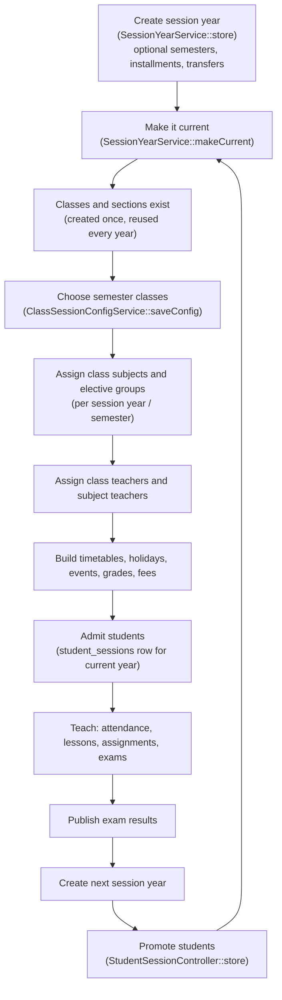

This page explains how the admin panel models a school's academic organisation: session years and semesters, mediums, classes, sections, streams and shifts, subjects and electives, class and subject teachers, student enrolment and promotion, timetables and the academic calendar. It also describes the two middleware classes that block app access when a student has no place in the current session year. For click-by-click admin steps see the end-user docs: [Academics](https://shawndaprawn.github.io/Eschool/features/academics/), [Session Year](https://shawndaprawn.github.io/Eschool/admin-panel/session-year/) and [Semester](https://shawndaprawn.github.io/Eschool/features/semester/).

## The building blocks

| Concept | Model / table | Scoped by session year? | Notes |
|---|---|---|---|
| Session year | `SessionYear` / `session_years` | It is the scope | One is "current" (see below) |
| Semester | `Semester` / `semesters` | Yes (`session_year_id`) | Optional; enabled per class per session year |
| Class semester switch | `ClassSessionConfig` / `class_session_configs` | Yes | `include_semesters` for one class in one session year |
| Medium | `Mediums` / `mediums` | No | Language of instruction; every class and subject belongs to one |
| Stream | `Stream` / `streams` | No | Optional; a class created with streams becomes one class row per stream |
| Shift | `Shift` / `shifts` | No | Optional `classes.shift_id` |
| Educational program | `EducationalProgram` / `educational_programs` | No | Optional `classes.educational_program_id`, shown on the public site |
| Class | `ClassSchool` / `classes` | No | |
| Section | `Section` / `sections` | No | Labels such as A, B |
| Class section | `ClassSection` / `class_sections` | No | Class plus section; what students, timetables, attendance, lessons and assignments attach to |
| Subject | `Subject` / `subjects` | No | Per medium; `type` is `Theory` or `Practical` |
| Class subject | `ClassSubject` / `class_subjects` | Yes (and semester) | `type` `Compulsory` (core) or `Elective` |
| Elective subject group | `ElectiveSubjectGroup` / `elective_subject_groups` | Yes (and semester) | "Pick `total_selectable_subjects` of `total_subjects`" |
| Student elective picks | `StudentSubject` / `student_subjects` | Yes (and semester) | Only electives are stored |
| Class teacher | `ClassTeacher` / `class_teachers` | Yes (and semester) | |
| Subject teacher | `SubjectTeacher` / `subject_teachers` | Yes (and semester) | |
| Student session | `StudentSessions` / `student_sessions` | Yes | A student's section, status and result for one year |
| Timetable period | `Timetable` / `timetables` | Yes (and semester) | Points at a subject-teacher row |
| Holiday / event | `Holiday`, `Event` / `holidays`, `events` | Yes | |

Table-level details are on [Database Schema](Database-Schema#academic-structure).

## Session years

### The current session year

The session year used by the apps, by most admin defaults and by every "current" check is the `settings` row with `type = 'session_year'`:

```php
$session_year_id = getSettings('session_year')['session_year'];
```

`session_years.default` is a mirror of that setting. Both are written by [`SessionYearService::makeCurrent()`](https://github.com/ShawnDaPrawn/Eschool/blob/main/admin-panel/app/Services/SessionYearService.php): it sets `default = 1` on that year and 0 on every other row, saves the `session_year` setting, runs [`ResetLessonSemesters`](https://github.com/ShawnDaPrawn/Eschool/blob/main/admin-panel/app/Actions/ResetLessonSemesters.php) (sets `semester_id = NULL` on every lesson) when the value changes, and points the admin's own year picker (`session('session_year')`, below) at the new year. It is called from:

| Where | Notes |
|---|---|
| **General Settings** (`SettingController::update`) | The `session_year` field, on every save of the form |
| **Make current** on the Session Years list: `POST session-years/{id}/make-current` (`SessionYearController::makeCurrent`, route `session-years.make-current`, permission `session-year-edit`) | Shown for years that are not current and have not ended. A year whose `end_date` has passed is refused with `session_year_has_ended`. |
| **Creating** a session year with `set_as_current = 1` | See [Creating a session year](#creating-a-session-year) |

`SessionYearController::update` also accepts a `default` flag. It refuses an already-ended year, clears `default` on all rows and sets it on the edited one, but it does **not** change the `session_year` setting. Use one of the paths above to switch the current year so the two stay in step.

When the current year's `end_date` has passed, the header shows users with `session-year-create` a banner ("The current session year (...) ended on ...") with a link to the Session Years page.

The installer creates one year, `2022-23` (ended), and makes it current. A new school should create its own year and make it current before assigning class subjects, teachers or students; until then they are saved under 2022-23.

The admin panel also keeps a per-browser "viewing" year: `POST /set-session-year` (`SessionYearController::setSessionYearToSessionStorage`) stores `session('session_year')`. It is read by the dashboard (`HomeController`), by `Exam\ResultController::viewExamResult`, and by `ClassSchool::getIncludeSemestersAttribute()`; most list pages instead take a `session_year_id` filter from the request and fall back to the setting. The mobile apps always use the setting.

### Creating a session year

`SessionYearController::store` validates with [`StoreSessionYearRequest`](https://github.com/ShawnDaPrawn/Eschool/blob/main/admin-panel/app/Http/Requests/StoreSessionYearRequest.php) (permission `session-year-create`, dates in `d-m-Y`, `name` unique among non-deleted session years, message `session_year_name_already_exists`) and hands off to [`SessionYearService::store`](https://github.com/ShawnDaPrawn/Eschool/blob/main/admin-panel/app/Services/SessionYearService.php), all inside one transaction:

1. Creates the `session_years` row (`name`, dates, `fee_due_date`, `fee_due_charges`, `free_app_use_date`, and `include_fee_installments` from `fees_installment`). The fee due date must fall inside the session dates or a `DomainException` (HTTP 422) is returned.
2. If `fees_installment = 1`, inserts `installment_fees` rows; each due date must be inside the session.
3. If `semester_data` is sent, inserts `semesters`; each must be inside the session. Otherwise it upserts a `class_session_configs` row with `include_semesters = false` for every class.
4. Runs the selected transfers from `source_session_year_id` (or the current year if none is given). Each is an action class in [`app/Actions/Transfers`](https://github.com/ShawnDaPrawn/Eschool/tree/main/admin-panel/app/Actions/Transfers) that copies rows with the new `session_year_id`:

| Request flag | Action | Copies |
|---|---|---|
| (automatic when `semester_data` is sent) | `TransferClassSessionConfig` | `class_session_configs` for classes not yet configured in the new year |
| `transfer_class_subject` | `TransferClassSubject` | `elective_subject_groups` (with an old-to-new id map) and `class_subjects` |
| `transfer_class_teacher_subject` | `TransferClassTeacherAndSubjectTeacher` | `class_teachers` and `subject_teachers` |
| `transfer_class_timetable` | `TransferClassTimetable` | `timetables` |
| `transfer_exam_grades` | `TransferExamGrades` | `grades` |
| `transfer_class_fee_type` | `TransferClassFeeType` | `fees_classes` |
| `transfer_leave_settings` | `TransferLeaveSettings` | `leave_masters` |

5. If the optional `set_as_current` is 1, calls `makeCurrent()` (above). The create modal sends it from the "Make this the current session year" toggle, which is on by default when the current year has ended or there is none.

The copies keep the source rows' `semester_id` values; the semesters themselves are created fresh from `semester_data`. Without `set_as_current` the new year does not become current.

Until `33e995b`, `include_fee_installments` was missing from `SessionYear::$fillable`, so a year created with installments got its `installment_fees` rows but kept the flag at 0. Migration `2026_10_21_000000_flag_session_years_that_have_fee_installments` sets the flag on every year that has (non-deleted) installments.

### Editing a session year

`SessionYearController::update` (permission `session-year-edit`):

- `name` must be unique among non-deleted years, ignoring the edited one.
- `fees_due_charges` is a number from 0 to 100.
- `free_app_use_date` must be after today only when it changes. An unchanged date may be in the past, so a running year can still be edited after its free-app date.
- `installment_data` rows are updated or added, then `include_fee_installments` is set to whether the year has any `installment_fees` rows. Deleting the last installment (`deleteInstallmentData`) clears it.
- The `default` flag is described under [The current session year](#the-current-session-year).

### Deleting and clearing

- `SessionYear::booted()` throws if the year is the default one, and `SessionYearController::destroy` checks the same first. Otherwise deleting a year soft-deletes its semesters, exams, assignments, attendance, student sessions, class and subject teachers, student subject picks, elective groups, grades, leaves, leave settings, online exams and questions, fee rows, installments, announcements, events, holidays and notifications.
- `SessionYearService::clearSpecificData()` (route `deleteSpecificData`, permission `session-year-delete`) deletes selected data types of a year without deleting the year: `class_subject`, `class_teachers` (also subject teachers), `fees_transactions`, `notifications`, `timetable`, `attendance`, `assignments`, `exams` (offline and online), `grades`, `announcements`, `holidays`, `events`, `leaves`, `allowed_leave_days`. Several of these use `DB::table()->delete()`, which is a hard delete.

## Semesters

A semester (`semesters`) has a name, `start_date`, `end_date` and `session_year_id`. `SemesterController` (permissions `semester-list|create|edit|delete`) creates them inside a year and rejects overlapping ranges.

- **Current semester.** The `current` accessor is true when today is between the start and end dates; a semester whose start is after its end is treated as wrapping the new year. Code finds "the" current semester with `Semester::get()->first(fn ($s) => $s->current)`, in some places filtered by session year first and in others (`Students::getCurrentSemester()`, `Student\SubjectController::selectSubjects`) not.
- **Per-class switch.** Semesters only affect a class whose `class_session_configs.include_semesters` is true for that session year. `ClassSessionConfig::classHasSemester($classId, $sessionYearId)` and `ClassSchool::getIncludeSemestersForSession()` read it.
- **What becomes semester-specific** when a class has semesters: class subjects and elective groups, student elective picks, timetables, class and subject teachers, lessons, assignments, announcements, offline and online exams. Queries for the apps filter by the current semester.
- **Deleting a semester** soft-deletes its class subjects, elective groups, timetables and student subjects (`Semester::booted()`). If it was the last semester of the year, `SemesterController::destroy` also deletes every `include_semesters = true` config row for that year and runs `wipeClassData()` (below) for those classes, including their lessons.

### ClassSessionConfigService

[`ClassSessionConfigService::saveConfig($sessionYearId, $selectedClassIds)`](https://github.com/ShawnDaPrawn/Eschool/blob/main/admin-panel/app/Services/ClassSessionConfigService.php) is called from the Semester page (`SemesterController::saveClassConfig`, permission `semester-edit`). It upserts a config row for **every** class (selected classes get `include_semesters = true`) and then, for every class whose value actually changed (a class with no row counts as changed only when it is turned on), calls `wipeClassData()`, which **force-deletes** that class's data for the session year:

1. Timetables, then subject teachers, then class teachers of the class's sections.
2. Announcements targeted at the class, its sections or its subject teachers.
3. Offline exams linked through `exam_classes` (cascading to timetables, marks and results).
4. Online exams for the class or its sections (cascading to questions placed, answers and attempts).
5. Assignments of its sections (cascading to submissions and files).
6. Lessons: kept, with `semester_id` set to NULL (deleted only when called with `$deleteLessons = true`, as `SemesterController::destroy` does).
7. Class subjects and elective subject groups.

Toggling semesters on a class in the middle of a year therefore erases its subjects, teachers, timetable, exams and assignments for that year.

Config rows are also created when a class is created (one per existing session year, `include_semesters = false`) and when a session year is created without semesters.

## Mediums, streams, shifts and sections

These are simple lookup tables managed from their own controllers (`MediumController`, `StreamController`, `ShiftController`, `SectionController`) with `<thing>-list|create|edit|delete` permissions. Deleting a medium (`Mediums::booted()`) deletes its classes and subjects one by one, so their own cascades run too.

Shift names (`name` on create, `edit_name` on edit) use the same `PlainName` rule as class names (below), and the end time must be after the start time (`edit_end_time` after `edit_start_time` on edit).

## Classes and class sections

`Classes\ClassController::store` (permission `class-create`):

- `name` must pass [`App\Rules\PlainName`](https://github.com/ShawnDaPrawn/Eschool/blob/main/admin-panel/app/Rules/PlainName.php) (also on update): letters and digits in any script, spaces and `. , ' & ( ) / + # _ -`, starting with a letter or digit, at most 191 characters. Markup such as `<b>` is refused with `name_has_invalid_characters`. Until `33e995b` only `[A-Za-z0-9_]` was allowed, so "Grade 1" was refused.
- Without `stream_id`, one `classes` row is created. With an array of `stream_id`, one row is created per stream, all with the same name, medium and shift.
- One `class_sections` row is inserted for every selected section, for every created class.
- A `class_session_configs` row with `include_semesters = false` is upserted for every class and every existing session year.

`ClassSchool` appends `full_name` and `include_semesters` (`1` or `0`: the class's `class_session_configs` value for the current session year, `0` when it has no row); the teacher app reads the latter from every class in the API to label semester classes. `ClassSection` appends `name` and `full_name` (class, section, stream and medium, depending on which relations are loaded). Deleting a class cascades to its online exams, session configs, class subjects, exam classes, fee classes and sections; deleting a section cascades to its student sessions, online exams, assignments, attendance, exam results, lessons, subject teachers, timetables and students.

## Subjects, class subjects and electives

- **Subjects** are defined per medium (`SubjectController`). A subject can be offered by many classes.
- **Class subjects** are assigned per class and per session year on the "Assign class subject" page (`Classes\SubjectController::update_subjects`, permission `assign-class-subject`):
  - Core subjects are `class_subjects` rows with `type = 'Compulsory'`.
  - Each elective group is an `elective_subject_groups` row plus one `class_subjects` row per subject with `type = 'Elective'` and `elective_subject_group_id`. `total_subjects` is the number of subjects in the group; `total_selectable_subjects` is how many a student must or may choose.
  - When semesters are on, every row carries a `semester_id`. The same subject cannot appear twice in the same semester (as two cores, two electives or core and elective); it may repeat across semesters.
  - Removing a subject from an existing elective group deletes the matching `student_subjects` picks.
  - The class-subject list's edit link (`class-subject-edit/{id}?session_year_id=...`) carries the session year the list is showing. The edit page shows that year's name and saves to it through a hidden `session_year_id` field; without the parameter it uses the current year.
- **Deleting** a class subject (`ClassSubject::booted()`) also deletes the subject-teacher rows for that subject in the class's sections and session year, and decrements the group's `total_subjects` (deleting the group at zero). Deleting a group removes its subjects and the students' picks.
- **Elective selection.** Students pick electives in the app (`POST /api/student/select-subjects`): each group must belong to the student's class for the session (and current semester when semesters are on), every subject must belong to the group, and existing plus new picks may not exceed `total_selectable_subjects`. Admins can assign electives from the panel (`Classes\ElectiveController::assignElectiveSubject`, permission `assign-elective-subjects`).
- **A student's subject list** comes from `Students::subjects()`: core subjects from `class_subjects` for the session year (filtered by the current semester when the class uses semesters) plus the student's `student_subjects` picks. Elective picks are returned only if the class has at least one elective group in scope. `Students::classSubjects()` returns the core subjects and the elective groups (with their subjects) on offer.

## Class teachers and subject teachers

| | Class teacher | Subject teacher |
|---|---|---|
| Table | `class_teachers` (`class_section_id`, `class_teacher_id` = `teachers.id`, `session_year_id`, `semester_id`) | `subject_teachers` (`class_section_id`, `subject_id`, `teacher_id`, `session_year_id`, `semester_id`) |
| Assigned by | `ClassTeacherController::assign_teacher` (permission `class-teacher-edit`) | `SubjectTeacherController::store` (needs both `subject-teacher-create` and `subject-teacher-edit`) |
| Cardinality | `updateOrCreate` on all four columns, so a section can have more than one class teacher | The controller refuses a second row for the same session year, subject, class section and semester |
| Side effects | A newly created assignment gives the teacher's user the direct permissions `class-teacher` and `student-leave-approve`. Removing one assignment (`ClassTeacherController` remove action, permission `class-teacher-delete`) revokes both direct permissions, even if the teacher is still class teacher of another section | Timetable periods reference the subject-teacher row (`timetables.subject_teacher_id`) |
| What it unlocks | Taking attendance for the section, uploading marks for the whole section, approving the section's student leaves, viewing the section's exam results, CheckStudent-protected teacher API calls | Lessons, topics, assignments and online exams for that subject in that section; marks for that subject |

The ownership checks behind these rules are described on [Roles and Permissions](Roles-and-Permissions#ownership-scoping).

## Students, admission and student sessions

### Admission

`Student\StudentController::store` (permission `student-create`) creates, in one transaction:

- The parents. `parent_guardian_type` is `parent` (father and mother) or `guardian`. For each one the form either sends the numeric id of an existing `parents` row in the email field (the record is reused) or new details, in which case a `users` row with the `Parent` role and a `parents` row are created (initial password: date of birth as `ddmmyyyy`).
- The student's `users` row with the `Student` role. Its `email` column holds the **admission number** (the "GR number" the student logs in with), and the initial password is the date of birth as `ddmmyyyy`.
- The `students` row. `admission_no` is generated server-side as the current session year's **name** followed by (highest student id including trashed + 1). `roll_number` is the highest roll number in the chosen class section + 1 (it can be renumbered later from the roll-number page).
- A `student_sessions` row for the current session year with the chosen `class_section_id`, `status = 1`, `result = 1`, `previous_session_year_id = NULL`.

Custom fields defined in `form_fields` (`for = 1` for students, `2` for parents, `3` for teachers) are saved as JSON in the `dynamic_fields` column.

**Online registration.** The public form (`WebController::studentRegistration`, custom fields with `for = 4`) creates a `students` row with `application_type = 'online'`, a `class_id` but no section. Approval (`Student\OnlineRegistrationController`, permission `online-registration-list`) sets the section, activates the student and parent users (`users.status = 1`) and upserts the current `student_sessions` row; rejection sets `users.status = 2`. See [Public Website](Public-Website).

### Student sessions

`student_sessions` is the source of truth for "which section is this student in for year X":

| Column | Meaning |
|---|---|
| `session_year_id` | The year this row describes |
| `class_section_id` | Section for that year; `NULL` once the student has left |
| `status` | 1 = continuing, 0 = left the school |
| `result` | 1 = pass, 0 = fail (set during promotion) |
| `previous_session_year_id` | The year the student was promoted from (`NULL` for the admission row) |

`students.class_section_id` holds the section for the current year; a promotion into a later year changes it when that year becomes current. The apps, exam publishing, reports and the session middleware all look up `StudentSessions` for the current year. The model has a global scope that hides rows of soft-deleted students; system code that must see them calls `StudentSessions::withoutStudentScope()`.

Migration `2025_12_16_164207_populate_student_sessions_from_students` truncated `student_sessions` on existing installs and recreated one row per student for the then-current session, so older promotion history was not kept.

### Promotion

The Promote Students page is `StudentSessionController` (permissions `promote-student-list` and `promote-student-edit`; the old `promote-student-create`/`-delete` were removed).

- `show()` lists `student_sessions` of a class section in the chosen (source) session year (the page opens on the current year), with each student's latest exam result and any existing promotion row (`previous_session_year_id` = the source year).
- `store()` receives `student_id[]`, `previous_session_id_for_student` (source year), `session_year_id` (target year, must differ), `new_class_section_id`, and per student `status<id>` (1 continue, 0 leave) and `result<id>` (1 pass, 0 fail). For each student it:
  1. Sets `students.is_new_admission = 0`.
  2. Finds or creates the `student_sessions` row with that `previous_session_year_id`, and sets `session_year_id` to the target year.
  3. If a different `new_class_section_id` was given, the student is promoted: the row gets the new section, and so does `students.class_section_id` if the target year is the current one. Otherwise the student repeats in the old section.
  4. If `status = 0`, clears the row's `class_section_id`, and sets `users.status = 0` (the student can no longer sign in) if the target year is the current one. Changing a leave back to continue sets `users.status` back to 1.

A promotion into a year that isn't current yet takes effect when that year becomes current: `SessionYearService::makeCurrent` moves each continuing student to their row's section and deactivates the students marked as left. Until then they keep their class and their account, so promoting before the year ends doesn't disturb the year still running.

A student with no `student_sessions` row for the current year is blocked from the app until promotion is done (see below).

## Timetables

`TimetableController::store` (permission `timetable-create`) saves periods for one day of one class section: `day` (1 Monday to 7 Sunday) and `day_name`, `start_time`, `end_time`, `link_name`, `live_class_url`, `session_year_id`, `semester_id`. The `subject_teacher_id` is looked up from the chosen subject and teacher (restricted to the current semester when the class uses semesters); if none is found it is stored as 0. Class and teacher timetable views need `class-timetable` and `teacher-timetable`. A live-class link can be changed by anyone with `timetable-edit` or by the teacher of that period (`TimetableController::linkUpdate`, http(s) URLs only).

## Holidays, events and the academic calendar

- `HolidayController` and `EventController` store holidays and events per session year (`session_year_id` is required on create and used as the list filter). Multi-day events have per-day rows in `multiple_events`.
- [`AcademicCalendarService::generate($classIds)`](https://github.com/ShawnDaPrawn/Eschool/blob/main/admin-panel/app/Services/AcademicCalendarService.php) builds a PDF (dompdf, view `academic_calendar.academic_calendar_pdf`) for the current session year from holidays, events, exam timetable dates of the given classes, and "Semester Break" entries for gaps between consecutive semesters. Items are grouped by month. It returns the PDF base64-encoded. It is used by `GET /api/student/academic-calendar-pdf`, `GET /api/parent/academic-calendar-pdf` and `GET /api/teacher/academic-calendar-pdf`.
- The `academic_calendars` table from the first migration is not used.

## Session middleware for the apps

Both classes are registered as aliases in `bootstrap/app.php` and applied to the authenticated API groups in `routes/api.php`.

### `EnsureStudentSessionIsActive` (`student.session.active`)

Applied after `auth:sanctum` and `role:Student` to every authenticated student endpoint. It returns:

| Condition | Response |
|---|---|
| No user, not a `Student`, `users.status` is not 1, or no `students` row | HTTP 403, `no_permission_message` |
| No `student_sessions` row for the current session year | HTTP 401, code `SESSION_NOT_ACTIVE`, "promotion to the next class has not been completed" |
| The row has `status = 0` | HTTP 401, code `SESSION_NOT_ACTIVE`, "Your Account is Deactivate..." |

`Student\AuthController::login` performs the same checks before issuing a token.

### `EnsureParentChildrenSessionIsActive` (`parent.children.session.active`)

Applied after `auth:sanctum` and `role:Parent`. The user must have a `parents` row (else HTTP 403). It loads every student where the parent is father, mother or guardian and checks their `student_sessions` for the current year:

| Condition | Response |
|---|---|
| No child has a row for the current year | HTTP 401, code `SESSION_NOT_ACTIVE` |
| Rows exist but every one has `status = 0` | HTTP 401, code `ACCOUNT_DEACTIVATED` |

One active child is enough to pass. Per-child endpoints additionally go through `CheckChild`, which resolves `child_id` against the parent's own children.

The teacher API has no equivalent session check.

## Lifecycle of a school year



In order:

1. **Create the next session year** with dates, fee due date and charges, optional installments and semesters. Tick the transfer options to copy class subjects, teachers, timetables, grades, fee classes and leave settings from the previous year.
2. **Make it current**: tick "Make this the current session year" when creating it, use **Make current** on the Session Years list, or pick it in General Settings. From this moment the apps and the session middleware look for `student_sessions` rows in the new year, promotions already recorded for it take effect, and lessons lose their semester link.
3. **Classes, sections, mediums, streams and subjects** carry over automatically; they are not session-scoped.
4. **Configure semesters per class** on the Semester page before entering subjects and teachers, because changing the setting later wipes the class's data for that year.
5. **Assign subjects** (core and elective groups) and **teachers** (class and subject) for the new year if they were not transferred.
6. **Timetables, grades, fee classes, holidays and events** for the year.
7. **Promote students** from the old year to the new one. Until a student has a row for the current year, their app (and their parents' app, if no other child is active) is blocked with `SESSION_NOT_ACTIVE`. New admissions get their row immediately.

## See also

- [Database Schema](Database-Schema)
- [Roles and Permissions](Roles-and-Permissions)
- [Exams and Grading](Exams-and-Grading)
- [API Student](API-Student)
- [API Parent](API-Parent)
- [Admin-Panel-Overview](Admin-Panel-Overview)
- [Glossary](Glossary)

## Phase 2 academic reference foundation

The new grade catalogue covers R–12 and Foundation, Intermediate, Senior and FET
phases. It is separate from the legacy school-specific `grades` table used by
existing result calculations. A seven-point reference stores thresholds in integer
basis points (100 = 1 percent); it does not recalculate existing learner marks.

Existing classes start with no grade mapping. An authorized administrator selects
a shared grade explicitly through the v2 API; no class name is guessed. Reads
require class-list or class-edit; writes require class-edit in the selected school.
Mappings can be cleared with explicit null, and changes are audited. A panel/app
editor, terms/semester transition and subject/assessment rules follow separately.
