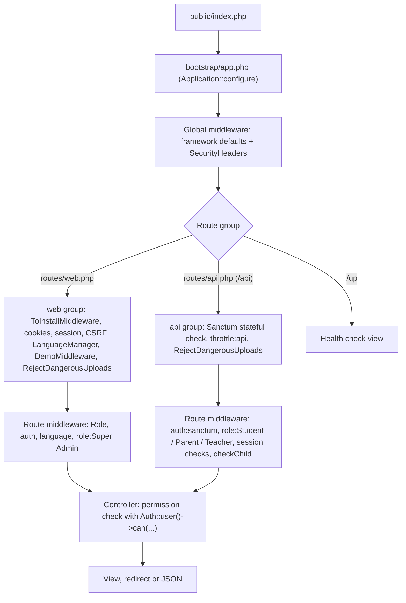

This page explains how the Laravel application in `admin-panel/` is put together: how a request travels through `bootstrap/app.php` and the middleware stack, what lives in each `app/` folder, how the Blade views and static assets are organised, the global helper functions, the JSON response conventions and the main Composer packages. The same application serves the staff admin panel, the public school website and the REST API used by the mobile apps.

## At a glance

| Item | Value |
|---|---|
| Framework | Laravel 12 (`laravel/framework` locked at v12.70.0 in `composer.lock`) |
| PHP | `^8.3.0` (`composer.json` pins the platform to 8.3.0 and sets `platform-check: false`) |
| Database | MySQL or MariaDB (the migrations use MySQL-specific SQL; CI runs MariaDB 10.11) |
| UI | Server-rendered Blade, Bootstrap, jQuery, bootstrap-table; prebuilt files in `public/assets/` |
| Auth | Session guard `web` for the panel; Laravel Sanctum bearer tokens (guard `sanctum`) for the apps |
| Authorisation | `spatie/laravel-permission` roles and permissions (see [Roles-and-Permissions](Roles-and-Permissions)) |
| Entry points | `public/index.php` (HTTP), `artisan` (CLI) |
| Route files | `routes/web.php` (admin panel, public site, the Stripe webhook, cache clear), `routes/api.php` (mobile apps, prefix `/api`), `routes/console.php` (closure commands and the schedule) |
| Health check | `GET /up` (registered by `withRouting(health: '/up')`, outside the `web` group) |
| Size | 46 controller files in `app/Http/Controllers` plus 4 API and 6 auth controllers, 76 models, 92 migrations, 668 registered routes |

## Request lifecycle

There is no `app/Http/Kernel.php`. The app uses the Laravel 11+ style [bootstrap/app.php](https://github.com/ShawnDaPrawn/Eschool/blob/main/admin-panel/bootstrap/app.php), which configures routing, middleware and providers in one place.



1. `public/index.php` checks for `storage/framework/maintenance.php` (set by `php artisan down`), loads Composer and boots the app from `bootstrap/app.php`.
2. Service providers register. They come from three places:
   - the `providers` array in [config/app.php](https://github.com/ShawnDaPrawn/Eschool/blob/main/admin-panel/config/app.php), which Laravel 12 still honours. It lists the framework providers, `Barryvdh\DomPDF\ServiceProvider`, `Barryvdh\Debugbar\ServiceProvider`, Sanctum, Spatie Permission, `Maatwebsite\Excel\ExcelServiceProvider`, and the app's `AppServiceProvider`, `AuthServiceProvider`, `EventServiceProvider` and `RouteServiceProvider` (`BroadcastServiceProvider` is commented out);
   - `->withProviders([...])` in `bootstrap/app.php` (Spatie Permission, Sanctum and the wizard installer, again);
   - package auto-discovery (for example `Laravel\Ui\UiServiceProvider`, `dacoto\EnvSet\EnvSetServiceProvider`, `Maatwebsite\Excel\ExcelServiceProvider`).
3. The installer's service provider prepends `ToInstallMiddleware` to the `web` group. Until `storage/installed` exists, every web route except `install/*` redirects to the wizard (see [Installation-Wizard](Installation-Wizard)).
4. Global middleware runs, then the route's group (`web` or `api`), then route middleware.
5. Controllers do most authorisation themselves: almost every action starts with `if (! Auth::user()->can('some-permission'))` and returns a redirect or JSON error.
6. The response is a Blade view, a redirect with flashed `success`/errors, or JSON. API controllers return JSON built by `ResponseService` (see [ResponseService conventions](#responseservice-conventions)).

`App\Providers\RouteServiceProvider` is still registered through `config/app.php`. It defines the rate limiters and `HOME = '/home'`. The route files are registered once, by `withRouting()` in `bootstrap/app.php` (until Phase 0 the provider's `boot()` loaded them a second time).

Rate limiters defined in [RouteServiceProvider.php](https://github.com/ShawnDaPrawn/Eschool/blob/main/admin-panel/app/Providers/RouteServiceProvider.php):

| Limiter | Limits | Used by |
|---|---|---|
| `api` | 60 per minute per user id, or per IP when signed out | the `api` middleware group |
| `login` | 5 per minute per path and account (`email`, `gr_number` or `gr_no` input), and 20 per minute per IP | app logins, `forgot-password` endpoints, `POST password/email` |

The public forms use inline limits: `POST contact-us/store` has `throttle:5,1` and `POST student-register` has `throttle:10,1`.

## bootstrap/app.php

```php
->withRouting(
    web: __DIR__ . '/../routes/web.php',
    api: __DIR__ . '/../routes/api.php',
    commands: __DIR__ . '/../routes/console.php',
    health: '/up',
)
```

What the `withMiddleware` callback does:

| Call | Effect |
|---|---|
| `validateCsrfTokens(except: ['webhook/*'])` | Payment gateway webhooks skip CSRF. Since Phase 0 the only one is `POST webhook/stripe` (Razorpay, Paystack and Flutterwave were removed). |
| `append(SecurityHeaders::class)` | Adds `SecurityHeaders` to the end of the global stack. |
| `web(append: [...])` | Appends `LanguageManager`, `App\Http\Middleware\EncryptCookies`, `AddQueuedCookiesToResponse`, `StartSession`, `ShareErrorsFromSession`, `SubstituteBindings`, `DemoMiddleware`, `RejectDangerousUploads`. Entries already in the default group are de-duplicated. |
| `api(prepend: [...])` | Prepends Sanctum's `EnsureFrontendRequestsAreStateful`, `throttle:api` and `SubstituteBindings`. |
| `api(append: [...])` | Appends `RejectDangerousUploads`. |
| `alias([...])` | Route middleware aliases (table below). |

`->withExceptions()` is empty, so exceptions use Laravel's default handler. `app/Exceptions/Handler.php` is not referenced anywhere.

The resolved stacks (printed from the booted app):

| Stack | Order |
|---|---|
| Global | `ValidatePathEncoding`, `InvokeDeferredCallbacks`, `Illuminate\Http\Middleware\TrustProxies`, `HandleCors`, `PreventRequestsDuringMaintenance`, `ValidatePostSize`, `TrimStrings`, `ConvertEmptyStringsToNull`, `App\Http\Middleware\SecurityHeaders` (plus Debugbar's `InjectDebugbar` when the dev package is installed) |
| `web` | `ToInstallMiddleware`, `Illuminate\Cookie\Middleware\EncryptCookies`, `AddQueuedCookiesToResponse`, `StartSession`, `ShareErrorsFromSession`, `ValidateCsrfToken`, `SubstituteBindings`, `LanguageManager`, `App\Http\Middleware\EncryptCookies`, `DemoMiddleware`, `RejectDangerousUploads` |
| `api` | `EnsureFrontendRequestsAreStateful`, `throttle:api`, `SubstituteBindings`, `RejectDangerousUploads` |
| `installer` | `InstallerMiddleware` (pushed by the installer package) |

The framework's own `EncryptCookies` is already in the default `web` group, so appending the app's subclass (which has an empty `$except`) adds a second encryption layer. It is redundant, not harmful.

### Route middleware aliases

| Alias | Class |
|---|---|
| `auth` | `App\Http\Middleware\Authenticate` |
| `Role` | `App\Http\Middleware\CheckRole` |
| `checkChild` | `App\Http\Middleware\CheckChild` |
| `checkStudent` | `App\Http\Middleware\CheckStudent` |
| `language` | `App\Http\Middleware\LanguageManager` |
| `demo` | `App\Http\Middleware\DemoMiddleware` |
| `permission` | `Spatie\Permission\Middleware\PermissionMiddleware` |
| `role` | `Spatie\Permission\Middleware\RoleMiddleware` |
| `role_or_permission` | `Spatie\Permission\Middleware\RoleOrPermissionMiddleware` |
| `auth.basic` | `Illuminate\Auth\Middleware\AuthenticateWithBasicAuth` |
| `student.session.active` | `App\Http\Middleware\EnsureStudentSessionIsActive` |
| `parent.children.session.active` | `App\Http\Middleware\EnsureParentChildrenSessionIsActive` |
| `cache.headers` | `Illuminate\Http\Middleware\SetCacheHeaders` |
| `can` | `Illuminate\Auth\Middleware\Authorize` |
| `guest` | `App\Http\Middleware\RedirectIfAuthenticated` |
| `password.confirm` | `Illuminate\Auth\Middleware\RequirePassword` |
| `signed` | `Illuminate\Routing\Middleware\ValidateSignature` (the framework class, not the app's) |
| `throttle` | `Illuminate\Routing\Middleware\ThrottleRequests` |
| `verified` | `Illuminate\Auth\Middleware\EnsureEmailIsVerified` |
| `installer` | `dacoto\LaravelWizardInstaller\Middleware\InstallerMiddleware` |
| `to.install` | `dacoto\LaravelWizardInstaller\Middleware\ToInstallMiddleware` |

`role` (lower case, Spatie) and `Role` (upper case, `CheckRole`) are different middleware.

## Middleware reference

Every class in [app/Http/Middleware](https://github.com/ShawnDaPrawn/Eschool/tree/main/admin-panel/app/Http/Middleware):

| Class | Registered as | Purpose |
|---|---|---|
| `Authenticate` | alias `auth` | Redirects to `route('login')` unless the request expects JSON (then a 401). Used as `auth` on admin routes and `auth:sanctum` on API routes. |
| `CheckChild` | alias `checkChild`; also referenced by class in `routes/api.php` | Parent API: reads `child_id`, looks it up among `$request->user()->parent->children()`, stores it as the request attribute `child`. Otherwise returns `{"error":true,"message":"Invalid Child ID Passed.","code":105}`. |
| `CheckRole` | alias `Role` | Admin panel gate. Lets a signed-in user through only if they have a role other than `Parent` or `Student`; otherwise logs them out and redirects to login with `no_permission_message`. For a guest it renders `auth.login` directly. |
| `CheckStudent` | alias `checkStudent`; referenced by class in the teacher API group | Teacher API: the `student_id` must belong to a class section where the signed-in teacher is a class teacher (`class_teachers.class_teacher_id`), else error code 105. |
| `DemoMiddleware` | appended to `web`; alias `demo` | When `config('app.demo_mode')` (`DEMO_MODE`) is true, blocks every non-GET request from a signed-in user except a fixed list of URIs (logins, ID cards, certificates, chat and leave list endpoints) unless the user's email is `demomodeoff@gmail.com`. Returns error code 112. |
| `EncryptCookies` | appended to `web`; `config/sanctum.php` `encrypt_cookies` | Subclass of the framework class with an empty `$except`. |
| `EnforceReadOnlyYears` | by class on the admin panel group in `routes/web.php` | Shares `$panelYear` (`App\Services\Panel\SessionYearContext`) with every view. While the year selected in the header is not the current one, a GET without `session_year_id` gets the selected year's id added (so lists follow it), and every POST, PUT, PATCH or DELETE not matched by `config('panel.read_only_years.allow')` is refused: 423 JSON `{error, message, code}` or a redirect back with the message and the input. See [School years in the panel](#school-years-in-the-panel). |
| `EnsureParentChildrenSessionIsActive` | alias `parent.children.session.active` | Parent API: 403 if the user has no parent record; 401 `SESSION_NOT_ACTIVE` if no child has a `student_sessions` row for the current `session_year` setting; 401 `ACCOUNT_DEACTIVATED` if none of those rows has `status = 1`. |
| `EnsureStudentSessionIsActive` | alias `student.session.active` | Student API: 403 unless the user has the `Student` role, `status = 1` and a student record; 401 `SESSION_NOT_ACTIVE` if there is no `student_sessions` row for the current session year or its status is 0. |
| `LanguageManager` | appended to `web`; alias `language` | Calls `app()->setLocale(Session::get('locale'))` when the session has a locale. |
| `PreventRequestsDuringMaintenance` | not registered | The framework's class is in the global stack instead. |
| `RedirectIfAuthenticated` | alias `guest` | Redirects signed-in users to `RouteServiceProvider::HOME` (`/home`). |
| `RejectDangerousUploads` | appended to `web` and `api` | Refuses any uploaded file whose name contains a blocked extension in any dot-separated part (PHP variants, `phtml`, `phar`, `html`, `js`, `xml`, `cgi`, `htaccess`, `ini`, `exe` and others in `BLOCKED_EXTENSIONS`) or whose detected MIME type looks like PHP, HTML, JavaScript, shell, Perl, Python, Ruby, executables or XML. SVG uploads are rewritten in place by `enshrined/svg-sanitize` with remote references removed; an SVG that can't be parsed is refused. Responds with 422 JSON (`code` 102) for API, JSON or AJAX requests, otherwise redirects back with an error. |
| `SecurityHeaders` | appended to the global stack | Sets `X-Frame-Options: SAMEORIGIN`, `X-Content-Type-Options: nosniff`, `Referrer-Policy: strict-origin-when-cross-origin`, and `Strict-Transport-Security: max-age=31536000` when `$request->isSecure()`. Headers already on the response are left alone. |
| `TrimStrings` | not registered | The framework's `TrimStrings` runs globally instead. |
| `TrustHosts` | not registered | The framework's `TrustHosts` is used instead (`$middleware->trustHosts()` in `bootstrap/app.php`): `APP_URL` and its subdomains, `localhost`, `127.0.0.1` and `TRUSTED_HOSTS`, once installed. See [Deployment](Deployment#https-proxies-and-hosts). |
| `TrustProxies` | not registered | The framework's `TrustProxies` runs globally. Proxies come from `config/trustedproxy.php` (`TRUSTED_PROXIES`, `*` on Cloud Run, none elsewhere), and only `X-Forwarded-For` and `X-Forwarded-Proto` are read. See [Deployment](Deployment#https-proxies-and-hosts). |
| `ValidateSignature` | not registered | The `signed` alias points at the framework class. |
| `VerifyCsrfToken` | only in `config/sanctum.php` (`verify_csrf_token`) | CSRF for web routes is the framework's `ValidateCsrfToken`, configured by `validateCsrfTokens(except: ['webhook/*'])`. |

Route-level usage, in short (details in [Security-Model](Security-Model) and [API-Overview](API-Overview)):

- Admin panel: `Route::group(['middleware' => ['Role', 'auth', EnforceReadOnlyYears::class]])` with a nested `language` group. `Role` runs before `auth`; `EnforceReadOnlyYears` keeps years other than the current one read-only.
- Maintenance: `POST /clear` (the Cache Clear button) needs `auth` and `role:Super Admin`. The System Update page and the GET URLs `/storage-link`, `/migrate` and `/seeder_install` were removed in Phase 0 and answer 404.
- Student API: `auth:sanctum`, `role:Student`, `student.session.active`. Parent API: `auth:sanctum`, `role:Parent`, `parent.children.session.active`, with `CheckChild` on child-specific routes. Teacher API: `auth:sanctum`, `role:Teacher`, with `CheckStudent` on student-specific routes.

## The app/ folders

| Folder | Contents |
|---|---|
| `app/Http/Controllers` | Controllers for the admin panel and public site, one per module (the larger modules are split into one controller per area in a sub-folder, like `Student/`, `Fees/`, `Exam/`, `Leave/` and `Classes/`; others are `SettingController`, `WebController` for the public website, `WebhookController` for the Stripe webhook, and so on; `Panel/` holds the global search and the new-year wizard). The base `Controller` also serves `GET /common/js/lang`, which returns `window.languageLabels = {...}` from `resources/lang/<code>.json` (falling back to `en.json`). |
| `app/Http/Controllers/Api` | `ApiController` (shared endpoints: settings, holidays, sliders, session years, events, gallery, forgot/change password, logout), the `Student/`, `Parent/` and `Teacher/` controllers (one per area, each role sharing an access trait). See [API-Overview](API-Overview). |
| `app/Http/Controllers/Auth` | laravel/ui controllers using the framework's `AuthenticatesUsers` and related traits. `LoginController::authenticated()` signs out users with the `Parent` or `Student` role, because those roles may only use the apps. There is no register route. |
| `app/Http/Middleware` | See the table above. |
| `app/Http/Requests` | Form requests: `StoreLessonRequest`, `UpdateLessonRequest`, `StoreLessonTopicRequest`, `UpdateLessonTopicRequest`, `StoreSessionYearRequest`, `Panel/SearchRequest`, `Academics/CreateNextYearRequest`, `Academics/SwitchToNewYearRequest`. Most other validation is inline with `$request->validate()` or `Validator::make()`. |
| `app/Http/Resources` | `UserResource`, `TimetableCollection`. |
| `app/Models` | 76 Eloquent models. Some names differ from Laravel conventions: `Students`, `Parents`, `Mediums`, `Settings`, `EmailTemplate` (table `email_tempalates`, which keeps the original misspelling). `User` uses Spatie's `HasRoles`. See [Database-Schema](Database-Schema). |
| `app/Services` | Domain services: `AcademicCalendarService` (calendar PDF), `AssignmentReportService`, `ExamReportService`, `FeesReportService`, `LeaveReportService` (student report statistics), `FeesCollectionService` (fee summary for the dashboard), `ClassSessionConfigService`, `SessionYearService` (creating session years, installments, semesters and transfers; `makeCurrent()` switches the current year), `ChatMessageCleanupService`, `SettingsConfigService` (applies admin settings over the `.env` config on boot; see [Configuration](Configuration#settings-that-override-env)), `EmailTemplateService` (fills `{$placeholders}` with escaped values, no Blade compilation), `MailService`, `IdCardService` (student and staff ID card PDFs), `GalleryService`, `ImageService` and `UploadService` (file storage on the public disk, JPEG/PNG recompressed with Intervention Image), `OnlineExamScoringService`, `FormService` (backs the `Form` facade), `BootstrapTableService`, `ResponseService`. |
| `app/Services/Payment` | `PaymentInterface`; `StripePayment`; `PaymentService` (factory `create($payment_method)` for `STRIPE = 2`, `RETIRED` naming the removed gateways' ids 1, 3 and 4 so old transactions still read correctly, plus `currencyCode()`, `webhookSecret()`, `amountMatches()`); `FeesPaymentService` (server-side fee calculation and transaction state). See [Payments](Payments). |
| `app/Services/Panel` | The panel shell: `Navigation` (the navigation registry), `SessionYearContext` (current and selected school year), `GlobalSearch`, `SetupChecklist` and `TodayNumbers` (Home). See [The panel shell](#the-panel-shell). |
| `app/Services/Academics` | `NewYearService`, behind the new-year wizard: suggests and creates next year, previews and runs the carry-forward transfers, and makes the year current through `SessionYearService::makeCurrent()`. |
| `app/Helpers` | `settings_helper.php` and `notification_helper.php`, autoloaded as files by Composer (see [Helpers](#helpers)). |
| `app/Rules` | `AfterNow`, `PlainName` (class and shift names), `YouTubeUrl`, `uniqueLessonInClass`, `uniqueTopicInLesson`. |
| `app/Imports` | Maatwebsite Excel imports: `StudentsImport` (bulk student upload: like Add Student, it enrols each student in the current session year and emails parents their credentials through the `student_registration` template), `AttendanceImport`, `OnlineExamQuestionsImport`. |
| `app/Exports` | `StudentsExport`. |
| `app/Actions` | `ResetLessonSemesters` (run by `SessionYearService::makeCurrent()` when the current session year changes) and `Actions/Transfers/*` (`TransferClassFeeType`, `TransferClassSessionConfig`, `TransferClassSubject`, `TransferClassTeacherAndSubjectTeacher`, `TransferClassTimetable`, `TransferExamGrades`, `TransferLeaveSettings`), used by `SessionYearService` and the new-year wizard (`NewYearService`) to copy setup data into a new session year. See [Academic-Structure](Academic-Structure). |
| `app/Facades` | `Form`, resolving the `form` singleton (`FormService`) registered in `AppServiceProvider`; aliased as `Form` in `config/app.php`. |
| `app/Providers` | `AppServiceProvider` (binds `form`, sets `Schema::defaultStringLength(191)`, calls `SettingsConfigService::apply()`), `AuthServiceProvider` (no policies; the Super Admin `Gate::before` is commented out), `EventServiceProvider` (`Registered` to `SendEmailVerificationNotification`), `RouteServiceProvider` (rate limiters), `BroadcastServiceProvider` (not registered; `routes/channels.php` does not exist). |
| `app/Exceptions` | `Handler.php`, a leftover that nothing uses. |
| `app/Console` | `Commands/CleanupOldChatMessages.php`, `Commands/DeleteFeesPaid.php`, and an unused `Kernel.php`. See [Scheduled-Tasks-and-Commands](Scheduled-Tasks-and-Commands). |

## Views and layouts

Blade templates live in [resources/views](https://github.com/ShawnDaPrawn/Eschool/tree/main/admin-panel/resources/views), one folder per module (`students`, `fees`, `exams`, `online_exam`, `settings`, `academics`, `search`, `web` and so on).

| Layout | Used by | Notes |
|---|---|---|
| `layouts/master.blade.php` | the admin views | The panel shell, built with the Material 3 library (`public/assets/m3`) while the pages inside it keep Bootstrap until they move: a skip link to `<main id="main-content">`, `layouts.include` (CSS, theme colours, `m3/m3.css`, early scripts, `panel.css` last), `layouts.header` (an M3 top app bar: search, school year, cache clear, language and account menus), `layouts.sidebar` (an M3 navigation drawer: the navigation by job), the read-only banner and notices, `layouts.footer`, `layouts.footer_js`, `after-update-note-modal`, the page confirm dialog, then `m3/m3.js`, `panel.js` and `page.js`. Sections: `title`, `css`, `content`, `js`, `script`. |
| `web/master.blade.php` | 7 public website views | Reads `web_settings` rows (`about_us`, `who_we_are`, `teacher`, `photos`, `videos`, `question`, `registration`) to decide which sections show. See [Public-Website](Public-Website). |
| `errors::minimal` | `resources/views/errors/*` | Error pages 401 to 503, on the design tokens. `403.blade.php` adds the exception message and a Go Back button. |

Points worth knowing:

- RTL: the layouts read `Session::get('language')`; when its `is_rtl` is set they add `dir="rtl"` and load `assets/css/rtl.css` instead of `style.css`.
- Theme: `layouts/include.blade.php` loads the Material 3 design tokens (`assets/css/m3-tokens.css`, generated from the apps' theme) and `m3-base.css`, so the panel uses the same colours, type and shapes as the apps; see [UI-Standards](UI-Standards#admin-panel-and-website). It writes the `login_image` setting into `--image-url`. The `theme_color` and `secondary_color` settings now only colour the printed certificates and result sheets.
- Translations for JavaScript come from `<script src="{{ route('common.language.read') }}">`, which defines `window.languageLabels`. See [Localization](Localization).
- Logos and favicon come from the `logo1`, `logo2` and `favicon` settings through `schoolLogoUrl()` and `schoolSetting()`; the school name in titles and footers is `config('app.name')`, which the `school_name` setting overrides. No view calls `env()` (enforced by `SettingsConfigTest`).
- `resources/views/components`: `x-icon` (inline Lucide SVG icons by name), `page/*` (the page pattern, on the Material 3 library: `header`, `filters`, `table`, `empty-state`, `field`, `form-card`, `confirm-dialog`; see [UI-Standards](UI-Standards#admin-panel-page-pattern)), `form/image-upload`, `form/status-radio`, `wizard`, `web-settings/section`.

### Data tables (bootstrap-table)

List pages use bootstrap-table with server-side pagination. A typical table tag:

```html
<table data-toggle="table" data-url="{{ url('medium_list') }}"
       data-side-pagination="server" data-pagination="true"
       data-query-params="queryParams" data-escape="true">
```

The list endpoint (for example `MediumController::show`) reads `offset`, `limit`, `sort`, `order` and `search` from the query string and returns:

```json
{ "total": 12, "rows": [ { "id": 1, "no": 1, "name": "...", "operate": "<a ...>...</a>" } ] }
```

`operate` holds the row's action buttons as HTML. `data-escape="true"` appears 155 times across the views (on tables and individual columns), and the shared `escapeHtml()`/`safeUrl()` helpers in `public/assets/js/custom/function.js` are used by formatters that build HTML from row data.

[BootstrapTableService](https://github.com/ShawnDaPrawn/Eschool/blob/main/admin-panel/app/Services/BootstrapTableService.php) provides `button()`, `editButton()`, `deleteButton()`, `restoreButton()`, `trashButton()`, `viewRelatedDataButton()`, the `menu*` dropdown variants and `menuItem()`, rendering icons through `<x-icon>` with a per-request cache. No controller currently calls it; the controllers build their `operate` HTML inline.

### Front-end JavaScript conventions

Forms submit over AJAX with `formAjaxRequest()` (in `function.js`), which validates the form with jQuery Validate, disables the submit button, expects JSON `{ "error": bool, "message": string }`, and shows a toast with the message. Handlers per form live in `public/assets/js/custom/custom.js`. Script and stylesheet tags for files that change often carry `?v={{ filemtime(...) }}` as a cache buster.

### Static assets

Everything the admin panel and public site load is committed under [public/assets](https://github.com/ShawnDaPrawn/Eschool/tree/main/admin-panel/public/assets) (about 17 MB):

| Folder | Contents |
|---|---|
| `assets/css` | `style.css`, `rtl.css`, `vendor.bundle.base.css`, page styles (`sidebar.css`, `header.css`, `content.css`, `tables.css`, `timetable.css`, `site.css` for the public site, and others), and `panel.css` (the panel shell and page pattern, loaded last) |
| `assets/js` | `vendor.bundle.base.js` (jQuery and Bootstrap), Chart.js, jQuery Validate, Flatpickr, Moment, SweetAlert2, jquery.repeater and others |
| `assets/js/custom` | App code: `custom.js`, `function.js`, `formatter.js`, `queryParams.js`, `custom-bootstrap-table.js`, `bootstrap-table-locale.js`, `validate.js`, `sidebar.js` (the navigation drawer: sections, the icon-only mode, the small-screen drawer and its backdrop), `dashboard.js`, `timetable.js`, `staff-attendance.js`, `reset-password.js`; `panel.js` (year switcher, global search, read-only mode), `page.js` (the page pattern: `PageTable`, form cards and the confirm dialog), `new-year.js` (the wizard's steps) |
| `assets/m3` | The Material 3 web library that replaces Bootstrap: `m3.css` and `m3.js` (see [UI-Standards](UI-Standards#the-material-3-web-library-replacing-bootstrap)) |
| `assets/bootstrap-table` | bootstrap-table with the mobile, export, fixed-columns and reorder-rows extensions, tableExport and jsPDF |
| `assets/jodit`, `assets/tinymce` | Rich text editors (Jodit replaced CKEditor 4 in the online exam editors) |
| `assets/katex` | Maths rendering |
| `assets/select2`, `assets/jquery-toast-plugin`, `assets/color-picker`, `assets/apexcharts`, `assets/fonts` | Other libraries |

One script is loaded from a CDN: the jQuery Validate message localisation from `cdnjs.cloudflare.com`.

## The panel shell

Phase 0 (stream S3, spec `engineering/specs/panel/redesign-part-one.md`) put every panel page in one shell: navigation by job, a header with search and the school year, read-only past years, and a Home that says what to set up next. User guides: `documentation/admin-panel/navigation.md`, `home.md`, `search.md`, `session-year.md`, `new-year.md`.

### Navigation registry

The sidebar is built from [config/navigation.php](https://github.com/ShawnDaPrawn/Eschool/blob/main/admin-panel/config/navigation.php), not written in Blade, and drawn as an M3 navigation drawer (the Dark Navy `--inverse` variant) whose sections are disclosure buttons (`sidebar.js`). It has eight sections by job (Home, People, Academics, Communication, Money, Activities, Wellbeing, Settings); each section has groups and each group has items:

| Item key | Meaning |
|---|---|
| `key` | Stable id, also used by tests |
| `label` | Language key (`nav_*`); every language file must have it (`NavigationTest`) |
| `route` or `url` | Named route, or a path for pages without a name; an item whose route does not exist is hidden |
| `permissions` | The item shows when the person has any of them |
| `roles` | Optional: the item also needs one of these roles |
| `module` | The Phase 1 module key (Appendix B) or `null`; ignored until module switches exist |
| `active` | Optional extra route patterns that mark the item current |
| `keywords` | Extra words the global search matches |

`App\Services\Panel\Navigation` filters the registry for the signed-in person (`sections()`, `items()`, `current()`); groups and sections with no visible item are hidden. Hiding is not a check: each page still checks its own permission. To add a page, add its item and its label in every `resources/lang/*.json`; `NavigationTest` fails if a page the old sidebar reached is missing.

### Header and search

`layouts/header.blade.php`, an M3 top app bar with M3 menus, holds the search box, the school year switcher (`#filter_session_year_global`, which existing pages read for their filters), the Cache Clear button for the Super Admin, the language menu and the account menu. On small screens the drawer repeats the year switcher.

`GET /search?q=` (route `search`, `Panel\SearchController`, `App\Services\Panel\GlobalSearch`) searches the panel's pages and settings (registry labels and keywords the person can see), learners (`student-list` or `student-report`; the selected year; a teacher without `student-create` only finds their own homerooms), parents (`parents-list`), teachers (`teacher-list` or `teacher-create`), other staff (`staff-list`), grades and homerooms (`class-list` or `class-create`) and subjects (`subject-list` or `subject-create`). Queries are 2 to 100 characters, LIKE wildcards are escaped, and results are capped: 5 per group as JSON (`Accept: application/json`, markup hex-escaped) for the header box, 20 per group on the results page. `panel.js` renders the box with `textContent` and `safeUrl()`; `/` and Ctrl/Cmd+K focus it.

### School years in the panel

The current year is the `session_year` setting; the selected year is `session('session_year')`, set by the header's switcher through `POST set-session-year`. `App\Services\Panel\SessionYearContext` answers which is which and whether the selected year is read-only (any year other than the current one). `EnforceReadOnlyYears` does the rest on the server:

- lists follow the selected year: a GET without `session_year_id` gets it added to the query;
- writes are refused unless they match a pattern in `config('panel.read_only_years.allow')`: switching years, signing out, the profile and password, the new-year wizard, session years themselves, settings that do not belong to a year (school settings, languages, roles, email templates, website content, certificates and ID cards), and POSTs that only read (exports, result lookups);
- the refusal message names both years (`read_only_year_refused`).

In the page, the banner (`layouts/partials/read-only-banner.blade.php`) offers "Back to {current}", and `panel.js` disables write controls: anything marked `data-write`, the legacy delete, restore and trash buttons, and the submit buttons of POST forms not marked `data-year-safe`. A page whose form writes something that does not belong to a year adds its path to the allow list and marks the form `data-year-safe`.

### Home

`HomeController@index` adds two things above the existing dashboard widgets:

- `App\Services\Panel\SetupChecklist`: seven steps (school profile; year and terms; grades and homerooms; subjects; staff; learners and parents; fees), each worked out from the school's data and linked to its page. People who can act on none of the steps (teachers) do not see it.
- `App\Services\Panel\TodayNumbers`: learners this year, staff present today, registers taken today and notices, each shown only with its permission and linked when the person can open the list. They follow the selected year.

### New-year wizard

`GET new-year` (`Panel\Academics\NewYearController`, permission `session-year-create`; making the year current needs `session-year-edit`) is a five-step page over `App\Services\Academics\NewYearService`:

1. Next year: name, dates and terms suggested from this year (`POST new-year/year` creates it with nothing carried forward and leaves the current year alone).
2. Carry forward: subjects, teachers, timetable, grading, fees and leave settings, each through its `app/Actions/Transfers/*` class; something the new year already has is never copied twice.
3. Year-end checks: results published, promotions decided, open leave, unpaid fees.
4. Preview (`GET new-year/preview`): what will be copied and who moves up.
5. Make it current (`POST new-year/make-current`): the copies and `SessionYearService::makeCurrent()` run in one transaction.

### Demo school

`database/seeders/DemoSchoolSeeder.php` adds one school with a user per profile (Super Admin, two teachers, a custom Finance role, two parents, six learners), last year and this year, homerooms, subjects, timetable, attendance, fees in cents and a few notices. It runs `InstallationSeeder` first when roles are missing, can run again without duplicating anything, and never replaces a running current year. The accounts and password are in [Testing-and-CI](Testing-and-CI#playwright-admin-panel); they are public, so never seed a production database people use.

## Front-end build (Vite)

The Vite toolchain is not used by the running application:

- [package.json](https://github.com/ShawnDaPrawn/Eschool/blob/main/admin-panel/package.json) and [vite.config.js](https://github.com/ShawnDaPrawn/Eschool/blob/main/admin-panel/vite.config.js) are the Laravel 12 skeleton defaults: Vite 6, `laravel-vite-plugin` and Tailwind 4, compiling `resources/css/app.css` and `resources/js/app.js` (which only sets up axios). No Blade view contains `@vite`, and there is no `public/build`.
- The Composer `dev` script (`composer run dev`) starts `php artisan serve`, `queue:listen`, `pail` and `npm run dev` together; the Vite server it starts serves nothing the pages use.

So `npm install` is not needed to run or deploy the admin panel. To change the UI, edit the files in `public/assets/` directly. The wizard installer has its own Tailwind build (`packages/laravel-wizard-installer/public/styles.css`, published to `public/vendor/installer/styles.css`).

## Helpers

Both files are autoloaded through `autoload.files` in `composer.json`, so the functions are global.

### settings_helper.php

[app/Helpers/settings_helper.php](https://github.com/ShawnDaPrawn/Eschool/blob/main/admin-panel/app/Helpers/settings_helper.php):

| Function | What it does |
|---|---|
| `getSettings($type = '')` | Returns an array `[type => message]` from the `settings` table: every row when `$type` is empty, otherwise only rows of that type. Always queries the database (there is no caching). Callers index the result, for example `getSettings('session_year')['session_year']`. |
| `schoolSetting(string $type, $default = null)` | One setting's value, or `$default` when the row is missing or empty. The replacement for the old `env('LOGO1')`-style reads. |
| `schoolLogoUrl(string $type = 'logo1')` | Full URL of the uploaded `logo1` or `logo2` (`url(Storage::url($path))`), or `url('assets/logo.svg')` when none is set. |
| `get_language()` | `Language::get()`, all rows of `languages`. |
| `getTimeFormat()` | The three time formats offered in General Settings (`h:i a`, `h:i A`, `H:i`) with a sample of the current time. |
| `getDateFormat()` | The twelve date formats offered in General Settings with a sample of today's date. |
| `getTimezoneList()` | Every PHP timezone identifier with its current time and UTC offset, sorted by offset. Memoised in a static variable. |
| `formatOffset($offset)` | Formats seconds as `+HH:MM` or `-HH:MM`. |
| `flattenMyModel($model)` | Flattens `$model->toArray()` into one level with `array_walk_recursive` (nested keys overwrite outer ones). |
| `findExamGrade($session_year_id, $percentage)` | Finds the `grades` row for the session year whose `starting_range`..`ending_range` contains `floor($percentage)`. Returns `''` when the session year has no grades, and `null` when none matches. |
| `resizeImage($image)` | Re-encodes an uploaded image in place with Intervention Image (GD driver) at quality 50. |
| `convertDateFormat($dateString, $format = 'Y-m-d H:i:s')` | Reformats a date string; returns the input unchanged if it is empty or can't be parsed. |
| `safe_htmlspecialchars($string, ...)` | `htmlspecialchars` that first removes control characters and NUL bytes, with a fallback that strips non-ASCII bytes if encoding fails. |
| `safe_htmlspecialchars_decode($string, ...)` | The matching decoder. |

### notification_helper.php

[app/Helpers/notification_helper.php](https://github.com/ShawnDaPrawn/Eschool/blob/main/admin-panel/app/Helpers/notification_helper.php) sends Firebase Cloud Messaging (HTTP v1) pushes. See [Notifications](Notifications) for where they are triggered.

| Function | What it does |
|---|---|
| `sendSimpleNotification($user, $title, $body, $type, $image, $userinfo)` | Sends to the FCM tokens (`users.fcm_id`) of the given user ids, one request per token. Android tokens get a data-only message; iOS tokens get a `notification` block plus the same data. The data always holds `click_action: FLUTTER_NOTIFICATION_CLICK`, `title`, `body`, `type`, `image`; type `chat` adds `sender_info` (JSON of `$userinfo`) and type `fees-due` adds `child_id`. |
| `sendNotificationToTopic($title, $body, $type, $image, $userinfo)` | Sends to FCM topics. `$userinfo` picks the topic pair: `all` (`allAndroid`, `allIOS`), `students`, `parents` or `teachers`. Logs and returns if there is no access token. |
| `sendFCMCurl($url, $access_token, $Data)` | POSTs one message to `https://fcm.googleapis.com/v1/projects/{project_id}/messages:send` with cURL and normal TLS verification. Returns `false` and logs on failure. |
| `getAccessToken()` | Reads the `service_account_file` setting, looks for the file on the private `local` disk first (`storage/app/firebase/service_account.json` for new uploads) and falls back to the public disk for older installs, then gets an OAuth token with scope `https://www.googleapis.com/auth/firebase.messaging` through `Google\Client`. Returns `null` and logs on any problem. |

The project id comes from the `project_id` setting. Pushes are sent synchronously during the request.

## ResponseService conventions

[app/Services/ResponseService.php](https://github.com/ShawnDaPrawn/Eschool/blob/main/admin-panel/app/Services/ResponseService.php) is used by the API controllers and by the `Classes\`, `Exam\` and `Student\` controllers, `SubjectController`, `StaffController`, `HomeController` and `OnlineExamQuestionController`.

| Method | Output |
|---|---|
| `successResponse($message = 'Success', $data = null, $customData = [], $code = null)` | Returns `{"error": false, "message": trans($message), "data": ..., "code": 200}` merged with `$customData`. |
| `errorResponse($message, $data = null, $code = null, $e = null)` | Returns `{"error": true, "message": ..., "data": ..., "code": ..., "details": ...}`. Given an `HttpResponseException` (a response a helper threw) it returns that response unchanged and logs nothing. With any other exception it logs the error and a redacted cURL reconstruction of the request. `details` holds the exception message, file and line only when `APP_DEBUG` is true; otherwise it is an empty string. |
| `validationError($message, $data = null)` | `errorResponse()` with `code` from `config('constants.RESPONSE_CODE.VALIDATION_ERROR')`. |
| `warningResponse($message, $data = null, $code = null)` | Returns `{"error": false, "warning": true, ...}`. |
| `noPermissionThenSendJson($permission)`, `noAnyPermissionThenSendJson(array)` | Throw an `HttpResponseException` with the error JSON if `Auth::user()` lacks the permission(s); call them as a statement. |
| `noPermissionThenRedirect`, `noRoleThenRedirect`, `noAnyRoleThenRedirect`, `noAnyPermissionThenRedirect` | Throw a redirect to `home` (or back) with `no_permission_message`. |
| `successRedirectResponse`, `errorRedirectResponse` | Return a redirect with a flashed `success` message or error. |
| `logErrorResponse($e)`, `logCurlRequest()` | `report($e)` plus a log line with the request parameters. Keys matching `pass`, `token`, `secret`, `key`, `signature`, `authorization`, `cookie` or `otp` are logged as `[redacted]`. |

Things to keep in mind:

- The `*Response` methods return the response; the action must `return` it (`ControllerMethodCallsTest` fails on a call whose value is dropped), and a helper that has to stop the request throws it: `throw new HttpResponseException(ResponseService::errorResponse(...))`. Until Phase 0 they sent the response and called `exit()`, which skipped the "after" middleware (`SecurityHeaders`, throttle headers, CORS), session saving and `terminate` callbacks, and forced the API tests onto a separate `php -S` server. See [Testing-and-CI](Testing-and-CI#testsconcernsrunsappserverphp).
- There is no `config/constants.php`, so the default `code` of `errorResponse()` and `validationError()` is `null` unless the caller passes one. API controllers usually pass numeric codes such as `103`.
- Admin controllers that don't use the service return the same shape by hand: `response()->json(['error' => false|true, 'message' => trans('...')])`, which is what `formAjaxRequest()` expects.

## Key Composer dependencies

| Package | Locked version | Why it is used |
|---|---|---|
| `laravel/framework` | v12.70.0 | The framework. |
| `laravel/sanctum` | v4.3.3 | Bearer tokens for the mobile apps; tokens expire after `SANCTUM_EXPIRATION` minutes. |
| `spatie/laravel-permission` | 6.25.0 | Roles (`Super Admin`, `Teacher`, `Parent`, `Student`, plus custom staff roles) and permissions. |
| `laravel/ui` | v4.6.3 | Authentication controller traits (`AuthenticatesUsers` and others). |
| `barryvdh/laravel-dompdf` | v3.1.2 | PDFs: ID cards, certificates, results, fee receipts, academic calendar. |
| `maatwebsite/excel` | 3.1.70 | Student, attendance and online exam question imports; student export. |
| `intervention/image` | 3.11.10 | Image recompression with the GD driver (`UploadService`, `ImageService`, `resizeImage()`). |
| `enshrined/svg-sanitize` | 1.1.1 | SVG cleaning in `RejectDangerousUploads`. |
| `google/apiclient` | v2.20.1 | OAuth access token for FCM (only the `FirebaseCloudMessaging` service is kept, via `extra.google/apiclient-services` and the `Google\Task\Composer::cleanup` pre-autoload script). |
| `stripe/stripe-php` | v18.2.0 | Stripe, the only payment gateway since Phase 0 (Razorpay, Paystack and Flutterwave, and their SDKs, were removed). |
| `guzzlehttp/guzzle` | 7.16.0 | HTTP client behind `Http::` (reCAPTCHA verification in `WebController`, Stripe payment intent status lookup in `Api/Parent/FeesController`). |
| `awobaz/compoships` | 2.5.5 | Multi-column relationships; used by the `ExamClass` model. |
| `doctrine/dbal` | 3.10.6 | Schema tooling; several old migrations alter columns with `->change()`. |
| `dacoto/laravel-wizard-installer` | `dev-main` | The installer, loaded from the local path `packages/laravel-wizard-installer` (see [Installation-Wizard](Installation-Wizard)). It pulls in `dacoto/laravel-env-set` 2.2.0 for editing `.env`. |
| `laravel/tinker` | v2.11.1 | `php artisan tinker`. |

Development packages (`require-dev`): `barryvdh/laravel-debugbar`, `fakerphp/faker`, `laravel/pail`, `laravel/pint`, `laravel/sail`, `mockery/mockery`, `nunomaduro/collision`, `phpunit/phpunit` 11.5. `config/app.php` registers `Barryvdh\Debugbar\ServiceProvider` explicitly, so the app does not boot after `composer install --no-dev`; see [Deployment](Deployment#composer-dependencies).

## See also

- [Architecture](Architecture)
- [Repository-Layout](Repository-Layout)
- [Configuration](Configuration)
- [Security-Model](Security-Model)
- [API-Overview](API-Overview)
- [Scheduled-Tasks-and-Commands](Scheduled-Tasks-and-Commands)
