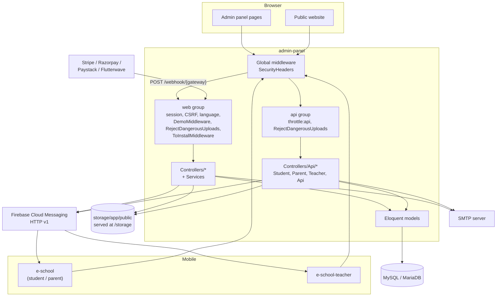
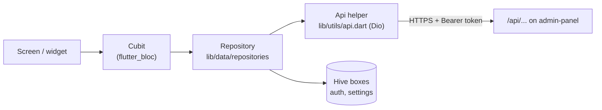
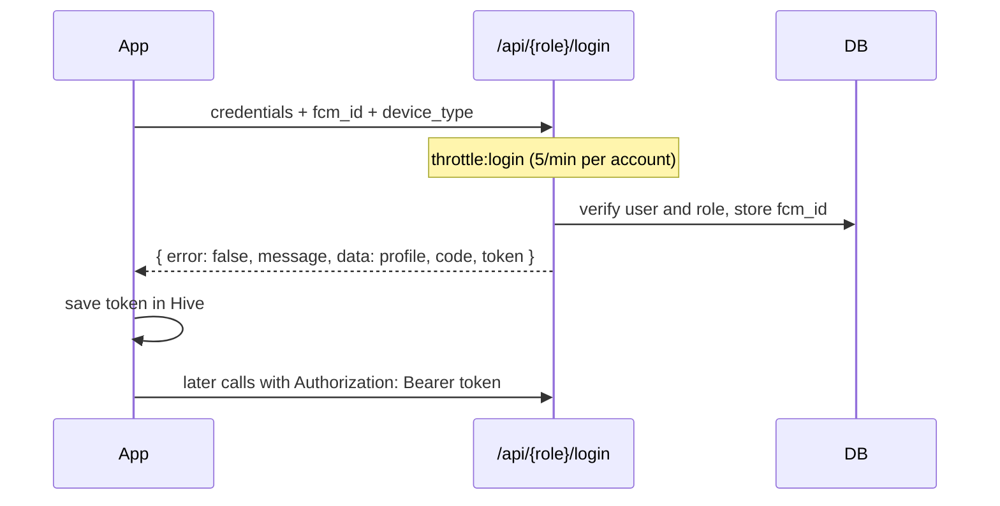

This page shows how the parts of eSchool fit together: what runs where, how requests move through the server, and how the apps, Firebase and the payment gateways connect to it. Each topic has its own detailed page, linked from the sections below.

## Deployment model

Each install serves **one school**. There is no multi-school tenancy: all data belongs to the single school configured in Settings. One Laravel application in `admin-panel/` does three jobs on the same domain and database:

1. **Admin panel.** Server-rendered Blade pages for staff, behind session login at `/login`.
2. **Public website.** The school's marketing site and online admission form at `/`.
3. **REST API.** JSON endpoints under `/api` for the two Flutter apps, with Laravel Sanctum token authentication.

## Server side

### Routing

Routes are registered in [`bootstrap/app.php`](https://github.com/ShawnDaPrawn/Eschool/blob/main/admin-panel/bootstrap/app.php):

| File | Prefix | Used by |
|---|---|---|
| [`routes/web.php`](https://github.com/ShawnDaPrawn/Eschool/blob/main/admin-panel/routes/web.php) | `/` | Public website, login and password reset, every admin module, `/webhook/*` payment callbacks |
| [`routes/api.php`](https://github.com/ShawnDaPrawn/Eschool/blob/main/admin-panel/routes/api.php) | `/api` | `/api/student/*`, `/api/parent/*`, `/api/teacher/*`, plus shared endpoints such as `/api/forgot-password` and `/api/logout` |
| [`routes/console.php`](https://github.com/ShawnDaPrawn/Eschool/blob/main/admin-panel/routes/console.php) | — | Scheduled tasks (see [Scheduled Tasks and Commands](Scheduled-Tasks-and-Commands)) |
| `packages/laravel-wizard-installer/routes/routes.php` | `/install` | The web installer (see [Installation Wizard](Installation-Wizard)) |
| (framework) | `/up` | Laravel health check |

### Middleware

`bootstrap/app.php` sets up the middleware:

- **Every response:** `SecurityHeaders`.
- **`web` group:** `LanguageManager` (UI language from the session), cookies and session, `ShareErrorsFromSession`, `SubstituteBindings`, `DemoMiddleware` (blocks writes when `DEMO_MODE=true`) and `RejectDangerousUploads`. The installer service provider prepends `ToInstallMiddleware`, which sends every request to `/install` until `storage/installed` exists. CSRF protection applies to everything except `webhook/*`.
- **`api` group:** Sanctum's stateful-frontend middleware, `throttle:api` (60 requests a minute per user, or per IP when not signed in), `SubstituteBindings` and `RejectDangerousUploads`.
- **Route aliases:**

| Alias | Purpose |
|---|---|
| `Role` | `CheckRole`, used on the admin panel route group |
| `role:Teacher` | spatie role check on the teacher API |
| `permission:...` | spatie permission checks |
| `checkChild` | `CheckChild`: the parent's `child_id` must belong to them |
| `checkStudent` | `CheckStudent`: the `student_id` a teacher sends must be in a class section where they are class teacher |
| `student.session.active` | `EnsureStudentSessionIsActive` |
| `parent.children.session.active` | `EnsureParentChildrenSessionIsActive` |
| `throttle:login` | 5 attempts a minute per account and path on login and password reset endpoints |

The full list is on [Admin Panel Overview](Admin-Panel-Overview#middleware). The security reasons behind each layer are on [Security Model](Security-Model).

### Code organisation

Controllers stay thin where they can and hand work to `app/Services`: fees collection and reports, exam reports, online-exam scoring, uploads, images, ID cards, mail and session years. Gateway code sits behind one interface in `app/Services/Payment`. Global helper functions are in `app/Helpers`. `settings_helper.php` reads the database-backed settings (`getSettings()`, `schoolSetting()`, `schoolLogoUrl()`, date and time formats, grade lookup). `notification_helper.php` sends FCM pushes. List screens in the panel use Bootstrap Table, which calls a JSON endpoint per module. `BootstrapTableService` builds those responses. Details: [Admin Panel Overview](Admin-Panel-Overview).

### Data

- **Relational data:** MySQL/MariaDB, in 91 migrations. Most academic records carry a `session_year_id`, so each school year is its own slice of data. Starting a new session year copies class subjects, teacher assignments, timetables, fee types, exam grades and leave settings forward (`app/Actions/Transfers/*`, called from `SessionYearService`). See [Database Schema](Database-Schema) and [Academic Structure](Academic-Structure).
- **Settings:** most runtime configuration is rows in the `settings` table, edited in the admin UI. That covers school details and logos, the FCM project, payment keys, chat settings and the app version numbers. The table is the only place these are stored: the admin forms never write to `.env`. On every boot, `SettingsConfigService` (called from `AppServiceProvider::boot()`) copies the school name, time zone, mail server and Paystack keys from the table into Laravel config, falling back to `.env` where a setting is empty. That keeps `php artisan optimize` and `config:cache` safe. `.env` holds the infrastructure settings: database, app URL, debug and demo flags, and default mail. See [Configuration](Configuration).
- **Files:** uploads go to the `public` disk (`storage/app/public`). They are served at `/storage/...` through the `public/storage` symlink. The apps build file URLs from `storageUrl = '$baseUrl/storage/'`.
- **Roles and permissions:** spatie/laravel-permission tables, seeded by `InstallationSeeder`. See [Roles and Permissions](Roles-and-Permissions).

### Background work

`.env.example` sets `QUEUE_CONNECTION=sync`, so nothing is queued. Emails and push notifications are sent during the request that triggers them. Scheduled cleanups run from `routes/console.php`, and the server needs the usual Laravel cron entry (`php artisan schedule:run` every minute). See [Scheduled Tasks and Commands](Scheduled-Tasks-and-Commands).

## Client side

### Admin panel UI

Blade templates in `resources/views`, styled with Bootstrap. jQuery and plugins under `public/assets` drive the pages: Bootstrap Table, Select2, TinyMCE/Jodit editors, KaTeX for exam questions, ApexCharts on the dashboard. The panel loads these pre-built assets directly. The Vite setup in `package.json` is the Laravel default and is not needed to run the panel. Translations reach the browser through `/common/js/lang`.

### Mobile apps

Both Flutter apps use the same layering:

- The base URL is a compile-time constant in `lib/utils/constants.dart`.
- On login the API returns a Sanctum token. The app keeps it in the Hive `authBoxKey` box and sends it as `Authorization: Bearer <token>` on every call. Tokens expire after `SANCTUM_EXPIRATION` minutes, 43200 (30 days) by default.
- Push notifications come in through `firebase_messaging` and are shown with `awesome_notifications`. Crashes go to Firebase Crashlytics.
- The student/parent app takes payments through the native SDKs (`flutter_stripe`, `razorpay_flutter`) or webviews (`webview_flutter`). The server never trusts the app's word that a payment succeeded. It confirms through the gateway API or the gateway's signed webhook.

See [Mobile Apps Overview](Mobile-Apps-Overview).

## Key flows

### Logging in from an app

Each role has its own login endpoint. Students sign in with their GR (admission) number, which is stored in `users.email`. Parents and teachers sign in with email. Before it issues a token, the endpoint checks that the account has the right role and is active. For students it also checks that they have an active `student_sessions` row for the current session year. Every API response, success or error, uses the envelope `error`, `message`, `data`, `code` from `ResponseService`. See [API Overview](API-Overview).

### Push notifications

An admin action (an announcement, a custom notification, a fee reminder) or an app action (a chat message, a new assignment, a leave decision) calls `sendSimpleNotification()` or `sendNotificationToTopic()` in `app/Helpers/notification_helper.php`. The helper gets an OAuth access token from the Firebase service-account file, looks up each recipient's `users.fcm_id` and `device_type`, and posts to `https://fcm.googleapis.com/v1/projects/{project_id}/messages:send`. The `project_id` comes from the settings table. See [Notifications](Notifications).

### Online fee payment

The app asks the API to start a payment. The server works out the amount from the fee records, never from the app, and creates the gateway order or intent plus a `payment_transactions` row. The app completes checkout with the gateway. The gateway then calls `/webhook/{gateway}`, the server verifies the signature or secret hash, and only then are the fees marked paid. See [Payments](Payments) for the per-gateway details and a sequence diagram.

## Cross-cutting concerns

| Concern | Where |
|---|---|
| Authentication | Web session guard (`/login`), Sanctum tokens (`/api/*/login`) |
| Authorization | spatie permissions on admin routes and controllers, role middleware and per-query scoping in the API. See [Roles and Permissions](Roles-and-Permissions) |
| Localization | `LanguageManager` and `languages` table on the server, JSON language files in each app. See [Localization](Localization) |
| Security headers, upload filtering | `SecurityHeaders`, `RejectDangerousUploads`, `UploadService`. See [Security Model](Security-Model) |
| Updates | In-panel ZIP updater. See [System Update](System-Update) |
| Observability | Laravel logs in `storage/logs`, Firebase Crashlytics and Analytics in the apps |

## See also

- [Repository Layout](Repository-Layout)
- [Admin Panel Overview](Admin-Panel-Overview)
- [API Overview](API-Overview)
- [Mobile Apps Overview](Mobile-Apps-Overview)
- [Security Model](Security-Model)
