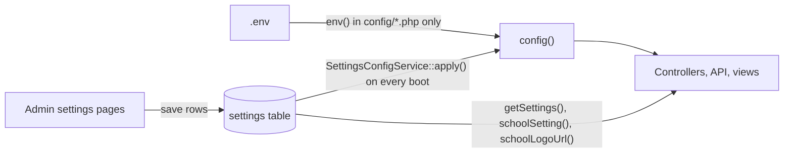

The admin panel is configured in two places: environment variables in `admin-panel/.env` (read through `config/*.php`), and rows in the database table `settings` that the admin UI edits. This page lists every key in `.env.example`, the other environment variables the config files read, the app-specific config files, how admin settings override the `.env` values at runtime, and the `settings` keys with the screens that write them. For click-by-click instructions on the settings screens, see the end-user docs, for example [General Settings](https://shawndaprawn.github.io/Eschool/admin-panel/general-settings/).

## How configuration flows

- `.env` is read only by `config/*.php`. Nothing in `app/`, `bootstrap/`, `database/`, `resources/views` or `routes/` calls `env()`; [SettingsConfigTest](https://github.com/ShawnDaPrawn/Eschool/blob/main/admin-panel/tests/Feature/SettingsConfigTest.php) fails the build if one is added.
- The settings screens save to the `settings` table only. Nothing in the app rewrites `.env` after installation (the old `changeEnv()` helper is gone). The wizard installer is the only code that edits `.env` (`DB_*`, `APP_URL`, `APP_KEY`).
- On every boot, `AppServiceProvider::boot()` calls [SettingsConfigService::apply()](https://github.com/ShawnDaPrawn/Eschool/blob/main/admin-panel/app/Services/SettingsConfigService.php), which copies the school name, timezone, mail server and Paystack settings over the values loaded from `.env` (see [Settings that override .env](#settings-that-override-env)).
- Everything else (logos, session year, payment gateways other than Paystack, chat limits, app versions) is read straight from the table with `getSettings()` or the `schoolSetting()` helper.
- Because of this, `php artisan config:cache` and `php artisan optimize` are supported. See [Deployment](Deployment#caching).

## .env.example

[admin-panel/.env.example](https://github.com/ShawnDaPrawn/Eschool/blob/main/admin-panel/.env.example), grouped. "Default" is the value in `.env.example`; "Config fallback" is what the config file uses if the key is missing entirely.

### Application

| Key | Default | Config fallback | Meaning |
|---|---|---|---|
| `APP_NAME` | `e-School` | `Laravel` | Initial `config('app.name')`. At runtime the `school_name` setting replaces it whenever that setting is non-empty. `APP_NAME` itself still names the session cookie (`<slug>_session`) and the cache and Redis prefixes, so renaming the school no longer changes the cookie name. |
| `APP_KEY` | empty | none | Encryption key for cookies, sessions and signed URLs. Must be generated before the first web request (`php artisan key:generate`); with an empty key every web page fails with `MissingAppKeyException`. The installer generates a fresh one at the end (`key:generate --force`). |
| `APP_ENV` | `production` | `production` | Environment name. In `production`, `db:seed` and `migrate` need `--force`. |
| `APP_DEBUG` | `false` | `false` | Detailed error pages, the `details` field in API errors, and Debugbar (when the dev package is installed). Keep `false` in production. |
| `APP_URL` | `http://localhost` | `http://localhost` | `config('app.url')`. Used for the public disk URL (`APP_URL/storage`), Sanctum's stateful domains, footer links, the trusted host names, and the default of `SESSION_SECURE_COOKIE` (true when it starts with `https://`). The installer's Keys step writes it. |
| `TRUSTED_HOSTS` | empty | empty | `config('app.trusted_hosts')`. Other host names the panel answers on besides the `APP_URL` host and its subdomains, comma separated. In production any other host gets 400 once installed; see [Deployment](Deployment#https-proxies-and-hosts). |
| `DEMO_MODE` | `false` | `false` | `config('app.demo_mode')`. When true, `DemoMiddleware` blocks most non-GET requests, the login page offers sample accounts, the payment and mail settings forms show `xxxx` instead of the stored values, and `GET /api/settings?type=app_settings` returns `is_demo`. |

### Logging

| Key | Default | Config fallback | Meaning |
|---|---|---|---|
| `LOG_CHANNEL` | `stack` | `stack` | `stack` writes to the `daily` channel, `storage/logs/laravel-YYYY-MM-DD.log`, 14 files kept. `single` (one `laravel.log`) is also defined. |
| `LOG_DEPRECATIONS_CHANNEL` | `null` | `null` | Where PHP deprecation notices go. |
| `LOG_LEVEL` | `error` | `debug` | Minimum level written. `MailService` logs failed emails at `info` (passwords and the email body are left out); keep this at `warning` or higher in production. |

### Database

| Key | Default | Config fallback | Meaning |
|---|---|---|---|
| `DB_CONNECTION` | `mysql` | `mysql` | Only MySQL/MariaDB is supported by the migrations. |
| `DB_HOST` | `127.0.0.1` | `127.0.0.1` | Written by the installer. |
| `DB_PORT` | `3306` | `3306` | Written by the installer. |
| `DB_DATABASE` | `eschool` | `forge` | Written by the installer. Tests require a name ending in `_test`. |
| `DB_USERNAME` | `root` | `forge` | Written by the installer. |
| `DB_PASSWORD` | empty | empty | Written by the installer. |

The `mysql` connection uses `utf8mb4`/`utf8mb4_unicode_ci`, `strict => false`, `engine => InnoDB`, and an empty table prefix.

### Drivers, sessions and tokens

| Key | Default | Config fallback | Meaning |
|---|---|---|---|
| `BROADCAST_DRIVER` | `log` | `null` | No broadcasting is used by the app. |
| `CACHE_DRIVER` | `file` | `file` | Default cache store (`storage/framework/cache/data`). Used by Spatie's permission cache (24 hours) and the scheduler's overlap lock. `config/cache.php` reads `CACHE_DRIVER`, not Laravel 12's `CACHE_STORE`. |
| `FILESYSTEM_DISK` | `local` | `local` | Default disk. Uploads are written to the `public` disk explicitly (`storage/app/public`, served at `/storage`); private files such as the Firebase service account use `local` (`storage/app`). |
| `QUEUE_CONNECTION` | `sync` | `sync` | Nothing in the app is queued; see [Deployment](Deployment#queue-workers). |
| `SESSION_DRIVER` | `file` | `file` | Admin panel sessions (`storage/framework/sessions`). |
| `SESSION_LIFETIME` | `120` | `120` | Minutes. |
| `SANCTUM_EXPIRATION` | `43200` | `60 * 24 * 30` | Minutes before a mobile-app token expires (30 days). Expired tokens are pruned daily; see [Scheduled-Tasks-and-Commands](Scheduled-Tasks-and-Commands). |
| `MEMCACHED_HOST` | `127.0.0.1` | `127.0.0.1` | Only if `CACHE_DRIVER=memcached`. |
| `REDIS_HOST` | `127.0.0.1` | `127.0.0.1` | Only if a Redis driver is chosen. |
| `REDIS_PASSWORD` | `null` | none | |
| `REDIS_PORT` | `6379` | `6379` | |

### Mail

These are fallbacks. Once the Email Settings page has been saved, the `mail_*` settings replace them at runtime (an empty setting leaves the `.env` value in place).

| Key | Default | Config fallback | Overridden by setting |
|---|---|---|---|
| `MAIL_MAILER` | `smtp` | `log` | `mail_mailer` (config `mail.default`) |
| `MAIL_HOST` | empty | `smtp.gmail.com` | `mail_host` |
| `MAIL_PORT` | empty | `587` | `mail_port` (cast to int) |
| `MAIL_USERNAME` | empty | empty | `mail_username` |
| `MAIL_PASSWORD` | empty | empty | `mail_password` |
| `MAIL_ENCRYPTION` | `tls` | `tls` | `mail_encryption` |
| `MAIL_FROM_ADDRESS` | empty | `hello@example.com` | `mail_send_from` (config `mail.from.address`, also used as the sender by several controllers) |
| `MAIL_FROM_NAME` | `"${APP_NAME}"` | `Example` | If it equals `APP_NAME` (as in `.env.example`), it follows the `school_name` setting; a different value of its own is kept. |

The `smtp` mailer in `config/mail.php` sets `verify_peer => false`, so the SMTP server's TLS certificate is not verified. The Email Settings form offers `smtp`, `mailgun`, `sendmail`, `postmark` and `amazon_ses`; `config/mail.php` defines the SES mailer as `ses`, so choosing "Amazon SES" makes sending fail with "Mailer [amazon_ses] is not defined." Mailgun and Postmark also need the `MAILGUN_*` or `POSTMARK_TOKEN` keys below, which only `.env` can set.

### Storage, broadcasting and leftovers

| Key | Default | Meaning |
|---|---|---|
| `AWS_ACCESS_KEY_ID`, `AWS_SECRET_ACCESS_KEY` | empty | Credentials for the `s3` disk, SES, SQS and DynamoDB cache. No code uses the `s3` disk. |
| `AWS_DEFAULT_REGION` | `us-east-1` | |
| `AWS_BUCKET` | empty | |
| `AWS_USE_PATH_STYLE_ENDPOINT` | `false` | |
| `PUSHER_APP_ID`, `PUSHER_APP_KEY`, `PUSHER_APP_SECRET` | empty | Pusher broadcasting connection (unused). |
| `PUSHER_APP_CLUSTER` | `mt1` | |
| `MIX_PUSHER_APP_KEY`, `MIX_PUSHER_APP_CLUSTER` | references to the Pusher keys | Only for a Laravel Mix front-end build, which this app does not have. |
| `LOGO1`, `LOGO2`, `FAVICON`, `LOGIN_IMAGE` | empty | Unused. Logos, favicon and login image now come from the `logo1`, `logo2`, `favicon` and `login_image` settings; the only remaining mentions of these keys are commented-out lines in `config/global.php`. |

## Environment variables not in .env.example

Read by `config/*.php` but missing from `.env.example`. Most are Laravel defaults; the app-specific ones are in bold.

| Key | Read in | Default | Notes |
|---|---|---|---|
| **`TIMEZONE`** | `config/app.php` (`timezone`) | `UTC` | Fallback only: a valid `time_zone` setting replaces it on boot. The settings migration seeds `time_zone = Africa/Johannesburg` (Pretoria, South Africa Standard Time), so a fresh install runs in that zone until General Settings is changed. `.env.example` sets the same value. |
| `ASSET_URL` | `config/app.php` | `null` | |
| `BCRYPT_ROUNDS` | `config/hashing.php` | `10` | phpunit.xml sets 4. |
| **`DB_PERSISTENT`** | `config/database.php` (`PDO::ATTR_PERSISTENT`) | `true` | Persistent MySQL connections are on unless set to `false`. The tests set it to `false` because shared persistent connections broke test transactions. |
| `DATABASE_URL`, `DB_SOCKET`, `MYSQL_ATTR_SSL_CA`, `DB_FOREIGN_KEYS` | `config/database.php` | | `DB_FOREIGN_KEYS` applies to SQLite only. |
| `REDIS_CLIENT`, `REDIS_CLUSTER`, `REDIS_PREFIX`, `REDIS_URL`, `REDIS_DB`, `REDIS_CACHE_DB` | `config/database.php` | `phpredis`, `redis`, slug of `APP_NAME`, none, `0`, `1` | |
| `SESSION_CONNECTION`, `SESSION_STORE`, `SESSION_COOKIE`, `SESSION_DOMAIN` | `config/session.php` | | `SESSION_COOKIE` defaults to `<slug of APP_NAME>_session`. |
| `SESSION_SECURE_COOKIE` | `config/session.php` | true when `APP_URL` starts with `https://` | |
| `CACHE_PREFIX`, `MEMCACHED_PERSISTENT_ID`, `MEMCACHED_USERNAME`, `MEMCACHED_PASSWORD`, `MEMCACHED_PORT`, `DYNAMODB_CACHE_TABLE`, `DYNAMODB_ENDPOINT` | `config/cache.php` | | |
| `SQS_PREFIX`, `SQS_QUEUE`, `SQS_SUFFIX`, `REDIS_QUEUE`, `QUEUE_FAILED_DRIVER` | `config/queue.php` | | |
| `AWS_URL`, `AWS_ENDPOINT` | `config/filesystems.php` | | |
| `LOG_SLACK_WEBHOOK_URL`, `LOG_PAPERTRAIL_HANDLER`, `PAPERTRAIL_URL`, `PAPERTRAIL_PORT`, `LOG_STDERR_FORMATTER` | `config/logging.php` | | |
| `MAIL_SENDMAIL_PATH`, `MAIL_LOG_CHANNEL` | `config/mail.php` | `/usr/sbin/sendmail -t -i`, none | |
| `MAILGUN_DOMAIN`, `MAILGUN_SECRET`, `MAILGUN_ENDPOINT`, `POSTMARK_TOKEN` | `config/services.php` | `MAILGUN_ENDPOINT=api.mailgun.net` | Needed for the Mailgun and Postmark mailers. |
| **`PAYSTACK_PUBLIC_KEY`, `PAYSTACK_SECRET_KEY`, `PAYSTACK_PAYMENT_URL`, `PAYSTACK_MERCHANT_EMAIL`** | `config/paystack.php` (and the first two in `config/services.php`) | `''`, `''`, `https://api.paystack.co`, `''` | Fallbacks; the `paystack_*` settings replace the first two on boot. `PAYSTACK_PAYMENT_URL` is not used: payments always go to `https://api.paystack.co`. |
| **`TRUSTED_PROXIES`** | `config/trustedproxy.php` | `*` when `K_SERVICE` is set, otherwise none | Proxies whose `X-Forwarded-For` and `X-Forwarded-Proto` are believed: comma-separated addresses or ranges, or `*`. See [Deployment](Deployment#https-proxies-and-hosts). |
| **`CACHE_LIMITER`** | `config/cache.php` (`limiter`) | `database` when `K_SERVICE` is set, otherwise the default store | Cache store for rate limit counters and the wrong-password lockout; must be shared when there is more than one server. |
| **`SYSTEM_UPDATE_ENABLED`** | `config/system_update.php` | false when `K_SERVICE` is set, otherwise true | Whether the System Update page may install an uploaded zip. |
| `K_SERVICE` | the three rows above | | Set by Cloud Run; not something to set by hand. |
| **`RAZORPAY_WEBHOOK_SECRET`, `STRIPE_WEBHOOK_SECRET`, `FLW_SECRET_HASH`** | `config/services.php` | none | Fallback webhook secrets, used only when the matching settings row is empty (see [config/services.php](#configservicesphp)). |
| `RAZORPAY_API_KEY`, `RAZORPAY_SECRET_KEY`, `STRIPE_PUBLISHABLE_KEY`, `STRIPE_SECRET_KEY`, `FLW_PUBLIC_KEY`, `FLW_SECRET_KEY` | `config/services.php` | none | Defined but not read by the payment code, which takes these keys from the settings table. |
| `ABLY_KEY` | `config/broadcasting.php` | | |
| `SANCTUM_STATEFUL_DOMAINS` | `config/sanctum.php` | `localhost,localhost:3000,127.0.0.1,127.0.0.1:8000,::1` plus the `APP_URL` host | |
| `VIEW_COMPILED_PATH` | `config/view.php` | `storage/framework/views` | |
| `DEBUGBAR_ENABLED`, `DEBUGBAR_EDITOR`, `DEBUGBAR_REMOTE_SITES_PATH`, `DEBUGBAR_LOCAL_SITES_PATH`, `DEBUGBAR_THEME` | `config/debugbar.php` | `DEBUGBAR_ENABLED=null` (follows `APP_DEBUG`) | |

The installer's Database step writes `DB_PREFIX` when a prefix is entered, but `config/database.php` hard-codes `'prefix' => ''`, so it has no effect.

Variables read by the framework itself rather than a config file, used by the test suite: `LARAVEL_STORAGE_PATH` (moves `storage/`), `APP_MAINTENANCE_DRIVER`. `phpunit.xml` also sets `PULSE_ENABLED`, `TELESCOPE_ENABLED` and `NIGHTWATCH_ENABLED`, for packages the app does not install.

## Settings that override .env

[SettingsConfigService](https://github.com/ShawnDaPrawn/Eschool/blob/main/admin-panel/app/Services/SettingsConfigService.php) runs from `AppServiceProvider::boot()` on every request and every Artisan command:

| Setting | Config key |
|---|---|
| `school_name` | `app.name` |
| `mail_mailer` | `mail.default` |
| `mail_host` | `mail.mailers.smtp.host` |
| `mail_port` | `mail.mailers.smtp.port` (as an integer) |
| `mail_username` | `mail.mailers.smtp.username` |
| `mail_password` | `mail.mailers.smtp.password` |
| `mail_encryption` | `mail.mailers.smtp.encryption` |
| `mail_send_from` | `mail.from.address` |
| `paystack_public_key` | `paystack.publicKey` |
| `paystack_secret_key` | `paystack.secretKey` |
| `time_zone` | `app.timezone`, and `date_default_timezone_set()` (only if it is a valid PHP timezone identifier) |

Rules:

- A setting overrides only when its trimmed value is non-empty; otherwise the `.env` value stays.
- If reading the table throws a `QueryException` or `PDOException` (not installed or not migrated yet), nothing is overridden.
- `mail.from.name` is set to the new `app.name` only if it was equal to `app.name` before the overrides (the `.env.example` default `MAIL_FROM_NAME="${APP_NAME}"`).
- `php artisan config:cache` boots the app, so the cache file also contains the database values at the time it was built. They are re-applied from the table on every boot, so later changes still take effect. One consequence: a setting that is later emptied keeps the value baked into the cache instead of falling back to `.env`, until the cache is rebuilt.

Logos and other school values are read through two helpers in [settings_helper.php](https://github.com/ShawnDaPrawn/Eschool/blob/main/admin-panel/app/Helpers/settings_helper.php):

- `schoolSetting($type, $default = null)`: one setting's value, or `$default` when it is missing or empty.
- `schoolLogoUrl($type = 'logo1')`: `url(Storage::url(...))` of the uploaded `logo1` or `logo2`, or `url('assets/logo.svg')`.

## App-specific config files

### config/app.php

Besides the usual keys, `timezone` reads `TIMEZONE` (not `APP_TIMEZONE`) and `demo_mode` reads `DEMO_MODE`. The `providers` array is still used by Laravel 12; see [Admin-Panel-Overview](Admin-Panel-Overview#request-lifecycle).

### config/global.php

[config/global.php](https://github.com/ShawnDaPrawn/Eschool/blob/main/admin-panel/config/global.php) holds a few UI constants: `CIRCLE_SVG` (`/images/circle.svg`), `BUTTON_CLASS` (`btn btn-theme`), `SUCCESS_MSG_CLASS` (`alert alert-success`) and `ERROR_MSG_CLASS` (`alert alert-danger`). The `LOGO_SM`, `LOGO1` and `LOGO2` entries are commented out.

### config/installer.php

[config/installer.php](https://github.com/ShawnDaPrawn/Eschool/blob/main/admin-panel/config/installer.php) overrides the wizard package's defaults:

| Key | Value | Meaning |
|---|---|---|
| `icon` | `/assets/logo.svg` | Logo and favicon on the wizard pages. |
| `background` | commented out | The package default `/images/background.jpeg` is merged in, but that file does not exist in `public/images`. |
| `support_url` | `mailto:support@example.com` | "Contact support" link on the welcome and finish pages. Change it for your deployment. |
| `server.php` | `>= 8.3.0` (`80300`) | PHP version check. |
| `server.*` | `pdo_mysql`, `mbstring`, `fileinfo`, `openssl`, `tokenizer`, `json`, `curl` | Extension checks. |
| `folders` | `../storage/framework`, `../storage/logs`, `../bootstrap/cache` | Permission checks (paths relative to `public/`). |
| `database.seeders` | `false` | `migrate` runs without `--seed`. |
| `commands` | `db:seed --class=InstallationSeeder --force`, `db:seed --class=AddSuperAdminSeeder --force`, `db:seed --class=EmailSeeder --force`, `key:generate --force` | Run after the Keys step. |
| `admin_area.user` | `superadmin@gmail.com` / `superadmin` | Shown on the finish page. These are the credentials `AddSuperAdminSeeder` creates; change the password after the first login. |
| `login` | `/login` | Login link on the finish page. |

See [Installation-Wizard](Installation-Wizard) for how these are used.

### config/paystack.php

Read by the `unicodeveloper/laravel-paystack` package, which `PaystackPayment` extends (`Config::get('paystack.secretKey')` and `paystack.paymentUrl`):

| Key | Env fallback | Default | Overridden by setting |
|---|---|---|---|
| `publicKey` | `PAYSTACK_PUBLIC_KEY` | `''` | `paystack_public_key` |
| `secretKey` | `PAYSTACK_SECRET_KEY` | `''` | `paystack_secret_key` |
| `paymentUrl` | `PAYSTACK_PAYMENT_URL` | `https://api.paystack.co` | none; `PaystackPayment` ignores it and always uses `https://api.paystack.co` |
| `merchantEmail` | `PAYSTACK_MERCHANT_EMAIL` | `''` | none |

### config/services.php

Besides the stock `mailgun`, `postmark` and `ses` entries, it defines `services.razorpay` (`key`, `secret`, `webhook_secret`), `services.stripe` (`key`, `secret`, `webhook_secret`), `services.paystack` (`public_key`, `secret_key`) and `services.flutterwave` (`public_key`, `secret_key`, `secret_hash`). The comment above them still says the fee settings page writes these `.env` keys; it no longer does. Their only use is as a fallback in `PaymentService::webhookSecret()`:

| Gateway | Settings row used | Fallback when the row is empty |
|---|---|---|
| razorpay | `razorpay_webhook_secret` | `services.razorpay.webhook_secret` (`RAZORPAY_WEBHOOK_SECRET`) |
| stripe | `stripe_webhook_secret` | `services.stripe.webhook_secret` (`STRIPE_WEBHOOK_SECRET`) |
| paystack | `paystack_secret_key` | `services.paystack.secret_key` (`PAYSTACK_SECRET_KEY`) |
| flutterwave | `flutterwave_hash_key` | `services.flutterwave.secret_hash` (`FLW_SECRET_HASH`) |

When both are empty the webhook is refused. See [Payments](Payments).

### Other config files

`config/sanctum.php` sets `expiration` from `SANCTUM_EXPIRATION` and `guard => ['web']`. `config/session.php` defaults `secure` from `APP_URL`, with `http_only => true` and `same_site => lax`. `config/permission.php` caches permissions for 24 hours in the default store under `spatie.permission.cache`. `config/filesystems.php` defines `local` (`storage/app`), `public` (`storage/app/public`, URL `APP_URL/storage`) and `s3`, and the `public/storage` link.

## The settings table

The table is created by `2022_04_01_044234_create_settings_table.php` with three columns: `id`, `type` (text) and `message` (text). The model is [App\Models\Settings](https://github.com/ShawnDaPrawn/Eschool/blob/main/admin-panel/app/Models/Settings.php) (no timestamps, fillable `type` and `message`). There is no unique index on `type`; the code looks rows up by `type` and either updates or inserts.

- Read: `getSettings()` returns `[type => message]` for all rows, `getSettings('x')` for one type, and `schoolSetting('x')` the single value. Nothing is cached, so each call is a query.
- Written: each settings controller loops over its list of keys, updating the row if one with that `type` exists or inserting it otherwise. `Settings::updateOrCreate`, `updateOrInsert` and `firstOrCreate` are used in a few places.
- Seeded: the migrations insert `school_name`, `school_email` (`info@tokensoft.tech`), `school_phone` (`+27 12 345 6789`), `school_address` (`Pretoria, South Africa`), `time_zone` (`Africa/Johannesburg`), `currency_code` (`ZAR`), `currency_symbol` (`R`), `date_formate` (`d-m-Y`), `time_formate` (`h:i A`), `theme_color` (`#4C5EA6`), `update_warning_modal` (`1`) and `secondary_color` (`#38A3A5`). `InstallationSeeder` adds `system_version` and the ID card defaults; `AddSuperAdminSeeder` inserts `session_year = 1`. A later migration replaces those contact, address and timezone values only when a database still has the original India defaults.

### Keys by screen

| Screen (route) | Controller and permission | Keys |
|---|---|---|
| General Settings (`GET/POST /settings`) | `SettingController@index/update`, `setting-create` | `school_name`, `school_email`, `school_phone`, `school_address`, `school_tagline`, `time_zone`, `date_formate`, `time_formate`, `theme_color`, `secondary_color`, `session_year`, `online_payment`, `facebook`, `instagram`, `linkedin`, `maplink`, `recaptcha_status`, `recaptcha_site_key`, `recaptcha_secret_key`; files `logo1`, `logo2`, `favicon`, `login_image` (stored on the public disk under `logo/`) |
| Email Settings (`GET/POST /email-settings`, `POST /verify-email-settings`) | `SettingController@email_index/email_update/verifyEmailConfigration`, `email-setting-create` | `mail_mailer`, `mail_host`, `mail_port`, `mail_username`, `mail_password`, `mail_encryption`, `mail_send_from`; `email_configration_verification` (set to 0 on save, 1 after a test email is sent). The form shows the current `config('mail.*')` values. |
| FCM / notification settings (`GET /fcm-settings`, `POST /notification-setting`) | `SettingController@fcm_index` (`fcm-setting-create`), `@notification_setting` (`setting-create`) | `sender_id`, `project_id`, `service_account_file` (the JSON is validated for `private_key` and `client_email`, then stored on the private `local` disk as `firebase/service_account.json`) |
| App Settings (`GET/POST /app-settings`) | `SettingController@app_index/app_update`, `setting-create` | `app_link`, `ios_app_link`, `app_version`, `ios_app_version`, `force_app_update`, `app_maintenance`, `teacher_app_link`, `teacher_ios_app_link`, `teacher_app_version`, `teacher_ios_app_version`, `teacher_force_app_update`, `teacher_app_maintenance` |
| Chat Settings (`GET /chat-settings`, `POST /chat-settings-update`) | `SettingController@chat_setting_index/chat_setting_update`, `chat-settings` | `max_files_or_images_in_one_message`, `max_file_size_in_bytes` (despite the name, the value is in MB; the API multiplies it by 1,000,000), `max_characters_in_text_message`, `automatically_messages_removed_days` |
| Page content (`POST /setting-update`) | `SettingController@setting_page_update`, `setting-create` | Any `type` sent by the form: `privacy_policy`, `terms_condition`, `about_us`, `contact_us`, and `online_exam_terms_condition` from the online exam terms page |
| Fees configuration (`GET /fees-config`, `POST /fees-config/update`) | `Fees\ConfigController@feesConfigIndex/feesConfigUpdate`, `fees-config` | `razorpay_status`, `razorpay_api_key`, `razorpay_secret_key`, `razorpay_webhook_secret`, `razorpay_webhook_url`, `razorpay_currency_code`; `stripe_status`, `stripe_publishable_key`, `stripe_secret_key`, `stripe_webhook_secret`, `stripe_webhook_url`, `stripe_currency_code`; `paystack_status`, `paystack_public_key`, `paystack_secret_key`, `paystack_webhook_url`, `paystack_currency_code` (the form's `paystack_payment_url` is not saved); `flutterwave_status`, `flutterwave_public_key`, `flutterwave_secret_key`, `flutterwave_hash_key`, `flutterwave_webhook_url`, `flutterwave_currency_code`; `currency_code`, `currency_symbol`, `compulsory_fee_payment_mode`, `is_student_can_pay_fees`, `enable_fees_installment`, `default_due_charges` |
| ID card settings (`GET /id-card-settings`, `POST /id-card-settings/update`) | `Student\IdCardController@idCardSettingIndex/updateIdCardSetting` | `header_color`, `footer_color`, `header_footer_text_color`, `layout_type`, `profile_image_style`, `card_width`, `card_height`, `student_id_card_fields`, `staff_id_card_fields` (comma-separated), `background_transparency`, `background_size`; files `background_image`, `signature` (public disk, `Idcard/`) |
| System Update (`POST /system-update`) | `SystemUpdateController@update`, Super Admin role | `system_version` |

Other keys:

| Key | Purpose |
|---|---|
| `session_year` | Id of the current `session_years` row. Read in about 150 places (`getSettings('session_year')['session_year']`), including the student and parent session-active middleware. Written by `SessionYearService::makeCurrent()` (General Settings, **Make current** on the Session Years page, or a new year created with "Make this the current session year"), which also flips `session_years.default` and, if it changed, runs `ResetLessonSemesters`. See [Academic-Structure](Academic-Structure). |
| `system_version` | Installed version (`3.5.0` from `InstallationSeeder`); checked and updated by [System-Update](System-Update). |
| `update_warning_modal` | Read by `after-update-note-modal.blade.php` to decide whether to show the post-update notice. `HomeController@updateWarningModal` (`GET /update-warning-modal`) does not change it. |
| `fees_due_date`, `fees_due_charges` | Read by `GET /api/settings?type=app_settings` if present; no admin screen writes them (the due date and charges are stored per session year in `session_years.fee_due_date` and `fee_due_charges`). |

### What the apps see

`GET /api/settings?type=...` (`ApiController@getSettings`) accepts `privacy_policy`, `contact_us`, `about_us`, `terms_condition`, `app_settings` and `fees_settings`. For `app_settings` it returns the app links and versions, maintenance and force-update flags, school name and tagline, the current session year, chat limits (defaults 10 files, 10,000,000 bytes, 500 characters, 30 days), currency, and for each enabled gateway only its status, public key and currency code. Secret keys and webhook secrets are not sent. See [Mobile-App-Configuration](Mobile-App-Configuration) and [API-Overview](API-Overview).

`GET /privacy-policy` and `GET /terms-conditions` print the `privacy_policy` and `terms_condition` settings directly.

A parent or teacher accepts those two pages in the app, after NavigateEd's own terms, the first time they sign in. The school writes them on the branding card of General Settings, or on the Privacy Policy and Terms pages (`POST /setting-update`). Leaving a page blank stores an empty string: that page is not shown. Editing a page later does not ask anyone again. See [API-Parent](API-Parent#terms-a-parent-must-accept).

## UI settings versus .env

| Configure in the admin UI (settings table) | Configure in .env |
|---|---|
| School name, contact details, logos, favicon, login image, colours, timezone, date and time formats, session year | `APP_KEY`, `APP_ENV`, `APP_DEBUG`, `APP_URL`, `DEMO_MODE` |
| Mail server, port, credentials, encryption and sender address | Database credentials (`DB_*`), `DB_PERSISTENT` |
| Firebase sender id, project id and service account file | Cache, session, queue and filesystem drivers |
| Payment gateway keys, webhook secrets, currencies, installment options | `LOG_CHANNEL`, `LOG_LEVEL` |
| App store links, minimum app versions, maintenance switches | `SANCTUM_EXPIRATION`, `SESSION_SECURE_COOKIE` |
| Chat limits and retention days | Mailgun or Postmark credentials, `MAIL_FROM_NAME` |
| Privacy policy, terms, about and contact pages; email templates (table `email_tempalates`); public website sections (table `web_settings`) | |

Where a value exists in both places, the setting wins whenever it is non-empty: school name over `APP_NAME`, `time_zone` over `TIMEZONE`, `mail_*` over `MAIL_*`, `paystack_*` over `PAYSTACK_*`, and the webhook secret rows over the `services.*` fallbacks. `.env` values matter only before the corresponding screen has been saved.

## See also

- [Deployment](Deployment)
- [Installation-Wizard](Installation-Wizard)
- [Admin-Panel-Overview](Admin-Panel-Overview)
- [Payments](Payments)
- [Notifications](Notifications)
- [Chat](Chat)
- [Mobile-App-Configuration](Mobile-App-Configuration)
