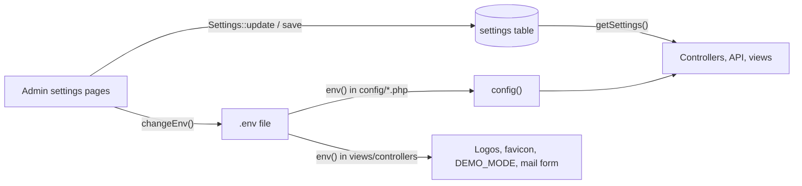

The admin panel is configured in two places: environment variables in `admin-panel/.env` (read through `config/*.php`), and rows in the database table `settings` that the admin UI edits. This page lists every key in `.env.example`, every other environment variable the code reads, the app-specific config files, and the `settings` keys with the screens that write them. For click-by-click instructions on the settings screens, see the end-user docs, for example [General Settings](https://shawndaprawn.github.io/Eschool/admin-panel/general-settings/).

## How configuration flows

- Most runtime behaviour (school details, session year, payment gateways, chat limits, app versions) is read from the `settings` table with `getSettings()`.
- Several settings screens also write some values into `.env` with `changeEnv()` (in [settings_helper.php](https://github.com/ShawnDaPrawn/Eschool/blob/main/admin-panel/app/Helpers/settings_helper.php)). Some of those `.env` keys are read by `config/*.php` (mail, timezone, app name, Paystack), some directly with `env()` in views, and some by nothing at all.
- The web server user therefore needs write access to `.env`. See [Deployment](Deployment#file-permissions).

## .env.example

[admin-panel/.env.example](https://github.com/ShawnDaPrawn/Eschool/blob/main/admin-panel/.env.example), grouped. "Default" is the value in `.env.example`; "Config fallback" is what the config file uses if the key is missing entirely.

### Application

| Key | Default | Config fallback | Meaning |
|---|---|---|---|
| `APP_NAME` | `e-School` | `Laravel` | `config('app.name')`. Also forms the session cookie name (`<slug>_session`) and the cache and Redis prefixes. Overwritten by General Settings with the school name (written as `APP_NAME="<school name>"`). |
| `APP_KEY` | empty | none | Encryption key for cookies, sessions and signed URLs. Must be generated before the first web request (`php artisan key:generate`); with an empty key every web page fails with `MissingAppKeyException`. The installer generates a fresh one at the end (`key:generate --force`). |
| `APP_ENV` | `production` | `production` | Environment name. In `production`, `db:seed` and `migrate` need `--force`. |
| `APP_DEBUG` | `false` | `false` | Detailed error pages, the `details` field in API errors, and Debugbar (when the dev package is installed). Keep `false` in production. |
| `APP_URL` | `http://localhost` | `http://localhost` | Base URL. Used for the public disk URL (`APP_URL/storage`), Sanctum's stateful domains, and the default of `SESSION_SECURE_COOKIE` (true when it starts with `https://`). The installer's Keys step writes it. |
| `DEMO_MODE` | `false` | (read with `env()` only) | When true, `DemoMiddleware` blocks most non-GET requests, the payment and mail settings forms show `xxxx` instead of the stored keys, and `GET /api/settings?type=app_settings` returns `is_demo`. |

### Logging

| Key | Default | Config fallback | Meaning |
|---|---|---|---|
| `LOG_CHANNEL` | `stack` | `stack` | `stack` writes to the `single` channel, `storage/logs/laravel.log`. `daily` (14 files) is also defined. |
| `LOG_DEPRECATIONS_CHANNEL` | `null` | `null` | Where PHP deprecation notices go. |
| `LOG_LEVEL` | `error` | `debug` | Minimum level written. `MailService` logs failed emails (including the generated passwords in the payload) at `info`, so keep this at `warning` or higher in production. |

### Database

| Key | Default | Config fallback | Meaning |
|---|---|---|---|
| `DB_CONNECTION` | `mysql` | `mysql` | Only MySQL/MariaDB is supported by the migrations. |
| `DB_HOST` | `127.0.0.1` | `127.0.0.1` | Written by the installer. |
| `DB_PORT` | `3306` | `3306` | Written by the installer. |
| `DB_DATABASE` | `eschool` | `forge` | Written by the installer. Tests require a name ending in `_test`. |
| `DB_USERNAME` | `root` | `forge` | Written by the installer. |
| `DB_PASSWORD` | empty | empty | Written by the installer. |

The `mysql` connection uses `utf8mb4`/`utf8mb4_unicode_ci`, `strict => false`, `engine => InnoDB`, and an empty table prefix.

### Drivers, sessions and tokens

| Key | Default | Config fallback | Meaning |
|---|---|---|---|
| `BROADCAST_DRIVER` | `log` | `null` | No broadcasting is used by the app. |
| `CACHE_DRIVER` | `file` | `file` | Default cache store (`storage/framework/cache/data`). Used by Spatie's permission cache (24 hours) and the scheduler's overlap lock. `config/cache.php` reads `CACHE_DRIVER`, not Laravel 12's `CACHE_STORE`. |
| `FILESYSTEM_DISK` | `local` | `local` | Default disk. Uploads are written to the `public` disk explicitly (`storage/app/public`, served at `/storage`); private files such as the Firebase service account use `local` (`storage/app`). |
| `QUEUE_CONNECTION` | `sync` | `sync` | Nothing in the app is queued; see [Deployment](Deployment#queue-workers). |
| `SESSION_DRIVER` | `file` | `file` | Admin panel sessions (`storage/framework/sessions`). |
| `SESSION_LIFETIME` | `120` | `120` | Minutes. |
| `SANCTUM_EXPIRATION` | `43200` | `60 * 24 * 30` | Minutes before a mobile-app token expires (30 days). Expired tokens are pruned daily; see [Scheduled-Tasks-and-Commands](Scheduled-Tasks-and-Commands). |
| `MEMCACHED_HOST` | `127.0.0.1` | `127.0.0.1` | Only if `CACHE_DRIVER=memcached`. |
| `REDIS_HOST` | `127.0.0.1` | `127.0.0.1` | Only if a Redis driver is chosen. |
| `REDIS_PASSWORD` | `null` | none | |
| `REDIS_PORT` | `6379` | `6379` | |

### Mail

| Key | Default | Config fallback | Meaning |
|---|---|---|---|
| `MAIL_MAILER` | `smtp` | `log` | Mailer name. Written by Email Settings. |
| `MAIL_HOST` | empty | `smtp.gmail.com` | Written by Email Settings. |
| `MAIL_PORT` | empty | `587` | Written by Email Settings. |
| `MAIL_USERNAME` | empty | empty | Written by Email Settings. |
| `MAIL_PASSWORD` | empty | empty | Written by Email Settings. |
| `MAIL_ENCRYPTION` | `tls` | `tls` | Written by Email Settings. |
| `MAIL_FROM_ADDRESS` | empty | `hello@example.com` | Written by Email Settings (field `mail_send_from`). Several controllers read it with `env()` as the sender address. |
| `MAIL_FROM_NAME` | `"${APP_NAME}"` | `Example` | Not written by the UI. |

The `smtp` mailer in `config/mail.php` sets `verify_peer => false`, so the SMTP server's TLS certificate is not verified. The Email Settings form offers `smtp`, `mailgun`, `sendmail`, `postmark` and `amazon_ses`; `config/mail.php` defines the SES mailer as `ses`, so choosing "Amazon SES" makes sending fail with "Mailer [amazon_ses] is not defined." Mailgun and Postmark also need the `MAILGUN_*` or `POSTMARK_TOKEN` keys below.

### Storage, broadcasting and branding

| Key | Default | Meaning |
|---|---|---|
| `AWS_ACCESS_KEY_ID`, `AWS_SECRET_ACCESS_KEY` | empty | Credentials for the `s3` disk, SES, SQS and DynamoDB cache. No code uses the `s3` disk. |
| `AWS_DEFAULT_REGION` | `us-east-1` | |
| `AWS_BUCKET` | empty | |
| `AWS_USE_PATH_STYLE_ENDPOINT` | `false` | |
| `PUSHER_APP_ID`, `PUSHER_APP_KEY`, `PUSHER_APP_SECRET` | empty | Pusher broadcasting connection (unused). |
| `PUSHER_APP_CLUSTER` | `mt1` | |
| `MIX_PUSHER_APP_KEY`, `MIX_PUSHER_APP_CLUSTER` | references to the Pusher keys | Only for a Laravel Mix front-end build, which this app does not have. |
| `LOGO1` | empty | Path on the public disk of the main logo (header, public website, login). Written by General Settings; read with `env('LOGO1')` in views. Falls back to `assets/logo.svg`. |
| `LOGO2` | empty | Second logo (login page, PDF receipts, academic calendar). Written by General Settings; read with `env()`. |
| `FAVICON` | empty | Favicon path on the public disk. Written by General Settings; read with `env()`. |
| `LOGIN_IMAGE` | empty | Written by General Settings but not read anywhere; the login background comes from the `login_image` setting. |

## Environment variables not in .env.example

These are read by `config/*.php` but missing from `.env.example`. Most are Laravel defaults; the app-specific ones are in bold.

| Key | Read in | Default | Notes |
|---|---|---|---|
| **`TIMEZONE`** | `config/app.php` (`timezone`) | `UTC` | Written by General Settings (`TIMEZONE='<zone>'`). The application timezone and the scheduler's timezone. |
| `ASSET_URL` | `config/app.php` | `null` | |
| `BCRYPT_ROUNDS` | `config/hashing.php` | `10` | phpunit.xml sets 4. |
| **`DB_PERSISTENT`** | `config/database.php` (`PDO::ATTR_PERSISTENT`) | `true` | Persistent MySQL connections are on unless set to `false`. The tests set it to `false` because shared persistent connections broke test transactions. |
| `DATABASE_URL`, `DB_SOCKET`, `MYSQL_ATTR_SSL_CA`, `DB_FOREIGN_KEYS` | `config/database.php` | | `DB_FOREIGN_KEYS` applies to SQLite only. |
| `REDIS_CLIENT`, `REDIS_CLUSTER`, `REDIS_PREFIX`, `REDIS_URL`, `REDIS_DB`, `REDIS_CACHE_DB` | `config/database.php` | `phpredis`, `redis`, slug of APP_NAME, none, `0`, `1` | |
| `SESSION_CONNECTION`, `SESSION_STORE`, `SESSION_COOKIE`, `SESSION_DOMAIN` | `config/session.php` | | `SESSION_COOKIE` defaults to `<slug of APP_NAME>_session`. |
| `SESSION_SECURE_COOKIE` | `config/session.php` | true when `APP_URL` starts with `https://` | |
| `CACHE_PREFIX`, `MEMCACHED_PERSISTENT_ID`, `MEMCACHED_USERNAME`, `MEMCACHED_PASSWORD`, `MEMCACHED_PORT`, `DYNAMODB_CACHE_TABLE`, `DYNAMODB_ENDPOINT` | `config/cache.php` | | |
| `SQS_PREFIX`, `SQS_QUEUE`, `SQS_SUFFIX`, `REDIS_QUEUE`, `QUEUE_FAILED_DRIVER` | `config/queue.php` | | |
| `AWS_URL`, `AWS_ENDPOINT` | `config/filesystems.php` | | |
| `LOG_SLACK_WEBHOOK_URL`, `LOG_PAPERTRAIL_HANDLER`, `PAPERTRAIL_URL`, `PAPERTRAIL_PORT`, `LOG_STDERR_FORMATTER` | `config/logging.php` | | |
| `MAIL_SENDMAIL_PATH`, `MAIL_LOG_CHANNEL` | `config/mail.php` | `/usr/sbin/sendmail -t -i`, none | |
| `MAILGUN_DOMAIN`, `MAILGUN_SECRET`, `MAILGUN_ENDPOINT`, `POSTMARK_TOKEN` | `config/services.php` | `MAILGUN_ENDPOINT=api.mailgun.net` | Needed for the Mailgun and Postmark mailers. |
| **`RAZORPAY_API_KEY`, `RAZORPAY_SECRET_KEY`, `RAZORPAY_WEBHOOK_SECRET`** | `config/services.php` (`services.razorpay.*`) | none | Written by the Fees configuration page. |
| **`STRIPE_PUBLISHABLE_KEY`, `STRIPE_SECRET_KEY`, `STRIPE_WEBHOOK_SECRET`** | `config/services.php` (`services.stripe.*`) | none | Written by the Fees configuration page. |
| **`PAYSTACK_PUBLIC_KEY`, `PAYSTACK_SECRET_KEY`** | `config/services.php` and `config/paystack.php` | empty | Written by the Fees configuration page. |
| **`PAYSTACK_PAYMENT_URL`** | `config/paystack.php` | `https://api.paystack.co` | Written by the Fees configuration page. |
| **`PAYSTACK_MERCHANT_EMAIL`** | `config/paystack.php` | empty | Not written by the UI. |
| **`FLW_PUBLIC_KEY`, `FLW_SECRET_KEY`, `FLW_SECRET_HASH`** | `config/services.php` (`services.flutterwave.*`) | none | Written by the Fees configuration page. |
| `ABLY_KEY` | `config/broadcasting.php` | | |
| `SANCTUM_STATEFUL_DOMAINS` | `config/sanctum.php` | `localhost,localhost:3000,127.0.0.1,127.0.0.1:8000,::1` plus the `APP_URL` host | |
| `VIEW_COMPILED_PATH` | `config/view.php` | `storage/framework/views` | |
| `DEBUGBAR_ENABLED`, `DEBUGBAR_EDITOR`, `DEBUGBAR_REMOTE_SITES_PATH`, `DEBUGBAR_LOCAL_SITES_PATH`, `DEBUGBAR_THEME` | `config/debugbar.php` | `DEBUGBAR_ENABLED=null` (follows `APP_DEBUG`) | |

Keys the app writes into `.env` that nothing reads: `LOGIN_IMAGE`, `SITE_KEY` and `SECRET_KEY` (reCAPTCHA, General Settings), `SENDER_ID` and `FIREBASE_PROJECT_ID` (FCM settings), `RAZORPAY_WEBHOOK_URL`, `STRIPE_WEBHOOK_URL`, `PAYSTACK_WEBHOOK_URL`, `FLW_WEBHOOK_URL` (Fees configuration). The installer's Database step writes `DB_PREFIX` when a prefix is entered, but `config/database.php` hard-codes `'prefix' => ''`, so it has no effect.

Variables read by the framework itself rather than a config file, used by the test suite: `LARAVEL_STORAGE_PATH` (moves `storage/`), `APP_MAINTENANCE_DRIVER`. `phpunit.xml` also sets `PULSE_ENABLED`, `TELESCOPE_ENABLED` and `NIGHTWATCH_ENABLED`, for packages the app does not install.

### env() calls outside config

Laravel stops loading `.env` once the configuration is cached (`php artisan config:cache` or `php artisan optimize`); after that, `env()` only sees real server environment variables. These keys are read with `env()` outside `config/`:

| Key | Where |
|---|---|
| `APP_NAME` | `layouts/footer.blade.php`, `web/footer.blade.php`, `AcademicCalendarService`, fee receipt code in `FeesTypeController`, `StudentApiController`, `ParentApiController`, `WebSettingController` |
| `APP_URL` | `layouts/footer.blade.php`, `web/footer.blade.php` |
| `DEMO_MODE` | `DemoMiddleware`, `ApiController` (`is_demo`), `auth/login.blade.php`, `students/index.blade.php`, `fees/fees_config.blade.php`, `settings/email_configuration.blade.php` |
| `LOGO1` | `layouts/header.blade.php`, `web/header.blade.php`, `web/footer.blade.php`, `auth/passwords/reset.blade.php` |
| `LOGO2` | `auth/login.blade.php`, `AcademicCalendarService`, fee receipt code in `FeesTypeController`, `StudentApiController`, `ParentApiController` |
| `FAVICON` | `layouts/include.blade.php`, `layouts/header.blade.php`, `web/master.blade.php`, `web/error-404.blade.php` |
| `MAIL_FROM_ADDRESS` | `StudentController`, `WebSettingController`, `SettingController::verifyEmailConfigration` |
| `MAIL_MAILER`, `MAIL_HOST`, `MAIL_PORT`, `MAIL_USERNAME`, `MAIL_PASSWORD`, `MAIL_ENCRYPTION` | `settings/email_configuration.blade.php` (the form's current values) |

All of these keys are in `.env.example`, but with a cached config they read as `null`: logos fall back to `assets/logo.svg`, the favicon breaks, demo mode turns off and the Email Settings form shows empty fields. Also, every `.env` write from a settings page is ignored until the cache is rebuilt. This is why [Deployment](Deployment#caching) recommends not caching the configuration.

## App-specific config files

### config/global.php

[config/global.php](https://github.com/ShawnDaPrawn/Eschool/blob/main/admin-panel/config/global.php) holds a few UI constants: `CIRCLE_SVG` (`/images/circle.svg`), `BUTTON_CLASS` (`btn btn-theme`), `SUCCESS_MSG_CLASS` (`alert alert-success`) and `ERROR_MSG_CLASS` (`alert alert-danger`). The `LOGO_SM`, `LOGO1` and `LOGO2` entries that built URLs from `env()` are commented out.

### config/installer.php

[config/installer.php](https://github.com/ShawnDaPrawn/Eschool/blob/main/admin-panel/config/installer.php) overrides the wizard package's defaults:

| Key | Value | Meaning |
|---|---|---|
| `icon` | `/assets/logo.svg` | Logo and favicon on the wizard pages. |
| `background` | commented out | The package default `/images/background.jpeg` is merged in, but that file does not exist in `public/images`. |
| `support_url` | `mailto:support@example.com` | "Contact support" link on the finish page. Change it for your deployment. |
| `server.php` | `>= 8.3.0` (`80300`) | PHP version check. |
| `server.*` | `pdo_mysql`, `mbstring`, `fileinfo`, `openssl`, `tokenizer`, `json`, `curl` | Extension checks. |
| `folders` | `../storage/framework`, `../storage/logs`, `../bootstrap/cache` | Permission checks (paths relative to `public/`). |
| `database.seeders` | `false` | `migrate` runs without `--seed`. |
| `commands` | `db:seed --class=InstallationSeeder --force`, `db:seed --class=AddSuperAdminSeeder --force`, `db:seed --class=emailseeder --force`, `key:generate --force` | Run after the Keys step. |
| `admin_area.user` | `superadmin@gmail.com` / `superadmin` | Shown on the finish page. These are the credentials `AddSuperAdminSeeder` creates; change the password after the first login. |
| `login` | `/login` | Login link on the finish page. |

See [Installation-Wizard](Installation-Wizard) for how these are used.

### config/paystack.php

Read by the `unicodeveloper/laravel-paystack` package, which `PaystackPayment` extends:

| Key | Env | Default |
|---|---|---|
| `publicKey` | `PAYSTACK_PUBLIC_KEY` | `''` |
| `secretKey` | `PAYSTACK_SECRET_KEY` | `''` |
| `paymentUrl` | `PAYSTACK_PAYMENT_URL` | `https://api.paystack.co` |
| `merchantEmail` | `PAYSTACK_MERCHANT_EMAIL` | `''` |

Paystack is the one gateway whose API keys come from `.env` (through this file) rather than the `settings` table, so the Fees configuration page's `.env` write matters for it, and a cached config hides changes until it is rebuilt.

### config/services.php

Besides the stock `mailgun`, `postmark` and `ses` entries, it defines `services.razorpay` (`key`, `secret`, `webhook_secret`), `services.stripe` (`key`, `secret`, `webhook_secret`), `services.paystack` (`public_key`, `secret_key`) and `services.flutterwave` (`public_key`, `secret_key`, `secret_hash`). `PaymentService::webhookSecret()` uses them as a fallback when the matching settings row is empty:

| Gateway | Settings row tried first | Config fallback |
|---|---|---|
| razorpay | `razorpay_webhook_secret` | `services.razorpay.webhook_secret` |
| stripe | `stripe_webhook_secret` | `services.stripe.webhook_secret` |
| paystack | `paystack_secret_key` | `services.paystack.secret_key` |
| flutterwave | `flutterwave_hash_key` | `services.flutterwave.secret_hash` |

When both are empty the webhook is refused. See [Payments](Payments).

### Other config files

`config/sanctum.php` sets `expiration` from `SANCTUM_EXPIRATION` and `guard => ['web']`. `config/session.php` defaults `secure` from `APP_URL`, with `http_only => true` and `same_site => lax`. `config/permission.php` caches permissions for 24 hours in the default store under `spatie.permission.cache`. `config/filesystems.php` defines `local` (`storage/app`), `public` (`storage/app/public`, URL `APP_URL/storage`) and `s3`, and the `public/storage` link.

## The settings table

The table is created by `2022_04_01_044234_create_settings_table.php` with three columns: `id`, `type` (text) and `message` (text). The model is [App\Models\Settings](https://github.com/ShawnDaPrawn/Eschool/blob/main/admin-panel/app/Models/Settings.php) (no timestamps, fillable `type` and `message`). There is no unique index on `type`; the code looks rows up by `type` and either updates or inserts.

- Read: `getSettings()` returns `[type => message]` for all rows, `getSettings('x')` for one type. Nothing is cached.
- Written: each settings controller loops over its list of keys, updating the row if one with that `type` exists or inserting it otherwise. `Settings::updateOrCreate`, `updateOrInsert` and `firstOrCreate` are used in a few places.
- Seeded: the migrations insert `school_name`, `school_email`, `school_phone`, `school_address`, `time_zone` (`Asia/Kolkata`), `date_formate` (`d-m-Y`), `time_formate` (`h:i A`), `theme_color` (`#4C5EA6`), `update_warning_modal` (`1`) and `secondary_color` (`#38A3A5`). `InstallationSeeder` adds `system_version` and the ID card defaults; `AddSuperAdminSeeder` inserts `session_year = 1`.

### Keys by screen

| Screen (route) | Controller and permission | Keys | Also writes to .env |
|---|---|---|---|
| General Settings (`GET/POST /settings`) | `SettingController@index/update`, `setting-create` | `school_name`, `school_email`, `school_phone`, `school_address`, `school_tagline`, `time_zone`, `date_formate`, `time_formate`, `theme_color`, `secondary_color`, `session_year`, `online_payment`, `facebook`, `instagram`, `linkedin`, `maplink`, `recaptcha_status`, `recaptcha_site_key`, `recaptcha_secret_key`; files `logo1`, `logo2`, `favicon`, `login_image` (stored on the public disk under `logo/`) | `LOGO1`, `LOGO2`, `FAVICON`, `LOGIN_IMAGE`, `APP_NAME`, `TIMEZONE`, `SITE_KEY`, `SECRET_KEY` |
| Email Settings (`GET/POST /email-settings`, `POST /verify-email-settings`) | `SettingController@email_index/email_update/verifyEmailConfigration`, `email-setting-create` | `mail_mailer`, `mail_host`, `mail_port`, `mail_username`, `mail_password`, `mail_encryption`, `mail_send_from`; `email_configration_verification` (set to 0 on save, 1 after a test email is sent) | `MAIL_MAILER`, `MAIL_HOST`, `MAIL_PORT`, `MAIL_USERNAME`, `MAIL_PASSWORD`, `MAIL_ENCRYPTION`, `MAIL_FROM_ADDRESS` |
| FCM / notification settings (`GET /fcm-settings`, `POST /notification-setting`) | `SettingController@fcm_index` (`fcm-setting-create`), `@notification_setting` (`setting-create`) | `sender_id`, `project_id`, `service_account_file` (the JSON is validated for `private_key` and `client_email`, then stored on the private `local` disk as `firebase/service_account.json`) | `SENDER_ID`, `FIREBASE_PROJECT_ID` |
| App Settings (`GET/POST /app-settings`) | `SettingController@app_index/app_update`, `setting-create` | `app_link`, `ios_app_link`, `app_version`, `ios_app_version`, `force_app_update`, `app_maintenance`, `teacher_app_link`, `teacher_ios_app_link`, `teacher_app_version`, `teacher_ios_app_version`, `teacher_force_app_update`, `teacher_app_maintenance` | none |
| Chat Settings (`GET /chat-settings`, `POST /chat-settings-update`) | `SettingController@chat_setting_index/chat_setting_update`, `chat-settings` | `max_files_or_images_in_one_message`, `max_file_size_in_bytes` (despite the name, the value is in MB; the API multiplies it by 1,000,000), `max_characters_in_text_message`, `automatically_messages_removed_days` | none |
| Page content (`POST /setting-update`) | `SettingController@setting_page_update`, `setting-create` | Any `type` sent by the form: `privacy_policy`, `terms_condition`, `about_us`, `contact_us`, and `online_exam_terms_condition` from the online exam terms page | none |
| Fees configuration (`GET /fees-config`, `POST /fees-config/update`) | `FeesTypeController@feesConfigIndex/feesConfigUpdate`, `fees-config` | `razorpay_status`, `razorpay_api_key`, `razorpay_secret_key`, `razorpay_webhook_secret`, `razorpay_webhook_url`, `razorpay_currency_code`; `stripe_status`, `stripe_publishable_key`, `stripe_secret_key`, `stripe_webhook_secret`, `stripe_webhook_url`, `stripe_currency_code`; `paystack_status`, `paystack_public_key`, `paystack_secret_key`, `paystack_webhook_url`, `paystack_payment_url`, `paystack_currency_code`; `flutterwave_status`, `flutterwave_public_key`, `flutterwave_secret_key`, `flutterwave_hash_key`, `flutterwave_webhook_url`, `flutterwave_currency_code`; `currency_code`, `currency_symbol`, `compulsory_fee_payment_mode`, `is_student_can_pay_fees`, `enable_fees_installment`, `default_due_charges` | `RAZORPAY_*`, `STRIPE_*`, `PAYSTACK_*`, `FLW_*` (see above) |
| ID card settings (`GET /id-card-settings`, `POST /id-card-settings/update`) | `StudentController@idCardSettingIndex/updateIdCardSetting` | `header_color`, `footer_color`, `header_footer_text_color`, `layout_type`, `profile_image_style`, `card_width`, `card_height`, `student_id_card_fields`, `staff_id_card_fields` (comma-separated), `background_transparency`, `background_size`; files `background_image`, `signature` (public disk, `Idcard/`) | none |
| System Update (`POST /system-update`) | `SystemUpdateController@update`, Super Admin role | `system_version` | none |

Other keys:

| Key | Purpose |
|---|---|
| `session_year` | Id of the current `session_years` row. Read in about 150 places (`getSettings('session_year')['session_year']`), including the student and parent session-active middleware. Changing it in General Settings also flips `session_years.default` and, if it changed, runs `ResetLessonSemesters`. See [Academic-Structure](Academic-Structure). |
| `system_version` | Installed version (`3.5.0` from `InstallationSeeder`); checked and updated by [System-Update](System-Update). |
| `update_warning_modal` | Read by `after-update-note-modal.blade.php` to decide whether to show the post-update notice. `HomeController@updateWarningModal` (`GET /update-warning-modal`) does not change it. |
| `fees_due_date`, `fees_due_charges` | Read by `GET /api/settings?type=app_settings` if present; no admin screen writes them (the due date and charges are stored per session year in `session_years.fee_due_date` and `fee_due_charges`). |

### What the apps see

`GET /api/settings?type=...` (`ApiController@getSettings`) accepts `privacy_policy`, `contact_us`, `about_us`, `terms_condition`, `app_settings` and `fees_settings`. For `app_settings` it returns the app links and versions, maintenance and force-update flags, school name and tagline, the current session year, chat limits (defaults 10 files, 10,000,000 bytes, 500 characters, 30 days), currency, and for each enabled gateway only its status, public key and currency code. Secret keys and webhook secrets are not sent. See [Mobile-App-Configuration](Mobile-App-Configuration) and [API-Overview](API-Overview).

`GET /privacy-policy` and `GET /terms-conditions` print the `privacy_policy` and `terms_condition` settings directly.

## UI settings versus .env

| Configure in the admin UI | Configure in .env |
|---|---|
| School name, contact details, logos, favicon, colours, timezone, date and time formats, session year | `APP_KEY`, `APP_ENV`, `APP_DEBUG`, `APP_URL` |
| SMTP details (written to both the table and `.env`) | Database credentials (`DB_*`) |
| Firebase sender id, project id and service account file | Cache, session, queue and filesystem drivers |
| Payment gateway keys, webhook secrets, currencies, installment options | `LOG_CHANNEL`, `LOG_LEVEL` |
| App store links, minimum app versions, maintenance switches | `SANCTUM_EXPIRATION`, `DB_PERSISTENT`, `SESSION_SECURE_COOKIE` |
| Chat limits and retention days | `DEMO_MODE` |
| Privacy policy, terms, about and contact pages; email templates (table `email_tempalates`); public website sections (table `web_settings`) | Mailgun or Postmark credentials, `MAIL_FROM_NAME` |

Values that exist in both places, and which one wins:

- Timezone: the app uses `TIMEZONE` from `.env`; the `time_zone` setting is what the form shows.
- School name: the `school_name` setting is what General Settings edits and what the API, emails and certificates read; `APP_NAME` (`config('app.name')` or `env('APP_NAME')`) is used for page titles, footers, fee receipts and the session cookie name. Saving General Settings keeps the two in step.
- Mail: Laravel sends with the `.env` values; the `mail_*` settings rows are a copy.
- Payment gateways: Razorpay, Stripe and Flutterwave API keys come from the settings table; Paystack's come from `.env` through `config/paystack.php`; webhook secrets come from the settings table with `.env` as a fallback.
- Logos: the settings rows hold the paths, but views read `LOGO1`, `LOGO2` and `FAVICON` from `.env`.

Saving General Settings with a new school name changes `APP_NAME`, which changes the session cookie name, so everyone signed in to the admin panel is signed out on their next request.

## See also

- [Deployment](Deployment)
- [Installation-Wizard](Installation-Wizard)
- [Admin-Panel-Overview](Admin-Panel-Overview)
- [Payments](Payments)
- [Notifications](Notifications)
- [Chat](Chat)
- [Mobile-App-Configuration](Mobile-App-Configuration)
