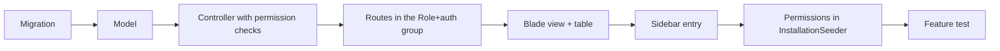

How to make changes to this repository: the branch and pull request flow, the coding conventions each project follows, step-by-step recipes for adding an admin module and an API endpoint, how to keep the mobile apps in step with the API, and how to edit this wiki.

## Branches and pull requests

- `main` is the default branch and the only long-lived one. Work happens on short-lived feature branches (the history so far uses tool-generated names such as `claude/...`, `ccr-...` and `cursor/...`; any descriptive name works).
- Every change reaches `main` through a pull request. PRs are merged with a merge commit ("Merge pull request #N from ShawnDaPrawn/<branch>"), so the individual commits stay in the history; see [Release-History](Release-History#merged-pull-requests).
- The `CI` workflow runs on every pull request and on every push to `main` (admin panel tests, Flutter analyze and test for both apps, documentation build, dependency audit). A PR should be green before it is merged. See [Testing-and-CI](Testing-and-CI).
- When a branch falls behind `main`, merge `main` into it (as in [0ce6bac](https://github.com/ShawnDaPrawn/Eschool/commit/0ce6bac)) and record how conflicts were resolved in the merge commit message.
- [CONTRIBUTING.md](https://github.com/ShawnDaPrawn/Eschool/blob/main/CONTRIBUTING.md) at the repository root points here, and the pull request template asks for a summary and a test plan. Describe what changed, why, and how it was tested.

### Commit messages

The fork's commits follow one style (see `git log`):

- Subject: one short imperative sentence, capitalised, no trailing full stop, describing the effect. Examples: "Require HTTPS in the student/parent app's release builds", "Stop leaking exception details and credentials", "Match teacher scopes on exact class and subject pairs".
- Body: wrapped at about 72 characters; says what was wrong, what the change does, and anything a reviewer or deployer must do (for example "rotate that secret"). Lists use `- ` bullets, grouped under a short heading when a commit touches several areas ("Payments:", "Online exams:").
- One logical change per commit, with its tests in the same commit.

## Coding conventions

### Admin panel (PHP / Laravel 12)

| Topic | Convention |
|---|---|
| PHP version | `^8.3.0` (`composer.json` `require.php`; `config.platform.php` is `8.3.0`) |
| Formatting | [.editorconfig](https://github.com/ShawnDaPrawn/Eschool/blob/main/admin-panel/.editorconfig): UTF-8, LF, 4-space indent (2 for YAML), final newline, trim trailing whitespace except in Markdown |
| Laravel Pint | `laravel/pint ^1.13` is in `require-dev`; there is no `pint.json`, so Pint's default `laravel` preset applies. Most of the existing code is not Pint-formatted (`vendor/bin/pint --test` reports about 230 files), and CI does not run Pint. Format only what you touch: `vendor/bin/pint --dirty` (files with uncommitted changes) or `vendor/bin/pint path/to/File.php`. Do not reformat whole directories in a feature PR. |
| Strict types | 182 of the 211 files in `app/` start with `declare(strict_types=1);`; new files should too |
| Controllers | One controller per module in `app/Http/Controllers` (API controllers in `app/Http/Controllers/Api`). Permission check first, then `Validator::make(...)`, then the work in `try { } catch (Throwable $e)`. AJAX actions answer `['error' => bool, 'message' => trans(...)]` |
| Services | Shared logic in `app/Services` (for example `FeesPaymentService`, `OnlineExamScoringService`, `EmailTemplateService`, `ResponseService`) |
| Helpers | Global functions in `app/Helpers/settings_helper.php` (`getSettings()`, `schoolSetting()`, `schoolLogoUrl()`, ...) and `app/Helpers/notification_helper.php`, autoloaded through `composer.json` |
| Configuration and settings | Never call `env()` outside `config/` (it returns `null` once config is cached; `SettingsConfigTest` fails on it). Read config with `config()` and admin-edited settings with `getSettings()` / `schoolSetting()`. Settings live only in the `settings` table; a setting that must override a config value goes in `SettingsConfigService::CONFIG_KEYS`. Give every route a unique name, or `route:cache` (and the CI cache step) fails |
| Translations | Labels are keys in `resources/lang/<code>.json` (flat `"key": "text"` maps; `TranslationsTest` checks this), used as `__('key')` / `trans('key')` in PHP and `trans('key')` in JS (labels are served by `/common/js/lang`). Add new keys to `en.json` at least |
| JavaScript | Page scripts in `public/assets/js/custom/` (`custom.js`, `function.js`, `formatter.js`, `custom-bootstrap-table.js`), plain jQuery, no build step for these files. When you change one, keep or add the `?v={{ filemtime(...) }}` cache buster on its `<script>` tag |
| Security rules | [Security-Model#rules-for-contributors](Security-Model#rules-for-contributors) |

### Flutter apps (Dart)

| Topic | Convention |
|---|---|
| Flutter / Dart | CI pins Flutter `3.44.9` (stable); `pubspec.yaml` requires Dart `>=3.8.0 <4.0.0` |
| Lints | `analysis_options.yaml` (same in both apps) includes `package:flutter_lints/flutter.yaml` (`flutter_lints ^6.0.0`) and sets `file_names: ignore` and `use_build_context_synchronously: ignore` under `analyzer.errors`; no extra rules are enabled. File names are lowerCamelCase (`webviewPaymentScreen.dart`), which is why `file_names` is ignored |
| Gate | `flutter analyze --no-fatal-infos` must report no errors or warnings; info-level lints are tolerated |
| Lock files | `pubspec.lock` is committed; CI runs `flutter pub get --enforce-lockfile`. If you change dependencies, commit the updated lock file |
| Structure | `lib/cubits/` (state, flutter_bloc), `lib/data/models/` and `lib/data/repositories/` (API access), `lib/ui/screens/` and `lib/ui/widgets/`, `lib/utils/` (`api.dart`, `constants.dart`, `labelKeys.dart`, `uiUtils.dart`) |
| Translations | `assets/languages/<code>.json` must have exactly the keys of `en.json`, and every language in `lib/utils/appLanguages.dart` needs a file (`test/translations_test.dart`) |

### Documentation site

Markdown pages under `documentation/<section>/`, built with Docusaurus; `npm run build` must pass (broken links fail it). See [Documentation-Site](Documentation-Site#adding-or-changing-a-page).

## Adding an admin module end to end

The Holiday module is the smallest complete example; the steps below follow its files.



1. **Migration.** `php artisan make:migration create_things_table` in `admin-panel/database/migrations/`. Data that belongs to an academic year gets a `session_year_id` column (as `holidays` does in `2022_05_06_071034_create_holidays_table.php`). Migrations must run on MySQL/MariaDB; the tests run `migrate:fresh` on every run.
2. **Model.** `app/Models/Thing.php` (`declare(strict_types=1);`, `use HasFactory;`). Add relationships, and if teachers may only see some rows, a scope like `Lesson::scopeLessonTeachers()` that matches the teacher's exact class section and subject.
3. **Controller.** `app/Http/Controllers/ThingController.php` with:
   - `index()` – check `thing-list`, return the view;
   - `store()` – check `thing-create`, validate, save, return JSON `{error, message}`;
   - `update()` – check `thing-edit`;
   - `show()` – the table data endpoint: check `thing-list`, read `offset`, `limit`, `sort`, `order`, `search` (prefer `$request->input('x', default)` over `$_GET['x']`, which crashed pages when a filter was missing), group the search `orWhere`s in a closure, and return `['total' => ..., 'rows' => [...]]` with an `operate` column for the edit/delete buttons;
   - `destroy()` – check `thing-delete`.
   Each check is `if (! Auth::user()->can('thing-list')) { return ...no_permission_message...; }`. Spatie's `permission:` middleware is also available (used by `RoleController`'s constructor: `$this->middleware('permission:role-create', ['only' => ['create', 'store']])`); either way, every action needs a check.
4. **Routes.** In [routes/web.php](https://github.com/ShawnDaPrawn/Eschool/blob/main/admin-panel/routes/web.php), inside `Route::group(['middleware' => ['Role', 'auth']], ...)` and its nested `language` group:

   ```php
   Route::resource('thing', ThingController::class)->except(['create', 'edit']);
   Route::get('thing-list', [ThingController::class, 'show']);
   ```

   Leave out with `->except()` every resource action the controller does not implement; `RoutesTest` fails on routes that point to missing methods, and `AdminPagesTest` fails on GET pages that return 403 or 5xx for the Super Admin.
5. **View.** `resources/views/thing/index.blade.php`, `@extends('layouts.master')` with `@section('title')`, `@section('content')` and `@section('script')`. The add form uses `class="create-form"` and `action="{{ url('thing') }}"`; `custom.js` submits it with `formAjaxRequest()` and shows the JSON `message` as a toast. The list is a bootstrap-table: `data-toggle="table"`, `data-url="{{ url('thing-list') }}"`, `data-escape="true"` on the table and `data-escape="false"` only on the `operate` column. Any formatter that builds HTML uses `escapeHtml()` / `safeUrl()`.
6. **Labels.** Add every new `__('key')` to `resources/lang/en.json` (and the other language files if you can).
7. **Sidebar.** Add an entry in [resources/views/layouts/sidebar.blade.php](https://github.com/ShawnDaPrawn/Eschool/blob/main/admin-panel/resources/views/layouts/sidebar.blade.php), wrapped in `@canany([...])` / `@can('thing-list')`, linking to `route('thing.index')` with `request()->routeIs('thing.*')` for the active state.
8. **Permissions.** In [database/seeders/InstallationSeeder.php](https://github.com/ShawnDaPrawn/Eschool/blob/main/admin-panel/database/seeders/InstallationSeeder.php):
   - append `thing-list`, `thing-create`, `thing-edit`, `thing-delete` to `$permissions` (the `id` values there are only labels; `Permission::firstOrCreate()` matches on `name`);
   - add them to `$superadmin_permission_list`, and to `$teacher_permissions_list` if teachers need them.
   The seeder calls `syncPermissions()` for both roles, so a permission left out of a list is removed from that role the next time the seeder runs (on every system update and `/seeder_install`). On an existing install, run `php artisan db:seed --class=InstallationSeeder --force`; the seeder clears the caches, including Spatie's permission cache. Custom roles can then be given the new permissions on the Roles page, because assignable permissions are the ones the Super Admin role has.
9. **Tests.** Add a feature test in `admin-panel/tests/Feature` that seeds with `$this->seedLikeInstaller()`, acts as a Teacher (or another role without the permission) and asserts each action is refused, and acts as the Super Admin and asserts it works. `AcademicAuthorizationTest` and `AdminAuthorizationTest` are the models to copy.
10. **Docs.** If admins will use it, add or update a page in `documentation/features/` (see [Documentation-Site](Documentation-Site)) and the relevant wiki page.

## Adding an API endpoint safely

1. **Pick the group.** Add the route to the matching group in [routes/api.php](https://github.com/ShawnDaPrawn/Eschool/blob/main/admin-panel/routes/api.php):
   - `student` prefix: `auth:sanctum`, `role:Student`, `student.session.active`;
   - `parent` prefix: `auth:sanctum`, `role:Parent`, `parent.children.session.active`; put endpoints that take a `child_id` inside the nested `CheckChild` group;
   - `teacher` prefix: `auth:sanctum`, `role:Teacher`.
   Only data that is meant to be public (holidays, sliders, public settings, events, galleries) belongs outside these groups. Login and password-reset routes get `->middleware('throttle:login')`.
   Point the route at the controller for its area (`Api/Student/AssignmentController`, `Api/Teacher/ExamController` and so on). Add a new area controller rather than growing an existing one past a few hundred lines, and put checks that several areas need in the role's access trait (`StudentAccess`, `ParentAccess`, `TeacherAccess`).
2. **Validate.** `Validator::make($request->all(), [...])`, then `ResponseService::validationError($validator->errors()->first())` on failure. Validate ids as integers and files with `mimes:` and `max:`.
3. **Scope to the caller.** This is the part that has been wrong before; see [Security-Model#api-scoping-to-the-callers-own-data](Security-Model#api-scoping-to-the-callers-own-data).
   - Parent: inside `CheckChild` read `$request->attributes->get('child')`; elsewhere call `resolveChild($request)` (the `ParentAccess` trait) or `parentChildIds($request)` (in `Parent\FeesController`). Never look a student up by a posted id directly.
   - Teacher: start from `currentTeacher()` and check with `isClassTeacherOf()`, `teachesSubject()`, `teachesStudent()`, `allStudentsInClassSection()`, `ownsLesson()`, `canManageFile()`, `canChatWith()`, or the model scopes.
   - Student: use `$request->user()->student` and limit to its class section, subjects (`studentSubjectIds()`) and the current session year.
   - Updates and deletes must load the row through the same scope, not by id alone.
4. **Respond.** `ResponseService::successResponse('message', $data)` on success; `ResponseService::errorResponse('error_occurred', null, 103, $e)` in the `catch (Throwable $e)` block. Both send the response and call `exit()`. Do not return exception text, secrets, or personal data the caller should not see (teacher payloads, for example, leave out the date of birth). Cap page sizes (`perPage()` clamps to 1–100).
5. **Test.** Because `ResponseService` calls `exit()`, API tests must call the endpoint through the `Tests\Concerns\RunsAppServer` trait (`freshInstall()`, `startAppServer()`, `apiClient($token)`), as described in [Testing-and-CI](Testing-and-CI#testsconcernsrunsappserverphp). Cover at least: the wrong role is refused, another family's / class's / teacher's record is refused, and the happy path works.
6. **Document** the endpoint on the matching wiki page ([API-Student](API-Student), [API-Parent](API-Parent), [API-Teacher](API-Teacher)).

## Keeping the apps and the API in sync

- **Base URL.** Each app's `lib/utils/constants.dart` defines `baseUrl` (shipped as `https://my-server.com`, no trailing slash), `databaseUrl = '$baseUrl/api/'` and `storageUrl = '$baseUrl/storage/'`. See [Mobile-App-Configuration](Mobile-App-Configuration).
- **Endpoints.** Every path the app calls is a static string in `lib/utils/api.dart` (for example `studentLogin = '${databaseUrl}student/login'`). Renaming or moving a route in `routes/api.php` breaks every installed app that still uses the old path; add the new route and keep the old one until old builds are gone.
- **Response shape.** API responses are `{"error": bool, "message": string, "data": ..., "code": ...}`. The apps map `code` values to messages in `lib/utils/errorMessageKeysAndCodes.dart` (for example `103` wrong online-exam key, `105` invalid child, `112` demo mode, `401` signs the user out). A new error code needs a mapping in both apps if it should show a specific message.
- **Backward-compatible payloads.** Add fields rather than renaming or removing them. When the server stopped sending the correct answers of online-exam questions, it kept placeholder answers for old builds and added `answers_count`, which `e-school/lib/ui/screens/exam/onlineExam/models/question.dart` reads with a fallback.
- **Forced updates.** When a server change needs new app builds, raise `app_version` / `ios_app_version` / `teacher_app_version` / `teacher_ios_app_version` and set `force_app_update` / `teacher_force_app_update` in the admin panel's app settings; `GET api/settings?type=app_settings` returns them to the apps.
- **Labels.** New app text goes into `assets/languages/en.json` and every other language file of that app with the same keys (enforced by `flutter test`); the admin panel's labels are separate (`admin-panel/resources/lang/*.json`).
- **Versions.** The apps' `pubspec.yaml` versions are `3.5.0+39` (e-school) and `3.5.0+32` (e-school-teacher); the server's version is the `system_version` row in `settings` (seeded as `3.5.0`). Release apps and server together and note the pairing in [Release-History](Release-History).

## Editing this wiki

- The wiki's source is the [`wiki/`](https://github.com/ShawnDaPrawn/Eschool/tree/main/wiki) folder of the main repository. Edit pages there, on a branch, through a pull request like any other change.
- When changes to `wiki/**` (or to the workflow itself) are merged to `main`, the workflow [.github/workflows/wiki.yml](https://github.com/ShawnDaPrawn/Eschool/blob/main/.github/workflows/wiki.yml) ("Publish wiki") clones `ShawnDaPrawn/Eschool.wiki.git` with the workflow's `GITHUB_TOKEN` (`contents: write`), copies `wiki/` over it with `rsync -a --delete --exclude .git`, and pushes a commit "Sync wiki from <short sha>". It can also be run by hand (`workflow_dispatch`).
- Because of `--delete`, the Wiki tab always mirrors the folder exactly: **edits made in the GitHub Wiki web editor are overwritten on the next sync**, and pages deleted from `wiki/` disappear from the wiki. Make every change in `wiki/`.
- The first run needs the wiki to exist: enable it under Settings → General → Features → Wikis and save any first page in the Wiki tab; otherwise the clone step fails with an error saying so.
- File names become page names: `wiki/Security-Model.md` is the page "Security Model" at `.../wiki/Security-Model`. Use hyphens, no spaces. `Home.md` is the landing page.
- `_Sidebar.md` is the navigation shown on every page and `_Footer.md` the footer. Add new pages to `_Sidebar.md`.
- Link between pages by name without `.md`: `[Payments](Payments)` or `[webhooks](Payments#webhooks)` (anchor = heading in lower case, spaces as hyphens, punctuation removed). Link to code with full `https://github.com/ShawnDaPrawn/Eschool/blob/main/...` URLs and to the end-user docs with `https://shawndaprawn.github.io/Eschool/<section>/<page>/`.
- Pages are GitHub-flavoured Markdown; Mermaid code blocks render. Pages start with an intro paragraph rather than an H1 (the wiki shows the page name as the title) and end with a "See also" list.
- Never put secrets in a page: name settings keys and files, not their values.

## See also

- [Testing-and-CI](Testing-and-CI)
- [Security-Model](Security-Model)
- [Roles-and-Permissions](Roles-and-Permissions)
- [API-Overview](API-Overview)
- [Admin-Modules](Admin-Modules)
- [Mobile-App-Configuration](Mobile-App-Configuration)
- [Documentation-Site](Documentation-Site)
- [Release-History](Release-History)
