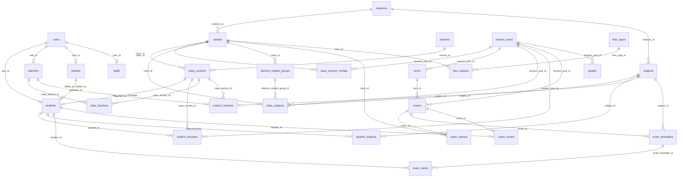

This page describes the MySQL/MariaDB schema of the admin panel as it stands after all 92 migrations in [`admin-panel/database/migrations`](https://github.com/ShawnDaPrawn/Eschool/tree/main/admin-panel/database/migrations) have run, the Eloquent models in [`admin-panel/app/Models`](https://github.com/ShawnDaPrawn/Eschool/tree/main/admin-panel/app/Models) that sit on top of it, and the seeders. Column lists below are the final state (later migrations that add, drop or rename columns are already applied); the migration history section lists those changes.

## Conventions that apply everywhere

- **Many schools in one database (Phase 1).** Every school-owned table has a `school_id` (NOT NULL, indexed, a foreign key to `schools`), and its model uses `BelongsToSchool`, which limits every query to the current school and fills `school_id` on new rows. `settings`, `audit_log`, `domain_events`, `notification_deliveries` and `idempotency_keys` have a nullable `school_id` (null: the platform's). `users` has none: people belong to schools through `school_memberships`. The decision for every table is in `App\Services\Platform\Tenancy\SchoolOwnedTables` and [the tenancy spec](https://github.com/ShawnDaPrawn/Eschool/blob/main/engineering/specs/platform/tenancy.md); `SchoolOwnedTablesTest` checks them against the schema. Column lists below leave `school_id` out.
- **Mixed foreign-key styles.** Tables from the original 2022 migration ([`2022_04_01_105826_all_tables.php`](https://github.com/ShawnDaPrawn/Eschool/blob/main/admin-panel/database/migrations/2022_04_01_105826_all_tables.php)) store relations in plain `int(11)` columns with **no** database constraint (for example `students.user_id`, `class_sections.class_id`, `exam_marks.student_id`). Tables added from 2022-12 onward mostly use `bigint unsigned` columns with real `FOREIGN KEY` constraints. The FK column in the tables below is marked "FK" only when a constraint exists.
- **Cascades live in models, not in the database.** Most deletes are soft deletes, and the cascade to child rows is done in each model's `booted()` / `boot()` `deleting` listener (see [Model-level cascades](#model-level-cascades)). Database `ON DELETE` rules only fire on hard deletes.
- **Soft deletes.** Most tables have `deleted_at`. A few models do **not** use the `SoftDeletes` trait even though their table has the column: `Staff` (`staffs`), `LessonTopic` (`lesson_topics`), `File` (`files`), `Language` (`languages`), `OnlineExamQuestionOption`, `OnlineExamQuestionAnswer`. Deleting through those models removes the row for real.
- **String length.** `AppServiceProvider` calls `Schema::defaultStringLength(191)`, so `string()` columns are `varchar(191)` unless a length is given.
- **Session-year scoping.** Almost every academic, attendance, exam, fee and communication table has a `session_year_id`. The "current" session year is not a column; it is the `settings` row with `type = 'session_year'` (read with `getSettings('session_year')['session_year']`). See [Academic Structure](Academic-Structure#session-years).
- **Term scoping.** These tables have a nullable `term_id`: `class_subjects`, `elective_subject_groups`, `timetables`, `student_subjects`, `lessons`, `assignments`, `announcements`, `class_teachers`, `subject_teachers`, `exams`, `online_exams`.
- **Email reuse after delete.** `users.email` is unique. `User::booted()` and `Parents::booted()` rewrite the email of a soft-deleted row to `<first 190 chars>::deleted-<id>-<unix time>` so the address can be registered again (`User::buildDeletedEmailPlaceholder()`).
- **Numeric status codes** are documented only in column comments; the most important ones are repeated in the tables below.

## Tables by domain

Legend: **SD** = has `deleted_at`. "FK" = database foreign-key constraint (with its `ON DELETE` rule).

### Users and authentication

| Table | Purpose and key columns | Relations | Notes |
|---|---|---|---|
| `users` | Every login: admins, staff, teachers, parents, students. `first_name`, `last_name`, `gender`, `email`, `password`, `mobile`, `image`, `dob`, `current_address`, `permanent_address`, `fcm_id`, `device_type` (`android`/`ios`), `status` (0 pending, 1 active, 2 rejected), `reset_request` (1 when a student asked for a password reset from the app), `remember_token` | One of `students.user_id`, `teachers.user_id`, `parents.user_id`, `staffs.user_id` points here. Roles via `model_has_roles` | SD. Unique `email`. Students log in with their admission number stored in `email` |
| `personal_access_tokens` | Laravel Sanctum app tokens: `tokenable_type`/`tokenable_id`, `name`, `token` (sha256), `abilities`, `last_used_at`, `expires_at` | Morph to `users` | Unique `token`; index on the morph pair. `config/sanctum.php` sets `expiration` from `SANCTUM_EXPIRATION` (default 30 days) and `routes/console.php` schedules `sanctum:prune-expired --hours=24` daily |
| `password_reset_tokens` | Laravel 11+ password reset tokens (`email` primary key, `token`, `created_at`) | | Created by `0001_01_01_000000_create_users_table.php`, which despite its name does **not** create `users` |
| `password_resets` | Older Laravel reset table (`email` indexed, `token`, `created_at`) | | Still created by `2014_10_12_100000_create_password_resets_table.php` |
| `sessions` | Database session store (`id`, `user_id`, `ip_address`, `user_agent`, `payload`, `last_activity`) | | Indexes on `user_id`, `last_activity` |

### Spatie permission tables

Created by [`2022_04_01_091033_create_permission_tables.php`](https://github.com/ShawnDaPrawn/Eschool/blob/main/admin-panel/database/migrations/2022_04_01_091033_create_permission_tables.php) in the single-school shape, then given teams mode by `2026_10_23_100500_add_school_id_to_permission_tables.php` (`config/permission.php`: `teams` on, the team is `school_id`).

| Table | Columns | Notes |
|---|---|---|
| `permissions` | `id`, `name`, `guard_name`, timestamps | Unique (`name`, `guard_name`). All permissions use guard `web` |
| `roles` | `id`, `school_id` (nullable, FK `schools`), `name`, `guard_name`, `custom_role` (int, default 0), timestamps | Unique (`school_id`, `name`, `guard_name`): each school has its own roles. `custom_role` was added by `2024_03_12_135926_add_column_type_in_events_table.php`; 1 marks roles created on the Roles page |
| `model_has_permissions` | `school_id` (FK `schools`), `permission_id` (FK cascade), `model_type`, `model_id` | Primary key (`school_id`, `permission_id`, `model_id`, `model_type`): given at one school. Direct per-user permissions (used for `class-teacher`, `student-leave-approve` and the teacher "grant permission" option) |
| `model_has_roles` | `school_id` (FK `schools`), `role_id` (FK cascade), `model_type`, `model_id` | Primary key (`school_id`, `role_id`, `model_id`, `model_type`): a role is granted at one school |
| `role_has_permissions` | `permission_id`, `role_id` (both FK cascade) | Follows its role's school |

See [Roles and Permissions](Roles-and-Permissions) for the role and permission catalogue.

### Academic structure

| Table | Purpose and key columns | Relations | Notes |
|---|---|---|---|
| `session_years` | Academic years. `name`, `start_date`, `end_date`, `default` (1 = current), `free_app_use_date`, `include_fee_installments`, `fee_due_date`, `fee_due_charges` (percent) | Parent of nearly every scoped table | SD. The `fee_due_date` column default is the date the migration ran |
| `terms` | Terms inside a session year. `name`, `start_date`, `end_date`, `session_year_id` | FK `session_year_id` → `session_years` (restrict) | SD. `start_month`/`end_month` were replaced by dates in `2025_10_27_095126` (converted using the current calendar year) |
| `mediums` | Language of instruction (for example English, Afrikaans). `name` | Referenced by `classes.medium_id`, `subjects.medium_id` | SD |
| `streams` | Optional class streams (for example Science, Commerce). `name` | Referenced by `classes.stream_id` | SD |
| `shifts` | School shifts. `title`, `start_time`, `end_time`, `status` | Referenced by `classes.shift_id` | SD |
| `classes` | A grade/class (model `ClassSchool`). `name`, `medium_id`, `stream_id`, `shift_id`, `educational_program_id` | FK `stream_id` → `streams` (cascade), `shift_id` → `shifts` (cascade), `educational_program_id` → `educational_programs` (restrict) | SD. `include_terms` existed from 3.3.0 until `2026_03_20_154121` moved it to `class_session_configs` |
| `sections` | Section labels (A, B, C). `name` | | SD |
| `class_sections` | A class plus a section; the unit students, timetables and attendance hang off. `class_id`, `section_id` | No FK constraints | SD. `class_teacher_id` was dropped in 2023-07 in favour of `class_teachers` |
| `class_session_configs` | Per class, per session year: `include_terms` (bool) | FK `class_id` → `classes` (cascade), `session_year_id` → `session_years` (cascade) | Unique (`class_id`, `session_year_id`) plus a non-unique index on the same pair. No soft deletes |
| `subjects` | Subject catalogue per medium. `name`, `code`, `bg_color`, `image`, `medium_id`, `type` (`Theory` / `Practical`) | | SD |
| `class_subjects` | Subjects offered by a class in a session year (and optionally a term). `class_id`, `subject_id`, `type` (`Compulsory` / `Elective`), `elective_subject_group_id` (when Elective), `term_id`, `session_year_id` | FK `term_id` → `terms` (restrict), `session_year_id` (restrict) | SD. Indexed `session_year_id` |
| `elective_subject_groups` | A pick-N group of elective subjects for a class. `class_id`, `total_subjects`, `total_selectable_subjects`, `term_id`, `session_year_id` | FK `term_id` (restrict), `session_year_id` (restrict) | SD |
| `class_teachers` | Class teacher assignment. `class_section_id`, `class_teacher_id` (a `teachers.id`), `session_year_id`, `term_id` | FK `class_section_id` → `class_sections` (cascade), `class_teacher_id` → `teachers` (cascade), `term_id` (cascade), `session_year_id` (restrict) | SD (dropped in 2023-07, re-added by `2026_02_05_110138`) |
| `subject_teachers` | Who teaches a subject in a class section. `class_section_id`, `subject_id`, `teacher_id`, `session_year_id`, `term_id` | FK `term_id` (cascade), `session_year_id` (restrict) | SD |
| `categories` | Student categories (the sample data uses General, Boarding, Day scholar and Bursary). `name`, `status` | Referenced by `students.category_id` | SD |
| `educational_programs` | Programmes shown on the public website and optionally linked to a class. `title`, `image` | Referenced by `classes.educational_program_id` | |

### Students, parents, teachers and staff

| Table | Purpose and key columns | Relations | Notes |
|---|---|---|---|
| `students` | Student record. `user_id`, `class_section_id` (nullable since 3.3.0), `class_id` (set for online applications), `application_type` (`offline` default, `online` from the public registration form), `category_id`, `admission_no`, `roll_number`, `caste` (shown in English as Community), `religion`, `admission_date`, `blood_group`, `height`, `weight`, `is_new_admission`, `father_id`, `mother_id`, `guardian_id`, `dynamic_fields` (JSON text of custom form fields) | FK `class_id` → `classes` (restrict). `father_id`/`mother_id`/`guardian_id` → `parents.id` (no FK) | SD. `class_section_id` is the student's *latest* section; the per-year placement is in `student_sessions` |
| `parents` | Father, mother or guardian contact. `user_id` (nullable), `first_name`, `last_name`, `gender`, `email`, `mobile`, `occupation`, `image`, `dob`, `dynamic_fields` | `user_id` → `users` (no FK) | SD. One `parents` row can be father/mother/guardian of several students |
| `teachers` | Teacher profile. `user_id`, `qualification`, `dynamic_fields` | `user_id` → `users` (no FK) | SD |
| `staffs` | Marks a user as non-teaching staff. `user_id` | FK `user_id` → `users` (restrict) | Table has `deleted_at`, but the `Staff` model does not use `SoftDeletes` |
| `student_sessions` | One row per student per session year: `student_id`, `session_year_id`, `class_section_id` (nullable; set to null when the student leaves), `previous_session_year_id`, `result` (1 pass, 0 fail), `status` (1 continuing, 0 left) | No FK constraints | SD. Source of truth for which section a student is in for a given year. See [Academic Structure](Academic-Structure#student-sessions) |
| `student_subjects` | Elective subjects a student picked. `student_id`, `subject_id`, `class_section_id`, `term_id`, `session_year_id` | FK `term_id` (restrict) | SD. Compulsory subjects are not stored here; they come from `class_subjects` |
| `form_fields` | Custom registration fields. `name`, `type` (`text`, `number`, `dropdown`, `radio`, `checkbox`, `textarea`, `file` per `FormFieldController::TYPE_RULE`), `for` (1 student, 2 parent, 3 teacher, 4 online registration form), `is_required`, `default_values` (JSON), `other`, `rank` | Values stored in `dynamic_fields` of `students`, `parents`, `teachers` | SD. The column comment only lists 1 to 3; the controller also accepts 4 |

### Attendance

| Table | Purpose and key columns | Relations | Notes |
|---|---|---|---|
| `attendances` | Daily student attendance. `class_section_id`, `student_id`, `session_year_id`, `date`, `type` (0 absent, 1 present, 3 holiday, 4 first half, 5 second half), `remark`, `status` (0 notification not sent, 1 sent) | No FK constraints | SD. Constants are on `Attendance::TYPE_*`; `Attendance::monthlyReport()` overlays approved leaves |
| `staff_attendances` | Daily attendance for teachers and staff. `user_id`, `session_year_id`, `date`, `type` enum (`present`, `absent`, `first_half`, `second_half`, `holiday`, `leave`), `remark` | FK `user_id` → `users` (cascade), `session_year_id` (cascade) | Unique (`user_id`, `date`). No soft deletes |

### Timetable, holidays, events

| Table | Purpose and key columns | Relations | Notes |
|---|---|---|---|
| `timetables` | Weekly periods. `class_section_id`, `subject_teacher_id`, `day` (1 Monday to 7 Sunday), `day_name`, `start_time`, `end_time`, `note`, `link_name`, `live_class_url`, `session_year_id`, `term_id` | FK `term_id` (restrict), `session_year_id` (restrict) | SD |
| `holidays` | `date`, `title`, `description`, `session_year_id` | FK `session_year_id` (restrict) | No soft deletes |
| `events` | Public/school events. `title`, `type` (default `single`), `start_date`, `end_date` (string), `start_time`, `end_time`, `image`, `description`, `session_year_id` | FK `session_year_id` (restrict) | No soft deletes. `date` was renamed to `start_date` in 2024-03 |
| `multiple_events` | Per-day schedule rows of a multi-day event. `event_id`, `title`, `date`, `start_time`, `end_time`, `description` | FK `event_id` → `events` (cascade) | |
| `academic_calendars` | `date`, `title`, `description`, `session_year_id` | | SD. No model uses this table. The academic calendar PDF is built by `AcademicCalendarService` from holidays, events, exam timetables and term gaps |

### Lessons and assignments

| Table | Purpose and key columns | Relations | Notes |
|---|---|---|---|
| `lessons` | `name`, `description`, `class_section_id`, `subject_id`, `term_id` | FK `term_id` (cascade) | SD |
| `lesson_topics` | `lesson_id`, `name`, `description` | | SD column, but `LessonTopic` has no `SoftDeletes`. `file` column dropped in 2022-05 |
| `files` | Polymorphic attachments for lessons, topics, assignments, submissions, announcements and leaves. `modal_type`/`modal_id`, `file_name`, `file_thumbnail`, `type` (1 file upload, 2 YouTube link, 3 video upload, 4 other link), `file_url` | Morph | SD column, but `File` has no `SoftDeletes`; `File::boot()` deletes the stored file from the `public` disk |
| `assignments` | `class_section_id`, `subject_id`, `name`, `instructions`, `due_date`, `points`, `resubmission`, `extra_days_for_resubmission`, `session_year_id`, `term_id` | FK `term_id` (cascade) | SD |
| `assignment_submissions` | `assignment_id`, `student_id`, `text_submission`, `feedback`, `points`, `status` (0 pending/in review, 1 accepted, 2 rejected, 3 resubmitted), `session_year_id` | | SD |

### Exams, grades and results

| Table | Purpose and key columns | Relations | Notes |
|---|---|---|---|
| `exams` | Offline exam header. `name`, `description`, `session_year_id`, `term_id`, `publish` (0/1) | FK `term_id` (cascade) | SD. `class_id` was moved to `exam_classes` in 2022-07 |
| `exam_classes` | Classes sitting an exam. `exam_id`, `class_id`, `session_year_id` | FK `session_year_id` (restrict) | SD |
| `exam_timetables` | One paper per class per subject. `exam_id`, `class_id`, `subject_id`, `total_marks`, `passing_marks`, `date`, `start_time`, `end_time`, `session_year_id` | | SD |
| `exam_marks` | Marks per student per paper. `exam_timetable_id`, `student_id`, `subject_id`, `obtained_marks` (int), `teacher_review`, `passing_status` (1 pass, 0 fail), `grade`, `session_year_id` | | SD |
| `exam_results` | Totals written when an exam is published. `exam_id`, `class_section_id`, `student_id`, `total_marks`, `obtained_marks`, `percentage` (double), `grade`, `session_year_id` | | SD (since `2026_02_05_110138`) |
| `grades` | Percentage bands. `starting_range`, `ending_range`, `grade`, `session_year_id` | FK `session_year_id` (restrict) | No soft deletes. Originally `minimum_percentage`/`maximum_percentage` |

### Online exams

| Table | Purpose and key columns | Relations | Notes |
|---|---|---|---|
| `online_exams` | `model_type`/`model_id` (`App\Models\ClassSchool` or `App\Models\ClassSection`), `subject_id`, `title`, `exam_key` (bigint), `duration` (minutes), `start_date`, `end_date` (datetime), `session_year_id`, `term_id` | FK `subject_id` → `subjects` (cascade), `session_year_id` (cascade), `term_id` (cascade) | SD. Rebuilt in `2023_02_14_164618` (was keyed by `class_subject_id`) |
| `online_exam_questions` | Question bank. `class_subject_id`, `question_type` (0 simple, 1 equation based), `question`, `image_url`, `note`, `session_year_id` | FK `class_subject_id` → `class_subjects` (cascade), `session_year_id` (restrict) | SD |
| `online_exam_question_options` | `question_id`, `option` | FK `question_id` (cascade) | SD column, no trait |
| `online_exam_question_answers` | Correct options. `question_id`, `answer` (an option id) | FK `question_id` (cascade), `answer` → `online_exam_question_options` (cascade) | SD column, no trait. A question can have several correct options |
| `online_exam_question_choices` | Questions placed in an exam, with marks. `online_exam_id`, `question_id`, `marks` | FK both (cascade) | SD |
| `student_online_exam_statuses` | Attempt state. `student_id`, `online_exam_id`, `status` (1 in progress, 2 completed) | FK both (cascade) | SD. Created when the student fetches the questions |
| `online_exam_student_answers` | One row per selected option. `student_id`, `online_exam_id`, `question_id` (**an `online_exam_question_choices.id`**), `option_id`, `submitted_date` | FK `question_id` → `online_exam_question_choices`, `option_id` → options, `student_id`, `online_exam_id` (all cascade) | SD |

### Fees and payments

| Table | Purpose and key columns | Relations | Notes |
|---|---|---|---|
| `fees_types` | Fee heads. `name`, `description` | | SD. `choiceable` moved to `fees_classes` in 2023-06 |
| `fees_classes` | Fee amount per class per session year. `class_id`, `fees_type_id`, `choiceable` (0 compulsory, 1 optional), `amount` (float) and `amount_cents`, `session_year_id` | FK `session_year_id` (restrict) | SD |
| `fees_choiceables` | Optional fees (and due-charge lines) paid by a student. `student_id`, `class_id`, `fees_type_id`, `is_due_charges`, `total_amount` and `total_amount_cents`, `date`, `payment_transaction_id`, `status` (0 not paid, 1 paid), `session_year_id` | FK `payment_transaction_id` → `payment_transactions` (cascade) | SD |
| `installment_fees` | Installment plan for a session year. `name`, `due_date`, `due_charges` (percent), `session_year_id` | FK `session_year_id` (cascade) | SD |
| `paid_installment_fees` | Installments paid. `class_id`, `student_id`, `parent_id`, `installment_fee_id`, `session_year_id`, `amount` and `amount_cents`, `due_charges` and `due_charges_cents`, `date`, `payment_transaction_id`, `status` (0 failed, 1 succeeded) | FK on all six id columns (cascade) | SD |
| `fees_paids` | Per-student compulsory-fee summary for a year. `parent_id`, `student_id`, `class_id`, `mode` (0 cash, 1 cheque, 2 online), `payment_transaction_id` (string), `cheque_no`, `total_amount` and `total_amount_cents`, `due_charges` and `due_charges_cents`, `is_fully_paid`, `date`, `session_year_id` | | SD. Audited |
| `payment_transactions` | Every payment attempt. `student_id`, `class_id`, `parent_id`, `mode`, `cheque_no`, `type_of_fee` (0 compulsory full, 1 installments, 2 optional), `payment_gateway` (`PaymentService` constants: 1 Razorpay, 2 Stripe, 3 Paystack, 4 Flutterwave), `order_id`, `payment_id`, `payment_signature`, `payment_status` (0 failed, 1 succeeded, 2 pending), `total_amount` and `total_amount_cents`, `date`, `session_year_id` | | SD. See [Payments](Payments) |

The original `fees`, `fees_sub_types` and `fees_paid` tables were dropped by `2022_11_11_065720_fees_module.php`.

**Money in cents.** Since Phase 0 every float money column has a nullable BIGINT `*_cents` twin beside it (`2026_10_22_100400`). The cents are the truth: the models (`HasMoneyColumns`) keep both columns equal on every write, read the cents (the float attribute and the v1 API value are the cents as currency units), cast the cents to `App\Services\Platform\Ledger\Money` and hide them from serialisation. The migration back-filled them with `ROUND(CAST(float AS DECIMAL(20,6)) * 100)` (half up) in id ranges of 1000; `php artisan money:backfill-cents` (daily at 02:10) fills rows a raw insert left empty and logs any disagreement. The float columns are dropped in Phase 5. `installment_fees.due_charges` and `session_years.fee_due_charges` are percentages, not money, and have no cents column.

### Communication

| Table | Purpose and key columns | Relations | Notes |
|---|---|---|---|
| `announcements` | `title`, `description`, `table_type`/`table_id` (nullable morph: `ClassSchool`, `ClassSection`, `SubjectTeacher`, ...), `session_year_id`, `term_id` | FK `term_id` (cascade) | SD. Index on the morph pair |
| `notifications` | Push/in-app notifications. `title`, `type`, `message` (128 chars), `send_to` (1 everyone, 2 specific users), `image`, `date`, `is_custom` (1 custom, 0 generated), `session_year_id` | FK `session_year_id` (restrict) | SD |
| `user_notifications` | Recipients of a notification. `notification_id`, `user_id` | FK both (cascade) | |
| `chat_messages` | `modal_type`/`modal_id` (receiver; the controllers store the receiver user id with `modal_type` `App/Models/User`), `sender_id`, `body`, `date` | FK `sender_id` → `users` (cascade) | The `date` column default is the timestamp at which the migration ran |
| `chat_files` | `message_id`, `file_name`, `file_type` | FK `message_id` (cascade) | |
| `read_messages` | Last message a user has read in a conversation. `modal_type`/`modal_id`, `user_id`, `last_read_message_id` | FK `user_id`, `last_read_message_id` (cascade) | |
| `chat_rooms`, `chat_members` | Room and membership tables | `chat_members` FK to `chat_rooms` and `users` (cascade) | Models exist but no controller uses them |

See [Notifications](Notifications) and [Chat](Chat).

### Leave

| Table | Purpose and key columns | Relations | Notes |
|---|---|---|---|
| `leave_masters` | Leave settings per session year. `total_leave` (leaves per month), `holiday_days` (comma-separated weekday names such as `Sunday`), `session_year_id` | FK `session_year_id` (cascade) | SD |
| `leaves` | Leave request by any user (teacher, staff or student). `user_id`, `leave_master_id`, `reason`, `from_date`, `to_date`, `status` (string: `0` pending, `1` approved, `2` rejected in code; the column comment says 3), `reason_of_rejection`, `session_year_id` | FK `user_id` (cascade), `leave_master_id` (cascade), `session_year_id` (restrict) | SD |
| `leave_details` | One row per leave day. `leave_id`, `date`, `type` (`Full` for a whole day; any other value is treated as a half day, and `Attendance::leaveTypeToType()` maps values containing "first"/"second"/"half" to the half-day attendance types), `session_year_id` | FK `leave_id` (cascade), `session_year_id` (restrict) | SD |

### Media, gallery and website content

| Table | Purpose and key columns | Notes |
|---|---|---|
| `sliders` | `image`, `type` (1 app, 2 web, 3 both) | |
| `medias` | Gallery albums. `name`, `type` (1 image, 2 video), `thumbnail`, `youtube_url`, `session_year_id` | Model `Media` (`$table = 'medias'`) |
| `media_files` | Images of an album. `media_id` (FK cascade), `file_url` | |
| `web_settings` | Public website sections (`about_us`, `who_we_are`, `teacher`, `events`, `programs`, `photos`, `videos`, `faqs`, `app`, `question`, `registration`). `name`, `tag`, `heading`, `content`, `image`, `status` | Rows inserted by the migrations themselves |
| `faqs` | `question`, `answer`, `status` | |
| `contact_us` | Public contact form submissions. `first_name`, `last_name`, `email`, `phone`, `date`, `message` | |

See [Public Website](Public-Website).

### Settings, languages and templates

| Table | Purpose and key columns | Notes |
|---|---|---|
| `settings` | Key/value store: `school_id` (nullable: null for platform keys; school keys from Phase 1), `type`, `message` (both `text`), no timestamps; index (`school_id`, `type(191)`) | Audited (secret values redacted). Holds `session_year`, `system_version`, school details, payment and app settings, ID-card design keys, terms and conditions, and more. Read with `getSettings()` in `app/Helpers/settings_helper.php` (no caching): the current school's rows over the platform's. Platform keys (mail server, push project, app versions, `system_version`) are always platform rows (`PlatformSettings::KEYS`); every other key is written for the current school |
| `languages` | `name`, `code`, `file` (JSON file in `resources/lang`), `is_rtl`, `status` | `2026_05_26_173526` inserts English (`en`, `en.json`) if missing |
| `email_tempalates` | Editable email templates. `type` (unique), `subject`, `content` | The table name keeps the original misspelling; the model is `EmailTemplate` (it was `EmailTempalate` until Phase 0) |

### Platform kernel

Added in Phase 0 (Build Bible 3.1). Specs: [queue-and-delivery](https://github.com/ShawnDaPrawn/Eschool/blob/main/engineering/specs/platform/queue-and-delivery.md), [kernel](https://github.com/ShawnDaPrawn/Eschool/blob/main/engineering/specs/platform/kernel.md).

| Table | Purpose and key columns | Notes |
|---|---|---|
| `notification_deliveries` | One row per attempt to deliver a mail or push. `school_id`, `delivery_key` (uuid shared by the attempts), `type` (`mail.*`, `push.*`), `channel`, `recipient_user_id`, `recipient_hash` (SHA-256 of the address or token), `status` (queued, sent, failed, delivered, bounced, complained), `provider`, `provider_message_id`, `attempt`, `error_summary`, `queued_at`, `sent_at`, `failed_at`, `feedback_at`, timestamps | Never holds a raw address or token. See [Notifications](Notifications#queued-delivery-and-notification_deliveries) |
| `webhook_receipts` | Provider events already processed. `provider`, `event_id` (unique together), `event_type`, `received_at` | SNS message ids of SES feedback |
| `domain_events` | The outbox. `school_id`, `type`, `payload` (JSON), `occurred_at`, `available_at`, `dispatched_at`, `attempts`, `last_error` | Written by `Outbox::record()` inside the change's transaction; dispatched once by `DispatchOutbox` |
| `audit_log` | Who changed what. `school_id`, `actor_id`, `actor_type` (user, guest, system), `action`, `subject_type`, `subject_id`, `before`, `after` (JSON), `ip`, `request_id`, `created_at` | Append-only. Written by the `Auditable` trait (`User`, `Students`, `ExamMarks`, `FeesPaid`, `Settings`) and `Audit::record()`; never holds hidden attributes or secret values |

### Schools and memberships

Added in Phase 1 (the Build Bible, section 7). Spec: [tenancy](https://github.com/ShawnDaPrawn/Eschool/blob/main/engineering/specs/platform/tenancy.md).

| Table | Purpose and key columns | Notes |
|---|---|---|
| `schools` | One row per school. `name`, `slug` (unique), `status` (active, suspended, archived), `timezone`, `package_key`, `short_name`, `tagline`, `crest_path`, `theme_color`, `secondary_color`, timestamps | School 1 is created from the install's settings by the first tenancy migration. The name, crest, timezone and colours follow the school's settings rows (`SchoolBranding`) |
| `school_memberships` | A person's role at a school. `user_id` (FK cascade), `school_id` (FK), `role` (role name), `status` (active, suspended, ended), `starts_on`, `ends_on`, timestamps | Unique (`user_id`, `school_id`, `role`). Back-filled from every role grant at school 1; granted and ended with Spatie's role events. Active: status active, today within the dates, the school active |

### Framework tables

`cache`, `cache_locks`, `jobs` (index on `queue`; the database queue is the default since Phase 0), `job_batches`, `failed_jobs` (unique `uuid`), `migrations`. `2026_10_20_000000_drop_service_health_logs_table.php` drops `service_health_logs`, which was only used by a removed license check.

## Core entity diagram

Entity names are table names. Relationships without a database constraint are included because the code relies on them.

## Migration history: changes to earlier tables

Columns listed in the tables above already reflect these changes. Migrations that only create a new table are not repeated here.

| Migration | What it changes |
|---|---|
| `2022_04_27_072441_parent_changes` | `users`: `name` replaced by `first_name`/`last_name`; adds `gender`, `current_address`, `permanent_address`. `students`: drops `father_*`, `mother_*` and `parent_id`, adds `father_id`, `mother_id`, `guardian_id`. `parents`: becomes a full contact record, `user_id` nullable |
| `2022_04_28_105419`, `2022_04_29_164836` | `timetables.day_name`, `timetables.class_section_id` |
| `2022_05_03_053843_add_lesson_files` | Creates polymorphic `files`; drops `lesson_topics.file` |
| `2022_05_13_041458` | `session_years.start_date`, `end_date` |
| `2022_05_16_045021` | `attendances.class_section_id` |
| `2022_05_19_053446`, `2022_05_31_133456`, `2023_10_19_161317` | `users.fcm_id`, `users.reset_request`, `users.device_type` |
| `2022_07_18_044243` | `languages.is_rtl` |
| `2022_07_25_103347_create_exams_table` | Drops `exams.class_id` (creates `exam_classes`); adds `exam_timetables.class_id`; `grades` percentage columns become `starting_range`/`ending_range` |
| `2022_11_11_065720_fees_module` | Drops `fees`, `fees_sub_types`, `fees_paid`; creates the current fee tables |
| `2022_12_08_044452` | `students.roll_number` nullable |
| `2023_02_14_164618` | Rebuilds `online_exams` around a `model` morph plus `subject_id`; existing rows migrated as class-wide (`ClassSchool`) exams |
| `2023_06_02_100137` | Moves `choiceable` from `fees_types` to `fees_classes` |
| `2023_06_02_100328` | `fees_classes.amount` to float; `session_years.include_fee_installments`, `fee_due_date`, `fee_due_charges`; `fees_paids.is_fully_paid`; creates `installment_fees` |
| `2023_06_05_104000` | Creates `paid_installment_fees`; `payment_transactions` gets `mode`, `cheque_no`, `type_of_fee`, `date`, nullable gateway and order id; `fees_choiceables` gets `date`, `payment_transaction_id` |
| `2023_07_06_101005`, `2023_07_18_101604` | `classes.stream_id`, `classes.shift_id` |
| `2023_07_11_101343`, `2023_07_25_123007` | Drops `class_sections.class_teacher_id`; drops `class_teachers.deleted_at` |
| `2023_09_23_131406` | `fees_choiceables.status` |
| `2023_09_26_123001`, `2024_04_25_110112` | Adds then drops `assignment_submissions.editing` |
| `2023_10_11_165326` | Creates `form_fields`; `students.dynamic_fields` |
| `2023_10_20_105920`, `2023_10_27_153258` | `notifications`: drops `url`, `user_id`; adds `is_custom` |
| `2024_01_30_165655` | `sliders.type` |
| `2024_03_12_135926` | `events`: `date` renamed to `start_date`, adds `type`, times, `end_date`, `image`; `web_settings.status`; `roles.custom_role` |
| `2024_04_16_154756`, `2024_05_27_125009` | `form_fields.for`; `dynamic_fields` on `parents` and `teachers`; all three `dynamic_fields` nullable |
| `2024_05_28_153727` | `timetables.live_class_url`, `link_name` |
| `2024_06_25_094803` | `session_years.free_app_use_date` |
| `2024_07_17_181831_create_3.2.1_version` | `assignment_submissions.text_submission`; `classes.educational_program_id`; `leaves.reason` to text |
| `2024_09_05_121951_create_3.3.0_version` | `students.class_id`, `application_type`, nullable `class_section_id`; creates `terms`; `classes.include_terms`; `term_id` on `class_subjects`, `elective_subject_groups`, `timetables`, `student_subjects`; inserts the `registration` web setting |
| `2024_09_23_152930_create_3.3.1_version` | `leaves.session_year_id`; `fees_paids.due_charges` |
| `2025_10_27_095126` | Term months converted to `start_date`/`end_date` |
| `2025_11_13_190706` | `leaves.reason_of_rejection` |
| `2025_12_15_151353`, `2025_12_16_164207`, `2025_12_18_165827` | `student_sessions.previous_session_year_id`; on installs that already have a `session_year` setting the table is **truncated** and refilled with one row per student for the current session; `class_section_id` nullable |
| `2025_12_27_152628` | Adds `attendances.status` and `paid_installment_fees.status` if missing |
| `2025_12_27_153705` | Adds nullable, indexed `session_year_id` with an FK (restrict) to `class_subjects`, `class_teachers`, `elective_subject_groups`, `events`, `exam_classes`, `fees_classes`, `grades`, `holidays`, `leave_details`, `online_exam_questions`, `notifications`, `subject_teachers`, `timetables`, and backfills them with the current session |
| `2026_02_05_110138` | `deleted_at` on `class_teachers`, `exam_results`, `installment_fees`, `leaves`, `leave_details`, `leave_masters`, `paid_installment_fees` |
| `2026_03_05_115045` | `users.status` comment: 0 pending, 1 active, 2 rejected |
| `2026_03_19_120035` | `terms.session_year_id` (backfilled with the current session) |
| `2026_03_20_000001` / `_000002`, `2026_03_20_154121` | Creates `class_session_configs`, copies `classes.include_terms` into it for the default session year, then drops `classes.include_terms` |
| `2026_03_23_180853` | `term_id` (FK cascade) on `lessons`, `assignments`, `announcements`, `class_teachers`, `subject_teachers`, `exams`, `online_exams` |
| `2026_04_28_165603_term_id_backfill` | Fills those `term_id` columns for the current session: exams by earliest timetable date, online exams by start date, assignments by due date, subject teachers and subject-teacher announcements to the current term, class teachers copied to every term |
| `2026_06_27_173418` | `attendances.type` comment adds 3, 4, 5 |
| `2026_07_03_120000` | Rewrites emails of already soft-deleted `users` and `parents` to the `::deleted-` placeholder |
| `2026_10_21_000000` | Sets `session_years.include_fee_installments = 1` for years that have `installment_fees` rows (the flag was not saved when such years were created) |
| `2026_10_22_100000` to `_100200` | Create `notification_deliveries`, `webhook_receipts`, `domain_events` and `audit_log` |
| `2026_10_22_100300` | `settings.school_id` (nullable) and the (`school_id`, `type(191)`) index |
| `2026_10_22_100400` | `*_cents` beside `fees_classes.amount`, `fees_paids.total_amount` and `.due_charges`, `fees_choiceables.total_amount`, `paid_installment_fees.amount` and `.due_charges`, `payment_transactions.total_amount`, back-filled half up |
| `2026_03_24_152838`, `2026_06_17_*`, `2026_06_18_120000` | Permission data changes; see [Roles and Permissions](Roles-and-Permissions#permission-migrations) |

## Eloquent models

[Compoships](https://github.com/topclaudy/compoships) (`awobaz/compoships`) is required in `composer.json` and imported in `ExamClass.php`, but no model uses the `Compoships` trait. Multi-column relations are emulated with an extra `where`, for example `ExamClass::class_timetable()` (`class_id` relation plus `where('exam_id', ...)`) and `ExamResult::exam_timetable()` (joins on `exam_id`).

| Model | Table | Important relationships | Scopes, events and notes |
|---|---|---|---|
| `User` | `users` | `student`, `parent`, `teacher`, `staff` (hasOne by `user_id`); `leaves`; `notifications` (belongsToMany via `user_notifications`); `messages` (morphMany `ChatMessage`) | `HasRoles` (guard `web`), `HasApiTokens`, `SoftDeletes`; appends `full_name`; `image` accessor returns a full URL; `deleting` frees the email |
| `Students` | `students` | `user`, `class_section`, `class`, `category`, `father`/`mother`/`guardian` (Parents), `exam_result`, `exam_marks`, `fees_paid` (hasOne), `student_subjects`, `studentSessions`, `attendances`, `assignmentSubmissions`, `onlineExamAnswers`, `onlineExamStatus`, `announcement` | `scopeOfTeacher` (`Super Admin`/`Admin` see all, a Teacher sees students in sections they class-teach or subject-teach, any other role sees none); `subjects()` and `classSubjects()` build the current subject list (term-aware); `deleting` cascades to submissions, attendance, marks, results, online answers/status, sessions and elective picks; fee records are kept |
| `Parents` | `parents` | `user`, `fatherRelationChild`, `motherRelationChild`, `guardianRelationChild`, `children()` (single OR query over the three columns) | `deleting` frees the email |
| `Teacher` | `teachers` | `user`, `classSections` (belongsToMany via `class_teachers`), `class_sections`/`classTeachers` (hasMany `ClassTeacher`), `subjects`/`subjectTeachers` (hasMany `SubjectTeacher`), `classes`, `attendance` (`StaffAttendance` on `user_id`) | `scopeTeachers` (a Teacher sees only themself); `deleting` cascades subject-teacher and class-teacher rows |
| `Staff` | `staffs` | `user`, `attendance` | No `SoftDeletes` trait |
| `SessionYear` | `session_years` | `terms`, `exams`, `assignments`, `attendances`, `studentSessions`, `classTeacher`, `subjectTeacher`, `classSubject` (this relation points at `StudentSubject`), `electiveSubjectGroup`, `grade`, `leave`, `leaveMaster`, `onlineExamQuestion`, `onlineExam`, `feesPaids`, `feesChoiceables`, `fee_installments`, `announcements`, `events`, `holidays`, `notifications` | `deleting` throws for the default year, otherwise deletes every related row (soft or force to match) |
| `Term` | `terms` | `class_subjects`, `elective_subject_groups`, `timetables`, `exams`, `assignments`, `student_subjects` | Appends `current`, `start_month_name`, `end_month_name`; `deleting` cascades to class subjects, elective groups, timetables, student subjects |
| `ClassSchool` | `classes` | `medium`, `streams`, `shifts`, `educational_program`, `sections` (via `class_sections`), `coreSubject`, `electiveSubject`, `allSubjects`, `electiveSubjectGroup`, `fees_class`, `classSections`, `sessionConfigs` | `scopeWithSessionConfigFor($sessionYearId)`, `scopeWhereIncludeTermsForSession()`; `getIncludeTermsForSession()`, `syncIncludeTermsForSession()`; appends `full_name` and `include_terms` (accessor, current session year); `deleting` cascades to online exams, session configs, class subjects, exam classes, fee classes, class sections |
| `ClassSection` | `class_sections` | `class`, `section` (both withTrashed), `classTeachers` (belongsToMany `Teacher`, pivot `term_id`), `class_teachers`, `subject_teachers`, `students`, `announcement` | `scopeSubjectTeacher` (Teacher sees sections they teach); `scopeClassTeacher` is unused and still references the dropped `class_teacher_id`; appends `name`, `full_name`; `deleting` cascades to student sessions (bypassing the global scope), online exams, assignments, attendance, results, lessons, subject teachers, timetables, students |
| `ClassSessionConfig` | `class_session_configs` | `class`, `sessionYear`, `classSections` | `classHasTerm($classId, $sessionYearId)` |
| `ClassSubject` | `class_subjects` | `class`, `subject`, `subjectGroup`, `term` | `scopeSubjectTeacher($classSectionId, $termId)`; `deleting` removes online exam questions, online exams, subject-teacher rows for that class and session, and decrements (or deletes) the elective group |
| `ElectiveSubjectGroup` | `elective_subject_groups` | `electiveSubjects` (ClassSubject), `term` | `deleting` removes the group's class subjects, online exams/questions and matching `student_subjects` |
| `Subject` | `subjects` | `medium`, `assignments`, `classSubjects`, `examMarks`, `examTimetables`, `studentSubjects`, `subjectTeachers` | `scopeSubjectTeacher`; `deleting` cascades to all listed relations |
| `ClassTeacher` | `class_teachers` | `classSections`, `classTeachers` (Teacher), `term` | |
| `SubjectTeacher` | `subject_teachers` | `class_section`, `subject`, `teacher`, `term`, `timetables`, `announcement` | `scopeSubjectTeacher`; `deleting` cascades to timetables and announcements |
| `StudentSessions` | `student_sessions` | `student` (withTrashed), `class_section` | Global scope `active_student_only` (only rows whose student is not soft-deleted); `withoutStudentScope()` bypasses it |
| `StudentSubject` | `student_subjects` | `subject` | |
| `Timetable` | `timetables` | `subject_teacher`, `class_section`, `subject` (the SubjectTeacher with its subject), `term` | |
| `Mediums`, `Section`, `Stream`, `Shift`, `Category` | `mediums`, `sections`, `streams`, `shifts`, `categories` | `Section::classes`, `Category::students` | `Mediums` deleting cascades to classes and subjects; `Category` deleting deletes its students |
| `Attendance` | `attendances` | `student`, `class_section` | `TYPE_*` constants, `leaveTypeToType()`, `monthlyReport()` |
| `StaffAttendance` | `staff_attendances` | `user`, `sessionYear` | |
| `Lesson` / `LessonTopic` | `lessons` / `lesson_topics` | `subject`, `class_section`, `file`, `topic`, `term` / `file`, `lesson` | `scopeLessonTeachers` (exact class-section and subject pair taught by the teacher), `scopeLessonTopicTeachers`; deleting removes files |
| `File` | `files` | `modal` (morphTo) | URL accessors; deleting removes the stored file |
| `Assignment` / `AssignmentSubmission` | `assignments` / `assignment_submissions` | `subject`, `term`, `submissions`, `class_section`, `file`, `session_year` / `file`, `assignment`, `student` | `scopeAssignmentTeachers` (term-aware, exact pair), `scopeAssignmentSubmissionTeachers`; deleting removes files and submissions |
| `Exam` | `exams` | `exam_classes`, `session_year`, `term`, `marks` (hasManyThrough `ExamMarks` via `ExamTimetable`), `timetable`, `results` | `deleting` cascades to marks, timetables, results, exam classes |
| `ExamClass`, `ExamTimetable`, `ExamMarks`, `ExamResult`, `Grade` | exam tables | See [Exams and Grading](Exams-and-Grading) | `Grade` has no relations |
| `OnlineExam` | `online_exams` | `model` (morphTo), `subject`, `term`, `question_choice`, `student_attempt` | `deleting` cascades to choices, student answers and statuses |
| `OnlineExamQuestion`, `OnlineExamQuestionOption`, `OnlineExamQuestionAnswer`, `OnlineExamQuestionChoice`, `OnlineExamStudentAnswer`, `StudentOnlineExamStatus` | online exam tables | `class_subject`, `options`, `answers`; `question_option`; `online_exam`, `questions`; `student_data` | Question and choice deletes cascade to student answers |
| `FeesType`, `FeesClass`, `FeesChoiceable`, `FeesPaid`, `InstallmentFee`, `PaidInstallmentFee`, `PaymentTransaction` | fee tables | `fees_class`, `fees_type`, `class`, `student`, `session_year`, `payment_transaction`, `paidInstallments`, `installment_fee`, `parent` | `FeesType` and `FeesClass` deletes cascade to fee choiceables; `InstallmentFee` cascades to paid installments and formats `due_date` with the `date_formate` setting |
| `Announcement` | `announcements` | `table` (morphTo, withTrashed), `file`, `term` | Deleting removes files |
| `Notification`, `UserNotification` | `notifications`, `user_notifications` | `users`; `notification`, `user` | |
| `ChatRoom`, `ChatMember`, `ChatMessage`, `ChatFile`, `ReadMessage` | chat tables | `members`, `messages`; `chatRoom`; `modal`, `file`; `message` | |
| `Leave`, `LeaveDetail`, `LeaveMaster` | leave tables | `user`, `leave_detail`, `leave_master`, `file`; `leave`; `session_year`, `leave` | `Leave::approvedTypesForDate($date)`; deleting a leave deletes its details and files |
| `Holiday`, `Event`, `MultipleEvent` | `holidays`, `events`, `multiple_events` | `Event::multipleEvent` | |
| `Media`, `MediaFile`, `Slider`, `WebSetting`, `EducationalProgram`, `Faq`, `ContactUs` | website tables | `Media::files` | Image URL accessors; `Media::embeded_url` parses YouTube links |
| `FormField` | `form_fields` | | `for` is not in `$fillable`; controllers set it directly |
| `Language`, `Settings`, `EmailTemplate` | `languages`, `settings`, `email_tempalates` | | `Settings` has no timestamps |
| `PromoteStudents` | `promote_students` | | Unused; no migration creates the table |

### Scoping summary

- **Global scopes.** Only `StudentSessions` has one (`active_student_only`). There is no global session-year scope; every query adds `where('session_year_id', ...)` itself, usually with `getSettings('session_year')['session_year']` or a `session_year_id` request field.
- **Ownership ("teacher") scopes.** Local scopes return the query unchanged for non-Teacher users and narrow it for users with the `Teacher` role: `Students::ofTeacher`, `ClassSection::subjectTeacher`, `ClassSubject::subjectTeacher`, `Subject::subjectTeacher`, `SubjectTeacher::subjectTeacher`, `Teacher::teachers`, `Lesson::lessonTeachers`, `LessonTopic::lessonTopicTeachers`, `Assignment::assignmentTeachers`, `AssignmentSubmission::assignmentSubmissionTeachers`. The lesson and assignment scopes match the exact class-section and subject pair (commit `a09dfe8`), and a Teacher-role user without a `teachers` row sees nothing. `Students::ofTeacher` and `Subject::subjectTeacher` are defined but not called anywhere.

### Model-level cascades

Because the database rarely cascades, deleting a parent record relies on these listeners. Two things to keep in mind:

- Listeners only run for model instances. A query-builder delete such as `Model::where(...)->delete()` does not fire the child model's own `deleting` listener, so the cascade stops one level down in places (for example `ClassSection` deletes its students with a query, so `Students::booted()` does not run for them).
- `ClassSubject::booted()` deletes `OnlineExam::where('subject_id', $classSubject->id)`, which compares a subject id column with a class-subject id. The same pattern is in `ElectiveSubjectGroup::booted()`.

## Seeders

| Seeder | Run by | What it inserts |
|---|---|---|
| `DatabaseSeeder` | `php artisan db:seed` | Nothing; `run()` is empty |
| `InstallationSeeder` | Installer (`config/installer.php` `commands`) and the container's web role on every start (`docker/entrypoint.sh`; the in-panel System Update and `/seeder_install` were removed in Phase 0) | Creates the 174 permissions with `firstOrCreate` (the `id` values in its array are ignored), roles `Super Admin`, `Teacher`, `Parent`, `Student`, syncs the Super Admin and Teacher permission lists, the English language row, `settings.system_version = 3.5.0`, default ID-card settings with `firstOrCreate` (existing designs are kept), then clears view, route, config and application caches |
| `AddSuperAdminSeeder` | Installer only | `users` row id 1 (`superadmin@gmail.com`, password `superadmin`) with the `Super Admin` role, `session_years` row id 1 (`2022-23`, default), and a `settings` row `session_year = 1`. Change these credentials immediately on any real install |
| `EmailSeeder` | Installer and every system update | `email_tempalates` rows `student_registration`, `staff_registration`, `student_application_regect` with `firstOrCreate`, so edited templates are not overwritten |
| `DummyDataSeeder` | Not called anywhere (only from a commented-out route in `routes/web.php`) | Demo mediums, sections, classes 9 and 10, class sections, 8 subjects, session years 2022 to 2025, a `session_year` setting (id 9), categories, three users (father, mother, student, password `01011999`), parents and one student. The parents array repeats id 2, so the guardian row overwrites the mother. For local demos only |

## See also

- [Academic Structure](Academic-Structure)
- [Roles and Permissions](Roles-and-Permissions)
- [Exams and Grading](Exams-and-Grading)
- [Payments](Payments)
- [Notifications](Notifications)
- [Installation Wizard](Installation-Wizard)
- [Glossary](Glossary)

## Notification rules and preferences

`notification_rules` stores school/portal/type/channel modes and the audited
actor. `notification_preferences` is global per human/type/channel; mandatory
school rules override it. `notification_dispatches` is school-owned and claims
each notice/person/channel once for retry deduplication. Notifications add hidden
`preferences_enforced`, `delivery_payload` and optional school-unique `source_key`.
Historical notices retain legacy visibility; new ones require recipient links.
Delivery status also includes `suppressed` when worker checks reject changed
access, destination or optional choices. See [Notifications](Notifications).

## Invitation mailbox binding

Guardian and learner email invitations add a hidden nullable `email_hash` of
the issued address. Unbound legacy email links are retired by migration
`2026_10_23_160000`; printed learner codes remain valid. The hash is not a new
consent record, and password setup still does not grant learner approval.

## Configurable profiles

`profile_field_categories`, `profile_field_definitions` and `profile_field_values`
are school-owned tables with school foreign keys. Categories/definitions have
soft deletes and immutable per-profile keys. Values are unique per school,
person and definition; custom values use application encryption and are hidden
from model/audit serialization. Core names/contact fields still use their
existing canonical user columns. The additive migration preserves legacy
`form_fields`, dynamic JSON and caste/religion columns pending the separate
compatibility migration. Rolling back the new tables requires a value backup
once they hold real data.
