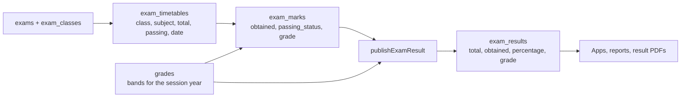

This page explains the two exam systems in the admin panel: **offline exams** (papers sat in school, marks typed in by teachers, results published with grades and printed as report cards) and **online exams** (multiple-choice tests taken in the student app and scored automatically). It covers the tables, the computations, publishing, PDF generation, the 2026 anti-cheating changes and how terms affect both. For the admin screens step by step, see [Online and Offline Exams](https://shawndaprawn.github.io/Eschool/features/exams/) in the end-user docs.

## At a glance

| | Offline exams | Online exams |
|---|---|---|
| Header | `exams` (+ `exam_classes`) | `online_exams` |
| Targets | One or more classes | One class (`ClassSchool`) or one class section (`ClassSection`) |
| Papers / questions | `exam_timetables` (one per class and subject, with total and passing marks) | `online_exam_question_choices` (questions from the bank placed in the exam with marks) |
| Results | `exam_marks` per paper, `exam_results` per exam after publishing | Computed on read from `online_exam_student_answers` |
| Grades | `grades` bands per session year | None |
| Pass/fail | Per paper (`passing_status`); per exam in reports | None |
| Managed by | Super Admin (`exam-create`, `exam-timetable-create`, `grade-create`), teachers enter marks (`exam-upload-marks`) | Teachers (`manage-online-exam`) |
| Controllers | `Exam\` controllers, `ExamTimetableController`, teacher API | `OnlineExamController`, `OnlineExamQuestionController`, student API |

## Offline exams

### Data flow



### 1. Grade bands

Grades are rows in `grades` (`starting_range`, `ending_range`, `grade`, `session_year_id`), managed by `Exam\GradeController::indexGrades`, `createGrades` and `destroyGrades` (permission `grade-create`). Validation: both ends numeric between 0 and 100, `ending_range` greater than `starting_range`, `session_year_id` required. Bands can be copied into a new session year with the `transfer_exam_grades` option when the year is created.

Lookups go through the `findExamGrade($session_year_id, $percentage)` helper in [`app/Helpers/settings_helper.php`](https://github.com/ShawnDaPrawn/Eschool/blob/main/admin-panel/app/Helpers/settings_helper.php):

```php
foreach ($grades as $row) {   // grades of that session year
    if (floor($percentage) >= $row['starting_range'] && floor($percentage) <= $row['ending_range']) {
        return $row->grade;
    }
}
```

It returns an empty string when the year has no bands and `null` when no band contains the value. Marks entry and publishing treat both as an error (`grades_data_does_not_exists`), so **the bands for a session year must cover every whole percentage from 0 to 100** before any marks can be saved.

### 2. Creating the exam

`Exam\ExamController::store` (permission `exam-create`) takes `name`, `description`, `session_year_id`, optional `term_id` and `class_id[]`, creates the `exams` row (`publish = 0`) and one `exam_classes` row per class. `update` changes the name, description and term and adds or removes exam classes; `destroy` soft-deletes the exam, and `Exam::booted()` cascades to its marks, timetables, results and exam classes. `deleteExamClass($exam_id, $class_id)` removes a single class.

All offline-exam admin actions, including publishing, check `exam-create`; the seeded `exam-list`, `exam-edit` and `exam-delete` permissions are not used.

### 3. Exam timetable

`ExamTimetableController::store` (permission `exam-timetable-create`) inserts one `exam_timetables` row per subject for a chosen exam and class: `subject_id`, `total_marks`, `passing_marks` (must be `<=` total), `date`, `start_time`, `end_time` (must be after start). `session_year_id` is copied from the exam.

An exam's status for a class is derived from its timetable dates and is computed the same way in several places:

| Status | Rule |
|---|---|
| 0 Upcoming | today is before the earliest paper date |
| 1 Ongoing | today is between the earliest and latest paper dates |
| 2 Completed | today is after the latest paper date |

### 4. Entering marks

**Admin panel** (`Exam\MarksController`, permission `exam-upload-marks`; in practice the Teacher role):

- `uploadMarks()` lists the class sections the logged-in teacher is class teacher of in the current session year.
- `marksList()` refuses until the exam is **Completed** for that class. Students come from `student_sessions` for the section and the exam's session year. For an elective subject only students with a matching `student_subjects` row are listed.
- `submitMarks()` validates `obtained_marks <= total_marks` for each row and limits the students to sections the teacher class-teaches or teaches the subject in (`teacherMarksClassSectionIds()` / `canManageStudentMarks()`); an existing `exam_marks_id` may only be overwritten for the same timetable and student. For each student:
  - `passing_status = obtained_marks >= exam_timetables.passing_marks ? 1 : 0`
  - `grade = findExamGrade(session_year_id, obtained_marks / total_marks * 100)`
  - `ExamMarks::updateOrInsert(['id' => exam_marks_id], [...])`

**Teacher app** (`POST /api/teacher/submit-exam-marks/subject` and `/student`, `Teacher\ExamController`):

- Refused with `exam_published` if the exam is already published.
- The teacher must be class teacher of the section or teach the subject there, every student must be in the section, and the exam must be Completed for the class.
- Obtained marks must be between 0 and the paper's `total_marks`. Passing status and grade are computed as above.

The admin `submitMarks()` does not check whether the exam is already published; corrections after publishing go through `updateExamResultMarks()` (below).

### 5. Publishing results

`Exam\PublishController::publishExamResult($id)` (permission `exam-create`) toggles publication.

To publish, all of these must hold:

1. Every `exam_timetables` row of the exam has at least one `exam_marks` row (else `marks_are_not_submitted`).
2. The exam is Completed. The status is taken from the **first** class in `exam_classes` only.
3. There is at least one timetable row and one marks row.

It then aggregates marks per student through `Exam::marks()` (a `hasManyThrough` from `exam_marks` via `exam_timetables`):

```sql
SUM(exam_timetables.total_marks) AS total_marks,
SUM(exam_marks.obtained_marks)   AS total_obtained_marks
GROUP BY student_id
```

So a student's total is the sum of the papers they have marks for. For each student:

- `percentage = total_obtained_marks * 100 / total_marks` (stored rounded to 2 decimals)
- `grade = findExamGrade(exam.session_year_id, percentage)`; a missing band aborts with `grades_data_does_not_exists`
- `class_section_id` is read from the student's `student_sessions` row for the exam's session year (aborts with "Student session not found." if missing)

All rows are bulk-inserted into `exam_results` and `exams.publish` becomes 1. Calling the endpoint on a published exam **unpublishes** it: the exam's `exam_results` rows are soft-deleted and `publish` goes back to 0.

`updateExamResultMarks()` (permission `exam-upload-marks`) edits marks of a published exam: it updates the `exam_marks` row (passing status and grade) and recalculates that student's `exam_results` row.

### 6. Where results are shown

- The student and parent apps read only `exam_results` (with the marks), so nothing is visible before publishing. `GET /api/student/get-exam-list` lists exams of the student's class that include the student's subjects, with the 0/1/2 status and an optional status filter.
- `Exam\ResultController::viewExamResult` / `fetchExamResultList` (permission `view-exam-result`) list results for Super Admin (all sections) and for teachers (their class-teacher sections).
- `Exam\ResultController::getExamResultIndex` / `showExamResult` (permission `exam-result`) are the class-teacher result screens; the requested section must be one of the teacher's class-teacher sections.

### Pass and fail

There are three different notions in the code:

| Where | Rule |
|---|---|
| `exam_marks.passing_status` | The paper is passed when `obtained_marks >= passing_marks` |
| `ExamReportService::offlineExamPassed()` | An exam counts as passed only when every paper of the student's class has `passing_status = 1` (no marks at all counts as failed) |
| Result PDFs | "Passed" when the overall percentage is at least 40 (`>= 40` is hard-coded), regardless of per-paper passing marks |

The `student_sessions.result` used during promotion is set by hand on the Promote Students page; it is not computed from exams.

## Report cards and PDFs

PDFs are rendered with dompdf (`barryvdh/laravel-dompdf` `^3.1`, facade `PDF`/`Pdf`).

| Generator | Access | Template | Content |
|---|---|---|---|
| `Student\ResultController::generateResult($id)` | `generate-result` | `students.result_template` | All **published** exams of the current session year that have papers in the student's subjects (core plus electives, term filter ignored). Per subject: marks per exam, totals and a grade; overall total, percentage, grade and Passed/Failed. Streamed as `result.pdf` |
| `Student\ResultController::generateExamResult($id)` | `view-exam-result` | `students.exam_result_template` | One published exam. Query string `exam_id` (required), `session_year_id` (defaults to current), `term_id` (optional filter on the exam). Only subjects that are in both the student's subject list and the exam timetable |
| `Teacher\ExamController::getStudentResultPdf` (`GET /api/teacher/get-student-result-pdf`) | Teacher who teaches the student | `students.result_template` | Same report as `generateResult`, returned base64-encoded in the JSON `pdf` field |

The grades printed in these PDFs are looked up directly with `Grade::where('starting_range', '<=', $p)->where('ending_range', '>=', $p)` on the **rounded** percentage, without a session-year filter, so the first matching band of any year is used. `findExamGrade()` (used when saving marks and publishing) filters by session year and uses `floor()`. The two can disagree when bands differ between years.

## ExamReportService

[`ExamReportService`](https://github.com/ShawnDaPrawn/Eschool/blob/main/admin-panel/app/Services/ExamReportService.php) produces the statistics behind `GET /api/student/offline-exam-report`, `/online-exam-report` and the parent equivalents (each takes `session_year_id`; the online one also takes an optional `subject_id`). Both methods return `[]` when the student has no `student_sessions` row for that year, which the endpoints turn into error code 113.

**`getOfflineStatistics($student_id, $session_year_id)`**

- Assigned exams: published exams of that session year that have timetable rows for the student's class (from `student_sessions`).
- Uses the student's `exam_results` for those exams: `average_percentage` (mean, 1 decimal), `avg_grade` (`findExamGrade` of the average), `pass_count` / `fail_count` (via `offlineExamPassed()`), `pass_percentage` (pass count over assigned exams), `missed_count` (assigned exams with no result), best and worst exam name and percentage, `total_exams`.

**`getOnlineStatistics($student_id, $session_year_id, $subject_id = null)`**

- Assigned exams: online exams of that session year for the student's class section or class (optionally one subject) that have at least one question.
- An exam is attempted when a `student_online_exam_statuses` row exists. For attempted exams the percentage comes from `OnlineExamScoringService::score()`.
- Returns `average_percentage`, `attempted_count`, `attempted_percentage`, `missed_count`, best and worst exam, `total_exams`. There is no pass/fail or grade.

## Online exams

### Building blocks

| Step | Table | Created by |
|---|---|---|
| Question bank | `online_exam_questions` (`class_subject_id`, `question_type` 0 simple / 1 equation based, `question`, `image_url`, `note`, `session_year_id`) with `online_exam_question_options` and `online_exam_question_answers` (one row per correct option) | `OnlineExamQuestionController::store` / `update`, or CSV import (`storeBulkData`) |
| Exam | `online_exams` (`model_type`/`model_id`, `subject_id`, `title`, `exam_key`, `duration` minutes, `start_date`, `end_date`, `session_year_id`, `term_id`) | `OnlineExamController::store` |
| Questions placed in the exam | `online_exam_question_choices` (`online_exam_id`, `question_id`, `marks`) | `OnlineExamController::storeQuestionsChoices` |
| Attempt | `student_online_exam_statuses` (`status` 1 in progress, 2 completed) | Student API, when questions are fetched |
| Answers | `online_exam_student_answers` (one row per selected option; `question_id` holds the **choice** id) | Student API, on submit |

Details:

- Questions belong to a class subject (looked up from the chosen class and subject) and a session year. The editors use Jodit; question and option text is stored HTML-escaped with `safe_htmlspecialchars()` and decoded for the app. Equation-based questions use separate `equestion` / `eoption` fields.
- The CSV import (`App\Imports\OnlineExamQuestionsImport`) reads `question_type`, `question`, `note`, `option1` to `option6` and `correct_options` (pipe-separated, 1-based option column numbers). Each row needs a question, at least two options and at least one correct option that points at a non-blank column.
- `online_exam_based_on = 0` creates a class-wide exam (`App\Models\ClassSchool`), `1` a section exam (`App\Models\ClassSection`). `exam_key` must be numeric and unique among non-deleted online exams; `end_date` must be after `start_date`; `duration >= 1`.
- Terms and conditions shown before an exam are a `settings` row saved by `storeOnlineExamTermsCondition`.
- Every admin action needs `manage-online-exam`, which only the Teacher role has.

### Taking an exam (student API)

All routes are in the `/api/student` group (`auth:sanctum`, `role:Student`, `student.session.active`).

1. **`GET get-online-exam-list`** returns exams for the student's class section or class in the current session year whose `end_date` has not passed, that have at least one question, that the student has not attempted, and whose subject is one of the student's subjects (or the given `subject_id`). When the class uses terms and a term is current, only exams with that `term_id` are listed. The `exam_key` is **not** included.
2. **`GET get-online-exam-questions`** (`exam_id`, `exam_key`):
   - The exam is looked up with `findStudentOnlineExam()`: same session year, the student's subjects, the student's class or section, and the current term when applicable. Someone else's exam gives "Invalid Exam Key".
   - Refused before `start_date` (`exam_not_started_yet`, 106) or after `end_date`. These come before the key check, so keys can't be guessed for an exam that isn't open.
   - The key is compared with `hash_equals()`; a wrong key gives "Invalid Exam Key" (103). After 5 wrong keys for one exam, the student is refused (code 429) for 10 minutes even with the right key; the right key clears the count.
   - Refused if an attempt row already exists (`student_already_attempted_exam`, code 105).
   - Creates the `student_online_exam_statuses` row with `status = 1`. This is the attempt's start time.
   - Returns each placed question with its options, `marks`, image and note. Correct answers are not sent: the response has `answers_count`, and `answers` is a list of that many placeholders (`id: 0, option_id: 0`) for older app builds.
3. **`POST submit-online-exam-answers`** (`online_exam_id`, `answers_data[]` of `{question_id: choice id, option_id: [option ids]}`):
   - Same exam lookup. Refused before `start_date` or more than 5 minutes (`ONLINE_EXAM_GRACE_MINUTES`) after `end_date`.
   - `OnlineExamScoringService::validateSubmission()` rejects a choice id that is not in this exam, an option that does not belong to that choice's question, and any repeated question or option. Option id `0` means unanswered and is dropped.
   - Inside a transaction with the attempt row locked (`lockForUpdate`): the attempt must exist (questions were fetched), must not be completed and must have no stored answers; if `duration > 0`, the submit must be within `duration + 5` minutes of the attempt row's `created_at`.
   - Stores one answer row per selected option and sets the attempt to `status = 2`.
4. **`GET get-online-exam-result-list`** lists the exams the student has an attempt for (optionally one `subject_id`), scored with `OnlineExamScoringService`. **`GET get-online-exam-result`** (`online_exam_id`) returns one exam's score: counts and choice ids of correct and incorrect (including unanswered) questions with their marks, `total_obtained_marks` and `total_marks`.

The parent API has the list, result-list and result endpoints for a child (behind `CheckChild`) but cannot take exams. Teachers see attempts in the panel through `OnlineExamController::onlineExamResultIndex` / `showOnlineExamResult`, which list completed attempts (`status = 2`) of students in sections the teacher is a subject teacher of.

### Scoring (OnlineExamScoringService)

[`OnlineExamScoringService`](https://github.com/ShawnDaPrawn/Eschool/blob/main/admin-panel/app/Services/OnlineExamScoringService.php) is the only scoring implementation. It is used by the student API result endpoints, the parent API, `Student\ResultController`, `OnlineExamController::showOnlineExamResult` and `ExamReportService`.

```php
public static function isCorrect(iterable $selectedOptionIds, iterable $correctOptionIds): bool
{
    $correct = self::normalize($correctOptionIds);   // positive ints, de-duplicated, sorted
    return $correct !== [] && self::normalize($selectedOptionIds) === $correct;
}
```

- A question scores only when the selected options are **exactly** the set of correct options: picking every option, a subset of a multi-answer question, or extra options all score zero. A question with no correct answers configured can never score.
- `score($studentId, $onlineExamId)` walks the exam's choices in id order, adds each choice's `marks` to `total_marks`, and adds them to `obtained_marks` when `isCorrect()`. Unanswered questions go into `incorrect_choice_ids`. There is no negative marking.

### Anti-cheating changes (commit 839c9eb)

Before this commit the questions endpoint sent the correct answers, the exam list sent the exam key, any submission was accepted, and selecting every option scored full marks at six separate scoring sites. Now:

- Correct answers are never sent before submission (only their count) and the exam key is never sent; the server checks the typed key.
- Fetching questions and submitting are limited to the student's own exam, its time window (plus 5 minutes) and its duration (plus 5 minutes, measured from the first fetch), with one attempt and one submission.
- Submitted options must belong to the right questions.
- All scoring goes through the exact-set rule above.

## Terms and exams

When a class has terms enabled for the session year (`class_session_configs.include_terms`):

- `exams.term_id` and `online_exams.term_id` can be set when the exam is created (both nullable).
- `GET /api/student/get-exam-list` accepts `term_id`; without it the current term is used. The filter is applied only when the class has terms and a term was found.
- The online exam list and `findStudentOnlineExam()` restrict to the current term's exams, so a term-tagged exam is not reachable once its term is over.
- `Student\ResultController::generateExamResult` accepts a `term_id` filter; `generateResult` reports the whole year and ignores terms.
- Migration `2026_04_28_165603_term_id_backfill` set `term_id` on existing exams from the earliest paper date, and on online exams from the start date, where the date fell inside a term of the same session year.
- Switching a class's term setting with `ClassSessionConfigService::saveConfig()`, or deleting the last term of a year, **force-deletes** that class's offline exams (with timetables, marks and results) and online exams for the session year. See [Academic Structure](Academic-Structure#classsessionconfigservice).

## See also

- [Academic Structure](Academic-Structure)
- [Database Schema](Database-Schema#exams-grades-and-results)
- [Roles and Permissions](Roles-and-Permissions#exams)
- [API Student](API-Student)
- [API Teacher](API-Teacher)
- [API Parent](API-Parent)
- [Glossary](Glossary)
