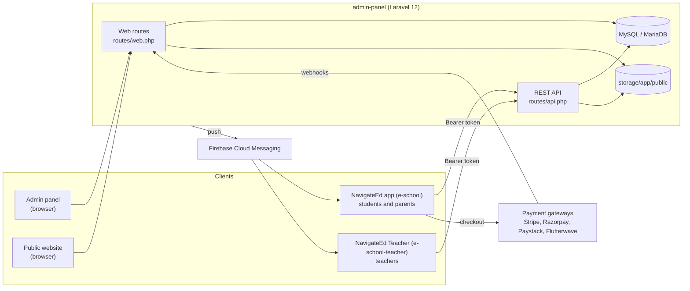

eSchool is a school management system. One Laravel server runs three things: the admin panel that school staff use, the school's public website, and the REST API behind two Flutter apps. One app is for students and parents, the other for teachers. Together they cover academic setup, admissions, attendance, timetables, lessons, assignments, exams and results, online exams, fees and online payments, leave, announcements, push notifications and chat.

This wiki is for people who build, run or change the system. For click-by-click guides on using the admin panel and configuring the apps, see the [documentation site](https://shawndaprawn.github.io/Eschool/).

## The system at a glance

| Component | Folder | Stack | App name and ID |
|---|---|---|---|
| Admin panel, public website, API | [`admin-panel/`](https://github.com/ShawnDaPrawn/Eschool/tree/main/admin-panel) | PHP 8.3, Laravel 12.70, Sanctum 4, spatie/laravel-permission 6, Blade + Bootstrap + jQuery | — |
| Student and parent app | [`e-school/`](https://github.com/ShawnDaPrawn/Eschool/tree/main/e-school) | Flutter (Dart `>=3.8`), flutter_bloc, Dio, Hive, Firebase. Version 3.5.0+39 | **NavigateEd**, `tech.tokensoft.navigateed` |
| Teacher app | [`e-school-teacher/`](https://github.com/ShawnDaPrawn/Eschool/tree/main/e-school-teacher) | Flutter (Dart `>=3.8`), flutter_bloc, Dio, Hive, Firebase. Version 3.5.0+32 | **NavigateEd Teacher**, `tech.tokensoft.navigateed.teacher` |
| End-user documentation | [`documentation/`](https://github.com/ShawnDaPrawn/Eschool/tree/main/documentation) | Docusaurus 3.10 | — |

The codebase, folders and Dart packages are still called eSchool (`eschool`, `eschool_teacher`). Only the published app names and store IDs are NavigateEd.

## Who uses what

| Role | Uses | Signs in at |
|---|---|---|
| Super Admin and custom staff roles | Admin panel | `/login` |
| Teacher | Teacher app, and a limited admin panel | `/api/teacher/login`, `/login` |
| Student | Student/parent app | `/api/student/login` |
| Parent (guardian) | Student/parent app, switching between their children | `/api/parent/login` |
| Public visitors | School website, online admission form | `/` |

Roles and what each one may do are covered in [Roles and Permissions](Roles-and-Permissions).

## Where to start

**New to the codebase?** Read [Architecture](Architecture), then [Repository Layout](Repository-Layout), then the [Glossary](Glossary). The words *session year*, *class section* and *medium* appear everywhere.

**Setting up a dev environment?** [Getting Started](Getting-Started).

**Running it in production?** [Deployment](Deployment), [Configuration](Configuration), [Scheduled Tasks and Commands](Scheduled-Tasks-and-Commands), [Security Model](Security-Model#security-checklist-for-deployers).

**Building the apps for your school?** [Mobile App Configuration](Mobile-App-Configuration), then [Building and Releasing Apps](Building-and-Releasing-Apps).

**Adding a feature or endpoint?** [Contributing](Contributing), [Admin Modules](Admin-Modules), [API Overview](API-Overview), [Security Model](Security-Model#rules-for-contributors).

**Something broken?** [Troubleshooting and FAQ](Troubleshooting-and-FAQ).

## Feature map

| Area | Admin panel | Apps | Wiki page |
|---|---|---|---|
| Academic setup: session years, mediums, classes, sections, streams, shifts, semesters, subjects | Yes | Read-only | [Academic Structure](Academic-Structure) |
| Students, parents, teachers, staff, ID cards, promotion | Yes | Profiles | [Admin Modules](Admin-Modules) |
| Attendance: students and staff | Yes | Teachers mark; students and parents view | [API Teacher](API-Teacher) |
| Timetable, lessons, topics, study material | Yes | Yes | [Admin Modules](Admin-Modules) |
| Assignments and submissions | Yes | Teachers create; students submit | [API Student](API-Student) |
| Exams, marks, grades, report cards | Yes | Results | [Exams and Grading](Exams-and-Grading) |
| Online exams | Yes | Students take them | [Exams and Grading](Exams-and-Grading#online-exams) |
| Fees, installments, online payment, receipts | Yes | Parents and students pay | [Payments](Payments) |
| Leave: staff and students | Yes | Yes | [Admin Modules](Admin-Modules) |
| Announcements, custom notifications, push | Yes | Yes | [Notifications](Notifications) |
| Chat between teachers and students or parents | Settings | Yes | [Chat](Chat) |
| Public website, online admission, gallery | Yes | — | [Public Website](Public-Website) |
| Languages and translations | Yes | Yes | [Localization](Localization) |

## About this fork

This repository builds on the eSchool 3.5.0 codebase. Since then it has added CI, upgraded the apps to the current Flutter and Gradle toolchain, completed the translations, and hardened security throughout: API scoping by role, child and class, permission checks, SQL-injection and XSS fixes, upload filtering, webhook signature checks and security headers. See [Release History](Release-History) and [Security Model](Security-Model).
