The admin panel ships a web installer at `/install`, built from a local copy of the `dacoto/laravel-wizard-installer` package in `admin-panel/packages/laravel-wizard-installer`. This page describes its steps and routes, what each step checks and writes, how the app decides it is installed, the seeders it runs, what the tests cover, and how to install from the command line instead. For the screenshots an end user follows, see [Installation Steps](https://shawndaprawn.github.io/Eschool/admin-panel/installation-steps/) in the user docs.

## How the package is wired in

- `composer.json` requires `dacoto/laravel-wizard-installer: dev-main` and declares a `path` repository pointing at `packages/laravel-wizard-installer`, so Composer installs the copy in this repo (the package itself requires PHP `^8.3`, `ext-pdo`, `illuminate/support ^12.0` and `dacoto/laravel-env-set ^2.0`).
- `bootstrap/app.php` registers `LaravelWizardInstallerServiceProvider` in `withProviders()` and defines the aliases `installer` and `to.install`. The package is also auto-discovered.
- [LaravelWizardInstallerServiceProvider](https://github.com/ShawnDaPrawn/Eschool/blob/main/admin-panel/packages/laravel-wizard-installer/src/LaravelWizardInstallerServiceProvider.php):
  - merges the package's `config/installer.php` under the app's [config/installer.php](https://github.com/ShawnDaPrawn/Eschool/blob/main/admin-panel/config/installer.php) (app values win, missing keys come from the package);
  - prepends `ToInstallMiddleware` to the `web` group and pushes `InstallerMiddleware` into a group called `installer`;
  - loads `routes/routes.php` and the `installer::` views;
  - publishes `public/styles.css` to `public/vendor/installer/styles.css` under the `laravel-assets` tag (already present in the repo; the Composer `post-update-cmd` re-publishes it with `--force`).

Differences between this copy and the package defaults are all in the app's `config/installer.php`: PHP 8.3 instead of 8.1, the eSchool seeders and `key:generate --force` instead of the package's `install:users` command (which does not exist here), the eSchool super admin credentials on the finish page, and the app logo.

## Installed state

The app counts as installed when the file `storage/installed` exists. Both middleware check only `file_exists(storage_path('installed'))`; the file's contents do not matter.

| Middleware | Applied to | Behaviour |
|---|---|---|
| `ToInstallMiddleware` | every route in the `web` group | Not installed and the route URI does not start with `install`: redirect to `route('install.index')`. |
| `InstallerMiddleware` | the `/install` routes (group `installer`) | Installed, or the URI does not start with `install`: `abort(404)`. |

So before installation every admin and public web page redirects to `/install`; after installation every `/install/*` URL returns 404. API routes (`/api/*`) and `/up` are not in the `web` group and are not redirected.

The finish step writes the file with JSON `{"url": config('app.url'), "date": "Y/m/d h:i:s"}`, opened with `FILE_APPEND`. `storage/installed` is listed in `.gitignore`. To run the wizard again, delete the file (and empty the database).

## Steps and routes

All routes are in the `web` and `installer` middleware groups with the prefix `install`.

| Step | Route | Controller | What it does |
|---|---|---|---|
| Welcome | `GET /install` (`install.index`) | `InstallIndexController` | Lists the information needed (app URL, database host, port, name, user, password). |
| Server | `GET /install/server` (`install.server`) | `InstallServerController` | Runs the requirement checks below. "Next" only appears when all pass. |
| Folders | `GET /install/folders` (`install.folders`) | `InstallFolderController` | Runs the folder checks. Redirects back to Server if the server checks fail. |
| Database form | `GET /install/database` (`install.database`) | `InstallDatabaseController` | Form for host, port, name, user, password and table prefix, prefilled from `config('database.connections.mysql')`. Redirects to Folders if the server or folder checks fail. |
| Database save | `POST /install/database` | `InstallSetDatabaseController` | Opens a PDO connection with `mysql:host=...;port=...;dbname=...`. On failure, goes back with the PDO error message. On success writes `DB_HOST`, `DB_PORT` (default 3306), `DB_DATABASE`, `DB_USERNAME`, `DB_PASSWORD` and, if given, `DB_PREFIX` to `.env`, then redirects to Migrations. |
| Migrations page | `GET /install/migrations` (`install.migrations`) | `InstallMigrationsController` | Requires a working database connection (`DB::connection()->getPdo()`), otherwise back to Database. |
| Run migrations | `POST /install/migrations` | `InstallSetMigrationsController` | `Artisan::call('migrate', ['--force' => true, '--seed' => false])`. Errors are shown on the page with a "Try again" button. |
| Keys page | `GET /install/keys` (`install.keys`) | `InstallKeysController` | Requires a database connection. Form with the app URL, prefilled with `url('/')`. |
| Keys save | `POST /install/keys` | `InstallSetKeysController` | See below. Redirects to Finish. |
| Finish | `GET /install/finish` (`install.finish`) | `InstallFinishController` | Requires a database connection, a non-empty `APP_KEY` in `.env` and passing server and folder checks, otherwise redirects to Database. Writes `storage/installed`, runs `route:clear`, `cache:clear`, `config:clear`, `view:clear` and `optimize:clear`, and shows the site URL, the login URL (`config('installer.login')`, `/login`) and the super admin credentials from `config('installer.admin_area.user')`. |

```mermaid
flowchart LR
    W["/install"] --> S["/install/server"]
    S --> F["/install/folders"]
    F --> D["/install/database"]
    D -->|"POST: test PDO, write DB_* to .env"| M["/install/migrations"]
    M -->|"POST: migrate --force"| K["/install/keys"]
    K -->|"POST: APP_URL, storage:link, seeders, key:generate --force"| X["/install/finish"]
    X -->|"writes storage/installed"| L["/login"]
```



### What the Keys step runs

`InstallSetKeysController`, in order:

1. Writes `APP_URL` from the form to `.env`.
2. Runs `key:generate --force --show` (prints a key without saving it). Only if `APP_KEY` in `.env` is empty is that key written. In practice the key is never empty here, because the wizard cannot run without one (see [Prerequisites](#prerequisites)).
3. Saves `.env`; throws `CantGenerateKeyException` if `APP_KEY` is still empty.
4. `Artisan::call('storage:link', ['--force' => true])`, creating `public/storage` pointing at `storage/app/public`. The result is not checked.
5. Runs each entry of `config('installer.commands')`:
   - `db:seed --class=InstallationSeeder --force`
   - `db:seed --class=AddSuperAdminSeeder --force`
   - `db:seed --class=emailseeder --force`
   - `key:generate --force`, which gives the install its own `APP_KEY` in place of whatever key was used to start the wizard.

Any exception sends the browser back to the Keys page with the message. Because the last command replaces `APP_KEY`, the browser's current session cookie can no longer be decrypted after this step; that does not matter for the wizard, which needs no login.

## Requirement checks

### Server

From `config('installer.server')`, evaluated by `InstallServerController::check()`:

| Check | Requirement |
|---|---|
| PHP Version | `PHP_VERSION_ID >= 80300` |
| PDO | extension `pdo_mysql` |
| Mbstring | extension `mbstring` |
| Fileinfo | extension `fileinfo` |
| OpenSSL | extension `openssl` |
| Tokenizer | extension `tokenizer` |
| Json | extension `json` |
| Curl | extension `curl` |

The list does not cover every extension the code needs: GD (Intervention Image), Zip (System Update and spreadsheet imports), DOM and XML (PDF generation, SVG sanitising, spreadsheets) are not checked. [Deployment](Deployment#server-requirements) has the full list.

### Folders

From `config('installer.folders')`: `../storage/framework`, `../storage/logs` and `../bootstrap/cache`. The paths are relative to the PHP working directory, which is `public/` when the site is served through `public/index.php`. `InstallFolderController::check()` reads each folder's mode with `File::chmod($path)` and fails if it is below `755` (the octal digits compared as a number). It does not test whether the web server user can actually write there; for example a `0700` directory owned by the web server user fails although it is writable, and a `0755` directory owned by another user passes although it is not.

## Seeders the installer runs

### InstallationSeeder

[database/seeders/InstallationSeeder.php](https://github.com/ShawnDaPrawn/Eschool/blob/main/admin-panel/database/seeders/InstallationSeeder.php). It is safe to run repeatedly; [System-Update](System-Update) and the `/seeder_install` maintenance URL run it again.

- Creates every permission with `Permission::firstOrCreate(['name' => ...], ['guard_name' => 'web'])` (ids in the list are ignored).
- `Role::updateOrCreate(['name' => 'Super Admin'])` and `syncPermissions()` with the Super Admin list.
- `Role::updateOrCreate(['name' => 'Teacher'])` and `syncPermissions()` with the Teacher list.
- Creates the `Parent` and `Student` roles (no permissions).
- `Language::updateOrCreate(['code' => 'en'], ['name' => 'English', 'file' => 'en.json', 'status' => 0, 'is_rtl' => 0])`.
- `Settings::updateOrCreate(['type' => 'system_version'], ['message' => '3.5.0'])`.
- ID card defaults with `Settings::firstOrCreate` (so a school's own design is not overwritten): `header_color`, `footer_color`, `header_footer_text_color`, `layout_type` (`vertical`), `profile_image_style` (`round`), `card_width` (`53.98`), `card_height` (`85.6`), `student_id_card_fields`, `staff_id_card_fields`, `background_transparency` (`80`), `background_size` (`80`).
- Runs `view:clear`, `route:clear`, `config:clear` and `cache:clear`.

The permission lists are documented in [Roles-and-Permissions](Roles-and-Permissions).

### AddSuperAdminSeeder

[database/seeders/AddSuperAdminSeeder.php](https://github.com/ShawnDaPrawn/Eschool/blob/main/admin-panel/database/seeders/AddSuperAdminSeeder.php):

- `User::updateOrCreate(['id' => 1], [...])` with first name `super`, last name `admin`, email `superadmin@gmail.com`, password `superadmin` (hashed), gender `Male`, image `logo.svg`, and assigns the `Super Admin` role. It must run after `InstallationSeeder`, which creates the role.
- `SessionYear::updateOrCreate(['id' => 1], ['name' => '2022-23', 'default' => 1, 'start_date' => '2022-06-01', 'end_date' => '2023-04-30'])`.
- Inserts a new `settings` row `session_year = 1` (a plain insert, so running the seeder twice leaves two `session_year` rows).

Warning: these are well-known demo credentials, and the installer's finish page displays them. Change the Super Admin password (and email) immediately after installing. Then create a current session year and select it in General Settings; the seeded one is 2022-23.

### emailseeder

[database/seeders/emailseeder.php](https://github.com/ShawnDaPrawn/Eschool/blob/main/admin-panel/database/seeders/emailseeder.php) creates the default email templates in the `email_tempalates` table with `firstOrCreate` on `type`: `student_registration` (subject "Student Admission Confirmation"), `staff_registration` and `student_application_regect`. Existing templates are left alone.

### Seeders the installer does not run

- `DatabaseSeeder::run()` is empty, so a plain `php artisan db:seed` does nothing. (The admin panel README's "default credentials `admin@admin.com` / `password`" do not match any seeder.)
- `DummyDataSeeder` upserts demo mediums, sections, classes, subjects, session years, categories, three users (`father@gmail.com`, `mother@gmail.com`, `student@gmail.com`), parents and a student. It assigns no roles, nothing calls it (only a commented-out route in `routes/web.php`), and it has not been checked against the current schema. Do not run it on a real install.

## How InstallationTest covers it

[tests/Feature/InstallationTest.php](https://github.com/ShawnDaPrawn/Eschool/blob/main/admin-panel/tests/Feature/InstallationTest.php) uses `RefreshDatabase`. The base `TestCase` calls `withoutMiddleware(ToInstallMiddleware::class)` so tests run against an "installed" app, and its `seedLikeInstaller()` helper seeds `InstallationSeeder`, `AddSuperAdminSeeder` and `emailseeder`, the same as `config/installer.php`.

| Test | Asserts |
|---|---|
| `test_installer_seeders_create_the_super_admin` | After `seedLikeInstaller()`, the user `superadmin@gmail.com` has the `Super Admin` role and `system_version` is `3.5.0`. |
| `test_installer_seed_commands_run_in_production` | Every `db:seed` entry in `config('installer.commands')` contains `--force` (without it `db:seed` is cancelled when `APP_ENV=production`, and the installer would finish without a super admin), and `key:generate --force` is in the list. |
| `test_old_licence_system_is_gone` | The registered `install*` URIs are exactly `install`, `install/database`, `install/finish`, `install/folders`, `install/keys`, `install/migrations`, `install/server` (no licence step); the classes `App\Services\SystemIntegrityService` and `App\Http\Middleware\EnsureRequestIntegrity` do not exist; there is no `service_health_logs` table. |
| `test_env_example_defaults_are_safe_for_production` | `.env.example` has `APP_ENV=production`, `APP_DEBUG=false` and an empty `APP_KEY=`, and `config('sanctum.expiration')` is not null. |

The HTTP steps of the wizard themselves (form posts, `.env` writes, `storage/installed`) are not exercised by any test. `AdminPagesTest` skips routes starting with `install`, and the `php -S` test server from `tests/Concerns/RunsAppServer.php` uses a temporary storage directory that already contains an `installed` file.

## Prerequisites

Before opening `/install`:

1. Install PHP dependencies: `composer install` (see [Deployment](Deployment#composer-dependencies) for why `--no-dev` currently breaks the app).
2. Create `.env`: `cp .env.example .env`. The wizard edits this file and fails if it is missing or not writable.
3. Generate a key: `php artisan key:generate`. `.env.example` ships with an empty `APP_KEY`, and the `web` middleware needs the encrypter for cookies, so without a key every page, including `/install`, returns a 500 error ("No application encryption key has been specified." in `storage/logs/laravel.log`).
4. Make `storage/`, `bootstrap/cache/`, `.env` and `public/` (for the storage link) writable by the web server user.
5. Create an empty MySQL or MariaDB database and a user for it.

## Installing without the wizard

The same result from the command line, run in `admin-panel/`:

```bash
composer install
cp .env.example .env
php artisan key:generate
# edit .env: APP_URL, DB_HOST, DB_PORT, DB_DATABASE, DB_USERNAME, DB_PASSWORD

php artisan migrate --force
php artisan db:seed --class=InstallationSeeder --force
php artisan db:seed --class=AddSuperAdminSeeder --force
php artisan db:seed --class=emailseeder --force
php artisan storage:link

# mark the app as installed, otherwise every web page redirects to /install
echo '{}' > storage/installed
```

Notes:

- The seeders must run in this order (`AddSuperAdminSeeder` needs the role from `InstallationSeeder`).
- `--force` is needed because `.env.example` sets `APP_ENV=production`.
- Running `key:generate` once is enough here; the wizard's final `key:generate --force` only exists to replace a key that was shared or used to bootstrap the wizard.
- This is what CI and the tests do: CI runs `cp .env.example .env && php artisan key:generate --force` and `php artisan test`, and `tests/Concerns/RunsAppServer.php` runs `migrate:fresh --force` followed by the three seeders. See [Testing-and-CI](Testing-and-CI).
- Sign in at `/login` with `superadmin@gmail.com` / `superadmin` and change the password.

## See also

- [Getting-Started](Getting-Started)
- [Deployment](Deployment)
- [Configuration](Configuration)
- [Roles-and-Permissions](Roles-and-Permissions)
- [System-Update](System-Update)
- [Troubleshooting-and-FAQ](Troubleshooting-and-FAQ)
