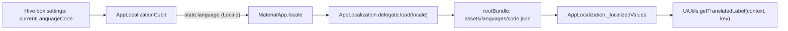

This page explains how translations work in the three user interfaces: the two Flutter apps, which bundle their own JSON language files, and the Laravel admin panel / public website, which stores language JSON files in `admin-panel/resources/lang/` and manages them through `LanguageController`. The two systems are independent: adding a language in the admin panel does not change the apps, and the apps never download translations from the server.

## Mobile apps

### Languages shipped

Both apps ship the same eight languages. English is the default. Files are in `assets/languages/` (declared as an asset folder in `pubspec.yaml`), and the list the user can choose from is `appLanguages` in `lib/utils/appLanguages.dart`.

| Code | Name shown (`languageName`) | File | Direction |
|---|---|---|---|
| `en` | English | `en.json` | LTR (default, `defaultLanguageCode = 'en'`) |
| `ur` | اردو - Urdu | `ur.json` | RTL |
| `tr` | Türkçe - Turkish | `tr.json` | LTR |
| `ar` | العربية - Arabic | `ar.json` | RTL |
| `es` | Español - Spanish | `es.json` | LTR |
| `pt-BR` | Português (Brasil) - Portuguese (Brazilian) | `pt-BR.json` | LTR |
| `fr` | Français - French | `fr.json` | LTR |
| `id` | Bahasa Indonesia - Indonesian | `id.json` | LTR |

Each file is a flat JSON object of label key to text: 428 keys per file in `e-school/`, 427 in `e-school-teacher/`. The keys are also declared as Dart constants in `lib/utils/labelKeys.dart` (for example `const String homeKey = 'home';`), and error messages use keys from `lib/utils/errorMessageKeysAndCodes.dart`. Sixteen keys starting with `timeago` (`timeagoPrefixAgo`, `timeagoSuffixAgo`, `timeagoMinutes`, ...) feed the relative-time strings.

The 3.5.0 changelogs list `ar`, `es`, `fr` (student app), `id`, `pt-BR` and `tr` as added in that release. The teacher changelog also lists `assets/languages/er.json`, which does not exist in the repository.

### How the app loads a language



1. `AppLocalizationCubit` (`lib/cubits/appLocalizationCubit.dart`) starts with `SettingsRepository.getCurrentLanguageCode()`, which reads `currentLanguageCode` from the Hive `settings` box and falls back to `defaultLanguageCode`.
2. `UiUtils.getLocaleFromLanguageCode()` splits the code on `-`: `en` becomes `Locale('en')`, `pt-BR` becomes `Locale('pt', 'BR')`.
3. `MyApp` (`lib/app/app.dart`) watches the Cubit and passes the locale to `MaterialApp.locale`. `supportedLocales` is built from `appLanguages`, and the delegates are `AppLocalization.delegate`, `GlobalMaterialLocalizations.delegate`, `GlobalWidgetsLocalizations.delegate` and `GlobalCupertinoLocalizations.delegate`.
4. `_AppLocalizationDelegate.isSupported()` accepts only locales in `appLanguages`. `load()` creates `AppLocalization(locale)` and calls `loadJson()`, which loads `assets/languages/<languageCode>.json`, or `<languageCode>-<countryCode>.json` when the locale has a country code, and stores every value as a string. It also registers a `timeago` `LookupMessages` built from the `timeago*` keys (falling back to `timeago.EnMessages()` if that fails).
5. Widgets call `UiUtils.getTranslatedLabel(context, someKey)`, which returns the translated text, or the key itself if the current file does not contain it.
6. Changing the language (`ChangeLanguageBottomsheetContainer`, from the settings screen in both apps) calls `AppLocalizationCubit.changeLanguage(code)`, which saves the code to Hive and emits the new locale; `MaterialApp` rebuilds and the delegate loads the new file.

The language is a device-local preference. It is not sent to the API, and server-generated text (notifications, announcements, PDFs) arrives in whatever language the school entered.

### RTL

There is no RTL flag in the apps. Text direction comes from Flutter's `GlobalWidgetsLocalizations`, which sets `Directionality` to RTL for right-to-left languages, including `ar` and `ur`. The UI is written with direction-aware widgets (`EdgeInsetsDirectional`, `AlignmentDirectional`, used on roughly 190 lines in `e-school/lib` and 160 in `e-school-teacher/lib`), and a few places check `Directionality.of(context)` explicitly:

- `UiUtils.getBackButtonPath()` returns `assets/images/rtl_back_icon.svg` instead of the normal back icon.
- `ui/screens/chat/widget/singleMessageItem.dart` flips the message bubble tail.
- `ui/screens/exam/onlineExam/widgets/optionContainer.dart` (student app) measures option text with the current direction.

### Adding a language to an app

Do this in each app you want to translate (`e-school/` and/or `e-school-teacher/`):

1. Copy `assets/languages/en.json` to `assets/languages/<code>.json` and translate the values. Keep every key. For a regional variant use `<language>-<COUNTRY>`, e.g. `pt-BR.json`.
2. Add the language to `appLanguages` in `lib/utils/appLanguages.dart`:

   ```dart
   const List<AppLanguage> appLanguages = [
     AppLanguage(languageCode: 'en', languageName: 'English'),
     // ...
     AppLanguage(languageCode: 'af', languageName: 'Afrikaans'),
   ];
   ```

   The code must match the file name exactly (case included), because `loadJson()` builds the file name from the `Locale`.
3. Optionally change `defaultLanguageCode` in the same file to make it the default for new installs. Existing installs keep the code stored in Hive.
4. Run `flutter test test/translations_test.dart` (see below).
5. The app does not supply its own Material/Cupertino translations, so system widget strings (date pickers, text selection menus) come from Flutter's `Global*Localizations`. Check that Flutter supports the language if those strings matter.

No `pubspec.yaml` change is needed because the whole `assets/languages/` folder is already an asset. Docs: https://shawndaprawn.github.io/Eschool/mobile-app/change-language/

### The translations test

`test/translations_test.dart` (identical in both apps apart from the import) reads `assets/languages/` relative to the app folder and checks:

| Test | Fails when |
|---|---|
| every language the app offers has a translation file | an `appLanguages` code has no `<code>.json` |
| there are no translation files for languages the app does not offer | a `.json` file has no matching `appLanguages` entry |
| every translation file has exactly the English keys | a file is missing keys from `en.json` (`<code>.json is missing keys`) or has keys `en.json` lacks (`<code>.json has keys English lacks`) |

CI runs `flutter test` for both apps, so these checks gate every pull request ([Building-and-Releasing-Apps](Building-and-Releasing-Apps#what-ci-checks)). When you add a new label, add it to `en.json` and to every other language file in the same change.

## Admin panel and public website

### Files

| Path | Contents |
|---|---|
| `admin-panel/resources/lang/en.json` | English labels, 1396 keys. Fallback language; must exist. |
| `admin-panel/resources/lang/ar.json` | Arabic labels, 1366 keys (not every English key is translated; missing keys fall back to the key text). |
| `admin-panel/resources/lang/en/` | Laravel's PHP group files `auth.php`, `pagination.php`, `passwords.php`, `validation.php` (English only). |

There is no top-level `admin-panel/lang/` folder, so Laravel uses `resources/lang` as its language path. Blade views translate with `__('key')` / `trans('key')`, which Laravel resolves from `resources/lang/<locale>.json`. `config/app.php` sets `locale` and `fallback_locale` to `en`.

JavaScript in the admin panel gets the same labels: `resources/views/layouts/include.blade.php` loads `<script src="{{ route('common.language.read') }}">`. That route (`GET /common/js/lang`, outside the auth group) is `Controller::readLanguageFile()` in `app/Http/Controllers/Controller.php`, which responds with `window.languageLabels = <contents of resources/lang/<code>.json>` (`Content-Type: text/javascript`), using the code of the `language` object in the session and falling back to `en.json` if there is no session language or the file does not exist. `basename()` is applied to the code, so it cannot point outside `resources/lang`. `trans(label)` in `public/assets/js/custom/function.js` returns `window.languageLabels[label]` or the label itself.

### `languages` table and `Language` model

Created by `2022_06_07_065946_create_languages_table.php`, extended by `2022_07_18_044243_is_rtl_in_language.php`:

| Column | Type | Notes |
|---|---|---|
| `id` | bigint | |
| `name` | string(512) | Shown in the language switchers. |
| `code` | string(64) | Locale code; also names the file `resources/lang/<code>.json`. |
| `file` | string(512) | Stored file name (`<code>.json`). |
| `is_rtl` | tinyint, default 0 | Switches the admin and website layouts to RTL. |
| `status` | tinyint, default 0, comment `1=>active` | Always written as 0 by `LanguageController::store()` and by the seeding code; nothing in the code reads it. |
| `created_at`, `updated_at`, `deleted_at` | timestamps / soft-delete column | The model does not use the `SoftDeletes` trait, so deleting a row removes it. |

`App\Models\Language` is an empty Eloquent model (`HasFactory` only). An English row (`code` `en`, `file` `en.json`) is created by migration `2026_05_26_173526_add_default_english_language.php` (only if missing) and by `InstallationSeeder` (`Language::updateOrCreate(['code' => 'en'], ...)`). No row is seeded for `ar`, even though `ar.json` ships.

### `LanguageController`

`app/Http/Controllers/LanguageController.php`. Routes are in `routes/web.php` inside the `['Role', 'auth']` group with the `language` middleware.

| Route | Method | Permission | Behaviour |
|---|---|---|---|
| `GET language` | `index` | `language-create` | Language settings page `resources/views/settings/language_setting.blade.php` (add form and list). |
| `POST language` | `store` | `language-create` | Validates `name` required; `code` required, string, max 12, `regex:/^[A-Za-z]{2,3}([-_][A-Za-z0-9]{2,8})?$/`, unique in `languages`; `file` required, `mimes:json`. Moves the upload to `resources/lang/<code>.json`, saves the row with `status = 0` and `is_rtl` from the "Is RTL" checkbox. Returns JSON. |
| `GET language-list` (also `GET language/{id}`) | `show` | `language-list` | Bootstrap-table JSON: `id`, `no`, `name`, `code`, `rtl`, `status`, `operate`. The `en` row gets only a download button; other rows also get edit and delete. Supports `offset`, `limit`, `sort`, `order`, `search`. |
| `PUT/PATCH language/{id}` | `update` | `language-edit` | Validates `id`, `name`, `code` (same rule, unique except itself). If a new `file` is uploaded (`mimes:json`) the old file is deleted and the new one saved as `<code>.json`. `is_rtl` is set from whether `rtl` is present. |
| `DELETE language/{id}` | `destroy` | `language-delete` | Refuses `en`. Deletes the row; the JSON file stays in `resources/lang/`. |
| `GET language-sample` | `language_sample` | `language-create` | Downloads `resources/lang/en.json` as `language.json`, the template to translate. |
| `GET language-download/{id}` | `download` | `language-list` | Downloads `resources/lang/<basename(file)>` as `<code>.json`. |
| `GET set-language/{lang}` (admin) and `GET web-set-language/{lang}` (public site, outside auth) | `set_language` | none | If a row with that `code` exists, stores `locale` and `language` (the row as an object) in the session and calls `app()->setLocale()`. Redirects back. |

The permissions `language-list`, `language-create`, `language-edit`, `language-delete` are created by `InstallationSeeder`; which roles get them is described on [Roles-and-Permissions](Roles-and-Permissions).

There is no "default language" setting in the admin panel. A visitor sees English (`config/app.php` `locale`) until they pick a language from the switcher; the choice is stored per session. English cannot be edited or deleted through the UI because it is the fallback for `readLanguageFile()` and the sample download.

To add a language to the admin panel and website: download the sample, translate the values, then add the language with its code, the JSON file and the RTL checkbox. Keep the keys as they are; any missing key shows the key text.

### `LanguageManager` middleware

`app/Http/Middleware/LanguageManager.php`:

```php
if (Session::has('locale')) {
    app()->setLocale(Session::get('locale'));
}
```

It is appended to the `web` middleware group in `bootstrap/app.php` and is also aliased as `language`, which `routes/web.php` applies to the public website group (`/`, `about`, `contact`, `photo`, `video`, `registration`, ...) and to the authenticated admin group. `resources/views/layouts/header.blade.php` also calls `app()->setLocale(Session::get('locale'))`.

RTL in the views: `resources/views/layouts/master.blade.php` and `resources/views/web/master.blade.php` read `Session::get('language')` and output `<html lang="en" dir="rtl">` when `is_rtl` is set; `resources/views/layouts/include.blade.php` then loads `public/assets/css/rtl.css`. The language switchers are in `resources/views/layouts/header.blade.php` (admin, links to `set-language/{code}`) and `resources/views/web/header.blade.php` (website, `web.set.language`), both listing `get_language()` (`Language::get()`, in `app/Helpers/settings_helper.php`).

### What `TranslationsTest` checks

`admin-panel/tests/Feature/TranslationsTest.php`, run by `php artisan test` in CI:

| Test | Checks |
|---|---|
| `test_every_language_file_is_a_flat_map_of_labels` | `resources/lang/en.json` exists; every `resources/lang/*.json` decodes to an array and every value is a string (no nested objects or numbers). |
| `test_the_admin_panel_gets_labels_for_the_chosen_language` | With session `language` = `{code: 'ar'}`, `GET common.language.read` returns 200, `Content-Type: text/javascript; charset=UTF-8` and exactly `window.languageLabels = ` followed by `ar.json`. |
| `test_a_language_without_a_file_falls_back_to_english` | For a code with no file (`w3`), for no session language, and for a path-traversal attempt (`../../.env`), the route returns the English file. |

Unlike the app tests, it does not compare keys between languages, so a partially translated file such as `ar.json` passes.

### Gotchas

- Changing a language's `code` in the edit form without uploading a new file leaves `file` pointing at the old `<oldcode>.json`. Both `__()` and `readLanguageFile()` look for `<newcode>.json`, so the language silently falls back to English. Re-upload the file when you change the code.
- Uploading a language whose code matches an existing file (for example `ar`, which ships without a database row) overwrites that file.
- Deleting a language leaves its JSON file on disk.
- The admin panel's languages have no effect on the mobile apps; translate the apps through `assets/languages/` as described above.

## See also

- [Mobile-Apps-Overview](Mobile-Apps-Overview)
- [Mobile-App-Configuration](Mobile-App-Configuration)
- [Admin-Panel-Overview](Admin-Panel-Overview)
- [Public-Website](Public-Website)
- [Roles-and-Permissions](Roles-and-Permissions)
- [Testing-and-CI](Testing-and-CI)
