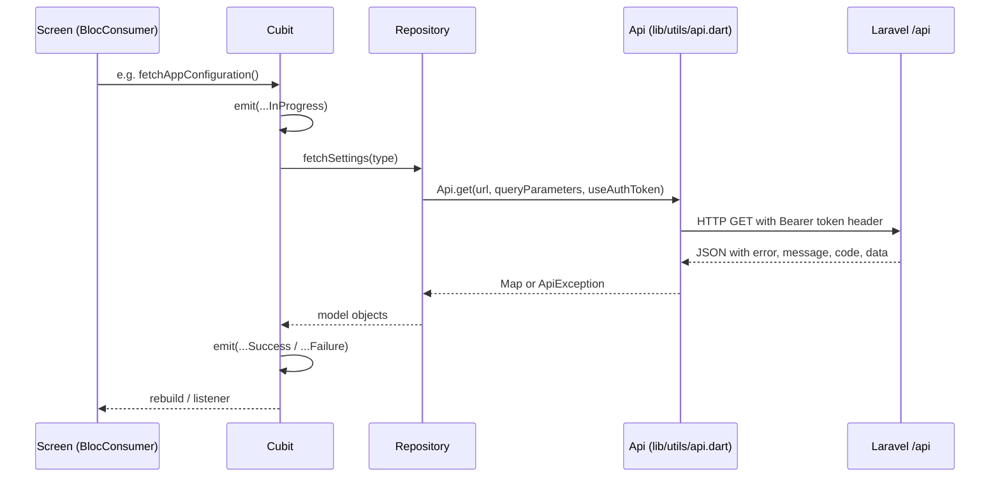

This page describes the architecture the two Flutter apps share: the student/parent app in `e-school/` (Dart package `eschool`) and the teacher app in `e-school-teacher/` (Dart package `eschool_teacher`). Both are thin clients of the Laravel REST API under `/api` in `admin-panel/`; they are built the same way, so almost everything below applies to both, on phones and, as web builds, in a browser (see [In a browser](#in-a-browser)). App-specific details are on [Student-Parent-App](Student-Parent-App) and [Teacher-App](Teacher-App).

## At a glance

| | Student/parent app | Teacher app |
|---|---|---|
| Folder | `e-school/` | `e-school-teacher/` |
| `pubspec.yaml` `name` | `eschool` (do not rename: every import uses it) | `eschool_teacher` (same warning) |
| `version` | `3.5.0+39` | `3.5.0+32` |
| Dart SDK constraint (`environment.sdk`) | `>=3.8.0 <4.0.0` | `>=3.8.0 <4.0.0` |
| SDK floor recorded in `pubspec.lock` | `dart: >=3.12.0 <4.0.0`, `flutter: >=3.44.0` | same |
| Flutter used by CI | 3.47.7 (stable) | 3.47.7 (stable) |
| Entry point | `lib/main.dart` → `initializeApp()` in `lib/app/app.dart` | same |
| Android `applicationId` | `tech.tokensoft.navigateed` | `tech.tokensoft.navigateed.teacher` |
| iOS bundle id | `tech.tokensoft.navigateed` | `tech.tokensoft.navigateed.teacher` |
| Logs in as | student (GR number) or parent (email) | teacher (email) |
| Server config keys read | `app_link`, `ios_app_link`, `app_version`, `ios_app_version`, `force_app_update`, `app_maintenance` | `teacher_app_link`, `teacher_ios_app_link`, `teacher_app_version`, `teacher_ios_app_version`, `teacher_force_app_update`, `teacher_app_maintenance` |

The lockfile records `dart >=3.12.0` and `flutter >=3.44.0`, so in practice you need Flutter 3.44 or newer even though `pubspec.yaml` allows Dart 3.8. The FAQ on the docs site also lists Flutter 3.44 (https://shawndaprawn.github.io/Eschool/faqs/).

## Source layout

Both apps use the same folder structure under `lib/`:

| Path | Contents |
|---|---|
| `lib/main.dart` | Calls `initializeApp()`; carries the version comment `///v-3.5.0`. |
| `lib/app/app.dart` | `initializeApp()` (Firebase, Crashlytics, notifications, Hive), `MyApp` with the global `MultiBlocProvider` and `MaterialApp`. |
| `lib/app/routes.dart` | `Routes` class: route-name constants and `onGenerateRouted()` (a `switch` over route names, unknown names give an empty `Scaffold`). |
| `lib/app/routeArguments.dart` | The typed arguments of the routes that take several values (see [Route arguments](#route-arguments)). |
| `lib/app/deepLinks.dart`, `lib/app/sessionWatcher.dart` | The links the app understands, and what keeps `/me/context`, the child and school switchers and links in step with sign-in (see [Links into the app](#links-into-the-app) and [Choosing a child and a school](#choosing-a-child-and-a-school)). |
| `lib/app/sharedScreens.dart` | The routes of the screens that live in the packages (Notifications settings, My school, Profile picture and, in the student app, Approvals and Invitation), and the Settings entries that open them (see [Shared screens](#shared-screens)). |
| `lib/app/selectedChild.dart` | Student app only: how a parent's child screens read the child picked in the switcher (`childRoute`, `SelectedChildScope`). |
| `lib/cubits/` | Feature Cubits (one file per Cubit, state classes in the same file). Sub-folders `chat/` and `gallery/`. Some screen-private Cubits live next to their screen, e.g. `e-school/lib/ui/screens/reports/cubits/`. |
| `lib/data/models/` | Plain Dart model classes with `fromJson` / `toJson`. |
| `lib/data/repositories/` | One class per domain (`AuthRepository`, `StudentRepository`, `SystemRepository`, ...). Repositories are the only layer that calls `Api`. |
| `lib/ui/screens/` | Screens. Most screens expose `static Route route(RouteSettings)`, which builds a `CupertinoPageRoute` and provides the screen-local Cubits; a few are wrapped in a `CupertinoPageRoute` directly in `routes.dart`. |
| `lib/ui/widgets/` | Reusable widgets (error containers, shimmer loaders, bottom sheets, force-update dialog, ...). |
| `lib/utils/api.dart` | `Api`: every endpoint URL, and static `post` / `get` / `download` that hand the call to the shared `ApiClient`. Also what the app does on a 401 (`logoutUser`). `ApiException` comes from `eschool_core` and is re-exported here. |
| `lib/utils/constants.dart` | `baseUrl`, `databaseUrl`, `storageUrl` (from the build defines, see [Mobile-App-Configuration](Mobile-App-Configuration#build-settings)), notification channel keys, pagination limit, demo-credential switches. |
| `lib/utils/hiveBoxKeys.dart` | Hive box names and keys, SharedPreferences keys. |
| `lib/utils/appLanguages.dart` | `defaultLanguageCode` and the `appLanguages` list. |
| `lib/utils/labelKeys.dart` | Constants for every translation key; re-exports the keys the shared widgets use from `eschool_core`. |
| `lib/utils/errorMessageKeysAndCodes.dart` | `ErrorMessageKeysAndCode`: maps API error codes to translation keys. |
| `lib/utils/uiUtils.dart` | `UiUtils`: `rootNavigatorKey`, `getTranslatedLabel()`, snack bars, date helpers, `forceUpdate()`, `launchWebUrl()`. The sizes and helpers that were the same in both apps forward to `SharedUiUtils` in `eschool_core`. |
| `lib/utils/notificationConfig.dart` | The app's `NotificationConfig` (channel description, types that do not raise the badge, tap routing by `data['type']`, the background handler) for `NotificationUtility` and `ChatNotificationsUtils` in [`packages/eschool_notifications`](https://github.com/ShawnDaPrawn/Eschool/tree/main/packages/eschool_notifications). |
| `lib/utils/fileNameUtils.dart` | `sanitizeFileName()` used before saving server-supplied file names. |
| `lib/utils/assets.dart` | `Assets` class with every image/animation path; the files the shared widgets draw point at `SharedAssets`. |
| `test/translations_test.dart` | Language file consistency. |
| `test/theme_colors_test.dart` | Fails on colours hard-coded outside the shared theme. |

The student app also has `lib/utils/stripeService.dart` (Stripe payment sheet) and `lib/utils/homeBottomsheetMenu.dart` (the "more" menu list).

### What the apps share through `eschool_core`

Files that were the same in both apps live once in [`packages/eschool_core`](https://github.com/ShawnDaPrawn/Eschool/tree/main/packages/eschool_core/lib/src) and both apps import them through `package:eschool_core/eschool_core.dart`:

| Folder in `eschool_core/lib/src/` | What moved there |
|---|---|
| `l10n/` | `AppLocalization` and `AppLocalizationDelegate` (each app passes its own `appLanguages`), the shared label keys |
| `models/` | `StudyMaterial`, `Announcement`, `Topic`, `SubjectMark`, `Result`, `ChatMessage`, `DynamicField`, the leave day types (`LeaveType`, `LeaveDateWithType`), plus the earlier gallery, calendar, chat-settings and event models |
| `cubits/` | `GalleryAlbumCubit`, `GalleryVideosCubit`, `GalleryAlbumPhotosCubit`, `EventDetailsCubit`, `AppSettingsCubit`, each taking an interface from `repositories/` (`GalleryRepository`, `EventScheduleRepository`, `AppSettingsRepository`) that the app's `SystemRepository` implements |
| `widgets/` | 21 of the 30 widget files the apps had in common (error container, shimmer loaders, back button, image and gallery widgets, bottom sheet parts, search field, refresh indicator, ...) and four screen parts (term break, gallery videos tab, leave day picker, drop-down) |
| `ui/` | `SharedUiUtils` (the sizes and helpers both `UiUtils` had), `SharedAssets` (paths of the images the shared widgets draw, which each app ships), `SharedRoutes` |
| `utils/` | `extensions.dart` and the list animations with their switches (`isApplicationItemAnimationOn` and the durations) |
| `shell/` | `AppShell`, which each app puts above its navigator in `MaterialApp.builder` |
| `avatars/` | `AvatarSet` (the 16 avatars in `assets/avatars/`: four each of `boy_`, `girl_`, `man_` and `woman_1` to `_4`, drawn in the theme's colours only, and the default for a person from gender and role) and `PersonAvatar` (an avatar key, a photo URL or initials) |
| `widgets/screen_scaffold.dart` | `ScreenScaffold` (the dark header, title and back button the packages' screens use) and `EmptyStateMessage` |

`AppShell` carries the few things the shared widgets do differently per app: the error code to label mapping (`ErrorMessageKeysAndCode`, code 113 means something else in each app), how an attachment opens (`UiUtils.viewOrDownloadStudyMaterial`) and the button drawn next to it (`DownloadFileButton`), and the bottom bar's height. Nine shared widget files still differ in how they look between the apps and stay in each app until the screens that use them are redesigned: `customAppbar`, `customTabBarContainer`, `tabBarBackgroundContainer`, `downloadFileButton`, `downloadFileBottomsheetContainer`, `dynamicFieldListContainer`, `listItemForExamAndResult`, `noDataContainer` and `notificationIconWidget`.

### Shared screens

Screens that both apps (or both a phone and a portal) show are built once in a package and opened by each app's `lib/app/sharedScreens.dart`:

| Screen | Package | Endpoint | In |
|---|---|---|---|
| Notifications settings: each notification type, push, email and in-app switches, a lock with the school's reason on a mandatory one | `eschool_notifications` (`NotificationSettingsScreen`) | `GET` and `PUT /api/v2/me/notification-preferences` | both apps; Settings, and the gear in the Notifications screen's header |
| Approvals: a parent approves a child's account after reading the consent, or withdraws it | [`eschool_people`](https://github.com/ShawnDaPrawn/Eschool/tree/main/packages/eschool_people) (`ApprovalsScreen`) | `GET /api/v2/guardian/approvals`, `POST .../approvals/{learner}` | student app, parents only |
| Invitation: a new parent opens the school's link, sets a password and is signed in | `eschool_people` (`InvitationScreen`) | `GET /api/v2/guardian/invitations/{token}`, `POST .../accept` | student app, from the link only, before sign-in |
| My school: the school's contacts (call, e-mail, website, address), documents and term dates | `eschool_people` (`MySchoolScreen`) | `GET /api/v2/schools/{school}/my-school` | both apps; Settings |
| Profile picture: pick an avatar, or upload a photo the school approves | `eschool_people` (`AvatarScreen`) | `GET`, `PUT` and `POST /api/v2/me/avatar` | both apps; Settings |

Each screen reads and writes through a repository interface (with an `Api...Repository` on the app's `ApiClient` and a fake in the tests), and its request and response models are written by hand until the endpoints are in `openapi.yaml` and the generated `eschool_api` client replaces them. The exact fields are in [engineering/specs/apps/phase-1-apps.md](https://github.com/ShawnDaPrawn/Eschool/blob/main/engineering/specs/apps/phase-1-apps.md). Until the server answers an endpoint (404), its Settings entry stays hidden: `AvailableOnly` (`eschool_session`) asks once per school and remembers the answer until sign-out or a school switch. A module the school has set to read only shows its screens without the buttons that change things (`MeContext.isModuleReadOnly`).

## Startup sequence

`initializeApp()` in [e-school/lib/app/app.dart](https://github.com/ShawnDaPrawn/Eschool/blob/main/e-school/lib/app/app.dart) calls `usePathUrlStrategy()` (web addresses without `#`), then `prepareApp()`, then `runApp(const MyApp())`. `prepareApp()` (the teacher copy has the same steps, with the orientation lock after the notification setup and without the `showCaseBox`):

1. `WidgetsFlutterBinding.ensureInitialized()`; `AppConfig.assertValid()`; in release mode `debugPrint` is replaced with a no-op.
2. Registers `google_fonts/OFL.txt` with `LicenseRegistry`.
3. Locks orientation to `DeviceOrientation.portraitUp`.
4. Except on the web: `Firebase.initializeApp()` with no options, so Firebase is configured from the native files (`google-services.json`, `GoogleService-Info.plist`; there is no `firebase_options.dart`), and `FlutterError.onError` and `PlatformDispatcher.instance.onError` go to Firebase Crashlytics. The integration smoke flows call `prepareApp(useFirebase: false)`.
5. `NotificationUtility.configure(notificationConfig, session: Api.session)`, then `NotificationUtility.initializeAwesomeNotification()` creates the two Android channels `basic_channel` and `chat_notifications_channel` (both from `eschool_notifications`; nothing happens on the web).
6. `initAppStorage(...)` (`eschool_session`) initialises Hive in `getApplicationSupportDirectory()` (not Documents, which iOS exposes in the Files app because `UIFileSharingEnabled` is on) and moves boxes left in Documents by older versions; on the web Hive uses IndexedDB. Then it opens the boxes (`showCaseBox`, `authBox`, `settings` in the student app; `authBox`, `settings` in the teacher app).

`MyApp` creates the app-wide Cubits in a `MultiBlocProvider` and builds a `MaterialApp` with `initialRoute: Routes.splash` (on the web, `onGenerateInitialRoutes` starts every visit at the splash screen whatever the address bar says), `onGenerateRoute: Routes.onGenerateRouted`, `navigatorKey: UiUtils.rootNavigatorKey`, and the shared Material 3 theme `AppTheme.light(font: GoogleFonts.poppinsTextTheme)` from `eschool_core` (see [UI-Standards](UI-Standards)).

The splash screen (`lib/ui/screens/splashScreen.dart`) then:

1. Calls `AppConfigurationCubit.fetchAppConfiguration()` (GET `settings?type=app_settings`).
2. On success, calls `UserProfileCubit.fetchAndSetUserProfile()` to refresh the stored profile if someone is logged in. In the student app this is called with `autoLogout: true`, so a failed profile fetch signs the user out. A signed-in parent or teacher whose first sign-in is still waiting on the terms skips this fetch, because the profile call would be HTTP 403, and the splash opens the terms screen instead. Once that acceptance is stored, the splash refreshes the profile and opens home.
3. Waits at least 2 seconds, then routes to the login screen when `AuthCubit` is `Unauthenticated`, otherwise to the home screen. The student app has extra branches (a parent's first sign-in, parent home, compulsory-fee screen), see [Student-Parent-App](Student-Parent-App#login-and-the-two-user-types).

If the configuration request fails the splash shows an `ErrorContainer` with a retry button; the app cannot get past the splash screen without reaching the server.

## Layout on tablets and desktops

The screens were designed for phones. Three pieces in `eschool_core/lib/src/layout/` let them work at every width without a second code path, and leave phones exactly as they were:

| Piece | What it does |
|---|---|
| `Breakpoints` | `ScreenSize.phone` below 600 px, `tablet` from 600 to 1024, `desktop` above; `Breakpoints.of(context)` reads the width the widget has. `contentMaxWidth` is 640. |
| `ContentColumn` | On a phone, returns its child unchanged. Wider, centres the child in a column at most 640 px wide on the page background (`surfaceContainerLow`) and tells the child, through `MediaQuery`, that the screen is the column's width, so screens that size things as a share of `MediaQuery.sizeOf(context).width` keep their proportions. |
| `AdaptiveScaffold` | The home screens' layout: on a phone the tab content with the app's own floating bottom bar, as before; on a tablet a `NavigationRail` with labels and the content in a `ContentColumn`; on a desktop the rail extended. The force-update dialog is drawn over all of it. |
| `AdaptivePageRoute` | The `CupertinoPageRoute` every screen opens with, whose page is wrapped in a `ContentColumn`. The two home routes pass `contentColumn: false` because `AdaptiveScaffold` lays them out. |

Every route in both apps is an `AdaptivePageRoute`, so every existing screen renders in the column at 820 and 1280 px; the learner home and the teacher home switch their bottom bars for a rail. Bottom sheets keep Material 3's 640 px limit. Tests: `packages/eschool_core/test/layout_test.dart` checks each piece at 390, 820 and 1280 px.

## Route arguments

Screens are opened by name (`Navigator.pushNamed(context, Routes.x, arguments: ...)`) and each screen's `static Route route(RouteSettings)` reads `routeSettings.arguments`. The arguments are typed: a route that takes several values has a small class in `lib/app/routeArguments.dart` (for example `SubjectDetailsArguments(subject:, childId:)`, `FeesDetailsArguments` with a `forChildId` constructor for fee reminders, `ExamTimeTableArguments`, `ClassScreenArguments` and `AddOrEditLessonArguments` in the teacher app); a route that takes one value receives it as it is (a `Student`, an `Assignment`, an `Event`, a `ChatUser`, a `GalleryAlbum`, a child id, the payment URL). The file viewers' `ImageFileViewArguments` and `PdfFileViewArguments` are in `eschool_core`, because both apps and the shared widgets open them. Passing the wrong type fails when the route is built, and `test/routes_test.dart` in each app builds every argument-taking route with its class. The add and edit screens, the file viewers and the academic calendar also open without arguments. A parent's child screens (child details, assignments, teachers, attendance, timetable, calendar, exams, results, reports, fees, leaves) take no child at all: they show the child picked in the child switcher (see [Choosing a child and a school](#choosing-a-child-and-a-school)).

## State management

All state is held in `flutter_bloc` Cubits (`flutter_bloc` 9.1.1, `bloc` 9.2.1); there are no `Bloc` event classes. Conventions used throughout:

- A Cubit takes its repository in the constructor, e.g. `FeesPaymentCubit(StudentRepository())`.
- States are small classes named `<Feature>Initial`, `<Feature>FetchInProgress`, `<Feature>FetchSuccess`, `<Feature>FetchFailure` (some extend `Equatable`). Failure states carry an `ApiException` or its message.
- Long-lived Cubits that several screens read are provided once in `MyApp` (for example `AuthCubit`, `AppConfigurationCubit`, `AppLocalizationCubit`, chat user lists, gallery). Screen-specific Cubits are provided inside each screen's `route()` factory, so they are created and closed with the route.
- Helper getters on Cubits hide the state type from widgets, e.g. `AppConfigurationCubit.getPaymentOptions()`, `AuthCubit.isParent()`, `DashboardCubit.primaryClass()`.

## How an API call flows

`Api` ([e-school/lib/utils/api.dart](https://github.com/ShawnDaPrawn/Eschool/blob/main/e-school/lib/utils/api.dart), [e-school-teacher/lib/utils/api.dart](https://github.com/ShawnDaPrawn/Eschool/blob/main/e-school-teacher/lib/utils/api.dart)) is a static class. The calls themselves are made by `ApiClient` in the shared [`eschool_core`](Repository-Layout#packageseschool_core) package (`packages/eschool_core/lib/src/api/api_client.dart`), which both apps use, so the behaviour below is the same in both and has its own tests. Each app builds one `ApiClient` in `Api`, passing in how to find the token and what to do on a 401.

- Every endpoint is a `static String` built from `databaseUrl` (`'$baseUrl/api/'`), for example `studentLogin = '${databaseUrl}student/login'`.
- `Api.post({body, url, useAuthToken, queryParameters, cancelToken, onSendProgress, onReceiveProgress})` sends the body as multipart `FormData` (`FormData.fromMap(body, ListFormat.multiCompatible)`), so file uploads and nested arrays go through the same call.
- `Api.get({url, useAuthToken, queryParameters})` sends query parameters only.
- `Api.download({url, cancelToken, savePath, updateDownloadedPercentage})` streams a file to disk with progress.
- `ApiClient` creates a new `Dio` per call from `createSessionDio()` (`eschool_session`): a plain `Dio()` on phones; on the web, one that sends the browser's cookies and Laravel's XSRF header (see [Session and token storage](#session-and-token-storage)). There are no base options or timeouts. Integration tests replace it through `Api.debugCreateDio`.
- `headers()` reads the token from `Api.session` (Hive `authBox` / `jwtToken`) and returns `{'Authorization': 'Bearer <token>'}` when `useAuthToken` is true; a web build signed in by cookie sends no Authorization header.

Response and error handling:

| Situation | Result |
|---|---|
| HTTP 2xx and `error == false` | `Map` of the response body returned to the repository. |
| HTTP 2xx and `error == true`, `code` is null and `message` is set | `ApiException(message, isApiMessage: true)`; the message is shown as is. |
| HTTP 2xx and `error == true` with a `code` | `ApiException(code)`; `UiUtils.getErrorMessageFromErrorCode()` maps the code to a translated label. |
| HTTP 401 | `Api.logoutUser()`: removes notification listeners, calls `AuthCubit.signOut()` and resets the navigator to the login route; throws code `401`. |
| HTTP 500 or 503 | code `500` (`internetServerError`). |
| `SocketException` | code `301` (`noInternet`). |
| anything else | code `302` (`defaultErrorMessage`). |
| download 404 | code `404` (`fileDownloadingFailed`). |

API error codes mapped in `ErrorMessageKeysAndCode.getErrorMessageKeyFromCode()`: `101` invalid login credentials, `104` assignment already submitted, `105` online exam already attended (student app), `106` online exam not started (student app), `107` invalid user details, `108` cannot send reset-password request, `109` invalid password, `112` feature disabled in demo mode, `113` student not in the current session year. Any other code shows the default error message. The server side of this envelope is described on [API-Overview](API-Overview).

Most repository methods catch exceptions and rethrow `ApiException(e.toString())`, and Cubits wrap anything else with `ApiException.fromException()`, so failure states carry an `ApiException`.

## Session and token storage

Login (`student/login`, `parent/login`, `teacher/login`) returns a Laravel Sanctum personal access token in `token` (the key in the app is still called `jwtToken`). The app also sends `fcm_id` (from `FirebaseMessaging.instance.getToken()`, empty string if it fails, e.g. on simulators) and `device_type` (`android` or `ios`), which the server uses for push notifications; both come from `NotificationUtility.signInDeviceFields()`. A web build sends neither, so the server keeps the values of the user's phone and the phone keeps getting push notifications.

The session itself (signed in or not, the token, whether FCM topics are subscribed) goes through `Api.session`, a `HiveSessionRepository` from the shared package [`packages/eschool_session`](https://github.com/ShawnDaPrawn/Eschool/tree/main/packages/eschool_session), which reads and writes the same `authBox` keys as before, so updating the app signs nobody out. `AuthRepository.getJwtToken()`, `setJwtToken()`, `getIsLogIn()` and `setIsLogIn()` delegate to it.

**Web portals.** `AuthMode.current` is the one switch: phones use `bearer`; a web build uses `cookie`, Sanctum's session cookie for the portal origins (`app.` and `teach.navigateed.co.za`). In cookie mode no token is written to storage (`setJwtToken` stores an empty string), every request is sent with credentials, and requests that change something send `X-XSRF-TOKEN`, after fetching `/sanctum/csrf-cookie` when the browser has no XSRF cookie yet. The server side (stateful domains, CORS with credentials, the session cookie on the parent domain) is the security stream's work. Building a web app with `--dart-define=WEB_AUTH_MODE=bearer` switches back to tokens, for a server that does not accept the portal origins yet.

Hive boxes and keys (`lib/utils/hiveBoxKeys.dart`):

| Box | Key | Meaning |
|---|---|---|
| `authBox` | `jwtToken` | Bearer token sent by `Api.headers()`. |
| `authBox` | `isLogIn` | Whether a session exists; read by `AuthCubit` at startup. |
| `authBox` | `hasSubscribedToNotificationTopics` | Prevents re-subscribing to FCM topics on every login. |
| `authBox` | `meContext`, `meContextFetchedAt` | The last `/api/v2/me/context` answer, as the server sent it (JSON), and when it was fetched; see [What the server says about the user](#what-the-server-says-about-the-user). |
| `authBox` | `selectedChildId`, `selectedSchoolId` | The child and the school picked in the switchers, kept across restarts and cleared on sign-out; see [Choosing a child and a school](#choosing-a-child-and-a-school). |
| `authBox` | `isStudentLogIn`, `studentDetails`, `parentDetails` | Student app only: user type and cached profile JSON. |
| `authBox` | `teacherDetails` | Teacher app only: cached profile JSON. |
| `settings` | `currentLanguageCode` | Selected language (falls back to `defaultLanguageCode`). |
| `settings` | `allowNotification` | Student app only. |
| `showCaseBox` | `showHomeScreenGuide` | Student app only. |

SharedPreferences keys `notificationCount`, `chatNotificationsBackgroundItem` and `contextChanged` (a `context.changed` push that arrived in the background) hold data that is also written by the FCM background handler `onBackgroundMessage()`, which runs in its own isolate; `SettingsRepository` calls `prefs.reload()` before every read and write.

Sign-out (`AuthCubit.signOut()`) unsubscribes from the FCM topics and calls `AuthRepository.signOutUser()`, which posts to `logout` (fire and forget; the server deletes the current token) and clears `isLogIn`, `jwtToken` and the cached profiles. Tokens expire on the server after `SANCTUM_EXPIRATION` minutes (default `60 * 24 * 30`, i.e. 30 days, in `admin-panel/config/sanctum.php`); the next request then gets a 401 and the app logs out.

Data protection on Android: both apps set `android:allowBackup="false"` and use `res/xml/data_extraction_rules.xml` to exclude all app data from cloud backup and device transfer, so the token is not copied to other devices. The student app's release `network_security_config.xml` allows HTTPS only; see [Mobile-App-Configuration](Mobile-App-Configuration#https-requirement).

## What the server says about the user

`MeContextCubit` (`eschool_session`, provided in `MyApp`) holds the answer of `GET /api/v2/me/context`: the user and their roles (`user.roles`), their schools with the roles at each (`schools[]`), the current school (name, crest, branding, timezone, session year), the modules switched on there (`modules[]`, each with `read_only`), the notification rules, feature flags and sign-in methods, and, for a guardian, their children (`children[]`, each with its school, student number, homeroom and whether it is approved) and their own approval state (`approval`). `MeContext` decodes each part with the generated `eschool_api` models; a key it does not know is ignored, and a key the server does not send yet reads as "not available yet" (`MeContext.has`), so an app keeps working against an older server.

`SessionWatcher` (`lib/app/sessionWatcher.dart`) loads it on launch when someone is signed in, whenever `AuthCubit` becomes `Authenticated` and after a school switch, and clears it on sign-out. `MeContextRefresher` fetches it again when the app comes back to the front and the answer is more than five minutes old, and when a `context.changed` push arrived (in the front at once; in the background, noted and fetched on resume). The last answer and when it came are kept in `authBox` (`meContext`, `meContextFetchedAt`) and shown while a new one loads or when the network fails.

A server older than API v2 answers 404; the cubit then emits `MeContextUnavailable` and the app carries on with today's behaviour (a parent's children then come from the v1 sign-in). School branding from the context is shown beside NavigateEd's brand, never instead of it; the theme does not read it.

## Choosing a child and a school

**Child switcher.** A parent's child screens all show one child: the one picked in `ChildSelectionCubit` (`eschool_session`). The children come from `/me/context` `children`, or from the v1 parent sign-in when the server does not send them. On a phone or tablet a bar above each child screen shows the child's avatar, name and school, and tapping it opens a list to pick another; in a window wider than 1024 px the list stays beside the screen. With one child there is no switcher. Picking a child rebuilds the open screen for that child (new cubits, a new fetch), and the choice is kept in `authBox` (`selectedChildId`), restored on the next launch and cleared on sign-out. Home's child cards pick the child too. In the student app `childRoute()` in `lib/app/selectedChild.dart` puts the frame (`ChildSwitcherFrame`) around a child screen; the v1 endpoints behind the screens still take a child id, and get the picked child's.

**School switcher.** A user with roles at more than one school sees the school's crest and a switch button in the home header (`SchoolSwitcherButton`); a user at one school does not. Picking a school stores it (`selectedSchoolId`), fetches `/me/context` again for that school and returns to home, where everything is fetched afresh. From then on every request carries `X-School-Id: <school id>`, added by `SchoolHeaderInterceptor` on the `Dio` each call creates (`Api.createDio`). A parent's child screens are sent for the child's school: picking a child at another school moves the school with it, and switching school shows a child at that school.

## Links into the app

`lib/app/deepLinks.dart` lists the addresses each app understands (for example `/notices`, `/notifications`, `/gallery`, and each such route's own name) and maps them to existing route names through `DeepLinkParser` (`eschool_session`). Accepted forms: `https://app.navigateed.co.za/<path>` and `https://teach.navigateed.co.za/<path>` (and their `staging-` hosts, and a web build's own origin), the hash form Flutter web uses (`/#/<path>`), and `navigateed://<path>`. `DeepLinkCoordinator` reads the link that opened the app through `app_links` (on the web, the address in the browser) and keeps it until home is shown: `Routes.onGenerateRouted` opens it over home the first time home is built, after the splash screen and sign-in. Links that arrive while the app runs open at once if the user is signed in and past sign-in, and wait otherwise.

Phase 1 adds the shared screens' paths to both apps: `/notifications/settings`, `/my-school` and `/profile-picture`, and in the student app `/approvals` and `/invite/<token>` (`/notifications` stays the list). An invitation is the one link that opens before sign-in, from the sign-in choice, because it is how a new parent gets an account. On phones the portal hosts are declared as Android App Links and iOS universal links, so tapping `https://app.navigateed.co.za/my-school` opens the app rather than the browser once the release's signing details are in the site-association files; see [Mobile-App-Configuration](Mobile-App-Configuration#deep-links).

A notification tap opens the push's `link` when it has one and the app understands it, after switching to the push's `school_id` if that is another of the user's schools (`PushLink`, `openPushLink` in `eschool_session`); a push without a link still routes by `data['type']`.

## App configuration from the server

`AppConfigurationCubit` (`lib/cubits/appConfigurationCubit.dart`) calls `SystemRepository.fetchSettings(type: 'app_settings')`, i.e. `GET /api/settings?type=app_settings` without a token, and parses the result into `AppConfiguration` (`lib/data/models/appConfiguration.dart`). The response is built in `ApiController::getSettings()` in `admin-panel/app/Http/Controllers/Api/ApiController.php` from the `settings` table. Fields the apps use:

| JSON field | Used for | App |
|---|---|---|
| `app_link`, `ios_app_link` (`teacher_app_link`, `teacher_ios_app_link`) | Store link opened by the force-update dialog and by the share/rate entries in settings. | both |
| `app_version`, `ios_app_version` (`teacher_*`) | Version compared with the installed one; also shown as "app version" in settings. | both |
| `force_app_update` (`teacher_force_app_update`) | `'1'` enables the force-update check. | both |
| `app_maintenance` (`teacher_app_maintenance`) | `'1'` replaces the home screen with `AppUnderMaintenanceContainer`. | both |
| `school_name`, `school_tagline` | Login screen text, Stripe merchant name. | both |
| `session_year`, `current_term`, `term_breaks`, `holiday_days` | Calendars, leave forms, filters. | both |
| `chat_settings` | `max_files_or_images_in_one_message` (default 10), `max_file_size_in_bytes` (default 10000000), `max_characters_in_text_message` (default 500), `automatically_messages_removed_days`. | both |
| `is_demo` | Value of the server's `DEMO_MODE` env; `UiUtils.isDemoVersionEnable()` is checked on the login screens and before changing the password. | both |
| `online_payment` | `'1'` shows the "pay" buttons. | student |
| `compulsory_fee_payment_mode`, `is_student_can_pay_fees` | Compulsory-fee gate and whether students may pay their own fees. | student |
| `payment_options` | Currency code/symbol, due date/charges and the public key of each enabled gateway (since Phase 0 the server offers `stripe` only; `paystack` and `flutterwave` are still read if an older server sends them, and a `razorpay` entry is ignored). Secret keys are never sent. | student |
| `online_exam_terms_condition` | Rules shown before an online exam. | student |

These values are edited in the admin panel under App Settings (`SettingController::app_index` / `app_update`, route `app-settings`); see https://shawndaprawn.github.io/Eschool/admin-panel/app-settings/. Other `type` values of the same endpoint (`privacy_policy`, `contact_us`, `about_us`, `terms_condition`) feed the static pages through `AppSettingsCubit`.

### Maintenance mode and force update

Both home screens check the configuration on every build:

- If `appUnderMaintenance()` is true, the body is `AppUnderMaintenanceContainer` (image `assets/images/branding/maintenance.svg`, label `appUnderMaintenance`) instead of the normal UI. The splash screen and login screens are not affected.
- If `forceUpdate()` is true, `UiUtils.forceUpdate(getAppVersion())` compares the server version with `PackageInfo` (`version+buildNumber`) through `ForceUpdate.check()` in `eschool_session`. `getAppVersion()` and `getAppLink()` pick the iOS or Android value with `ForceUpdate.forPlatform()`; a web build has no store and never asks for an update. If it returns true, `ForceUpdateDialogContainer` is drawn over the home screen with a single "update" button that opens the store link. The dialog cannot be dismissed.

The rules of `ForceUpdate.isRequired()`, unchanged from the apps' own check:

- An empty server version disables the check.
- The `x.y.z` parts are compared one position at a time, and any position where the server number is larger triggers an update. This means a server value of `3.4.1` triggers the dialog for an installed `3.5.0`. Always set the server value to the exact version you released.
- If both sides have a `+build` suffix, a larger server build number also triggers an update, independently of the version part.
- Each part must be an integer; a two-part value such as `3.5` makes the check throw and no dialog is shown.
- On iOS `PackageInfo` reads `CFBundleShortVersionString`/`CFBundleVersion`, which come from `pubspec.yaml` like Android's version (see [Building-and-Releasing-Apps](Building-and-Releasing-Apps#versioning)). iOS builds made before the October 2026 fix report build number 3, so with force update on, an `ios_app_version` with a `+39` suffix makes the dialog appear on every launch of those builds.

## Push notifications

Both apps use `firebase_messaging` for delivery and `awesome_notifications` (not `flutter_local_notifications`) to display notifications on Android. The code is in the shared package `packages/eschool_notifications`; each app's `lib/utils/notificationConfig.dart` holds what differs (see the package README). The web portals have no push notifications in Phase 0 and list notifications from the API.

- After login the apps subscribe to FCM topics by audience (`NotificationAudience.students`, `parents` or `teachers`): student app `studentsAndroid`/`studentsIOS` or `parentsAndroid`/`parentsIOS` plus `allAndroid`/`allIOS`; teacher app `teachersAndroid`/`teachersIOS` plus `allAndroid`/`allIOS`. These match the topic map in `sendNotificationToTopic()` in `admin-panel/app/Helpers/notification_helper.php`. Individual notifications are sent to the stored `fcm_id` instead.
- Android messages are data-only; `NotificationUtility.createLocalNotification()` builds the visible notification (big picture when `image` is set). iOS messages carry a `notification` block and are shown by the system.
- A payload with `link` (an app path) opens that screen, after switching to `school_id` when it names another of the user's schools (see [Links into the app](#links-into-the-app)). Otherwise the payload `type` decides the tap action (`noticeboard`, `assignment`, `custom`, `Online`, `fees-due`, `chat`, ...), in each app's `onNotificationTap()`. Chat messages go through `ChatNotificationsUtils` and the `chat_notifications_channel`.
- `context.changed` is silent: nothing is shown, and the app fetches `/me/context` again (at once in the front; from the background, `contextChanged` in SharedPreferences notes it and the app fetches on resume).
- What a user receives, and on which channel, is set in Notifications settings (see [Shared screens](#shared-screens)); the server applies it.
- The unread badge count is kept in SharedPreferences (`notificationCount`) and shown from `NotificationUtility.unreadCount`; types in `notificaitonTypesToNotIncrementCount` (notice board, class, chat and, in the student app, fee-due) do not increment it.

Server-side sending is covered on [Notifications](Notifications); chat on [Chat](Chat).

## In a browser

Both apps also build for the web (`flutter build web`, see [Building-and-Releasing-Apps](Building-and-Releasing-Apps#web-builds)): the student/parent app is the portal at `app.navigateed.co.za`, the teacher app at `teach.navigateed.co.za`. It is the same code, laid out for the window's width ([Layout on tablets and desktops](#layout-on-tablets-and-desktops)). What a browser cannot do the phone way goes through small platform files chosen with conditional imports (`if (dart.library.js_interop)`), so no `dart:io` call runs on the web:

| Area | Phone | Web | Where |
|---|---|---|---|
| Signing in | Bearer token in Hive | Session cookie, no token stored | `AuthMode`, [Session and token storage](#session-and-token-storage) |
| Storage | Hive in the support directory | Hive on IndexedDB | `initAppStorage()` in `eschool_session` |
| Push and local notifications | FCM and awesome_notifications | None; the Notifications screen lists them from the API | `NotificationUtility.isActive` |
| Crash reports | Firebase Crashlytics | None; errors go to the browser console | `prepareApp()` |
| PDFs | Downloaded to a file, flutter_pdfview | Downloaded into memory, pdfx (pdf.js from `web/index.html`) | `PdfDocumentView` in `eschool_core` |
| Receipts, ID cards, results, calendars | Saved in the documents folder, opened with open_filex | Downloaded by the browser | `DeviceFiles.saveDocument()` and `open()` in `eschool_core` |
| Study material downloads | Saved to Downloads (external_path) | Opened in a new tab | `DownloadFileCubit` |
| Attaching files, paying fees | As before | A notice: "This works in the NavigateEd app on your phone for now." (label `availableInMobileApp`) | `UiUtils.showMobileOnlyNotice()` |
| Platform checks | `dart:io` `Platform` | `kIsWeb`, `defaultTargetPlatform` | |

Addresses are paths (`/notices`); a reload starts at the splash screen, and an address the app understands (see [Links into the app](#links-into-the-app)) opens its screen after sign-in. In a wide window a parent's children are listed beside the child screens rather than in a bar above them. The web builds also serve the app-link files (`web/well-known/`, at `/.well-known/` through `firebase.json`). Uploads from the browser and web push are planned for Phase 1. The spec is [engineering/specs/apps/web-builds.md](https://github.com/ShawnDaPrawn/Eschool/blob/main/engineering/specs/apps/web-builds.md).

## Key dependencies

Constraint from `pubspec.yaml`, resolved version from `pubspec.lock`.

| Package | Constraint | Locked | Student | Teacher | Used for |
|---|---|---|---|---|---|
| `flutter_bloc` | `^9.1.1` | 9.1.1 | yes | yes | Cubits, `BlocProvider`, `BlocConsumer`. |
| `bloc` | `any` | 9.2.1 | yes | yes | `Cubit` base class. |
| `dio` | `^5.9.2` | 5.11.1 | yes | yes | All HTTP calls (`Api`). `http` is only a transitive dependency. |
| `hive` / `hive_flutter` | `^2.2.3` / `^1.1.0` | 2.2.3 / 1.1.0 | yes | yes | Token, profile and settings storage. |
| `shared_preferences` | `^2.5.5` | 2.5.6 | yes | yes | Notification count and background chat items. |
| `firebase_core` | `^4.7.0` | 4.15.0 | yes | yes | Firebase initialisation. |
| `firebase_messaging` | `^16.2.0` | 16.7.0 | yes | yes | FCM token, topics, message streams. |
| `firebase_crashlytics` | `^5.2.0` | 5.4.0 | yes | yes | Crash reporting. |
| `firebase_analytics` | `^12.3.0` | 12.6.0 | yes | yes | Declared only; not referenced in Dart code. |
| `awesome_notifications` | `^0.11.0` | 0.11.0 | yes | yes | Local notification display and tap handling. |
| `permission_handler` | `^12.0.1` | 12.0.3 | yes | yes | Notification and storage permissions. |
| `google_fonts` | `^8.1.0` | 8.2.1 | yes | yes | Poppins text theme (font files bundled in `google_fonts/`). |
| `flutter_svg` | `^2.2.4` | 2.3.0 | yes | yes | SVG icons and branding images. |
| `lottie` | `^3.3.3` | 3.6.1 | yes | yes | `assets/animations/*.json`. |
| `flutter_animate` | `^4.5.2` | 4.5.2 | yes | yes | List/item appearance effects. |
| `cached_network_image` | `^3.4.1` | 3.4.1 | yes | yes | Remote images. |
| `flutter_html` | `^3.0.0` | 3.0.0 | yes | yes | HTML from the server (about/privacy/terms/contact pages, online exam rules). |
| `url_launcher` | `^6.3.2` | 6.3.3 | yes | yes | External links (only http/https via `UiUtils.launchWebUrl`). |
| `webview_flutter` | `^4.13.1` | 4.14.1 | yes | yes | The WebView checkout (student; unused while the server offers only Stripe), web content. |
| `youtube_player_iframe` | `^6.0.2` | 6.0.2 | yes | yes | YouTube study material and gallery videos. |
| `file_picker` | `12.0.0-beta.7` (pinned) | 12.0.0-beta.7 | yes | yes | Attachments. |
| `image_picker` | `^1.2.2` | 1.2.4 | yes | yes | Camera/gallery images. |
| `path_provider` / `external_path` | `^2.1.5` (`any` in teacher) / `^2.2.0` | 2.1.6 / 2.2.0 | yes | yes | Save locations for downloads. |
| `open_filex` | `^4.7.0` (in `eschool_core`) | 4.7.0 | yes | yes | Open downloaded files (not on the web). |
| `flutter_pdfview` / `pdfx` | `^1.4.4` / `^2.11.0` (in `eschool_core`) | 1.4.5 / 2.11.0 | yes | yes | In-app PDF viewer: flutter_pdfview on phones, pdfx in the web build. |
| `package_info_plus` | `^10.1.0` | 10.2.2 | yes | yes | Installed version for force update. |
| `table_calendar` | `^3.2.0` | 3.2.1 / 3.3.0 | yes | yes | Attendance and academic calendars. |
| `intl` | `any` | 0.20.2 / 0.20.3 | yes | yes | Date formatting. |
| `timeago` | `^3.7.1` | 3.7.1 | yes | yes | Relative times, localised from the language JSON. |
| `flutter_stripe` | `^12.6.0` | 12.6.0 | yes | no | Stripe payment sheet. |
| `flutter_tex` | `4.0.9` (pinned) | 4.0.9 | yes | no | Maths in online exam questions. |
| `wakelock_plus` | `^1.5.2` | 1.8.0 | yes | no | Keeps the screen on during online exams. |
| `video_player` | `^2.11.1` | 2.14.1 | yes | no | Uploaded study-material videos. |
| `fl_chart` | `^1.2.0` | 1.2.0 | yes | no | Report charts. |
| `carousel_slider` | `^5.1.2` | 5.1.2 | yes | no | Home sliders. |
| `equatable` | `^2.0.8` | 2.1.0 | yes | no | State equality. |
| `webview_flutter_plus` | override `0.4.7` | 0.4.7 | yes | no | Pinned through `dependency_overrides`. |
| `showcaseview` | `^5.0.2` | 5.1.0 | no | yes | Declared; not referenced in Dart code. |
| `dotted_line` | `^3.3.0` | 3.3.0 | no | yes | UI separators. |

Dev dependencies in both apps: `flutter_lints ^6.0.0` (6.0.0), `flutter_launcher_icons ^0.14.4` (0.14.4), `change_app_package_name ^1.5.0` (1.5.0), `flutter_test`.

Native Android dependencies added in `android/app/build.gradle.kts`: `androidx.multidex:multidex:2.0.1`, Firebase BoM `31.0.2` with `firebase-messaging`, `androidx.emoji2` 1.4.0 (works around a crash when pressing back during a Stripe payment).

## Static analysis

`analysis_options.yaml` in both apps includes `package:flutter_lints/flutter.yaml` and ignores `file_names` and `use_build_context_synchronously`. CI runs `flutter analyze --no-fatal-infos`, so info-level lints are reported but only warnings and errors fail the job. See [Building-and-Releasing-Apps](Building-and-Releasing-Apps#what-ci-checks).

## See also

- [Student-Parent-App](Student-Parent-App)
- [Teacher-App](Teacher-App)
- [Mobile-App-Configuration](Mobile-App-Configuration)
- [Building-and-Releasing-Apps](Building-and-Releasing-Apps)
- [Localization](Localization)
- [API-Overview](API-Overview)
- [Notifications](Notifications)
- [Architecture](Architecture)

### Learning content

The shared academic package supplies the teacher content hub and adaptive draft
editor, plus the learner/parent library and Markdown reader. Both shells expose
Learning content when `/me/context` advertises `academic_content`. Private reads
pin school, account and selected child; context changes close pushed readers.
Publication requires an explicit human review, and uncertain uploads reuse their
original operation identifier. See [the user guide](../documentation/features/learning-content.md).

The family content reader now supports explicit encrypted offline copies, bounded
to one day and 20 items per environment/account/school. It rechecks current
publication access online, expires visible readers and clears keys on scope
replacement. Offline opens do not claim a server read acknowledgement.

Afrikaans and isiZulu development drafts are available in both apps. Shared
academic labels use the selected locale; school-authored content is unchanged.
See `documentation/features/languages.md` and `engineering/languages/review.md`
for coverage and outstanding fluent/device acceptance. English is the default.
