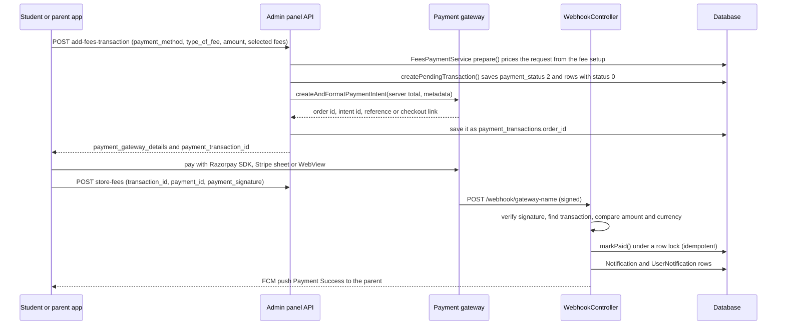

This page explains how school fees are modelled, how the student/parent app pays them online through Razorpay, Stripe, Paystack or Flutterwave, how a payment is confirmed (only by a signed gateway webhook), how staff record cash and cheque payments, and which settings drive all of it. It describes the code after the fee-forgery fixes in commit `839c9eb` and the Flutterwave secret-hash fix in `05b97a9`.

For the click-by-click admin steps see the Docusaurus pages [Fee Payment (admin panel)](https://shawndaprawn.github.io/Eschool/admin-panel/fee-payment/), [Payment Gateway's Webhook Configuration](https://shawndaprawn.github.io/Eschool/admin-panel/webhook-config/) and [Fee Payment (features)](https://shawndaprawn.github.io/Eschool/features/fee-payment/).

## Overview

| Piece | Where |
|---|---|
| Fee setup (types, class fees, installments) | `FeesTypeController`, `SessionYearController` / `SessionYearService` |
| Server-side pricing and recording of online payments | [`FeesPaymentService`](https://github.com/ShawnDaPrawn/Eschool/blob/main/admin-panel/app/Services/Payment/FeesPaymentService.php) |
| Gateway factory, currency, webhook secrets, amount checks | [`PaymentService`](https://github.com/ShawnDaPrawn/Eschool/blob/main/admin-panel/app/Services/Payment/PaymentService.php) |
| Gateway adapters | `StripePayment`, `RazorpayPayment`, `PaystackPayment`, `FlutterwavePayment` (all implement `PaymentInterface`) in [`app/Services/Payment`](https://github.com/ShawnDaPrawn/Eschool/tree/main/admin-panel/app/Services/Payment) |
| App endpoints | `Api/Student/FeesController`, `ParentApiController` (`/api/student/*`, `/api/parent/*`) |
| Payment confirmation | [`WebhookController`](https://github.com/ShawnDaPrawn/Eschool/blob/main/admin-panel/app/Http/Controllers/WebhookController.php) (`/webhook/*`) |
| Offline (cash/cheque) payments, receipts, logs | `FeesTypeController` (admin panel) |
| Dashboard and app statistics | [`FeesCollectionService`](https://github.com/ShawnDaPrawn/Eschool/blob/main/admin-panel/app/Services/FeesCollectionService.php), [`FeesReportService`](https://github.com/ShawnDaPrawn/Eschool/blob/main/admin-panel/app/Services/FeesReportService.php) |
| Tests | [`tests/Feature/PaymentWebhookTest.php`](https://github.com/ShawnDaPrawn/Eschool/blob/main/admin-panel/tests/Feature/PaymentWebhookTest.php), fee cases in `StudentApiSecurityTest` and `ParentApiSecurityTest` |

Composer packages used: `stripe/stripe-php`, `razorpay/razorpay`, `unicodeveloper/laravel-paystack` (from the `laravel-shift` fork, branch `l12-compatibility`), `barryvdh/laravel-dompdf` for receipts. Flutterwave is called with raw cURL. The student/parent Flutter app uses `razorpay_flutter`, `flutter_stripe`, and a WebView (`webviewPaymentScreen.dart`) for Paystack and Flutterwave.

## Fee model

Fees are scoped to a session year. A fee **type** is a name; it becomes payable when it is attached to a **class** with an amount and a compulsory/optional flag.

| Model (table) | Purpose | Key columns |
|---|---|---|
| `FeesType` (`fees_types`) | Named fee (Tuition, Bus, ...) | `name`, `description`. Soft-deleting a type soft-deletes its `fees_classes` and `fees_choiceables` rows (model `deleting` hook). |
| `FeesClass` (`fees_classes`) | A fee type assigned to a class for a session year | `class_id`, `fees_type_id`, `amount` (float), `choiceable` (0 compulsory, 1 optional), `session_year_id`. Deleting it deletes the matching `fees_choiceables` rows. |
| `InstallmentFee` (`installment_fees`) | Installment schedule for compulsory fees, per session year | `name`, `due_date`, `due_charges` (percent), `session_year_id`. The `due_date` accessor formats with the `date_formate` setting; use `getRawOriginal('due_date')` for arithmetic. |
| `PaidInstallmentFee` (`paid_installment_fees`) | One paid (or pending) installment for a student | `student_id`, `class_id`, `parent_id`, `installment_fee_id`, `session_year_id`, `amount`, `due_charges`, `date`, `payment_transaction_id`, `status` (0 not paid, 1 paid) |
| `FeesChoiceable` (`fees_choiceables`) | One paid (or pending) optional fee, or the due charges paid with a full compulsory payment | `student_id`, `class_id`, `fees_type_id` (null for due charges), `is_due_charges` (0/1), `total_amount`, `session_year_id`, `date`, `payment_transaction_id`, `status` (0 not paid, 1 paid) |
| `FeesPaid` (`fees_paids`) | Running ledger per student, class and session year | `parent_id`, `student_id`, `class_id`, `mode`, `payment_transaction_id`, `cheque_no`, `total_amount` (accumulates every payment, optional ones included), `is_fully_paid`, `due_charges`, `date`, `session_year_id` |
| `PaymentTransaction` (`payment_transactions`) | One payment attempt (online or offline) | `student_id`, `class_id`, `parent_id`, `mode`, `cheque_no`, `type_of_fee`, `payment_gateway`, `order_id`, `payment_id`, `payment_signature`, `payment_status`, `total_amount`, `date`, `session_year_id` |

All of these use `SoftDeletes`. Column codes used throughout the code:

| Column | Values |
|---|---|
| `payment_transactions.payment_status` | 0 failed, 1 succeeded, 2 pending |
| `payment_transactions.payment_gateway` | 1 Razorpay, 2 Stripe, 3 Paystack, 4 Flutterwave (`PaymentService::RAZORPAY` ... `FLUTTERWAVE`); null for offline payments |
| `mode` (transactions and `fees_paids`) | 0 cash, 1 cheque, 2 online |
| `payment_transactions.type_of_fee` | 0 compulsory in full, 1 installments, 2 optional (`FeesPaymentService::COMPULSORY`, `INSTALLMENTS`, `OPTIONAL`) |

Session-year columns that drive due charges (set on the Session Years page, see [Academic-Structure](Academic-Structure)): `fee_due_date`, `fee_due_charges` (percent applied to a full compulsory payment after the due date), `include_fee_installments`, `free_app_use_date`. `SessionYearService::storeInstallments()` refuses installment due dates outside the session dates, and the session-year "transfer" options include `TransferClassFeeType` to copy class fees into a new session year.

What a student owes:

- Compulsory total = sum of `fees_classes.amount` where `class_id` is the student's class in that session year and `choiceable = 0`.
- With installments, each installment is `compulsory total / number of installments` (an even split), plus `due_charges`% of that share once its due date has passed.
- Without installments, a full payment adds `fee_due_charges`% of the compulsory total once `fee_due_date` has passed.
- Optional fees are paid individually at their `fees_classes.amount`.

## Online payment flow

### App endpoints

All are behind `auth:sanctum`. Student routes also have `role:Student` and `student.session.active`; parent routes have `role:Parent` and `parent.children.session.active`, and the ones marked "CheckChild" additionally require a `child_id` belonging to the parent (`App\Http\Middleware\CheckChild`). See [API-Student](API-Student) and [API-Parent](API-Parent) for the rest of those APIs.

| Endpoint | Controller method | Purpose |
|---|---|---|
| `GET /api/settings?type=app_settings` | `ApiController::getSettings` | Public. Returns `online_payment`, `compulsory_fee_payment_mode`, `is_student_can_pay_fees`, `payment_options.currency_code/currency_symbol`, and for each enabled gateway only its public key and currency (`razorpay_api_key`, `stripe_publishable_key`, `paystack_public_key`, `flutterwave_public_key`). Secret keys and webhook secrets are never returned (the Razorpay webhook secret used to be; see [commit 839c9eb](#forgery-protections-commit-839c9eb)). |
| `GET /api/student/fees-details`, `GET /api/parent/fees-details` (CheckChild) | `getFeesDetails` | Compulsory, optional and installment items with paid flags, totals, `compulsory_due_date`, `compulsory_due_charges`, `is_fee_pending`. Also expires the latest pending transaction if it is more than one hour old (sets `payment_status` 0). |
| `POST /api/student/add-fees-transaction`, `POST /api/parent/add-fees-transaction` (CheckChild) | `storeFeesTransaction` | Validates `payment_method` (1-4), `amount`, `type_of_fee` (0-2), optional `optional_fees_data[]` / `installment_data[]` (each `{id: ...}`); refuses a gateway whose `*_status` setting is off; prices, creates the pending transaction and the gateway intent; returns `payment_gateway_details` (the formatted intent plus `payment_transaction_id`). `is_fully_paid` is still accepted from old app builds but ignored. |
| `POST /api/student/store-fees`, `POST /api/parent/store-fees` (CheckChild) | `storeFees` | Notes `payment_id` and `payment_signature` on the caller's own transaction, only if those columns are still empty. Student: pending transactions only. Parent: pending or succeeded (the webhook often arrives first). It never marks anything paid. |
| `POST /api/student/fail-payment-transaction`, `POST /api/parent/fail-payment-transaction` | `failPaymentTransactionStatus` | Marks the caller's own **pending** transaction failed (`payment_status` 0) and sends a "Payment Failed" notification. A transaction the webhook has already marked paid is refused. The student version uses a conditional update so a concurrent webhook wins. |
| `POST /api/student/get-payment-status`, `POST /api/parent/get-payment-status` | `ParentApiController::getPaymentStatus` (both routes) | Stripe only. `payment_intent_id` must match `^pi_[A-Za-z0-9_]+$` and belong to a transaction of the caller (student's own id, or the parent's children); returns the PaymentIntent `status` from Stripe. `StudentApiController::getPaymentStatus` still exists but no route points to it. |
| `GET fees-paid-list` | `feesPaidList` | `fees_paids` rows: the student's for the current session year; the child's for every session year on the parent API. |
| `GET fees-paid-receipt-pdf` | `feesPaidReceiptPDF` | Base64 PDF (`fees.fees_receipt` view). Parent: requires `fees_paid_id` of one of their children. Student: uses the student's first `fees_paids` row. |
| `GET fees-transactions-list` | `getFeesPaymentTransactions` | Paginated (15) `payment_transactions`, optional `session_year_id` (parent: optional `child_id`, else all the parent's children); also expires pending transactions older than one hour. |
| `GET fees-report` | `getFeesReport` | `FeesReportService::getStatistics()` (see [Reporting](#reporting-services)). |
| `GET /api/student/send-fee-notification` | `Student\FeesController::sendFeeNotification` | Pushes "Fees are dues" (type `fees-due`, `child_id` in the data) to the student's parents. See [Notifications](Notifications). |

The app sends `payment_method` as 1 Razorpay, 2 Stripe, 3 Paystack, 4 Flutterwave. Paystack and Flutterwave are opened in a WebView at the gateway URL; the WebView watches for the paths `/response/paystack/success` and `/response/flutterwave/success`, which `WebhookController::paystackSuccessCallback()` / `flutterwaveSuccessCallback()` answer with a fixed JSON message. Those landing routes change nothing.

### Server-side pricing (`FeesPaymentService::prepare`)

`prepare(int $studentId, int $sessionYearId, int $typeOfFee, array $optionalFees, array $installments, $clientAmount)` decides what is being paid and for how much. The app's `amount` is only compared with the server total.

- The student's class comes from `student_sessions` for the current session year (`session_year` setting); no session means refusal.
- Compulsory (0): refused if `fees_paids.is_fully_paid = 1` already, or if any installment has been paid (`Installments have been started; please pay the remaining installments.`). Due charges = `fee_due_charges`% of the compulsory total when the session's `fee_due_date` has passed. The plan gets `is_fully_paid = 1`.
- Installments (1): each id must be an installment of the session year, not repeated, and not already paid; due charges apply per installment. `is_fully_paid` becomes 1 only when the already-paid plus selected installments cover all of them.
- Optional (2): each `fees_type_id` must be an optional `fees_classes` row of the student's class and session year and not already paid. Amounts sent by the app per fee are ignored.
- Ids must be positive integers, given once each.
- Due-date boundary: the app may be in another timezone, so an item whose due date is today or yesterday (`DUE_MAYBE`) is accepted with or without its due charges, whichever matches the app's total. Past dates (`DUE_YES`) always include them.
- The app's total must match within `AMOUNT_TOLERANCE` (0.02 currency units), otherwise `The fee amount has changed. Please refresh and try again.`
- Errors are thrown as `ValidationException` with key `fees`; the controllers return them as validation errors.

`createPendingTransaction($plan, $parentId, $paymentMethod)` then writes a `payment_transactions` row (`mode` 2, `payment_status` 2, server `total_amount`) and one `fees_choiceables` or `paid_installment_fees` row per item with `status` 0 and the transaction id. `gatewayMetadata()` builds the metadata/notes sent to the gateway (student, parent, class, session year, transaction id, the row ids as JSON, payer email/name/mobile). That metadata is informational: webhooks never use it to decide what was paid.

Who is recorded as the parent: for the student endpoint `father_id`, else `guardian_id`; the payer email is the father's, else the guardian's. For the parent endpoint, the logged-in parent.

### Gateway adapters

`PaymentService::create($payment_method)` builds the adapter with keys from the `settings` table (`getSettings()`), except Paystack, which the `Unicodeveloper\Paystack\Paystack` base class configures from `config('paystack.secretKey')` and `config('paystack.paymentUrl')`. `App\Services\SettingsConfigService::apply()` (called from `AppServiceProvider::boot()`) overwrites those config values with the `paystack_secret_key` and `paystack_payment_url` settings on every request, so the `.env` values in `config/paystack.php` only matter while the settings are empty. `PaymentService::currencyCode()` uses the gateway's own `*_currency_code` setting, else `currency_code`, upper-cased.

| Gateway | What `createPaymentIntent` creates | Stored as `order_id` | Amount sent | Notes |
|---|---|---|---|---|
| Razorpay | `$api->order->create()` with `notes` = metadata | Razorpay order id | `RazorpayPayment::amountInSubunits()`: x1000 for BHD, IQD, JOD, KWD, OMR, TND; x100 for the listed two-decimal currencies; unchanged for zero-decimal ones (an unknown currency throws) | Status map: `created`/`attempted` pending, `paid` succeed |
| Stripe | `paymentIntents->create()` with `metadata` | PaymentIntent id (`pi_...`) | `StripePayment::amountInSubunits()`: raised to Stripe's minimum charge for the currency (e.g. 0.50 USD/EUR/INR, 0.30 GBP, 50 JPY), x100 except zero-decimal currencies | The app confirms with the intent's client secret from `payment_gateway_response` |
| Paystack | `getAuthorizationResponse()` with `email` (required), `reference` from `genTranxRef()`, `callback_url` = `route('paystack.success')` | The generated reference | `amount x 100` | Throws `Email cannot be empty` when the payer has no email |
| Flutterwave | cURL `POST https://api.flutterwave.com/v3/payments` with `tx_ref` = `uniqid()`, `meta` = metadata, `order_id` = transaction id, `redirect_url` = `route('flutterwave.success')`, a hard-coded `payment_type` of `mobilemoneyghana` | The hosted checkout link (`data.link`) | `max(1, amount)` in main units | TLS verification uses cURL defaults (commit `420df6d` removed the disabled verification) |

## Payment confirmation (webhooks)

Routes (in `routes/web.php`, outside every auth group; `bootstrap/app.php` exempts `webhook/*` from CSRF):

| Method and URL | Handler | Signature check | Events handled | Transaction lookup |
|---|---|---|---|---|
| `POST /webhook/razorpay` | `razorpay` | `X-Razorpay-Signature` = HMAC-SHA256 of the raw body with `PaymentService::webhookSecret('razorpay')` | `payment.captured` (paid), `payment.failed` (failed) | `payment_gateway = 1` and `order_id = payload.payment.entity.order_id` |
| `POST /webhook/stripe` | `stripe` | `Stripe\Webhook::constructEvent()` with the `Stripe-Signature` header and `webhookSecret('stripe')`; refused outright when no secret is set | `payment_intent.succeeded` (uses `amount_received`), `payment_intent.payment_failed` | `payment_gateway = 2` and `order_id` = intent id |
| `POST /webhook/paystack` | `paystack` | `x-paystack-signature` = HMAC-SHA512 of the raw body with `webhookSecret('paystack')` (the Paystack **secret key**) | `charge.success` only | `payment_gateway = 3` and `order_id = data.reference` |
| `POST /webhook/flutterwave` | `flutterwave` | `verif-hash` header must equal `webhookSecret('flutterwave')` (`hash_equals`); refused when either is empty | `data.status` `successful` (paid) or `failed` | `payment_transaction_id` from `meta_data` (or `data.meta`) and `payment_gateway = 4`, because the stored `order_id` is the checkout link |
| `GET /response/paystack/success` (`paystack.success`), `GET /response/flutterwave/success` (`flutterwave.success`) | `paystackSuccessCallback`, `flutterwaveSuccessCallback` | none | none | none: fixed JSON reply only |

`PaymentService::webhookSecret($gateway)` reads the settings row first (`razorpay_webhook_secret`, `stripe_webhook_secret`, `paystack_secret_key`, `flutterwave_hash_key`), then the config value (`services.razorpay.webhook_secret`, `services.stripe.webhook_secret`, `services.paystack.secret_key`, `services.flutterwave.secret_hash`, defined in [`config/services.php`](https://github.com/ShawnDaPrawn/Eschool/blob/main/admin-panel/config/services.php) from `.env` keys that the admin panel never writes, so they are only a manual fallback). It returns `''` when neither is set, and every handler then refuses the call. All comparisons use `hash_equals`.

After the signature, every handler does the same thing:

1. Find the transaction created by this app for that gateway. Not found: log a warning and return 200 `Transaction not found` (so a gateway shared with another integration stops retrying).
2. On success events, `paid()` checks the reported currency against `PaymentService::currencyCode()` and the amount with `PaymentService::amountMatches()` (gateway sub-units for Razorpay/Stripe/Paystack, within 0.01 for Flutterwave). A mismatch is logged and answered with 400; nothing is recorded.
3. `FeesPaymentService::markPaid($transactionId, $attributes)` runs in a DB transaction with `lockForUpdate()` on the transaction. If the transaction is already `payment_status = 1` it returns null and the webhook answers `Payment already recorded`, so retries and duplicates are harmless. Otherwise it:
   - stores gateway ids (`payment_id`) and sets `payment_status = 1`;
   - restores (if a failed attempt soft-deleted them) and sets `status = 1` on every `fees_choiceables` (non-due-charge) and `paid_installment_fees` row carrying this `payment_transaction_id`;
   - for a compulsory payment, records due charges as a new `fees_choiceables` row (`is_due_charges = 1`) when the stored total exceeds the class's compulsory total;
   - adds the transaction total to the student's `fees_paids` row (locked) or creates it, and recomputes `is_fully_paid` (always 1 for compulsory; for installments, 1 when every installment of the session year is paid; unchanged for optional fees).
4. On failure events, `markFailed()` sets `payment_status = 0` and deletes the transaction's rows that are still `status = 0`, but leaves an already-paid transaction alone (a late failure for an earlier attempt cannot undo a payment). A later success for the same order still records the payment, restoring those rows.
5. When a payment was newly recorded (or a pending one newly failed), `notifyParents()` creates a `Notification` (`send_to` 2, type `online`, title `Payment Success` / `Payment Failed`, message `Amount :- <total>`), a `UserNotification` for the parent's user, and calls `sendSimpleNotification()`. A notification failure is logged and never undoes the payment.

What a payment covers always comes from the stored transaction and its rows; webhook metadata such as `is_fully_paid`, `due_charges` or `installment_fees_paid` is ignored.

Pending transactions are not swept by a scheduled job. They are only flipped to failed (`payment_status` 0) when the app reads `fees-details` or `fees-transactions-list` more than an hour after the attempt; their `status = 0` rows stay until a failure webhook removes them, and a late success webhook still records the payment.

## Offline payments by staff

The admin panel's **Fees > Fees Paid** page (`fees.paid.index`, view `fees/fees_paid.blade.php`) lists every enrolled student of a class and session year (`StudentSessions`-based, so unpaid students appear) through the Bootstrap-table endpoint `GET fees/paid/list`. From it staff record payments (permission `fees-paid` for every route below):

| Route | Method | Behaviour |
|---|---|---|
| `POST fees/compulsory-paid/store` (`fees.compulsory-paid.store`) | `compulsoryFeesPaidStore` | `mode` 0 cash or 1 cheque (`cheque_no`), `date`, `session_year_id`, `total_amount`, optional `installment_fees[]` (`id`, `amount`, `due_charges`, `fully_paid`), `installment_mode`, `due_charges_whole_year`. Creates a succeeded `payment_transactions` row (`type_of_fee` 1 if installments, else 0), the `paid_installment_fees` rows, and updates/creates `fees_paids` (`is_fully_paid` = 1 when `installment_mode` is 0, else the last installment's `fully_paid` flag). |
| `POST fees/optional-paid/store` (`fees.optional-paid.store`) | `optionalFeesPaidStore` | Same for `optional_fees_type_data[]` (`id`, `amount`) into `fees_choiceables`, `type_of_fee` 2. |
| `DELETE fees/paid/remove-choiceable-fees/{id}` | `feesPaidRemoveChoiceableFees` | Deletes one optional fee payment and subtracts it from the transaction and `fees_paids` (deleting them when they reach 0). |
| `DELETE fees/paid/remove-installment-fees/{id}` | `feesPaidRemoveInstallmentFees` | Same for one installment; sets `is_fully_paid` to 0. |
| `DELETE fees/paid/clear-data/{id}` | `clearFeesPaidData` | Deletes a `fees_paids` row and all `fees_choiceables`, `paid_installment_fees` and `payment_transactions` of that student, class and session year. |
| `GET fees/paid/receipt-pdf/{id}` (`fees.paid.receipt.pdf`) | `feesPaidReceiptPDF` | Streams the receipt PDF for one `fees_paids` row, built with `Pdf::loadView('fees.fees_receipt', ...)` using the `logo2` setting (`schoolSetting('logo2')`), `config('app.name')` (the school name, see [Configuration](Configuration)) and the `school_address` and `currency_symbol` settings. The app receipt endpoints use the same sources. |

Unlike the app endpoints, staff-entered amounts are taken from the request (staff are trusted). Both store methods require the student to have a father or guardian (`no_parent_or_guardian_assigned` otherwise), because `payment_transactions.parent_id` and `paid_installment_fees.parent_id` reference `parents`. Both send a "Payment Success" push with type `Online` to that parent, even for cash.

Other fee pages (all in `FeesTypeController`, views in `resources/views/fees/`):

| Page | Routes | Permission |
|---|---|---|
| Fees Type | resource `fees-type` (`index`, `store`, `show` = list JSON, `update`, `destroy`) | `fees-type` |
| Assign Fees Classes | `fees/classes` (`fees.class.index`), `fees/classes/list`, `POST class/fees-type` (`class.fees.type.update`), `DELETE class/fees-type/{fees_class_id}` | `fees-classes` |
| Fees Transaction Logs | `fees/transaction-logs` (`fees.transactions.log.index`), `fees/transaction-logs/list` (filters: session year, class, `payment_status`; search on id, `order_id`, `payment_id`, student name) | `fees-paid` |
| Fees Configuration | `fees-config` (`fees.config.index`), `POST fees-config/update` (`fees.config.udpate`) | `fees-config` |

## Settings reference

Everything below is stored only in the `settings` table (`type`/`message` pairs, read with `getSettings()`). The fees configuration page (`FeesTypeController::feesConfigUpdate`, view `fees/fees_config.blade.php`) writes the gateway keys there. It no longer copies anything into `.env`: commit `e13ac7d` removed the `changeEnv()` helper, so the checkout and the webhooks read the same settings rows. A gateway's keys are only saved while its status is 1, and `required_if:<gateway>_status,1` makes its keys, webhook secret, webhook URL and currency mandatory when enabling it. With `DEMO_MODE=true` (`config('app.demo_mode')`) the form shows `x` placeholders instead of the stored keys.

| Setting key | Written by | `.env` fallback (only when the setting is empty) | Used by |
|---|---|---|---|
| `currency_code`, `currency_symbol` | Fees configuration | none | Default currency; receipts; `/api/settings` |
| `default_due_charges`, `enable_fees_installment` | Fees configuration | none | Defaults shown on the session-year form |
| `compulsory_fee_payment_mode` | Fees configuration | none | When 1, login/profile APIs return `is_fee_payment_due` (from `free_app_use_date`, `fee_due_date`, installments) so the app can block use until fees are paid |
| `is_student_can_pay_fees` | Fees configuration | none | Sent to the app; the student payment endpoints do not check it |
| `online_payment` | General settings (`SettingController::update`) | none | Sent to the app; not checked by the payment endpoints |
| `razorpay_status`, `razorpay_api_key`, `razorpay_secret_key`, `razorpay_webhook_secret`, `razorpay_webhook_url`, `razorpay_currency_code` | Fees configuration | `RAZORPAY_WEBHOOK_SECRET` (`services.razorpay.webhook_secret`) | API keys from settings only; webhook secret from the setting, then the config fallback |
| `stripe_status`, `stripe_publishable_key`, `stripe_secret_key`, `stripe_webhook_secret`, `stripe_webhook_url`, `stripe_currency_code` | Fees configuration | `STRIPE_WEBHOOK_SECRET` (`services.stripe.webhook_secret`) | Secret key from settings only; webhook secret from the setting, then the config fallback |
| `paystack_status`, `paystack_public_key`, `paystack_secret_key`, `paystack_webhook_url`, `paystack_payment_url`, `paystack_currency_code` | Fees configuration | `PAYSTACK_PUBLIC_KEY`, `PAYSTACK_SECRET_KEY`, `PAYSTACK_PAYMENT_URL` (`config/paystack.php`); `PAYSTACK_SECRET_KEY` also as `services.paystack.secret_key` | API calls: `SettingsConfigService` copies `paystack_public_key`, `paystack_secret_key`, `paystack_payment_url` onto `paystack.publicKey`, `paystack.secretKey`, `paystack.paymentUrl` on every boot. Webhook HMAC key: the `paystack_secret_key` setting, then `services.paystack.secret_key` |
| `flutterwave_status`, `flutterwave_public_key`, `flutterwave_secret_key`, `flutterwave_hash_key`, `flutterwave_webhook_url`, `flutterwave_currency_code` | Fees configuration | `FLW_SECRET_HASH` (`services.flutterwave.secret_hash`) | Secret key from settings only; `verif-hash` compared with `flutterwave_hash_key`, then the config fallback |

`config/services.php` also defines `services.razorpay.key/secret`, `services.stripe.key/secret` and `services.flutterwave.public_key/secret_key` from `.env`, but no payment code reads them, and its comment that "the fee settings page writes these .env keys" predates commit `e13ac7d`. The `paystack_payment_url` field is read-only and always submits `https://api.paystack.co`.

The `*_webhook_url` fields are read-only, pre-filled with `<scheme://host>/webhook/<gateway>`, and only stored for reference; the gateway dashboards must point at those URLs. The Docusaurus webhook page covers Razorpay, Stripe and Paystack; it has no Flutterwave section.

### Flutterwave secret hash

Since commit `05b97a9` the field is labelled "Flutterwave Webhook Secret Hash" with the hint "Must match the Secret hash under Settings > Webhooks in your Flutterwave dashboard (not the encryption key)", and `flutterwave_hash_key` is `required_if:flutterwave_status,1`. Before that the field was labelled as an encryption key and could be left empty; because the webhook now refuses calls without a matching `verif-hash`, an install that stored the encryption key there (or nothing) will never confirm Flutterwave payments until the real secret hash is saved.

## Forgery protections (commit 839c9eb)

That commit rewrote the payment path. The behaviour it guarantees, and that `PaymentWebhookTest` checks:

- `GET /api/settings` no longer returns the Razorpay webhook secret (it was public, so anyone could sign a fake "payment captured" webhook). The commit message asks installs to rotate that secret.
- Webhooks fail closed without a secret; Flutterwave actually checks `verif-hash` (previously any request passed); Razorpay and Paystack no longer accept an HMAC made with an empty key; Razorpay's failure branch is signed like the success branch; comparisons are constant time.
- The transaction is found by the stored gateway order id (Flutterwave: by transaction id plus gateway), amount and currency are checked, and coverage comes from stored rows only.
- The duplicate-webhook guard used to check a column that does not exist, so replays added the amount to `fees_paids` again; recording is now idempotent under a row lock.
- Students and parents used to choose the amount, the fully-paid flag and which installments/optional fees were covered (paying 1.00 could mark everything paid). `FeesPaymentService` now prices the payment from the fee setup, checks every item belongs to the child and is unpaid, and charges the server total.
- `store-fees` and `fail-payment-transaction` only work on the caller's own pending transaction (parent `store-fees` also accepts its own succeeded one).

## Reporting services

| Service | Used by | What it returns |
|---|---|---|
| `FeesCollectionService::summary($sessionYearId)` | `GET home/widget/fees-collection` (`HomeController::feesCollectionWidget`, permission `fees-paid`) | `currency`, `collected`, `upcoming_dues`, `overdue`, `series`, `labels` for the dashboard donut. `outstandingByDueDate()` walks every active `student_sessions` row, takes the class's compulsory total minus what the student paid (all `fees_paids` minus paid optional fees), and buckets it by unpaid installment due dates (overdue buckets include the installment's due-charge percent) or by the session `fee_due_date`. Note: `collected()` returns the whole `fees_paids` sum; the line that would subtract optional fees sits after a `return` and never runs. |
| `FeesReportService::getStatistics($studentId, $sessionYearId)` | `GET /api/student/fees-report`, `GET /api/parent/fees-report` | `total_fee_payable` (compulsory total), `total_paid` (succeeded transactions with `type_of_fee` 0 or 1), `total_pending`, `last_payment_date`, `next_due_date` (next unpaid installment or the session due date), `instalments` (`total`, `completed`, `pending`) or null. Returns `[]` when the student has no session that year. |

## The `app:delete-fees` command

[`app/Console/Commands/DeleteFeesPaid.php`](https://github.com/ShawnDaPrawn/Eschool/blob/main/admin-panel/app/Console/Commands/DeleteFeesPaid.php) registers `php artisan app:delete-fees` ("Delete Fees Data"). It runs `DB::table(...)->delete()` on `fees_choiceables`, `payment_transactions` and `fees_paids` for **every** session year, bypassing soft deletes, and logs `data-delete`. It does not touch `paid_installment_fees` directly, though that table's `payment_transaction_id` foreign key is `ON DELETE CASCADE`. It is not scheduled in `routes/console.php`; treat it as a destructive maintenance tool. For per-session clean-up use the session year's "clear specific data" option (`fees_transactions` deletes `fees_choiceables`, `fees_classes`, `installment_fees` and `fees_paids` of that session year). See [Scheduled-Tasks-and-Commands](Scheduled-Tasks-and-Commands).

## Tests

`tests/Feature/PaymentWebhookTest.php` (in-process, `RefreshDatabase`, seeds like the installer) covers:

| Test | Checks |
|---|---|
| `test_flutterwave_cannot_be_enabled_without_its_webhook_secret_hash` | Fees config update refuses Flutterwave on without `flutterwave_hash_key` |
| `test_compulsory_fees_are_priced_on_the_server` | Wrong amount refused; full payment total and `is_fully_paid` |
| `test_due_charges_are_required_once_the_due_date_has_passed` | Due charges required after the due date; either total accepted on the due date |
| `test_installments_are_priced_and_checked_on_the_server` | Per-installment pricing with due charges, duplicates/unknown ids refused, paid installments and full payment after installments refused |
| `test_optional_fees_must_belong_to_the_class_and_not_be_paid` | Client per-fee amounts ignored, other-class fees and paid fees refused |
| `test_pending_transaction_and_gateway_metadata_use_server_values` | Pending transaction, row amounts and metadata come from the plan |
| `test_unsigned_or_wrongly_signed_razorpay_webhooks_are_refused` | Missing, wrong and empty-key signatures get 401 |
| `test_razorpay_payment_is_recorded_once_from_the_stored_transaction` | Metadata pointing at another student is ignored; retried delivery adds the amount once |
| `test_payment_with_a_different_amount_or_currency_is_not_recorded` | Amount or currency mismatch gets 400 |
| `test_late_failure_event_does_not_undo_a_payment` | `payment.failed` after `payment.captured` leaves it paid |
| `test_failed_attempt_then_success_on_the_same_order_is_recorded` | Failure deletes pending rows; later success restores and records them |
| `test_stripe_webhook_needs_a_configured_secret_and_valid_signature` | Stripe signature checking and refusal without a secret |
| `test_paystack_webhook_checks_signature_and_reference` | HMAC-SHA512 check, `payment_id` stored, metadata due charges ignored |
| `test_flutterwave_webhook_requires_the_secret_hash_header` | Missing or wrong `verif-hash` refused; duplicate delivery recorded once |
| `test_compulsory_payment_with_due_charges_records_them_from_the_stored_total` | Due charges recorded from the stored total, not metadata |

`StudentApiSecurityTest::test_public_settings_do_not_include_payment_secrets` and `test_fee_payments_use_server_amounts_and_own_transactions`, and `ParentApiSecurityTest::test_fee_receipt_and_payment_endpoints_refuse_another_familys_records`, cover the app side. See [Testing-and-CI](Testing-and-CI).

## Gotchas

- Gateway keys and webhook secrets saved in the admin panel take effect on the next request, including with `php artisan config:cache`, because they are read from the settings table (Paystack's through `SettingsConfigService` at boot). `.env` payment keys are only consulted while the matching setting is empty; with cached config they are whatever was in `.env` when the cache was built.
- Older installs may still have payment keys in `.env` from when the panel copied them there; they are no longer updated, so a stale `.env` webhook secret is harmless only as long as the setting is filled in.
- An enabled gateway with a missing webhook secret leaves every payment pending: the app shows the gateway's success, but nothing is recorded until a valid webhook arrives.
- Paystack payments need a payer email (father's or guardian's for the student app, the parent's own for the parent app).
- The student app's receipt endpoint uses the student's first `fees_paids` row, not one for a chosen session year.

## See also

- [Notifications](Notifications)
- [API-Student](API-Student), [API-Parent](API-Parent)
- [Admin-Modules](Admin-Modules#fees)
- [Configuration](Configuration)
- [Security-Model](Security-Model)
- [Database-Schema](Database-Schema)
- [Troubleshooting-and-FAQ](Troubleshooting-and-FAQ)
