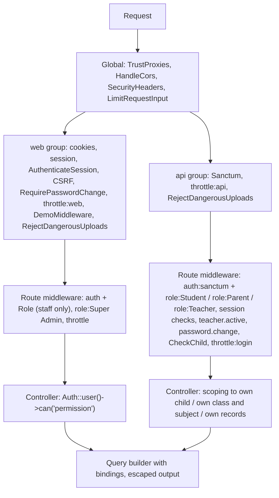
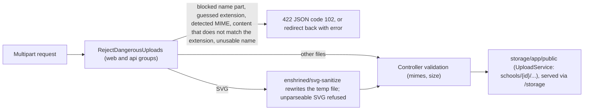

This page describes the security controls in the admin panel, the REST API and the two Flutter apps as the code stands now: what each control is, where it is implemented, and what it guarantees. Most of these controls were added or fixed by this fork's hardening commits (listed in [Release-History](Release-History#security-hardening)); the [Testing-and-CI](Testing-and-CI) page lists the tests that keep them in place. The page ends with a checklist for people deploying the system and rules for people changing the code.

## Overview

Every request passes through several independent layers. A missing check in one layer is not compensated by the others, so each layer has to be right on its own.

Middleware registration is in [bootstrap/app.php](https://github.com/ShawnDaPrawn/Eschool/blob/main/admin-panel/bootstrap/app.php); rate limiters are in [RouteServiceProvider.php](https://github.com/ShawnDaPrawn/Eschool/blob/main/admin-panel/app/Providers/RouteServiceProvider.php).

Two middleware aliases differ only by case and do different things: `Role` is `App\Http\Middleware\CheckRole` (any staff role), `role` is Spatie's `RoleMiddleware` (one named role).

## Authentication

### Admin panel (web sessions)

| Control | Where | Guarantee |
|---|---|---|
| Login form | `GET`/`POST login` → `App\Http\Controllers\Auth\LoginController` (laravel/ui `AuthenticatesUsers`), `guest` middleware | Standard session login with CSRF token |
| Login throttling | `throttle:login` on `POST login` (shared with the app logins, see below); laravel/ui `ThrottlesLogins` defaults | 5 attempts per minute per account across the panel and every app, 20 per minute per address, and the wrong-password lockout below |
| Wrong-password lockout | `AppServiceProvider::limitFailedLogins()` (listens to every `Auth::attempt()`), [TooManyLoginFailures](https://github.com/ShawnDaPrawn/Eschool/blob/main/admin-panel/app/Exceptions/TooManyLoginFailures.php) | 10 wrong passwords in an hour for one account (email or GR number, any capitalisation) stop sign-ins to it, from the panel and every app, until the hour is up; a correct password resets the count. The panel shows a form error; the apps get `error: true` with a message. Each refusal is logged as one warning line |
| Password rule | [PasswordPolicy](https://github.com/ShawnDaPrawn/Eschool/blob/main/admin-panel/app/Services/Platform/Identity/PasswordPolicy.php), registered as `Password::defaults()` in `AppServiceProvider::boot()` | Every password a person chooses (panel profile, emailed reset page, app change-password for learners, parents and teachers, the learner set-up pages) needs at least 10 characters with letters and numbers, and must not be in a known breach. The breach check (Have I Been Pwned range API) sends only the first five characters of the password's SHA-1 and gives up after 5 seconds; if the service can't be reached, the password is accepted |
| Deactivated teachers | `LoginController::authenticated()`, `CheckRole` | A teacher whose `users.status` is not 1 cannot sign in, and an open panel session is signed out on its next request |
| Default passwords | [RequirePasswordChange](https://github.com/ShawnDaPrawn/Eschool/blob/main/admin-panel/app/Http/Middleware/RequirePasswordChange.php) in the `web` group, flagged by `LoginController::authenticated()`; [DateOfBirthPasswords](https://github.com/ShawnDaPrawn/Eschool/blob/main/admin-panel/app/Services/Platform/Identity/DateOfBirthPasswords.php) | Someone who signs in with `superadmin` or with their date of birth (`ddmmyyyy`, `dd-mm-yyyy`, `dd/mm/yyyy`, `yyyy-mm-dd` or `yyyymmdd`) can only open the change-password page (or sign out) until they change it, and can't change it to a default again; an account flagged `users.password_change_required` is treated the same way |
| App-only roles kept out at login | `LoginController::authenticated()` | A user with the `Parent` or `Student` role is signed out immediately, the session is invalidated, and the login page shows `app_only_login_not_allowed_on_web` |
| Staff role required on every admin page | `CheckRole` (alias `Role`) on the main group `['Role', 'auth']` in [routes/web.php](https://github.com/ShawnDaPrawn/Eschool/blob/main/admin-panel/routes/web.php) | A signed-in user needs at least one role other than `Parent`/`Student`; anyone else is signed out, the session invalidated and the CSRF token regenerated |
| No self-registration | the `/register` route was removed (commit [439395d](https://github.com/ShawnDaPrawn/Eschool/commit/439395d)) | Accounts are only created by staff, or through the public online registration form, which creates students awaiting approval |
| Password reset | `password/email` and `POST password/reset` have `throttle:login`; `ForgotPasswordController`; `ResetPassword::createUrlUsing()` in `AppServiceProvider` | Reset-link requests and reset attempts are rate limited like app logins (see below). The answer is the same whether or not the address has an account. Reset links always start with `APP_URL`, never the host the request named. The new password follows the password rule. A completed reset deletes the account's app tokens |
| Change password | `HomeController::checkPassword` / `changePassword`, both `POST` with `throttle:password` (20 a minute per user) | The current password must match (`Hash::check`) before the new one is saved, and the new one follows the password rule. The live check of the current password is a `POST`, so the password is not written to access logs with the URL. A change deletes all the user's app tokens and signs out their other panel sessions |
| Other sessions signed out | `AuthenticateSession` in the `web` group | A session (or remember-me cookie) whose password no longer matches the account's is signed out on its next request |
| Sign-out | `POST logout` only; the profile menu submits a form | Another site can't sign people out with a link or image |
| Session cookie | [config/session.php](https://github.com/ShawnDaPrawn/Eschool/blob/main/admin-panel/config/session.php) | `http_only` true, `same_site` `SESSION_SAME_SITE` (default `lax`), lifetime `SESSION_LIFETIME` (default 120 minutes); `secure` defaults to true when `APP_URL` starts with `https://` (`SESSION_SECURE_COOKIE` overrides). `SESSION_DOMAIN` is empty (the panel's host only) unless the web portals on sibling hosts must share the cookie |
| CSRF | Laravel's CSRF check in the `web` group; `validateCsrfTokens(except: ['webhook/*', 'csp-report'])` | Every state-changing web request needs the session's token, except the payment webhook, which is authenticated by signature instead, and browsers' content security policy reports, which change nothing |

The installer seeds a Super Admin as `superadmin@gmail.com` / `superadmin` (`config/installer.php`, `admin_area`). The panel makes whoever signs in with it change the password first; change the email address too. The Cloud Run container replaces that login on every start while it is still in place (see [Deployment](Deployment#navigateed-production)).

| Installer | Where | Guarantee |
|---|---|---|
| Closed once installed | `InstallerMiddleware`, `ToInstallMiddleware` in `packages/laravel-wizard-installer` | `/install` answers 404 when `storage/installed` exists, and also when the database already has users, so a lost marker file doesn't reopen the installer on a live school. A browser that started the installation on an empty database can finish it (the wizard creates the admin before its last steps); the finish step, which only writes `storage/installed`, is always allowed |

### Mobile app API (Sanctum tokens)

| Control | Where | Guarantee |
|---|---|---|
| Role-checked logins | `Student\AuthController::login` (`gr_number` + `password`; the GR number is stored in `users.email`), `Parent\AuthController::login`, `Teacher\AuthController::login` | A token is issued only if the credentials are valid and the user has the matching role (`Student`, `Parent`, `Teacher`); a teacher also needs `users.status = 1` ("deactivated" otherwise) |
| Student account state at login | `Student\AuthController::login` | The user must have a `students` row and `users.status = 1`, and a `student_sessions` row for the current session year whose `status` is not 0, before any token is created |
| Bearer tokens | [AppTokens](https://github.com/ShawnDaPrawn/Eschool/blob/main/admin-panel/app/Services/Platform/Identity/AppTokens.php)`::issue()`, named `student-app`, `parent-app` or `teacher-app` | Opaque Sanctum personal access tokens, hashed in `personal_access_tokens`. Signing in to an app revokes the account's earlier tokens for that app (one device per app); tokens of the account's other apps stay, so a teacher who is also a parent stays signed in to both. Tokens from before tokens carried an app name count as this app's when the account can only use this app, otherwise they simply expire |
| Token expiry | [config/sanctum.php](https://github.com/ShawnDaPrawn/Eschool/blob/main/admin-panel/config/sanctum.php) `expiration = env('SANCTUM_EXPIRATION', 60 * 24 * 30)`; `.env.example` sets `SANCTUM_EXPIRATION=43200` | Tokens stop working 30 days after they were issued; both apps sign the user out on a 401 |
| Expired token cleanup | [routes/console.php](https://github.com/ShawnDaPrawn/Eschool/blob/main/admin-panel/routes/console.php): `sanctum:prune-expired --hours=24` daily | Expired tokens are deleted from the database (needs the scheduler cron, see [Scheduled-Tasks-and-Commands](Scheduled-Tasks-and-Commands)) |
| Logout | `POST api/logout` → `ApiController::logout`, `AppTokens::signOut()` | Revokes the account's tokens for the app that signs out (the others stay) and clears `users.fcm_id` |
| Change password | `POST api/change-password` (`auth:sanctum`) → `ApiController::changePassword` | Needs `current_password`; `new_password` follows the password rule; every other token of the account is revoked (other devices are signed out), the device that made the change stays signed in |
| Forgot password | `POST api/forgot-password` and `api/student/forgot-password` | The response is the same whether or not the email belongs to an account; mail errors are logged, not shown |
| Login and reset throttling | `RateLimiter::for('login')`, applied as `throttle:login` to `login`, `password/email`, `api/student/login`, `api/student/forgot-password`, `api/parent/login`, `api/teacher/login` and `api/forgot-password` | 5 attempts per minute per account (`email`, `gr_number` or `gr_no`, lower-cased; one count across the panel and all apps) and 20 per minute per address, plus the wrong-password lockout (10 an hour per account). Parents' first passwords are still their dates of birth, so guessing must be slow. |
| Tokens revoked | `HomeController::changePassword`, the `PasswordReset` listener, `Student\PasswordController::change_password` (staff resetting a learner), `LearnerInvitations::complete()`, `TeacherController::changeStatus` (deactivation), `StaffController::destroy`, `TeacherController::destroy` | Changing or resetting a password in the panel or by email, setting a learner's password through an invitation, deactivating or removing a teacher, or removing a staff member deletes all that account's app tokens |
| Deactivated teachers | [EnsureTeacherActive](https://github.com/ShawnDaPrawn/Eschool/blob/main/admin-panel/app/Http/Middleware/EnsureTeacherActive.php) (`teacher.active`) on both teacher groups in `routes/api.php` | A teacher deactivated after signing in gets 401 (`code` 401) on the next teacher request; both apps treat a 401 as signed out |
| Forced password change | [EnforcePasswordChange](https://github.com/ShawnDaPrawn/Eschool/blob/main/admin-panel/app/Http/Middleware/EnforcePasswordChange.php) (`password.change`) on the student, parent and teacher groups; `password_change_required` in the v1 login answer | An account still on its date of birth (flagged by `learners:flag-dob-passwords` or at sign-in) keeps working in today's apps; an app that sends `X-Supports-Password-Change: 1` gets 403 `PASSWORD_CHANGE_REQUIRED` on the role groups' routes (`api/change-password` and `api/logout` are outside them) until the password is changed |
| General API throttling | `throttle:api` prepended to the `api` group; `RateLimiter::for('api')` | 60 requests per minute per user id, or per IP when not signed in |
| Paging caps | e.g. `ApiController::perPage()` | `per_page` is clamped to 1–100 |

The `api` group also runs Sanctum's `EnsureFrontendRequestsAreStateful`, and `config/sanctum.php` lists the `web` guard, so a browser request from a stateful domain (`SANCTUM_STATEFUL_DOMAINS`, default the localhost variants plus the hosts of the CORS origins below) can authenticate with the session cookie. The apps always use bearer tokens.

**CORS.** [config/cors.php](https://github.com/ShawnDaPrawn/Eschool/blob/main/admin-panel/config/cors.php) answers only the panel (`APP_URL`) and the web portals: `CORS_ALLOWED_ORIGINS` (comma-separated), defaulting to `https://app.navigateed.co.za` and `https://teach.navigateed.co.za` (with a `staging-` prefix when `APP_URL` is a `staging-` host); `localhost` on any port only when `APP_ENV` is `local` or `testing`. `supports_credentials` is on, so a portal may use Sanctum's cookie mode. Any other origin, including look-alike hosts, `http://` and `null`, gets no CORS headers, so a browser on another site can't read the API's answers. The native apps send no `Origin` and are unaffected. `Platform/CorsTest` checks it.

### Public forms

| Route | Throttle | Why |
|---|---|---|
| `POST contact-us/store` | `throttle:5,1` (5 per minute per IP) | Creates contact messages shown to staff |
| `POST student-register` | `throttle:10,1` | Creates student and parent accounts and stores uploaded photos; reCAPTCHA is optional. A parent or guardian email that already has an account is only reported after reCAPTCHA passes, so the form can't be used to look up who has an account |
| `POST learner-setup` (GR number and set-up code) | `throttle:login` | A printed code is 10 characters from 31 symbols and works once; guessing is limited like a sign-in |
| `POST learner-setup/{invitation}/{token}` (guardian link) | `throttle:password` | The link is signed (relative signature, so it always starts with `APP_URL`), expires and works once |

## Request limits

These keep one client, or one expensive request, from tying up the server. They don't stop a flood from many addresses; see the last item of the checklist below.

| Control | Where | Guarantee |
|---|---|---|
| Real client addresses | [config/trustedproxy.php](https://github.com/ShawnDaPrawn/Eschool/blob/main/admin-panel/config/trustedproxy.php), `trustProxies(headers: ...)` in `bootstrap/app.php` | Per-address limits count the address the connection (or a trusted proxy) reports, not one the visitor wrote into `X-Forwarded-For`. `X-Forwarded-Host`, `-Port` and `-Prefix` are ignored, so a visitor can't change the links the app builds |
| Shared counters | `limiter` in [config/cache.php](https://github.com/ShawnDaPrawn/Eschool/blob/main/admin-panel/config/cache.php) (`CACHE_LIMITER`, default `database` on Cloud Run, else the default cache store) | All Cloud Run instances count against the same limits |
| Panel and website | `throttle:web` in the `web` group, `RateLimiter::for('web')` | 600 requests a minute per signed-in user (a whole school can share one address), 300 per address for visitors. Payment webhooks are not limited |
| App API | `throttle:api` | 60 requests a minute per user, or per address when not signed in |
| PDFs, exports and imports | `throttle:heavy` on the ID card, receipt, result and calendar PDFs, certificates, student export and bulk imports | 10 a minute per user from the apps and 30 in the panel |
| Page sizes | [LimitRequestInput](https://github.com/ShawnDaPrawn/Eschool/blob/main/admin-panel/app/Http/Middleware/LimitRequestInput.php) (global) | `limit` and `per_page` are kept to 1–1000 and `offset` to 0 or more, in the request and in `$_GET`/`$_POST`; a huge or negative `limit` used to load whole tables |
| JSON bodies | `LimitRequestInput` | Bodies over 1 MB sent as JSON get 413 before they are parsed. The apps and forms send form data, which PHP caps at `max_input_vars` (1000 fields) |
| Image and SVG size | `RejectDangerousUploads` | Images over 30 megapixels are refused before anything decodes them (a small PNG can declare a huge size), and SVGs over 2 MB before they are parsed |
| ID card PDFs | `IdCardService::MAX_CARDS` | At most 500 people per PDF |
| Spreadsheet imports | [RowLimit](https://github.com/ShawnDaPrawn/Eschool/blob/main/admin-panel/app/Imports/RowLimit.php), the read filter of the student, attendance and online exam question imports | A file with more than 5000 data rows (all sheets together) is refused while it is read, before the rest is loaded or any row saved |
| Chat lists | `getChatUserList`, `getUserChatMessage` in the parent and teacher chat APIs | Without a `limit`, 100 contacts or messages are returned instead of all of them |
| Chat messages | `sendMessage` in the student, parent and teacher chat APIs | Text up to the configured maximum length; teacher attachments up to the configured number and size |
| Outgoing calls | `sendFCMCurl()`, `getAccessToken()` in `notification_helper.php`, the breach check of the password rule | FCM calls give up after 5 seconds connecting and 10 seconds in all, the breach check after 5 seconds, instead of holding a worker; the FCM access token is cached for 50 minutes |

## Authorization

### Admin panel: roles and permissions

| Layer | Where | Guarantee |
|---|---|---|
| Permission strings | [database/seeders/InstallationSeeder.php](https://github.com/ShawnDaPrawn/Eschool/blob/main/admin-panel/database/seeders/InstallationSeeder.php) creates about 175 permissions (`<module>-list`, `-create`, `-edit`, `-delete`, plus specials such as `fees-config`, `email-setting-create`, `attendance-staff`) and syncs the lists for the `Super Admin` and `Teacher` roles; `Parent` and `Student` get none | The seeder is re-run by the installer and at every deploy (`docker/entrypoint.sh`), so new permissions reach existing installs |
| Controller checks | `if (! Auth::user()->can('holiday-list')) { ... }` at the top of each action (about 375 checks across `app/Http/Controllers`); helpers in [ResponseService](https://github.com/ShawnDaPrawn/Eschool/blob/main/admin-panel/app/Services/ResponseService.php): `noPermissionThenRedirect`, `noPermissionThenSendJson`, `noAnyPermissionThenRedirect`, `noRoleThenRedirect` | Page actions redirect to `home` with `no_permission_message`; AJAX actions answer `{"error": true, "message": ...}` (some with HTTP 403) |
| No Super Admin bypass | `Gate::before` is commented out in `AuthServiceProvider` | Super Admin can do only what its seeded permissions allow; a new permission must be added to the Super Admin list to be usable |
| Super Admin-only areas | `['auth', 'role:Super Admin']` on `POST clear`; `hasRole('Super Admin')` checks in a few controllers | Cache Clear cannot be reached by other roles. The storage link, migrations and the installer seeders run at deploy time (`docker/entrypoint.sh`); the old `storage-link`, `migrate` and `seeder_install` URLs are gone |
| No code upload | the System Update page and its zip upload were removed in Phase 0 | Nobody can replace the application's code from the panel; a release is a new container image |
| Menu visibility | `@can` / `@canany` in [resources/views/layouts/sidebar.blade.php](https://github.com/ShawnDaPrawn/Eschool/blob/main/admin-panel/resources/views/layouts/sidebar.blade.php) | Cosmetic only; the controller check is what protects the action |
| Role editing | [RoleController](https://github.com/ShawnDaPrawn/Eschool/blob/main/admin-panel/app/Http/Controllers/RoleController.php): `permission:role-*` middleware, `BUILT_IN_ROLES = ['Super Admin', 'Teacher', 'Parent', 'Student']`, `isEditableRole()`, `assignablePermissionsFrom()` | Only custom roles (`custom_role = 1`) can be edited or deleted; a custom role can only receive permissions the Super Admin role itself has, whatever ids are posted |
| Staff accounts | [StaffController](https://github.com/ShawnDaPrawn/Eschool/blob/main/admin-panel/app/Http/Controllers/StaffController.php) `assignableRoleRule()` | Staff can only be given custom roles (never Super Admin or a built-in role); only a Super Admin may change a Super Admin account; staff attendance pages need `attendance-staff` |
| Teacher data limits in the admin panel | e.g. marks entry in `Exam\MarksController`, `TimetableController` live-class links, model scopes below | Teachers can only enter marks for their own class or subject sections; a timetable's live-class link needs timetable edit permission or the period's own teacher |

See [Roles-and-Permissions](Roles-and-Permissions) for the full permission list and how roles are built.

### API: role groups

| Group (in [routes/api.php](https://github.com/ShawnDaPrawn/Eschool/blob/main/admin-panel/routes/api.php)) | Middleware | Guarantee |
|---|---|---|
| `api/student/*` | `auth:sanctum`, `role:Student`, `student.session.active` | Only Student tokens (others get 403). `EnsureStudentSessionIsActive` also refuses users whose `status` is not 1, who have no `students` row, or whose current-session `student_sessions` row is missing or inactive (401 `SESSION_NOT_ACTIVE`) |
| `api/parent/*` | `auth:sanctum`, `role:Parent`, `parent.children.session.active` | Only Parent tokens with a `parents` row; `EnsureParentChildrenSessionIsActive` requires at least one child with an active session this year |
| `api/parent/*` child endpoints | additionally `CheckChild` | See next table |
| `api/teacher/*` | `auth:sanctum`, `role:Teacher`, `teacher.active` | Only Teacher tokens of active teachers |
| `api/teacher/get-student-result`, `get-student-marks` | additionally `CheckStudent` | The `student_id` must be in a class section the teacher is class teacher of |
| `api/logout`, `api/change-password` | `auth:sanctum` | Any signed-in app user |
| General (`holidays`, `sliders`, `settings`, `get-events-list`, galleries, ...) | none | Public school information only; `GET api/settings` returns only the Stripe publishable key, never the secret key or webhook secret |

### API: scoping to the caller's own data

Role checks only say what kind of user is calling. Each endpoint must also limit the records to the caller's own.

| Caller | Control | Where | Guarantee |
|---|---|---|---|
| Parent | `Parents::children()` | [app/Models/Parents.php](https://github.com/ShawnDaPrawn/Eschool/blob/main/admin-panel/app/Models/Parents.php) | One query: `father_id = parent OR mother_id = parent OR guardian_id = parent` (it used to be a UNION that a chained `where` only partly filtered) |
| Parent | `CheckChild` middleware | [CheckChild.php](https://github.com/ShawnDaPrawn/Eschool/blob/main/admin-panel/app/Http/Middleware/CheckChild.php) | `child_id` must be an integer and one of `children()`; the resolved `Students` model is stored as the request attribute `child`; otherwise `{"error": true, "code": 105}` |
| Parent | `resolveChild()` (`ParentAccess` trait), `parentChildIds()`, `payerStudentIds()` (`FeesController`), `chatTeacherScope()`, `chatAllowedUserIds()` (`ChatController`) | [Api/Parent/](https://github.com/ShawnDaPrawn/Eschool/tree/main/admin-panel/app/Http/Controllers/Api/Parent) | Endpoints outside the `CheckChild` group (announcements, receipts, transactions, payment status, chat, `delete-leave`) still resolve every child, transaction and leave through the parent's own children; chat only reaches the children's class and subject teachers; teacher payloads do not include dates of birth |
| Student | `findStudentOnlineExam()` (`OnlineExamController`), `studentSubjectIds()` (`StudentAccess` trait), `chatTeacherIds()` (`ChatController`) | [Api/Student/](https://github.com/ShawnDaPrawn/Eschool/tree/main/admin-panel/app/Http/Controllers/Api/Student) | Exams, lesson topics, announcements and assignment submissions are limited to the student's class section and subjects; elective choices must come from the class's groups within their selectable count; chat only to the student's teachers |
| Teacher | `currentTeacher()` | [TeacherAccess.php](https://github.com/ShawnDaPrawn/Eschool/blob/main/admin-panel/app/Http/Controllers/Api/Teacher/Concerns/TeacherAccess.php) | A Teacher-role user without a `teachers` row is refused (403) instead of matching everything |
| Teacher | `isClassTeacherOf()`, `teachesSubject()`, `teacherClassSectionIds()`, `teachesStudent()`, `allStudentsInClassSection()` | `TeacherAccess` trait | Attendance read/submit only as class teacher of that section and only for its students; marks only as class or subject teacher, for students of the section, between 0 and the total (`obtainedMarksOutOfRange()`); student details, guardian contacts and result PDFs only for students the teacher teaches; student leaves only for the class teacher (approval also needs `student-leave-approve`) |
| Teacher | `ownsLesson()`, `ownsAnnouncement()` (`TeacherAccess`), `canManageFile()` (`Teacher\LessonController`) | `TeacherAccess` trait | Updates and deletes of lessons, topics, assignments and announcements go through ownership checks; `update-file` / `delete-file` only for files attached to the teacher's own lessons, topics, assignments, announcements or leaves |
| Teacher | `canChatWith()` | `Teacher\ChatController` | Messages only to students of the teacher's sections, their parents, or people who already wrote to the teacher |
| Teacher (API and admin lists) | `Lesson::scopeLessonTeachers`, `LessonTopic::scopeLessonTopicTeachers`, `Assignment::scopeAssignmentTeachers`, `AssignmentSubmission::scopeAssignmentSubmissionTeachers`, `Students::scopeOfTeacher` | `app/Models/` | Rows are matched on the exact (class section, subject) pair in `subject_teachers`, so teaching Maths in 5A and Science in 5B does not expose Science in 5A |

See [API-Overview](API-Overview), [API-Student](API-Student), [API-Parent](API-Parent) and [API-Teacher](API-Teacher) for the endpoints themselves.

## Input handling

### SQL

| Control | Where | Guarantee |
|---|---|---|
| Query builder and Eloquent with bindings | everywhere | Values are sent as bound parameters |
| Raw fragments use placeholders | e.g. `whereRaw("concat(first_name,' ',last_name) LIKE ?", ['%'.$search.'%'])` in `Student\StudentController`, `AttendanceController`, `Exam\ResultController`, `ClassTeacherController`, `SubjectTeacherController`, `AssignmentController` | Search text is never spliced into SQL. Commit [6b9f7dd](https://github.com/ShawnDaPrawn/Eschool/commit/6b9f7dd) converted eight list searches; `AcademicAuthorizationTest::test_search_text_is_bound_not_spliced_into_sql` checks it |
| OR conditions grouped in a closure | `->where(function ($q) use ($search) { $q->where(...)->orWhere(...); })` | A search cannot widen a query past its other filters (session year, class, teacher) |

### Output escaping

| Control | Where | Guarantee |
|---|---|---|
| Blade `{{ }}` | all views | HTML-escaped. `{!! !!}` is used about 440 times for HTML that staff author (website content, editor output, icons); never put user-supplied data in it |
| `escapeHtml()`, `safeUrl()`, `escapeToastText()` | [public/assets/js/custom/function.js](https://github.com/ShawnDaPrawn/Eschool/blob/main/admin-panel/public/assets/js/custom/function.js), loaded first by `layouts/footer_js.blade.php` (and `web/footer.blade.php`) | `escapeHtml` escapes `& < > " ' \``; `safeUrl` returns the URL only if it is http(s) or relative, otherwise `#`; `escapeToastText` escapes a string or each item of an array |
| Toasts | `showErrorToast()` / `showSuccessToast()` in function.js | `$.toast` inserts with `.html()`, so messages are escaped first |
| Flash messages | `layouts/footer_js.blade.php` | Passed as `escapeHtml(@json(...))`, not inside quoted JS strings |
| Table output | bootstrap-table views set `data-escape="true"` on the table (63 of the 69 table views) and `data-escape="false"` only on HTML columns such as `operate`; formatters in [formatter.js](https://github.com/ShawnDaPrawn/Eschool/blob/main/admin-panel/public/assets/js/custom/formatter.js) and [custom-bootstrap-table.js](https://github.com/ShawnDaPrawn/Eschool/blob/main/admin-panel/public/assets/js/custom/custom-bootstrap-table.js) escape row fields they build HTML from (`renderPersonCell`, `renderPersonText`, file links, contact messages, leave reasons, reviews, live-class links) | Text from the contact form, online registration, leave requests, file names and submissions is shown as text in staff sessions |
| Cache busting | `function.js?v={{ filemtime(...) }}` | Browsers load the current helpers after an update |
| Online exam editors | Jodit 4.18.6 in `public/assets/jodit` replaces CKEditor 4 (end of life); KaTeX 0.19.0 served from `public/assets/katex` | Jodit's cleaner strips scripts, iframes and event-handler attributes. Equation questions are stored as HTML (`\(...\)`) and rendered as HTML by design |

### Other inputs

| Control | Where | Guarantee |
|---|---|---|
| Email templates are never compiled | [EmailTemplateService::render()](https://github.com/ShawnDaPrawn/Eschool/blob/main/admin-panel/app/Services/EmailTemplateService.php), used by `Student\StudentController`, `Student\OnlineRegistrationController`, `StaffController`, `TeacherController` | `{$name}` / `{name}` placeholders are replaced with `e()`-escaped values; Blade and PHP in a template are left as text. Unknown placeholders stay as they are |
| Email template editing | `email-setting-create` checked in `EmailController::index/store` and `SettingController::email_index/email_update/verifyEmailConfigration` | Only staff with that permission can change templates or mail settings |
| `.env` is never written from admin forms | settings pages save to the `settings` table only; [SettingsConfigService::apply()](https://github.com/ShawnDaPrawn/Eschool/blob/main/admin-panel/app/Services/SettingsConfigService.php) (called from `AppServiceProvider::boot()`) applies the school name, timezone and mail server over the `.env` config on every boot (the mail password only when `MAIL_PASSWORD` is not set; see [Secrets](#secrets)) | No admin settings form adds or changes `.env` entries (only the installation wizard writes `.env`, during installation). The old `changeEnv()` helper, which rewrote `.env` from settings forms, was removed in [e13ac7d](https://github.com/ShawnDaPrawn/Eschool/commit/e13ac7d); `SettingsConfigTest` checks that saving mail settings leaves `.env` unchanged |
| Language codes | `LanguageController::CODE_RULE` `^[A-Za-z]{2,3}([-_][A-Za-z0-9]{2,8})?$`; `Controller::readLanguageFile()` uses `basename()` and falls back to `en.json` | An uploaded language file cannot be written outside `resources/lang`, and `/common/js/lang` cannot read other files |
| Settings image removal | `remove-image/{type}` | Needs the setting permission and only deletes ID-card images, not arbitrary `settings` rows |

## File uploads

| Control | Where | Guarantee |
|---|---|---|
| Blocked extensions | `RejectDangerousUploads::BLOCKED_EXTENSIONS` in [RejectDangerousUploads.php](https://github.com/ShawnDaPrawn/Eschool/blob/main/admin-panel/app/Http/Middleware/RejectDangerousUploads.php): PHP variants (`php`, `php3`–`php8`, `pht`, `phtml`, `phar`, `phps`, `pgif`, `phpt`), `shtml`/`shtm`/`stm`, `htaccess`, `htpasswd`, `ini`, `cgi`, `pl`, `py`, `rb`, `sh`, `bash`, ASP/JSP (`asp`, `aspx`, `ascx`, `ashx`, `asmx`, `jsp`, `jspx`, `war`), Windows executables and scripts (`exe`, `dll`, `bat`, `cmd`, `vbs`, `ps1`), web pages and scripts (`html`, `htm`, `xhtml`, `xht`, `mht`, `mhtml`, `hta`, `js`, `mjs`, `swf`), `xml`, `xsl`, `xslt`, `svgz` | Every dot-separated part of the client file name counts (`photo.php.jpg` is refused), plus the extension guessed from the content |
| Blocked detected types | `BLOCKED_MIME_PATTERN` | Files whose detected MIME type is PHP, HTML, JavaScript/ECMAScript, shell, Perl, Python, Ruby, Windows executables, or `text/xml`/`application/xml` are refused whatever their name (e.g. PHP saved as `.txt`) |
| Nested uploads | `files()` walks `allFiles()` recursively | Files inside arrays (`files[0][x]`) are checked too |
| Content matches the extension | `RejectDangerousUploads::CONTENT_FAMILIES` | A file named as a picture or a PDF must have picture or PDF content (a PDF renamed `.jpg` is refused) |
| Unusable names | [FileNames](https://github.com/ShawnDaPrawn/Eschool/blob/main/admin-panel/app/Services/Platform/Files/FileNames.php)`::isRefused()` | A name made only of dots or holding control characters is refused; PHP and Symfony keep only the last path segment, so `../` never reaches a controller |
| Client file names | `FileNames::sanitize()` / `forUpload()`, the server's copy of the apps' `sanitizeFileName()` | Every `getClientOriginalName()` in `app/` goes through it: path separators, colons, wildcards, quotes, backticks, angle brackets, pipes, `#`, `%` and control characters become `_`, and the name is cut to 150 characters. `Unit/FileNamesTest` fails on a new raw call |
| SVG sanitising | `sanitizeSvg()` with `enshrined\svgSanitize\Sanitizer` and `removeRemoteReferences(true)` (`enshrined/svg-sanitize ^1.1`) | SVGs are still accepted (subjects, logos and website images use them) but are rewritten without scripts, event handlers and remote references before any controller stores them; unparseable SVGs are refused |
| Apache rules for stored files | [storage/app/public/.htaccess](https://github.com/ShawnDaPrawn/Eschool/blob/main/admin-panel/storage/app/public/.htaccess) | PHP engine off, PHP/CGI handlers removed, script extensions and dotfiles denied, `X-Content-Type-Options: nosniff`, and SVG/HTML/XML served with a sandboxing `Content-Security-Policy`. Nginx and other servers ignore this file, which is why the middleware does not rely on it |
| Per-field validation | each controller's `Validator` rules | Typical sets: photos `mimes:jpeg,png,jpg` (max 2048 KB); subject and website images also `svg`; settings logos `jpeg,jpg,png,gif,webp,svg` (favicon also `ico`); lesson/announcement/assignment files `pdf,doc,docx,xls,xlsx,ppt,pptx,jpg,jpeg,png,gif`; imports `csv,txt` (students also `xlsx,xls`); language files `json`. Chat attachments are limited by count and size from the chat settings rather than by type |
| Chat attachment names | `sendMessage` in the student, parent and teacher API controllers | Each attachment is stored in its own random folder, `chatfile/<random string>/<file name>` (`Str::random(32)` in the student and parent APIs, which also replace any character outside `A-Za-z0-9._-` in the name; `Str::random(40)` in the teacher API), with the name passed through `FileNames`, so attachments cannot overwrite each other |
| Firebase service account key | `FCM_SERVICE_ACCOUNT_JSON` (Secret Manager); otherwise `SettingController` (`SERVICE_ACCOUNT_FILE = 'firebase/service_account.json'`) | When the environment provides the key, the settings page offers no upload. Otherwise the upload is stored on the private `local` disk (`storage/app/firebase/`), never the public disk; it must be JSON with `private_key` and `client_email` (max 64 KB); saving the FCM settings moves an older copy off the public disk |
| `UploadService` / `ImageService` | [app/Services/UploadService.php](https://github.com/ShawnDaPrawn/Eschool/blob/main/admin-panel/app/Services/UploadService.php), `ImageService.php`, [CurrentSchool](https://github.com/ShawnDaPrawn/Eschool/blob/main/admin-panel/app/Services/Platform/Tenancy/CurrentSchool.php) | `UploadService` stores under `schools/{id}/<folder>/` with a random name (`CurrentSchool` gives the school; it used to read a `users.school_id` column that does not exist); files stored under older paths stay readable and deletable. `ImageService` re-encodes jpg/png as JPEG (quality 60). Most controllers still store files directly with `store()`/`storeAs()`, under generated names |

## HTTP response headers

[App\Http\Middleware\SecurityHeaders](https://github.com/ShawnDaPrawn/Eschool/blob/main/admin-panel/app/Http/Middleware/SecurityHeaders.php) is appended to the global middleware stack, so it runs for web, API and webhook responses. It only sets a header the response does not already have.

| Header | Value | When |
|---|---|---|
| `X-Frame-Options` | `SAMEORIGIN` | always |
| `X-Content-Type-Options` | `nosniff` | always |
| `Referrer-Policy` | `strict-origin-when-cross-origin` | always |
| `Strict-Transport-Security` | `max-age=31536000` | only when `$request->isSecure()` |
| `Content-Security-Policy-Report-Only` | the policy below | HTML responses (panel, public pages, learner set-up), not API answers |
| `Reporting-Endpoints` | `csp="/csp-report"` | with the policy |

**Content security policy (report-only).** [ContentSecurityPolicy](https://github.com/ShawnDaPrawn/Eschool/blob/main/admin-panel/app/Services/Platform/Security/ContentSecurityPolicy.php) builds the policy: `default-src 'self'`; scripts from the panel, cdnjs, jsDelivr and Google reCAPTCHA (plus inline scripts); styles from the panel, Google Fonts, cdnjs and jsDelivr (plus inline styles); fonts from the panel, `data:`, Google Fonts and cdnjs; images from the panel, `data:`, `blob:` and any `https:` address; frames from YouTube and Google Maps; `connect-src 'self'`; `object-src 'none'`; `base-uri`, `form-action` and `frame-ancestors` `'self'`. It is sent as `Content-Security-Policy-Report-Only`, so nothing is blocked yet: browsers report violations to `POST /csp-report` ([CspReportController](https://github.com/ShawnDaPrawn/Eschool/blob/main/admin-panel/app/Http/Controllers/Platform/CspReportController.php), no CSRF token, `throttle:csp` 30 a minute per address, answers 204), which logs a warning with the directive and the blocked origin only. A walk of every panel page on the Material 3 panel found no violation. Before the policy is enforced, the inline scripts and styles have to move to files or nonces. SVG/HTML/XML files under `/storage` on Apache also get a sandboxing policy (see above).

The project-root [.htaccess](https://github.com/ShawnDaPrawn/Eschool/blob/main/admin-panel/.htaccess) denies dotfiles, `composer.json/lock`, `package(-lock).json`, `artisan`, `phpunit.xml` and `vite.config.js`, and answers 404 for `/.git` and `/.env` paths, even when `mod_rewrite` is off or the project root is the document root.

## TLS and HTTPS

| Control | Where | Guarantee |
|---|---|---|
| Outgoing TLS verification | `app/Helpers/notification_helper.php` (FCM), the Stripe SDK, the breach check (Laravel HTTP client) | Calls to FCM, Stripe and Have I Been Pwned use the default certificate and host verification; no code in `app/` or `config/` turns verification off |
| HSTS and secure cookies | `SecurityHeaders`, `config/session.php` | Sent once the site runs on `https://` |
| Student/parent app, Android | `e-school/android/app/src/main/res/xml/network_security_config.xml`, `android:usesCleartextTraffic="false"` | Release builds: HTTPS only and only the system certificate authorities. Debug builds use `src/debug/res/xml/network_security_config.xml`, which allows HTTP and user-installed CAs for local development |
| Teacher app, Android | `e-school-teacher/android/app/src/main/AndroidManifest.xml` | No cleartext opt-in, so Android's default (no plain HTTP) applies |
| Both apps, certificate checks | the global `HttpOverrides` with `badCertificateCallback => true` was removed (commit [3627cf8](https://github.com/ShawnDaPrawn/Eschool/commit/3627cf8)) | Every Dart HTTP request validates the server certificate; a broken chain must be fixed on the server |
| iOS | `ios/Runner/Info.plist` in both apps | No `NSAllowsArbitraryLoads` exception |
| Payment WebView | `e-school/lib/ui/screens/fees/webviewPaymentScreen.dart` `_onNavigationRequest()` | Non-http(s) navigation is blocked. The callback paths it watches belonged to the removed Paystack and Flutterwave gateways; the server no longer has them, and a Stripe payment is recorded only from the signed webhook |

The application does not redirect HTTP to HTTPS itself; configure that in the web server. Trusted proxies come from [config/trustedproxy.php](https://github.com/ShawnDaPrawn/Eschool/blob/main/admin-panel/config/trustedproxy.php): `TRUSTED_PROXIES` (a comma-separated list of addresses or ranges, or `*`), defaulting to `*` on Cloud Run (where `K_SERVICE` is set) and to none elsewhere. Behind any other TLS-terminating proxy or load balancer, set `TRUSTED_PROXIES`; otherwise `isSecure()` is false and HSTS is not sent. Only `X-Forwarded-For` and `X-Forwarded-Proto` are read from trusted proxies (`trustProxies(headers: ...)` in `bootstrap/app.php`). Once installed, the panel only answers on its own host names (`APP_URL` and subdomains, `localhost`, `127.0.0.1`, `TRUSTED_HOSTS`); see [Deployment](Deployment#https-proxies-and-hosts). The `app/Http/Middleware/TrustProxies.php` and `TrustHosts.php` classes are not registered.

## Secrets

Secrets live in the environment, which on Google Cloud is filled from Secret Manager. [config/secrets.php](https://github.com/ShawnDaPrawn/Eschool/blob/main/admin-panel/config/secrets.php) and [SecretSettings](https://github.com/ShawnDaPrawn/Eschool/blob/main/admin-panel/app/Services/Platform/Secrets/SecretSettings.php) list them:

| Secret | Environment variable | Used by |
|---|---|---|
| Mail server password | `MAIL_PASSWORD` | `SettingsConfigService`, the email settings page |
| Stripe secret key | `STRIPE_SECRET_KEY` | `PaymentService`, the fees settings page |
| Stripe webhook signing secret | `STRIPE_WEBHOOK_SECRET` | `PaymentService::webhookSecret()` |
| reCAPTCHA secret key | `RECAPTCHA_SECRET_KEY` | the public website forms (`WebController`) |
| Firebase service account (the JSON itself) | `FCM_SERVICE_ACCOUNT_JSON` | push notifications (`notification_helper.php`) |

| Control | Where | Guarantee |
|---|---|---|
| The environment wins | `SecretSettings::get()` | A secret set in the environment is used; the old `settings` row is read only when the environment has nothing, so an install without Secret Manager keeps working |
| Never shown, never saved | the email, general, fees and Firebase settings pages; `SecretSettings::editable()`, `rulesFor()` | A secret the environment provides shows as "Set in the environment"; the field is not required and a posted value is ignored |
| Rows cleared | `php artisan secrets:audit-settings` (lists, values never printed) and `--purge` | `--purge` deletes each row the environment now replaces (and the uploaded Firebase file), and every `razorpay_*`, `paystack_*` and `flutterwave_*` row left by the removed gateways. Rows the environment does not replace yet are kept and listed, so nothing stops working |

`Platform/SecretSettingsTest` checks all three.

## Errors and logging

| Control | Where | Guarantee |
|---|---|---|
| Debug off by default | `.env.example`: `APP_ENV=production`, `APP_DEBUG=false`, `LOG_LEVEL=error`; `config/app.php` `debug` defaults to false | Visitors see generic error pages, not stack traces or the debug bar |
| API error details | `ResponseService::errorResponse()` | The `details` field (exception message, file, line) is filled only when `app.debug` is true; the log always has it |
| Request logging | `ResponseService::logErrorResponse()`, `logCurlRequest()`, `requestShape()`; `MailService::loggableData()` | A failing request is logged as one line with the method, the path, the names of its query, form and file fields and the user id, and one line with the fields' shape where every value is `[omitted]` except whole-number ids. Emails that fail to send are logged without their body, and fields whose key matches `/pass\|token\|secret\|key\|signature\|authorization\|cookie\|otp/i` are logged as `[redacted]`. Exceptions are passed to `report()` rather than logged whole |
| Log size | `ResponseService::loggable()`, `truncate()` | Each logged value is cut at 1000 bytes and the logged request shape and exception message at 10 KB, so one large request can't write a huge log entry |
| Validation flashing | `App\Exceptions\Handler::$dontFlash` | `current_password`, `password` and `password_confirmation` are never flashed back to forms |
| No exception objects in responses | controllers fixed in [ee49250](https://github.com/ShawnDaPrawn/Eschool/commit/ee49250), [201b863](https://github.com/ShawnDaPrawn/Eschool/commit/201b863), [6b9f7dd](https://github.com/ShawnDaPrawn/Eschool/commit/6b9f7dd) | Exception messages, stack traces and `dd()` output no longer reach the browser |
| App logging | `initializeApp()` in `lib/app/app.dart` of both apps | `debugPrint` is replaced by a no-op in release builds; the auth token, request bodies and API responses are no longer printed |

## Data on the device

| Control | Where | Guarantee |
|---|---|---|
| No app backups | `android:allowBackup="false"` and `android:dataExtractionRules="@xml/data_extraction_rules"` in both apps' `AndroidManifest.xml`; `data_extraction_rules.xml` excludes every domain from `cloud-backup` and `device-transfer` | The Hive box holding the bearer token is not copied to cloud backups or to a new device |
| Private Hive location | `initHiveStorage()` in `lib/app/app.dart` (both apps) | Hive boxes live in the Application Support directory, not Documents (which iOS exposes in the Files app); existing boxes are moved on start so nobody is signed out |
| Safe download names | `sanitizeFileName()` in `lib/utils/fileNameUtils.dart` (both apps) | Server-provided file names cannot contain path separators, control characters or `..`, so downloads stay inside the download folder |
| Safe links | `UiUtils.isWebUrl()` / `UiUtils.launchWebUrl()` in `lib/utils/uiUtils.dart` (both apps) | Links from chat, assignments, timetables and videos are opened only if they are http(s) URLs with a host |

## Payments and webhooks

Details are on the [Payments](Payments) page; the security-relevant rules are:

Stripe is the only gateway; Razorpay, Paystack and Flutterwave were removed in Phase 0.

| Gateway | Route | Signature check | Secret |
|---|---|---|---|
| Stripe | `POST webhook/stripe` | `Stripe\Webhook::constructEvent()` with `Stripe-Signature` | `STRIPE_WEBHOOK_SECRET` (Secret Manager), else the `stripe_webhook_secret` row saved by the fees settings page |

| Control | Where | Guarantee |
|---|---|---|
| Fail closed | `WebhookController`, `PaymentService::webhookSecret()` | No configured secret or no valid signature means 401 |
| Transaction lookup | `WebhookController::findTransaction()` | The payment is matched to a `payment_transactions` row by gateway and the stored `order_id` |
| Amount and currency | `WebhookController::paid()`, `PaymentService::amountMatches()` / `currencyCode()` | The paid amount (in the gateway's units) and currency must match the stored transaction, otherwise 400 and nothing is recorded |
| Recording from stored data | `FeesPaymentService::markPaid()` / `markFailed()` | What a payment covers comes from the stored transaction and its rows, never webhook metadata (such as `is_fully_paid`); recording runs in a DB transaction with `lockForUpdate()` and is idempotent; a late failure cannot undo a payment |
| Server-side pricing | `FeesPaymentService::prepare()` | The server computes the total from the fee setup (compulsory fees, installments, optional fees, due charges) and checks every item belongs to the child and is unpaid; the app's amount is only compared against it |
| Own transactions only | `store-fees`, `fail-payment-transaction`, `get-payment-status`, receipts | Students and parents can only act on their own (children's) pending transactions; payment ids are written once |
| Required secrets | `Fees\ConfigController::feesConfigUpdate()` (`fees-config` permission) | The Stripe secret key and webhook secret are required when Stripe is enabled, unless the environment provides them |

The admin steps for configuring webhooks are at https://shawndaprawn.github.io/Eschool/admin-panel/webhook-config/ and https://shawndaprawn.github.io/Eschool/admin-panel/fee-payment/.

## Online exams

| Control | Where | Guarantee |
|---|---|---|
| Answers stay on the server | `Student\OnlineExamController::getOnlineExamQuestions` | Only the number of correct answers (`answers_count`) is sent, not which options are correct |
| Exam key checked by the server | `getOnlineExamList` omits `exam_key`; `getOnlineExamQuestions` requires `exam_key` and compares it with `hash_equals()` | The key is never sent to the app; questions are only served after the student types the key the teacher gave them |
| Exam key guessing | `getOnlineExamQuestions` | The key is only checked while the exam is open, and 5 wrong keys for one exam stop that student for 10 minutes (`exam-key:<exam>:<user>` in the rate limiter) |
| Submission limits | `submitOnlineExamAnswers`, `findStudentOnlineExam()` | Only the student's own exam; not before `start_date`, not after `end_date` plus `ONLINE_EXAM_GRACE_MINUTES`, not after the exam `duration` (plus the same grace) from when the student started; only one submission; only options of that exam's questions |
| Exact-set scoring | [OnlineExamScoringService::isCorrect()](https://github.com/ShawnDaPrawn/Eschool/blob/main/admin-panel/app/Services/OnlineExamScoringService.php) | A question scores only if the selected options are exactly the correct options; selecting every option scores nothing |

## Maintenance, demo mode and APP_KEY

| Control | Where | Guarantee |
|---|---|---|
| Cache Clear | `POST /clear` in `routes/web.php` | The Cache Clear button, shown to Super Admins only, needs Super Admin; it is a form post because clearing the cache can also reset rate limits. Every other maintenance step (storage link, migrations, seeders) runs at deploy time, and there is no maintenance URL. The old unauthenticated `delete-chat-message/cron-job` URL is gone; old chat messages are deleted by the scheduled `app:cleanup-old-chat-messages` command |
| Demo mode | [DemoMiddleware](https://github.com/ShawnDaPrawn/Eschool/blob/main/admin-panel/app/Http/Middleware/DemoMiddleware.php) in the `web` group, enabled by `config('app.demo_mode')` (`DEMO_MODE` in `.env`, default false) | When on, every non-GET request by a signed-in user is refused (API: `code` 112; AJAX: HTTP 403; pages: redirect back with "This is not allowed in the Demo Version.") except the login endpoints, chat send/read, leave lists and a few export/certificate URLs listed in `$exclude_uri`, and except for the user `demomodeoff@gmail.com`. The fees configuration page also masks gateway keys. `GET api/settings` reports it as `is_demo` |
| APP_KEY | `.env.example` has `APP_KEY=` (empty); the installer runs `key:generate --force` (`config/installer.php`); CI runs `php artisan key:generate --force` | Laravel refuses to start without a key, so no two installs share one. The key encrypts cookies and sessions and signs URLs. `InstallationTest` fails if `.env.example` gets a key again |

Code outside `config/` reads configuration through `config()`, secrets through `SecretSettings` and school settings through `getSettings()` / `schoolSetting()`, never `env()`, so demo mode, mail settings and webhook secrets keep working after `php artisan config:cache` / `optimize` (enforced by `SettingsConfigTest`).

## Security checklist for deployers

1. Serve the admin panel over HTTPS only, with a complete certificate chain from a public CA. The student/parent app's release build refuses plain HTTP and user-installed certificates, and both apps validate certificates.
2. Set `APP_URL` to the `https://` address (this makes session cookies `Secure`), `APP_ENV=production`, `APP_DEBUG=false`, `LOG_LEVEL=error`. After installation the application no longer writes `.env` (the installation wizard needs it writable only while it runs), so it can be made read-only for the web server user. You can cache the configuration with `php artisan optimize` (re-run it after editing `.env` or updating); admin settings are read from the database and still apply.
3. Make sure `APP_KEY` is set and unique (the installer generates it). Never copy a key between installs or commit `.env`.
4. Point the web server's document root at `admin-panel/public/`. If the project root must be the document root, keep the root `.htaccess` (Apache) or add equivalent rules that deny dotfiles, `.env`, `.git`, `vendor/` and project metadata.
5. On Nginx or any non-Apache server, make sure nothing under `/storage` is executed as PHP and that `storage/app/public/` is served as static files only; the `.htaccess` there only works on Apache.
6. Change the seeded Super Admin login (`superadmin@gmail.com` / `superadmin`) straight after installation. The panel insists on a new password at the first sign-in; change the email address too.
7. If the server sits behind a reverse proxy or load balancer that terminates TLS, set `TRUSTED_PROXIES` to its addresses (Cloud Run needs nothing), otherwise HSTS is not sent, the request is treated as HTTP, and every visitor shares the proxy's address in the rate limits. Never trust `*` when visitors can reach the server directly: they could then choose their own address.
8. Add the scheduler cron (`* * * * * php /path/to/admin-panel/artisan schedule:run`) so expired app tokens and old chat messages are deleted; see [Scheduled-Tasks-and-Commands](Scheduled-Tasks-and-Commands).
9. Put the secrets in the environment (on Google Cloud, Secret Manager): `MAIL_PASSWORD`, `STRIPE_SECRET_KEY`, `STRIPE_WEBHOOK_SECRET`, `RECAPTCHA_SECRET_KEY` and `FCM_SERVICE_ACCOUNT_JSON` (see [Configuration](Configuration#secrets)). Then run `php artisan secrets:audit-settings` and `php artisan secrets:audit-settings --purge`, so no key is left in the database. If Stripe is on, register `webhook/stripe` in the Stripe dashboard; without the signing secret, webhooks are refused and payments are never confirmed.
10. Rotate any secret that may have been exposed by an older version: the Firebase service account key (older versions stored it on the public disk) and every secret that sat in the `settings` table or was shown on a settings page. The removed gateways' keys (Razorpay, Paystack, Flutterwave) should be revoked in those dashboards.
11. Give the Firebase service account as `FCM_SERVICE_ACCOUNT_JSON`. Without Secret Manager, upload it through the notification settings page so it lands on the private disk; never place it under `public/` or `storage/app/public/`.
12. Keep `DEMO_MODE=false` on a real school install.
13. New learners get a random password and their guardians a link to set it (or the school prints a sign-in sheet); a staff reset does the same. Parents' and teachers' first passwords are still their dates of birth (see https://shawndaprawn.github.io/Eschool/faqs/): staff are made to change theirs at their first panel sign-in, and anyone who signs in to an app with their date of birth is flagged for a change. The `password_change_required` migration queues `learners:flag-dob-passwords`, which flags learners whose password is still their date of birth; it needs the queue worker (or run it by hand). Login throttling and the wrong-password lockout slow guessing but do not replace this.
14. Back up the database and `storage/app/` (uploads) yourself unless the platform does it (on Google Cloud, Cloud SQL backups and the bucket); take a backup before every release.
15. The request limits stop one client from overloading the server, not a flood from many addresses. Put the panel behind a CDN or a web application firewall with rate-based rules (on Google Cloud, a load balancer with Cloud Armor) if it could be a target.
16. Run `composer audit` periodically on the installed version, or watch the weekly CI audit.
17. Set `CORS_ALLOWED_ORIGINS` when the web portals are not on the default hosts, and leave `SESSION_DOMAIN` empty unless a portal on a sibling host must share the panel's session cookie (then `.navigateed.co.za`).

## Rules for contributors

1. **Check a permission in every admin controller action**, including JSON/AJAX endpoints and list (`show`) endpoints, with `Auth::user()->can('<module>-<action>')` or a `ResponseService::noPermissionThen*()` helper, and return immediately when it fails. Hiding a sidebar item is not a check.
2. **Add new permission strings to `InstallationSeeder`** and to the Super Admin list (and the Teacher list if teachers need it). There is no Super Admin bypass.
3. **Use the right role middleware.** Admin routes go inside the `['Role', 'auth']` group; Super Admin-only routes use `role:Super Admin`. App routes go in the matching `role:Student` / `role:Parent` / `role:Teacher` group in `routes/api.php`.
4. **Scope every API query to the caller.** Parents: resolve children only through `$parent->children()` (`CheckChild` or `resolveChild()`), never `Students::find($request->child_id)`. Teachers: go through `currentTeacher()`, `teachesSubject()`, `isClassTeacherOf()`, `teachesStudent()` or the model scopes, and match class section and subject as a pair. Students: limit to their class section, subjects and session. Treat every id in a request as untrusted.
5. **Never trust amounts, flags or ownership sent by an app.** Compute totals on the server (`FeesPaymentService`), and record payments only from signed webhooks.
6. **Never concatenate input into SQL.** Use the query builder; in `whereRaw`/`orWhereRaw`/`selectRaw` use `?` placeholders and a bindings array. Group `OR` search conditions in a closure.
7. **Escape output.** Use `{{ }}` in Blade; use `{!! !!}` only for HTML that staff wrote on purpose. In JavaScript that builds HTML, wrap every row field in `escapeHtml()` and every link in `safeUrl()`; add `data-escape="true"` to new bootstrap-table tables and `data-escape="false"` only on columns that return HTML you built safely. Pass PHP values to scripts with `@json`.
8. **Do not compile stored content as Blade.** Fill email templates with `EmailTemplateService::render()`.
9. **Never call `env()` outside `config/`, and never write `.env` from a request.** Read configuration with `config()` and admin-edited settings with `getSettings()` / `schoolSetting()`; store new settings in the `settings` table (and, if they must override a config value, add them to `SettingsConfigService::CONFIG_KEYS`). A new secret goes into `config/secrets.php` and `SecretSettings::SECRETS`, never into `settings`. `SettingsConfigTest` fails on any `env()` call outside `config/`.
10. **Validate uploads** with `mimes:` and `max:` rules for the field, and store them through `UploadService` or under generated names, not the client's file name. Pass every client file name through `FileNames::sanitize()` / `forUpload()` before keeping or showing it. Leave `RejectDangerousUploads` on both groups.
11. **Do not leak internals.** Do not return exception messages, `$e`, stack traces or `dd()` output; use `ResponseService::errorResponse('error_occurred', null, <code>, $e)` or `report($e)`. Never log tokens, passwords, keys or request values; log ids and field names.
12. **Do not send secrets to the apps.** Public endpoints such as `api/settings` may only carry publishable keys.
13. **Keep TLS verification on** in PHP (curl, Guzzle) and Dart; never add `CURLOPT_SSL_VERIFYPEER => false`, `'verify' => false`, or a `badCertificateCallback`.
14. **In the apps, open only http(s) links** (`UiUtils.launchWebUrl()`), sanitise file names (`sanitizeFileName()`), and do not print tokens or responses.
15. **Add a test** for each new permission check or scoping rule, following `AcademicAuthorizationTest` or the `*ApiSecurityTest` classes.
16. **Use the shared identity services.** Validate a chosen password with `Password::defaults()`; issue and revoke app tokens with `AppTokens`; never set a password a person can work out (such as a date of birth) for a new account: use `LearnerInvitations` for learners.

## See also

- [Roles-and-Permissions](Roles-and-Permissions)
- [API-Overview](API-Overview), [API-Student](API-Student), [API-Parent](API-Parent), [API-Teacher](API-Teacher)
- [Payments](Payments)
- [Deployment](Deployment), [Configuration](Configuration)
- [Testing-and-CI](Testing-and-CI)
- [Release-History](Release-History)
- [Contributing](Contributing)
