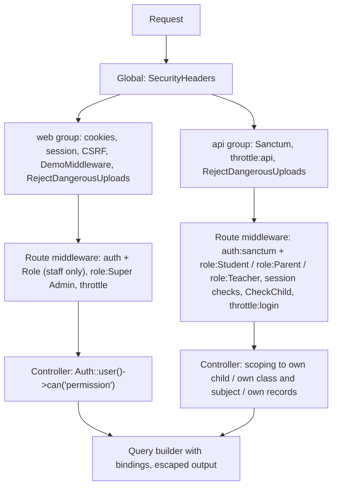
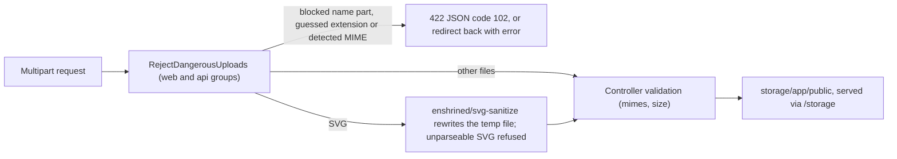

This page describes the security controls in the admin panel, the REST API and the two Flutter apps as the code stands now: what each control is, where it is implemented, and what it guarantees. Most of these controls were added or fixed by this fork's hardening commits (listed in [Release-History](Release-History#security-hardening)); the [Testing-and-CI](Testing-and-CI) page lists the tests that keep them in place. The page ends with a checklist for people deploying the system and rules for people changing the code.

## Overview

Every request passes through several independent layers. A missing check in one layer is not compensated by the others, so each layer has to be right on its own.

Middleware registration is in [bootstrap/app.php](https://github.com/ShawnDaPrawn/Eschool/blob/main/admin-panel/bootstrap/app.php); rate limiters are in [RouteServiceProvider.php](https://github.com/ShawnDaPrawn/Eschool/blob/main/admin-panel/app/Providers/RouteServiceProvider.php).

Two middleware aliases differ only by case and do different things: `Role` is `App\Http\Middleware\CheckRole` (any staff role), `role` is Spatie's `RoleMiddleware` (one named role).

## Authentication

### Admin panel (web sessions)

| Control | Where | Guarantee |
|---|---|---|
| Login form | `GET`/`POST login` → `App\Http\Controllers\Auth\LoginController` (laravel/ui `AuthenticatesUsers`), `guest` middleware | Standard session login with CSRF token |
| Login throttling | laravel/ui `ThrottlesLogins` defaults (LoginController does not override them) | 5 failed attempts per minute per lower-cased email + IP address, then a lockout for the rest of the minute |
| App-only roles kept out at login | `LoginController::authenticated()` | A user with the `Parent` or `Student` role is signed out immediately, the session is invalidated, and the login page shows `app_only_login_not_allowed_on_web` |
| Staff role required on every admin page | `CheckRole` (alias `Role`) on the main group `['Role', 'auth']` in [routes/web.php](https://github.com/ShawnDaPrawn/Eschool/blob/main/admin-panel/routes/web.php) | A signed-in user needs at least one role other than `Parent`/`Student`; anyone else is signed out, the session invalidated and the CSRF token regenerated |
| No self-registration | the `/register` route was removed (commit [439395d](https://github.com/ShawnDaPrawn/Eschool/commit/439395d)) | Accounts are only created by staff, or through the public online registration form, which creates students awaiting approval |
| Password reset | `password/email` has `throttle:login` | Reset-link requests are rate limited like app logins (see below) |
| Change password | `HomeController` password change (`old_password`) | The current password must match (`Hash::check`) before the new one is saved |
| Session cookie | [config/session.php](https://github.com/ShawnDaPrawn/Eschool/blob/main/admin-panel/config/session.php) | `http_only` true, `same_site` `lax`, lifetime `SESSION_LIFETIME` (default 120 minutes); `secure` defaults to true when `APP_URL` starts with `https://` (`SESSION_SECURE_COOKIE` overrides) |
| CSRF | Laravel's CSRF check in the `web` group; `validateCsrfTokens(except: ['webhook/*'])` | Every state-changing web request needs the session's token, except the payment gateway webhooks, which are authenticated by signature instead |

The installer seeds a Super Admin as `superadmin@gmail.com` / `superadmin` (`config/installer.php`, `admin_area`). Change that password, and preferably the email address, immediately after installation.

### Mobile app API (Sanctum tokens)

| Control | Where | Guarantee |
|---|---|---|
| Role-checked logins | `StudentApiController::login` (`gr_number` + `password`; the GR number is stored in `users.email`), `ParentApiController::login`, `TeacherApiController::login` | A token is issued only if the credentials are valid and the user has the matching role (`Student`, `Parent`, `Teacher`) |
| Student account state at login | `StudentApiController::login` | The user must have a `students` row and `users.status = 1`, and a `student_sessions` row for the current session year whose `status` is not 0, before any token is created |
| Bearer tokens | `$user->createToken($user->first_name)->plainTextToken` | Opaque Sanctum personal access tokens, hashed in `personal_access_tokens` |
| Token expiry | [config/sanctum.php](https://github.com/ShawnDaPrawn/Eschool/blob/main/admin-panel/config/sanctum.php) `expiration = env('SANCTUM_EXPIRATION', 60 * 24 * 30)`; `.env.example` sets `SANCTUM_EXPIRATION=43200` | Tokens stop working 30 days after they were issued; both apps sign the user out on a 401 |
| Expired token cleanup | [routes/console.php](https://github.com/ShawnDaPrawn/Eschool/blob/main/admin-panel/routes/console.php): `sanctum:prune-expired --hours=24` daily | Expired tokens are deleted from the database (needs the scheduler cron, see [Scheduled-Tasks-and-Commands](Scheduled-Tasks-and-Commands)) |
| Logout | `POST api/logout` → `ApiController::logout` | Deletes the current token and clears `users.fcm_id` |
| Change password | `POST api/change-password` (`auth:sanctum`) → `ApiController::changePassword` | Needs `current_password`; `new_password` at least 8 characters; every other token of the user is deleted (other devices are signed out) |
| Forgot password | `POST api/forgot-password` and `api/student/forgot-password` | The response is the same whether or not the email belongs to an account; mail errors are logged, not shown |
| Login and reset throttling | `RateLimiter::for('login')`, applied as `throttle:login` to `api/student/login`, `api/student/forgot-password`, `api/parent/login`, `api/teacher/login`, `api/forgot-password` and `password/email` | 5 attempts per minute per route + account (`email`, `gr_number` or `gr_no`, lower-cased) and 20 per minute per IP. Default app passwords are dates of birth, so guessing must be slow. |
| General API throttling | `throttle:api` prepended to the `api` group; `RateLimiter::for('api')` | 60 requests per minute per user id, or per IP when not signed in |
| Paging caps | e.g. `ApiController::perPage()` | `per_page` is clamped to 1–100 |

The `api` group also runs Sanctum's `EnsureFrontendRequestsAreStateful`, and `config/sanctum.php` lists the `web` guard, so a browser request from a stateful domain (`SANCTUM_STATEFUL_DOMAINS`, default localhost variants plus the `APP_URL` host) can authenticate with the admin session cookie. The apps always use bearer tokens.

### Public forms

| Route | Throttle | Why |
|---|---|---|
| `POST contact-us/store` | `throttle:5,1` (5 per minute per IP) | Creates contact messages shown to staff |
| `POST student-register` | `throttle:10,1` | Creates student and parent accounts and stores uploaded photos; reCAPTCHA is optional |

## Authorization

### Admin panel: roles and permissions

| Layer | Where | Guarantee |
|---|---|---|
| Permission strings | [database/seeders/InstallationSeeder.php](https://github.com/ShawnDaPrawn/Eschool/blob/main/admin-panel/database/seeders/InstallationSeeder.php) creates about 175 permissions (`<module>-list`, `-create`, `-edit`, `-delete`, plus specials such as `fees-config`, `email-setting-create`, `attendance-staff`) and syncs the lists for the `Super Admin` and `Teacher` roles; `Parent` and `Student` get none | The seeder is re-run by the installer and by every system update, so new permissions reach existing installs |
| Controller checks | `if (! Auth::user()->can('holiday-list')) { ... }` at the top of each action (about 375 checks across `app/Http/Controllers`); helpers in [ResponseService](https://github.com/ShawnDaPrawn/Eschool/blob/main/admin-panel/app/Services/ResponseService.php): `noPermissionThenRedirect`, `noPermissionThenSendJson`, `noAnyPermissionThenRedirect`, `noRoleThenRedirect` | Page actions redirect to `home` with `no_permission_message`; AJAX actions answer `{"error": true, "message": ...}` (some with HTTP 403) |
| No Super Admin bypass | `Gate::before` is commented out in `AuthServiceProvider` | Super Admin can do only what its seeded permissions allow; a new permission must be added to the Super Admin list to be usable |
| Super Admin-only areas | `['auth', 'role:Super Admin']` route group (`storage-link`, `migrate`, `seeder_install`); `hasRole('Super Admin')` in `SystemUpdateController` and others | Maintenance and system update cannot be reached by other roles; `/clear` (cache clear) needs any logged-in user |
| Menu visibility | `@can` / `@canany` in [resources/views/layouts/sidebar.blade.php](https://github.com/ShawnDaPrawn/Eschool/blob/main/admin-panel/resources/views/layouts/sidebar.blade.php) | Cosmetic only; the controller check is what protects the action |
| Role editing | [RoleController](https://github.com/ShawnDaPrawn/Eschool/blob/main/admin-panel/app/Http/Controllers/RoleController.php): `permission:role-*` middleware, `BUILT_IN_ROLES = ['Super Admin', 'Teacher', 'Parent', 'Student']`, `isEditableRole()`, `assignablePermissionsFrom()` | Only custom roles (`custom_role = 1`) can be edited or deleted; a custom role can only receive permissions the Super Admin role itself has, whatever ids are posted |
| Staff accounts | [StaffController](https://github.com/ShawnDaPrawn/Eschool/blob/main/admin-panel/app/Http/Controllers/StaffController.php) `assignableRoleRule()` | Staff can only be given custom roles (never Super Admin or a built-in role); only a Super Admin may change a Super Admin account; staff attendance pages need `attendance-staff` |
| Teacher data limits in the admin panel | e.g. marks entry in `ExamController`, `TimetableController` live-class links, model scopes below | Teachers can only enter marks for their own class or subject sections; a timetable's live-class link needs timetable edit permission or the period's own teacher |

See [Roles-and-Permissions](Roles-and-Permissions) for the full permission list and how roles are built.

### API: role groups

| Group (in [routes/api.php](https://github.com/ShawnDaPrawn/Eschool/blob/main/admin-panel/routes/api.php)) | Middleware | Guarantee |
|---|---|---|
| `api/student/*` | `auth:sanctum`, `role:Student`, `student.session.active` | Only Student tokens (others get 403). `EnsureStudentSessionIsActive` also refuses users whose `status` is not 1, who have no `students` row, or whose current-session `student_sessions` row is missing or inactive (401 `SESSION_NOT_ACTIVE`) |
| `api/parent/*` | `auth:sanctum`, `role:Parent`, `parent.children.session.active` | Only Parent tokens with a `parents` row; `EnsureParentChildrenSessionIsActive` requires at least one child with an active session this year |
| `api/parent/*` child endpoints | additionally `CheckChild` | See next table |
| `api/teacher/*` | `auth:sanctum`, `role:Teacher` | Only Teacher tokens |
| `api/teacher/get-student-result`, `get-student-marks` | additionally `CheckStudent` | The `student_id` must be in a class section the teacher is class teacher of |
| `api/logout`, `api/change-password` | `auth:sanctum` | Any signed-in app user |
| General (`holidays`, `sliders`, `settings`, `get-events-list`, galleries, ...) | none | Public school information only; `GET api/settings` returns only public payment keys (Razorpay key id, Stripe publishable key, Paystack and Flutterwave public keys), never secret keys or webhook secrets |

### API: scoping to the caller's own data

Role checks only say what kind of user is calling. Each endpoint must also limit the records to the caller's own.

| Caller | Control | Where | Guarantee |
|---|---|---|---|
| Parent | `Parents::children()` | [app/Models/Parents.php](https://github.com/ShawnDaPrawn/Eschool/blob/main/admin-panel/app/Models/Parents.php) | One query: `father_id = parent OR mother_id = parent OR guardian_id = parent` (it used to be a UNION that a chained `where` only partly filtered) |
| Parent | `CheckChild` middleware | [CheckChild.php](https://github.com/ShawnDaPrawn/Eschool/blob/main/admin-panel/app/Http/Middleware/CheckChild.php) | `child_id` must be an integer and one of `children()`; the resolved `Students` model is stored as the request attribute `child`; otherwise `{"error": true, "code": 105}` |
| Parent | `resolveChild()`, `parentChildIds()`, `payerStudentIds()`, `chatTeacherScope()`, `chatAllowedUserIds()` | [ParentApiController.php](https://github.com/ShawnDaPrawn/Eschool/blob/main/admin-panel/app/Http/Controllers/Api/ParentApiController.php) | Endpoints outside the `CheckChild` group (announcements, receipts, transactions, payment status, chat, `delete-leave`) still resolve every child, transaction and leave through the parent's own children; chat only reaches the children's class and subject teachers; teacher payloads do not include dates of birth |
| Student | `findStudentOnlineExam()`, `studentSubjectIds()`, `chatTeacherIds()` | [StudentApiController.php](https://github.com/ShawnDaPrawn/Eschool/blob/main/admin-panel/app/Http/Controllers/Api/StudentApiController.php) | Exams, lesson topics, announcements and assignment submissions are limited to the student's class section and subjects; elective choices must come from the class's groups within their selectable count; chat only to the student's teachers |
| Teacher | `currentTeacher()` | [TeacherApiController.php](https://github.com/ShawnDaPrawn/Eschool/blob/main/admin-panel/app/Http/Controllers/Api/TeacherApiController.php) | A Teacher-role user without a `teachers` row is refused (403) instead of matching everything |
| Teacher | `isClassTeacherOf()`, `teachesSubject()`, `teacherClassSectionIds()`, `teachesStudent()`, `allStudentsInClassSection()` | TeacherApiController | Attendance read/submit only as class teacher of that section and only for its students; marks only as class or subject teacher, for students of the section, between 0 and the total (`obtainedMarksOutOfRange()`); student details, guardian contacts and result PDFs only for students the teacher teaches; student leaves only for the class teacher (approval also needs `student-leave-approve`) |
| Teacher | `ownsLesson()`, `ownsAnnouncement()`, `canManageFile()` | TeacherApiController | Updates and deletes of lessons, topics, assignments and announcements go through ownership checks; `update-file` / `delete-file` only for files attached to the teacher's own lessons, topics, assignments, announcements or leaves |
| Teacher | `canChatWith()` | TeacherApiController | Messages only to students of the teacher's sections, their parents, or people who already wrote to the teacher |
| Teacher (API and admin lists) | `Lesson::scopeLessonTeachers`, `LessonTopic::scopeLessonTopicTeachers`, `Assignment::scopeAssignmentTeachers`, `AssignmentSubmission::scopeAssignmentSubmissionTeachers`, `Students::scopeOfTeacher` | `app/Models/` | Rows are matched on the exact (class section, subject) pair in `subject_teachers`, so teaching Maths in 5A and Science in 5B does not expose Science in 5A |

See [API-Overview](API-Overview), [API-Student](API-Student), [API-Parent](API-Parent) and [API-Teacher](API-Teacher) for the endpoints themselves.

## Input handling

### SQL

| Control | Where | Guarantee |
|---|---|---|
| Query builder and Eloquent with bindings | everywhere | Values are sent as bound parameters |
| Raw fragments use placeholders | e.g. `whereRaw("concat(first_name,' ',last_name) LIKE ?", ['%'.$search.'%'])` in `StudentController`, `AttendanceController`, `ExamController`, `ClassTeacherController`, `SubjectTeacherController`, `AssignmentController` | Search text is never spliced into SQL. Commit [6b9f7dd](https://github.com/ShawnDaPrawn/Eschool/commit/6b9f7dd) converted eight list searches; `AcademicAuthorizationTest::test_search_text_is_bound_not_spliced_into_sql` checks it |
| OR conditions grouped in a closure | `->where(function ($q) use ($search) { $q->where(...)->orWhere(...); })` | A search cannot widen a query past its other filters (session year, class, teacher) |

### Output escaping

| Control | Where | Guarantee |
|---|---|---|
| Blade `{{ }}` | all views | HTML-escaped. `{!! !!}` is used about 440 times for HTML that staff author (website content, editor output, icons); never put user-supplied data in it |
| `escapeHtml()`, `safeUrl()`, `escapeToastText()` | [public/assets/js/custom/function.js](https://github.com/ShawnDaPrawn/Eschool/blob/main/admin-panel/public/assets/js/custom/function.js), loaded first by `layouts/footer_js.blade.php` (and `web/footer.blade.php`) | `escapeHtml` escapes `& < > " ' \``; `safeUrl` returns the URL only if it is http(s) or relative, otherwise `#`; `escapeToastText` escapes a string or each item of an array |
| Toasts | `showErrorToast()` / `showSuccessToast()` in function.js | `$.toast` inserts with `.html()`, so messages are escaped first |
| Flash messages | `layouts/footer_js.blade.php` | Passed as `escapeHtml(@json(...))`, not inside quoted JS strings |
| Table output | bootstrap-table views set `data-escape="true"` on the table (63 of the 69 table views) and `data-escape="false"` only on HTML columns such as `operate`; formatters in [formatter.js](https://github.com/ShawnDaPrawn/Eschool/blob/main/admin-panel/public/assets/js/custom/formatter.js) and [custom-bootstrap-table.js](https://github.com/ShawnDaPrawn/Eschool/blob/main/admin-panel/public/assets/js/custom/custom-bootstrap-table.js) escape row fields they build HTML from (`renderPersonCell`, `renderPersonText`, file links, contact messages, leave reasons, reviews, live-class links) | Text from the contact form, online registration, leave requests, file names and submissions is shown as text in staff sessions |
| Cache busting | `function.js?v={{ filemtime(...) }}` | Browsers load the current helpers after an update |
| Online exam editors | Jodit 4.18.6 in `public/assets/jodit` replaces CKEditor 4 (end of life); KaTeX 0.19.0 served from `public/assets/katex` | Jodit's cleaner strips scripts, iframes and event-handler attributes. Equation questions are stored as HTML (`\(...\)`) and rendered as HTML by design |

### Other inputs

| Control | Where | Guarantee |
|---|---|---|
| Email templates are never compiled | [EmailTemplateService::render()](https://github.com/ShawnDaPrawn/Eschool/blob/main/admin-panel/app/Services/EmailTemplateService.php), used by `StudentController`, `StaffController`, `TeacherController` | `{$name}` / `{name}` placeholders are replaced with `e()`-escaped values; Blade and PHP in a template are left as text. Unknown placeholders stay as they are |
| Email template editing | `email-setting-create` checked in `EmailController::index/store` and `SettingController::email_index/email_update/verifyEmailConfigration` | Only staff with that permission can change templates or mail settings |
| `.env` is never written from admin forms | settings pages save to the `settings` table only; [SettingsConfigService::apply()](https://github.com/ShawnDaPrawn/Eschool/blob/main/admin-panel/app/Services/SettingsConfigService.php) (called from `AppServiceProvider::boot()`) applies the school name, timezone, mail server and Paystack keys over the `.env` config on every boot | No admin settings form adds or changes `.env` entries (only the installation wizard writes `.env`, during installation). The old `changeEnv()` helper, which rewrote `.env` from settings forms, was removed in [e13ac7d](https://github.com/ShawnDaPrawn/Eschool/commit/e13ac7d); `SettingsConfigTest` checks that saving mail settings leaves `.env` unchanged |
| Language codes | `LanguageController::CODE_RULE` `^[A-Za-z]{2,3}([-_][A-Za-z0-9]{2,8})?$`; `Controller::readLanguageFile()` uses `basename()` and falls back to `en.json` | An uploaded language file cannot be written outside `resources/lang`, and `/common/js/lang` cannot read other files |
| Settings image removal | `remove-image/{type}` | Needs the setting permission and only deletes ID-card images, not arbitrary `settings` rows |

## File uploads

| Control | Where | Guarantee |
|---|---|---|
| Blocked extensions | `RejectDangerousUploads::BLOCKED_EXTENSIONS` in [RejectDangerousUploads.php](https://github.com/ShawnDaPrawn/Eschool/blob/main/admin-panel/app/Http/Middleware/RejectDangerousUploads.php): PHP variants (`php`, `php3`–`php8`, `pht`, `phtml`, `phar`, `phps`, `pgif`, `phpt`), `shtml`/`shtm`/`stm`, `htaccess`, `htpasswd`, `ini`, `cgi`, `pl`, `py`, `rb`, `sh`, `bash`, ASP/JSP (`asp`, `aspx`, `ascx`, `ashx`, `asmx`, `jsp`, `jspx`, `war`), Windows executables and scripts (`exe`, `dll`, `bat`, `cmd`, `vbs`, `ps1`), web pages and scripts (`html`, `htm`, `xhtml`, `xht`, `mht`, `mhtml`, `hta`, `js`, `mjs`, `swf`), `xml`, `xsl`, `xslt`, `svgz` | Every dot-separated part of the client file name counts (`photo.php.jpg` is refused), plus the extension guessed from the content |
| Blocked detected types | `BLOCKED_MIME_PATTERN` | Files whose detected MIME type is PHP, HTML, JavaScript/ECMAScript, shell, Perl, Python, Ruby, Windows executables, or `text/xml`/`application/xml` are refused whatever their name (e.g. PHP saved as `.txt`) |
| Nested uploads | `files()` walks `allFiles()` recursively | Files inside arrays (`files[0][x]`) are checked too |
| SVG sanitising | `sanitizeSvg()` with `enshrined\svgSanitize\Sanitizer` and `removeRemoteReferences(true)` (`enshrined/svg-sanitize ^1.1`) | SVGs are still accepted (subjects, logos and website images use them) but are rewritten without scripts, event handlers and remote references before any controller stores them; unparseable SVGs are refused |
| Apache rules for stored files | [storage/app/public/.htaccess](https://github.com/ShawnDaPrawn/Eschool/blob/main/admin-panel/storage/app/public/.htaccess) | PHP engine off, PHP/CGI handlers removed, script extensions and dotfiles denied, `X-Content-Type-Options: nosniff`, and SVG/HTML/XML served with a sandboxing `Content-Security-Policy`. Nginx and other servers ignore this file, which is why the middleware does not rely on it |
| Per-field validation | each controller's `Validator` rules | Typical sets: photos `mimes:jpeg,png,jpg` (max 2048 KB); subject and website images also `svg`; settings logos `jpeg,jpg,png,gif,webp,svg` (favicon also `ico`); lesson/announcement/assignment files `pdf,doc,docx,xls,xlsx,ppt,pptx,jpg,jpeg,png,gif`; imports `csv,txt` (students also `xlsx,xls`); language files `json`; system update `zip`. Chat attachments are limited by count and size from the chat settings rather than by type |
| Chat attachment names | `sendMessage` in the student, parent and teacher API controllers | Each attachment is stored in its own random folder, `chatfile/<random string>/<file name>` (`Str::random(32)` in the student and parent APIs, which also replace any character outside `A-Za-z0-9._-` in the name; `Str::random(40)` in the teacher API), so attachments cannot overwrite each other |
| Firebase service account key | `SettingController` (`SERVICE_ACCOUNT_FILE = 'firebase/service_account.json'`) | Stored on the private `local` disk (`storage/app/firebase/`), never the public disk; the upload must be JSON with `private_key` and `client_email` (max 64 KB); saving the FCM settings moves an older copy off the public disk |
| `UploadService` / `ImageService` | [app/Services/UploadService.php](https://github.com/ShawnDaPrawn/Eschool/blob/main/admin-panel/app/Services/UploadService.php), `ImageService.php` | Helpers that store under a random `uniqid().time()` name and re-encode jpg/png as JPEG (quality 60). No controller calls them at present; controllers store files directly with `store()`/`storeAs()` |

## HTTP response headers

[App\Http\Middleware\SecurityHeaders](https://github.com/ShawnDaPrawn/Eschool/blob/main/admin-panel/app/Http/Middleware/SecurityHeaders.php) is appended to the global middleware stack, so it runs for web, API and webhook responses. It only sets a header the response does not already have.

| Header | Value | When |
|---|---|---|
| `X-Frame-Options` | `SAMEORIGIN` | always |
| `X-Content-Type-Options` | `nosniff` | always |
| `Referrer-Policy` | `strict-origin-when-cross-origin` | always |
| `Strict-Transport-Security` | `max-age=31536000` | only when `$request->isSecure()` |

No `Content-Security-Policy` is sent for application pages (only for SVG/HTML/XML files under `/storage` on Apache, see above).

The project-root [.htaccess](https://github.com/ShawnDaPrawn/Eschool/blob/main/admin-panel/.htaccess) denies dotfiles, `composer.json/lock`, `package(-lock).json`, `artisan`, `phpunit.xml` and `vite.config.js`, and answers 404 for `/.git` and `/.env` paths, even when `mod_rewrite` is off or the project root is the document root.

## TLS and HTTPS

| Control | Where | Guarantee |
|---|---|---|
| Outgoing TLS verification | `app/Helpers/notification_helper.php` (FCM), `app/Services/Payment/FlutterwavePayment.php` (commit [420df6d](https://github.com/ShawnDaPrawn/Eschool/commit/420df6d)) | Calls to FCM and Flutterwave use curl's default certificate and host verification; no code in `app/` or `config/` turns verification off |
| HSTS and secure cookies | `SecurityHeaders`, `config/session.php` | Sent once the site runs on `https://` |
| Student/parent app, Android | `e-school/android/app/src/main/res/xml/network_security_config.xml`, `android:usesCleartextTraffic="false"` | Release builds: HTTPS only and only the system certificate authorities. Debug builds use `src/debug/res/xml/network_security_config.xml`, which allows HTTP and user-installed CAs for local development |
| Teacher app, Android | `e-school-teacher/android/app/src/main/AndroidManifest.xml` | No cleartext opt-in, so Android's default (no plain HTTP) applies |
| Both apps, certificate checks | the global `HttpOverrides` with `badCertificateCallback => true` was removed (commit [3627cf8](https://github.com/ShawnDaPrawn/Eschool/commit/3627cf8)) | Every Dart HTTP request validates the server certificate; a broken chain must be fixed on the server |
| iOS | `ios/Runner/Info.plist` in both apps | No `NSAllowsArbitraryLoads` exception |
| Payment WebView | `e-school/lib/ui/screens/fees/webviewPaymentScreen.dart` `_onNavigationRequest()` | Only the server's own `/response/paystack/success` and Flutterwave callback URLs end the payment flow; non-http(s) navigation is blocked |

The application does not redirect HTTP to HTTPS itself; configure that in the web server. `App\Http\Middleware\TrustProxies` exists but is not registered in `bootstrap/app.php`, so Laravel's default (no trusted proxies) applies; behind a TLS-terminating proxy or load balancer `isSecure()` is false unless trusted proxies are configured (for example with `$middleware->trustProxies(...)` in `bootstrap/app.php`), and HSTS is then not sent.

## Errors and logging

| Control | Where | Guarantee |
|---|---|---|
| Debug off by default | `.env.example`: `APP_ENV=production`, `APP_DEBUG=false`, `LOG_LEVEL=error`; `config/app.php` `debug` defaults to false | Visitors see generic error pages, not stack traces or the debug bar |
| API error details | `ResponseService::errorResponse()` | The `details` field (exception message, file, line) is filled only when `app.debug` is true; the log always has it |
| Log redaction | `ResponseService::logErrorResponse()`, `redact()`, `isSensitiveKey()`, `logCurlRequest()` | Request fields and headers whose key matches `/pass\|token\|secret\|key\|signature\|authorization\|cookie\|otp/i` are logged as `[redacted]` |
| Validation flashing | `App\Exceptions\Handler::$dontFlash` | `current_password`, `password` and `password_confirmation` are never flashed back to forms |
| No exception objects in responses | controllers fixed in [ee49250](https://github.com/ShawnDaPrawn/Eschool/commit/ee49250), [201b863](https://github.com/ShawnDaPrawn/Eschool/commit/201b863), [6b9f7dd](https://github.com/ShawnDaPrawn/Eschool/commit/6b9f7dd) | Exception messages, stack traces and `dd()` output no longer reach the browser |
| App logging | `initializeApp()` in `lib/app/app.dart` of both apps | `debugPrint` is replaced by a no-op in release builds; the auth token, request bodies and API responses are no longer printed |

## Data on the device

| Control | Where | Guarantee |
|---|---|---|
| No app backups | `android:allowBackup="false"` and `android:dataExtractionRules="@xml/data_extraction_rules"` in both apps' `AndroidManifest.xml`; `data_extraction_rules.xml` excludes every domain from `cloud-backup` and `device-transfer` | The Hive box holding the bearer token is not copied to cloud backups or to a new device |
| Private Hive location | `initHiveStorage()` in `lib/app/app.dart` (both apps) | Hive boxes live in the Application Support directory, not Documents (which iOS exposes in the Files app); existing boxes are moved on start so nobody is signed out |
| Safe download names | `sanitizeFileName()` in `lib/utils/fileNameUtils.dart` (both apps) | Server-provided file names cannot contain path separators, control characters or `..`, so downloads stay inside the download folder |
| Safe links | `UiUtils.isWebUrl()` / `UiUtils.launchWebUrl()` in `lib/utils/uiUtils.dart` (both apps) | Links from chat, assignments, timetables and videos are opened only if they are http(s) URLs with a host |

## Payments and webhooks

Details are on the [Payments](Payments) page; the security-relevant rules are:

| Gateway | Route | Signature check | Secret (settings row, then config) |
|---|---|---|---|
| Razorpay | `POST webhook/razorpay` | HMAC-SHA256 of the raw body vs `X-Razorpay-Signature` | `razorpay_webhook_secret`, `services.razorpay.webhook_secret` (`RAZORPAY_WEBHOOK_SECRET`) |
| Stripe | `POST webhook/stripe` | `Stripe\Webhook::constructEvent()` with `Stripe-Signature` | `stripe_webhook_secret`, `services.stripe.webhook_secret` (`STRIPE_WEBHOOK_SECRET`) |
| Paystack | `POST webhook/paystack` | HMAC-SHA512 of the raw body vs `x-paystack-signature` | `paystack_secret_key`, `services.paystack.secret_key` (`PAYSTACK_SECRET_KEY`) |
| Flutterwave | `POST webhook/flutterwave` | `verif-hash` header equals the secret hash | `flutterwave_hash_key`, `services.flutterwave.secret_hash` (`FLW_SECRET_HASH`) |

`PaymentService::webhookSecret()` reads the `settings` row saved by the fees settings page first and falls back to the config key only when that row is empty. The fees page no longer copies these values into `.env`, so the `.env` keys only matter if someone sets them by hand.

| Control | Where | Guarantee |
|---|---|---|
| Fail closed | `WebhookController::validHmac()`, `PaymentService::webhookSecret()` | No configured secret or no signature means 401; comparisons use `hash_equals()` |
| Transaction lookup | `WebhookController::findTransaction()` | The payment is matched to a `payment_transactions` row by gateway and the stored `order_id` (Flutterwave: `payment_transaction_id` in metadata plus gateway) |
| Amount and currency | `WebhookController::paid()`, `PaymentService::amountMatches()` / `currencyCode()` | The paid amount (in the gateway's units) and currency must match the stored transaction, otherwise 400 and nothing is recorded |
| Recording from stored data | `FeesPaymentService::markPaid()` / `markFailed()` | What a payment covers comes from the stored transaction and its rows, never webhook metadata (such as `is_fully_paid`); recording runs in a DB transaction with `lockForUpdate()` and is idempotent; a late failure cannot undo a payment |
| Server-side pricing | `FeesPaymentService::prepare()` | The server computes the total from the fee setup (compulsory fees, installments, optional fees, due charges) and checks every item belongs to the child and is unpaid; the app's amount is only compared against it |
| Own transactions only | `store-fees`, `fail-payment-transaction`, `get-payment-status`, receipts | Students and parents can only act on their own (children's) pending transactions; payment ids are written once |
| Callback pages change nothing | `paystackSuccessCallback()`, `flutterwaveSuccessCallback()` | They only return a JSON message; payments are recorded only from signed webhooks |
| Required secrets | `FeesTypeController::feesConfigUpdate()` (`fees-config` permission) | Each gateway's webhook secret is required when that gateway is enabled (`required_if:<gateway>_status,1`), including the Flutterwave secret hash |

The admin steps for configuring webhooks are at https://shawndaprawn.github.io/Eschool/admin-panel/webhook-config/ and https://shawndaprawn.github.io/Eschool/admin-panel/fee-payment/.

## Online exams

| Control | Where | Guarantee |
|---|---|---|
| Answers stay on the server | `StudentApiController::getOnlineExamQuestions` | Only the number of correct answers (`answers_count`) is sent, not which options are correct |
| Exam key checked by the server | `getOnlineExamList` omits `exam_key`; `getOnlineExamQuestions` requires `exam_key` and compares it with `hash_equals()` | The key is never sent to the app; questions are only served after the student types the key the teacher gave them |
| Submission limits | `submitOnlineExamAnswers`, `findStudentOnlineExam()` | Only the student's own exam; not before `start_date`, not after `end_date` plus `ONLINE_EXAM_GRACE_MINUTES`, not after the exam `duration` (plus the same grace) from when the student started; only one submission; only options of that exam's questions |
| Exact-set scoring | [OnlineExamScoringService::isCorrect()](https://github.com/ShawnDaPrawn/Eschool/blob/main/admin-panel/app/Services/OnlineExamScoringService.php) | A question scores only if the selected options are exactly the correct options; selecting every option scores nothing |

## Maintenance URLs, demo mode and APP_KEY

| Control | Where | Guarantee |
|---|---|---|
| Maintenance URLs | `routes/web.php` | `/clear` needs a logged-in user; `/storage-link`, `/migrate` and `/seeder_install` need Super Admin; `migrate` and `seeder_install` pass `--force`. The old unauthenticated `delete-chat-message/cron-job` URL is gone; old chat messages are deleted by the scheduled `app:cleanup-old-chat-messages` command |
| Demo mode | [DemoMiddleware](https://github.com/ShawnDaPrawn/Eschool/blob/main/admin-panel/app/Http/Middleware/DemoMiddleware.php) in the `web` group, enabled by `config('app.demo_mode')` (`DEMO_MODE` in `.env`, default false) | When on, every non-GET request by a signed-in user is refused (API: `code` 112; AJAX: HTTP 403; pages: redirect back with "This is not allowed in the Demo Version.") except the login endpoints, chat send/read, leave lists and a few export/certificate URLs listed in `$exclude_uri`, and except for the user `demomodeoff@gmail.com`. The fees configuration page also masks gateway keys. `GET api/settings` reports it as `is_demo` |
| APP_KEY | `.env.example` has `APP_KEY=` (empty); the installer runs `key:generate --force` (`config/installer.php`); CI runs `php artisan key:generate --force` | Laravel refuses to start without a key, so no two installs share one. The key encrypts cookies and sessions and signs URLs. `InstallationTest` fails if `.env.example` gets a key again |

Code outside `config/` reads configuration through `config()` and school settings through `getSettings()` / `schoolSetting()`, never `env()`, so demo mode, mail settings and webhook secrets keep working after `php artisan config:cache` / `optimize` (enforced by `SettingsConfigTest`).

## Security checklist for deployers

1. Serve the admin panel over HTTPS only, with a complete certificate chain from a public CA. The student/parent app's release build refuses plain HTTP and user-installed certificates, and both apps validate certificates.
2. Set `APP_URL` to the `https://` address (this makes session cookies `Secure`), `APP_ENV=production`, `APP_DEBUG=false`, `LOG_LEVEL=error`. After installation the application no longer writes `.env` (the installation wizard needs it writable only while it runs), so it can be made read-only for the web server user. You can cache the configuration with `php artisan optimize` (re-run it after editing `.env` or updating); admin settings are read from the database and still apply.
3. Make sure `APP_KEY` is set and unique (the installer generates it). Never copy a key between installs or commit `.env`.
4. Point the web server's document root at `admin-panel/public/`. If the project root must be the document root, keep the root `.htaccess` (Apache) or add equivalent rules that deny dotfiles, `.env`, `.git`, `vendor/` and project metadata.
5. On Nginx or any non-Apache server, make sure nothing under `/storage` is executed as PHP and that `storage/app/public/` is served as static files only; the `.htaccess` there only works on Apache.
6. Change the seeded Super Admin login (`superadmin@gmail.com` / `superadmin`) straight after installation.
7. If the server sits behind a reverse proxy or load balancer that terminates TLS, configure Laravel's trusted proxies, otherwise HSTS is not sent and the request is treated as HTTP.
8. Add the scheduler cron (`* * * * * php /path/to/admin-panel/artisan schedule:run`) so expired app tokens and old chat messages are deleted; see [Scheduled-Tasks-and-Commands](Scheduled-Tasks-and-Commands).
9. For each enabled payment gateway, set its webhook secret (Razorpay webhook secret, Stripe signing secret, Paystack secret key, Flutterwave secret hash) on the fees settings page, and register the `webhook/<gateway>` URL in the gateway dashboard. Without the secret, webhooks are refused and payments are never confirmed.
10. Rotate any secret that may have been exposed by an older version: the Razorpay webhook secret (an older public `api/settings` returned it) and the Firebase service account key (older versions stored it on the public disk).
11. Upload the Firebase service account file through the notification settings page so it lands on the private disk; do not place it under `public/` or `storage/app/public/`.
12. Keep `DEMO_MODE=false` on a real school install.
13. Default passwords for students, parents and teachers are their dates of birth (see https://shawndaprawn.github.io/Eschool/faqs/); ask users to change them. Login throttling slows guessing but does not replace this.
14. Back up the database and `storage/app/` (uploads and the Firebase key) yourself; the application has no built-in backup job. Take a backup before every system update.
15. Run `composer audit` periodically on the installed version, or watch the weekly CI audit.

## Rules for contributors

1. **Check a permission in every admin controller action**, including JSON/AJAX endpoints and list (`show`) endpoints, with `Auth::user()->can('<module>-<action>')` or a `ResponseService::noPermissionThen*()` helper, and return immediately when it fails. Hiding a sidebar item is not a check.
2. **Add new permission strings to `InstallationSeeder`** and to the Super Admin list (and the Teacher list if teachers need it). There is no Super Admin bypass.
3. **Use the right role middleware.** Admin routes go inside the `['Role', 'auth']` group; Super Admin-only routes use `role:Super Admin`. App routes go in the matching `role:Student` / `role:Parent` / `role:Teacher` group in `routes/api.php`.
4. **Scope every API query to the caller.** Parents: resolve children only through `$parent->children()` (`CheckChild` or `resolveChild()`), never `Students::find($request->child_id)`. Teachers: go through `currentTeacher()`, `teachesSubject()`, `isClassTeacherOf()`, `teachesStudent()` or the model scopes, and match class section and subject as a pair. Students: limit to their class section, subjects and session. Treat every id in a request as untrusted.
5. **Never trust amounts, flags or ownership sent by an app.** Compute totals on the server (`FeesPaymentService`), and record payments only from signed webhooks.
6. **Never concatenate input into SQL.** Use the query builder; in `whereRaw`/`orWhereRaw`/`selectRaw` use `?` placeholders and a bindings array. Group `OR` search conditions in a closure.
7. **Escape output.** Use `{{ }}` in Blade; use `{!! !!}` only for HTML that staff wrote on purpose. In JavaScript that builds HTML, wrap every row field in `escapeHtml()` and every link in `safeUrl()`; add `data-escape="true"` to new bootstrap-table tables and `data-escape="false"` only on columns that return HTML you built safely. Pass PHP values to scripts with `@json`.
8. **Do not compile stored content as Blade.** Fill email templates with `EmailTemplateService::render()`.
9. **Never call `env()` outside `config/`, and never write `.env` from a request.** Read configuration with `config()` and admin-edited settings with `getSettings()` / `schoolSetting()`; store new settings in the `settings` table (and, if they must override a config value, add them to `SettingsConfigService::CONFIG_KEYS`). `SettingsConfigTest` fails on any `env()` call outside `config/`.
10. **Validate uploads** with `mimes:` and `max:` rules for the field, and store them under generated names, not the client's file name. Leave `RejectDangerousUploads` on both groups. Keep secrets such as service-account files on the `local` disk.
11. **Do not leak internals.** Do not return exception messages, `$e`, stack traces or `dd()` output; use `ResponseService::errorResponse('error_occurred', null, <code>, $e)`, which logs details with secrets redacted. Never log tokens, passwords or keys.
12. **Do not send secrets to the apps.** Public endpoints such as `api/settings` may only carry publishable keys.
13. **Keep TLS verification on** in PHP (curl, Guzzle) and Dart; never add `CURLOPT_SSL_VERIFYPEER => false`, `'verify' => false`, or a `badCertificateCallback`.
14. **In the apps, open only http(s) links** (`UiUtils.launchWebUrl()`), sanitise file names (`sanitizeFileName()`), and do not print tokens or responses.
15. **Add a test** for each new permission check or scoping rule, following `AcademicAuthorizationTest` (in-process) or the `*ApiSecurityTest` classes with `RunsAppServer` (API endpoints that `exit()`).

## See also

- [Roles-and-Permissions](Roles-and-Permissions)
- [API-Overview](API-Overview), [API-Student](API-Student), [API-Parent](API-Parent), [API-Teacher](API-Teacher)
- [Payments](Payments)
- [Deployment](Deployment), [Configuration](Configuration)
- [Testing-and-CI](Testing-and-CI)
- [Release-History](Release-History)
- [Contributing](Contributing)
