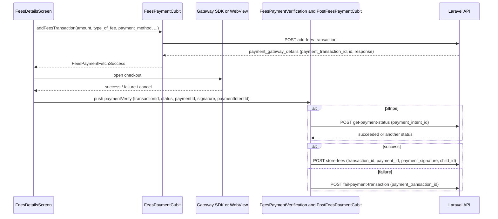

This page covers the specifics of the student/parent Flutter app in `e-school/` (Dart package `eschool`, version `3.5.0+39`): how one binary serves two user types, every route and screen with the Cubits and repositories behind it, fees and online payments, chat, notifications and file downloads. The shared architecture (startup, `Api`, Hive, server configuration) is on [Mobile-Apps-Overview](Mobile-Apps-Overview); the endpoints themselves are on [API-Student](API-Student) and [API-Parent](API-Parent).

## Login and the two user types

The app has two login screens and keeps track of which one was used.

| Step | Code | What happens |
|---|---|---|
| Choose user type | `lib/ui/screens/auth/authScreen.dart` (`Routes.auth`) | Shows a Lottie animation (`assets/animations/onboarding.json`), the school name and tagline from the server configuration, and two buttons: "Login as Student" (`Routes.studentLogin`) and "Login as Parent" (`Routes.parentLogin`). A "school website" link opens `baseUrl` in an in-app browser view. |
| Student login | `studentLoginScreen.dart`, `SignInCubit.signInUser(isStudentLogin: true)` → `AuthRepository.signInStudent()` | POST `student/login` with `gr_number`, `password`, `fcm_id`, `device_type`. Forgot password opens `RequestResetPasswordBottomsheet` (`RequestResetPasswordCubit` → POST `student/forgot-password` with `gr_no` and `dob` as `yyyy-MM-dd`). |
| Parent login | `parentLoginScreen.dart`, `SignInCubit.signInUser(isStudentLogin: false)` → `AuthRepository.signInParent()` | POST `parent/login` with `email`, `password`, `fcm_id`, `device_type`. Forgot password opens `ForgotPasswordRequestBottomsheet` (`ForgotPasswordRequestCubit` → POST `forgot-password` with `email`). |
| Store session | `AuthCubit.authenticateUser(jwtToken, isStudent, student, parent)` | Writes `jwtToken`, `isLogIn`, `isStudentLogIn`, `studentDetails`, `parentDetails` to the Hive `authBox` and emits `Authenticated`. |
| Push topics | `NotificationUtility.subscribeOrUnsubscribeToNotificationTopics(isParent: ...)` | Students: `studentsAndroid`/`studentsIOS`; parents: `parentsAndroid`/`parentsIOS`; both: `allAndroid`/`allIOS`. |
| First screen | login listener and `splashScreen.dart` | Student: `Routes.home` (`HomeScreen`), or `Routes.studentFeePaymentDueScreen` when the student's `isFeePaymentDue` is true and the server has `compulsory_fee_payment_mode = 1`. Parent: `Routes.parentHome` (`ParentHomeScreen`). |

`AuthCubit` (`lib/cubits/authCubit.dart`) holds `Authenticated(jwtToken, isStudent, student, parent)`; for a student session `parent` is an empty `Parent`, for a parent session `student` is empty. `AuthCubit.isParent()` is what the rest of the app checks to choose between the `student/...` and `parent/...` endpoints. Most repositories take a `useParentApi` / `isParent` flag or a nullable `childId` and pick the URL accordingly, e.g. `childId == null ? Api.storeFeesStudent : Api.storeFeesParent`.

The demo credentials in `lib/utils/constants.dart` (`defaultStudentGRNumber`, `defaultStudentPassword`, `defaultParentEmail`, `defaultParentPassword`) are only pre-filled when `showDefaultCredentials` is `true`; it is `false` in the repo.

### Parent and child switching

There is no global "selected child". The parent profile returned by `parent/login` and `parent/get-profile-data` contains `children` (a list of `Student`), stored in `Parent.children`.

- `ParentHomeScreen` (`lib/ui/screens/parentHomeScreen.dart`) shows a card per child. Tapping a card pushes `Routes.studentDetails` (`'parent/studentDetails'`, `ChildDetailsScreen`) with that `Student` as the argument. If compulsory fee payment mode is on and that child has `isFeePaymentDue`, the tap opens `Routes.feesDetails` for the child instead.
- `ChildDetailsScreen` lists the child's subjects (`ChildSubjectsCubit` → `ParentRepository`, GET `parent/subjects`) and a menu built in `lib/ui/widgets/childInformationItemsContainer.dart`: assignments, teachers, attendance, timetable, academic calendar, exams, results, reports, fees and manage leaves.
- Every screen opened from that menu receives the child's id and sends it as `child_id`. On the server, the routes inside the `CheckChild` middleware group reject a `child_id` that is not one of the parent's children with `error: true`, `code: 105`, message `Invalid Child ID Passed.` (see [API-Parent](API-Parent)). Because the app maps code `105` to the `examOnlineAttended` label, that rejection is displayed as "Student already attempted exam" (English text).

Parents reach chat through a floating action button on `ParentHomeScreen` (opens `ChatUsersScreen`), and their own profile through `Routes.parentProfile`.

### Student home

`HomeScreen` (`lib/ui/screens/home/homeScreen.dart`) has a bottom navigation bar with four items: home (`HomeContainer`), chat (`ChatUsersScreen`), assignments (`AssignmentsContainer`) and menu. The menu opens `MoreMenuBottomsheetContainer`, whose entries come from `homeBottomSheetMenu` in `lib/utils/homeBottomsheetMenu.dart`: attendance, timetable, notice board, exams, result, reports, parent profile, academic calendar, settings. Each entry is rendered inside the home screen's `IndexedStack` rather than pushed as a route.

## Routes

All route names from `Routes` in [e-school/lib/app/routes.dart](https://github.com/ShawnDaPrawn/Eschool/blob/main/e-school/lib/app/routes.dart). Unknown names produce an empty `Scaffold`.

| Constant | Route name | Screen | File (under `lib/ui/screens/`) |
|---|---|---|---|
| `splash` | `splash` | `SplashScreen` | `splashScreen.dart` |
| `auth` | `auth` | `AuthScreen` | `auth/authScreen.dart` |
| `studentLogin` | `studentLogin` | `StudentLoginScreen` | `auth/studentLoginScreen.dart` |
| `parentLogin` | `parentLogin` | `ParentLoginScreen` | `auth/parentLoginScreen.dart` |
| `home` | `/` | `HomeScreen` (student) | `home/homeScreen.dart` |
| `parentHome` | `parent/` | `ParentHomeScreen` | `parentHomeScreen.dart` |
| `studentDetails` | `parent/studentDetails` | `ChildDetailsScreen` | `childDetailsScreen.dart` |
| `studentProfile` | `/studentProfile` | `StudentProfileScreen` | `studentProfileScreen.dart` |
| `parentProfile` | `/parentProfile` | `ParentProfileScreen` | `parentProfileScreen.dart` |
| `assignment` | `/assignment` | `AssignmentScreen` | `assignment/assignmentScreen.dart` |
| `childAssignments` | `/childAssignments` | `ChildAssignmentsScreen` | `childAssignmentsScreen.dart` |
| `exam` | `/exam` | `ExamScreen` | `examScreen.dart` |
| `examTimeTable` | `/examTimeTable` | `ExamTimeTableScreen` | `exam/examTimeTableScreen.dart` |
| `examOnline` | `/examOnline` | `ExamOnlineScreen` | `exam/onlineExam/examOnlineScreen.dart` |
| `result` | `/result` | `ResultScreen` | `resultScreen.dart` |
| `resultOnline` | `/resultOnline` | `ResultOnlineScreen` | `resultOnline/resultOnlineScreen.dart` |
| `childResults` | `/childResults` | `ChildResultsScreen` | `childResultsScreen.dart` |
| `subjectDetails` | `/subjectDetails` | `SubjectDetailsScreen` | `subjectDetails/subjectDetailsScreen.dart` |
| `chapterDetails` | `/chapterDetails` | `ChapterDetailsScreen` | `chapterDetails/chapterDetailsScreen.dart` |
| `topicDetails` | `/topicDetails` | `TopicDetailsScreen` | `topicDetailsScreen.dart` |
| `playVideo` | `/playVideo` | `PlayVideoScreen` | `playVideo/playVideoScreen.dart` |
| `selectSubjects` | `/selectSubjects` | `SelectSubjectsScreen` | `selectSubjectsScreen.dart` |
| `childAttendance` | `/childAttendance` | `ChildAttendanceScreen` | `childAttendanceScreen.dart` |
| `childTimeTable` | `/childTimeTable` | `ChildTimeTableScreen` | `childTimeTableScreen.dart` |
| `childTeachers` | `/childTeachers` | `ChildTeachersScreen` | `childTeachers.dart` |
| `noticeBoard` | `/noticeBoard` | `NoticeBoardScreen` | `noticeBoardScreen.dart` |
| `academicCalendar` | `/calendar` | `AcademicCalendarScreen` | `academicCalendar/academicCalendarScreen.dart` |
| `eventDetails` | `/eventDetails` | `EventDetailsScreen` | `event/eventsDetailsScreen.dart` |
| `childFees` | `/fees` | `FeesStatusScreen` | `fees/feesStatusScreen.dart` |
| `feesDetails` | `/feesDetails` | `FeesDetailsScreen` | `fees/feesDetailsScreen.dart` |
| `paymentVerify` | `/paymentVerify` | `FeesPaymentVerification` | `fees/feesPaymentVerification.dart` |
| `feesTransaction` | `/feesTransaction` | `FeesTransactionScreen` | `fees/feesTransactionScreen.dart` |
| `studentFeePaymentDueScreen` | `/studentFeePaymentDue` | `StudentFeePaymentDueScreen` | `fees/studentFeePaymentDueScreen.dart` |
| `webViewPaymentScreen` | `/webViewPayment` | `WebViewPaymentScreen` | `fees/webviewPaymentScreen.dart` |
| `subjectWiseReport` | `/reportSubjectsContainer` | `ReportsScreen` | `reports/reportsScreen.dart` |
| `manageLeaves` | `/manageLeaves` | `ManageLeavesScreen` | `leave/manageLeavesScreen.dart` |
| `addLeave` | `/addLeave` | `AddLeaveScreen` | `leave/addLeaveScreen.dart` |
| `notifications` | `/notifications` | `NotificationScreen` | `notificationsScreen.dart` |
| `chatMessages` | `/chatMessages` | `ChatMessagesScreen` | `chat/chatMessagesScreen.dart` |
| `chatUserProfile` | `/chatUserProfile` | `ChatUserProfileScreen` | `chat/chatUserProfileScreen.dart` |
| `chatUserSearch` | `/chatUserSearch` | `ChatUsersSearchScreen` | `chat/chatUserSearchScreen.dart` |
| `gallery` | `/gallery` | `GalleryScreen` | `gallery/galleryScreen.dart` |
| `galleryAlbumPhotos` | `/galleryAlbumPhotos` | `GalleryAlbumPhotosScreen` | `gallery/galleryAlbumPhotosScreen.dart` |
| `pdfFileView` | `/pdfFileView` | `PdfFileScreen` | `fileViews/pdfFileScreen.dart` |
| `imageFileView` | `/imageFileView` | `ImageFileScreen` | `fileViews/imageFileScreen.dart` |
| `settings` | `/settings` | `SettingsScreen` | `settingsScreen.dart` |
| `aboutUs` | `/aboutUs` | `AboutUsScreen` | `aboutUsScreen.dart` |
| `privacyPolicy` | `/privacyPolicy` | `PrivacyPolicyScreen` | `privacyPolicyScreen.dart` |
| `termsAndCondition` | `/termsAndCondition` | `TermsAndConditionScreen` | `termsAndConditionScreen.dart` |
| `contactUs` | `/contactUs` | `ContactUsScreen` | `contactUsScreen.dart` |

`Routes.currentRoute` holds the last generated route name; the chat notification handler uses it to avoid stacking two chat screens.

## Screen inventory by feature

"Global" Cubits are created once in `MyApp` ([e-school/lib/app/app.dart](https://github.com/ShawnDaPrawn/Eschool/blob/main/e-school/lib/app/app.dart)): `AppLocalizationCubit`, `AuthCubit`, `StudentDashboardCubit`, `NoticeBoardCubit`, `AppConfigurationCubit`, `ExamDetailsCubit`, `StudentFeesCubit`, `FeesPaymentCubit`, `PostFeesPaymentCubit`, `FeesReceiptCubit`, `ResultTabSelectionCubit`, `ExamTabSelectionCubit`, `ExamOnlineCubit`, `ExamsOnlineCubit`, `ResultsOnlineCubit`, `ChatUsersCubit`, `GalleryAlbumCubit`, `GalleryVideosCubit`. All others are provided by the screen that needs them.

### Account, home and settings

| Screen / widget | Cubits | Repositories | Notes |
|---|---|---|---|
| `SplashScreen` | `AppConfigurationCubit`, `AuthCubit`, `UserProfileCubit` | `AuthRepository` | Profile refresh with `autoLogout: true`. |
| `AuthScreen`, `StudentLoginScreen`, `ParentLoginScreen` | `SignInCubit`, `AuthCubit`, `RequestResetPasswordCubit` / `ForgotPasswordRequestCubit`, `AppConfigurationCubit` | `AuthRepository`, `SettingsRepository` | See [login](#login-and-the-two-user-types). |
| `HomeScreen` (student) | `AppConfigurationCubit`, `AssignmentsCubit`, `AssignmentsTabSelectionCubit`, `AttendanceCubit`, `ChatUsersCubit`, `EventsCubit`, `ResultsCubit`, `SemestersCubit`, `StudentParentDetailsCubit`, `TimeTableCubit`, `AcademicCalendarCubit` | `StudentRepository`, `AssignmentRepository`, `SystemRepository`, `SettingsRepository` | `HomeContainer` reads `StudentDashboardCubit` (GET `student/dashboard`). |
| `ParentHomeScreen` | `AppConfigurationCubit`, `AuthCubit`, `ChatUsersCubit`, `NoticeBoardCubit`, `SlidersCubit`, `UserProfileCubit`, gallery Cubits | `AuthRepository`, `SystemRepository`, `SettingsRepository` | Sliders from GET `sliders`. |
| `StudentProfileScreen` | `AuthCubit`, `AppConfigurationCubit`, `DownloadIdCardCubit` | `SystemRepository` | ID card download. |
| `ParentProfileScreen`, `ParentProfileContainer` | `AuthCubit`, `StudentParentDetailsCubit` | `StudentRepository` | Student's view of their guardians uses GET `student/parent-details`. |
| `SettingsContainer` / `SettingsScreen` | `AppConfigurationCubit`, `AppLocalizationCubit`, `ChangePasswordCubit` | `AuthRepository` | Notifications (parents), fees (students allowed to pay) or fee transactions (parents), manage leaves, language, change password (POST `change-password`), privacy/terms/about/contact, rate/share (open the store link), app version (the server value). |
| `AboutUsScreen`, `PrivacyPolicyScreen`, `TermsAndConditionScreen`, `ContactUsScreen` | `AppSettingsCubit` | `SystemRepository` | GET `settings?type=about_us|privacy_policy|terms_condition|contact_us`, rendered with `flutter_html`. |
| `SelectSubjectsScreen` | `ClassElectiveSubjectsCubit`, `SelectElectiveSubjectsCubit`, `StudentDashboardCubit`, `AuthCubit` | `ClassRepository`, `StudentRepository` | Elective subjects: GET `student/class-subjects`, POST `student/select-subjects`. |

### Academics

| Screen | Cubits | Repositories | Endpoints (student / parent) |
|---|---|---|---|
| `SubjectDetailsScreen` | `SubjectLessonsCubit`, `SubjectAnnouncementCubit`, `AuthCubit` | `SubjectRepository`, `AnnouncementRepository` | `student/lessons` / `parent/lessons`, `student/announcements` / `parent/announcements` |
| `ChapterDetailsScreen` | (receives the lesson) | | |
| `TopicDetailsScreen` | `TopicStudyMaterialCubit` | `SubjectRepository` | `student/lesson-topics` / `parent/lesson-topics` |
| `PlayVideoScreen` | (none) | | Plays uploaded videos (`video_player`); YouTube material opens through `UiUtils.launchWebUrl`. |
| `AssignmentScreen` | `UploadAssignmentCubit`, `UndoAssignmentSubmissionCubit`, `AuthCubit` | `AssignmentRepository` | POST `student/submit-assignment`, POST `student/delete-assignment-submission` |
| `AssignmentsContainer`, `ChildAssignmentsScreen` | `AssignmentsCubit` | `AssignmentRepository` | `student/assignments` / `parent/assignments` |
| `ChildTimeTableScreen`, `TimeTableContainer` | `TimeTableCubit` | `StudentRepository` | `student/timetable` / `parent/timetable` |
| `ChildAttendanceScreen`, `AttendanceContainer` | `AttendanceCubit` | `StudentRepository` | `student/attendance` / `parent/attendance` |
| `ChildTeachersScreen` | `ChildTeachersCubit` | `ParentRepository` | `parent/teachers` |
| `NoticeBoardScreen`, `NoticeBoardContainer` | `NoticeBoardCubit` (global) | `AnnouncementRepository` | `student/announcements` / `parent/announcements` |
| `AcademicCalendarScreen` | `AcademicCalendarCubit`, `AcademicCalendarPdfDownloadCubit`, `AppConfigurationCubit` | `SystemRepository`, `StudentRepository` | `holidays`, `get-events-list`, exam lists; PDF from `student/academic-calendar-pdf` / `parent/academic-calendar-pdf` |
| `EventDetailsScreen` | `EventDetailsCubit` | `SystemRepository` | `get-events-details` (see the note below) |
| `GalleryScreen`, `GalleryAlbumPhotosScreen` | `GalleryAlbumCubit`, `GalleryVideosCubit`, `GalleryAlbumPhotosCubit` | `SystemRepository` | `get-gallery-albums`, `get-gallery-images`, `get-gallery-videos` (no token) |

Note: `SystemRepository.fetchEventDetails()` sends a GET to `get-events-details`, but `admin-panel/routes/api.php` registers that route with `Route::post`. A GET to a POST-only Laravel route is answered with HTTP 405, which the app shows as the default error message. The teacher app has the same call.

### Exams and results

| Screen | Cubits | Repositories | Endpoints |
|---|---|---|---|
| `ExamScreen`, `ExamContainer` | `SemestersCubit`, `ExamTabSelectionCubit`, `ExamsOnlineCubit` (global) | `StudentRepository`, `ExamOnlineRepository` | `student/get-exam-list` / `parent/get-exam-list`; `student/get-online-exam-list` / `parent/get-online-exam-list`; `get-semesters` |
| `ExamTimeTableScreen` | `ExamTimeTableCubit`, `AuthCubit` | `StudentRepository` | `student/get-exam-details` / `parent/get-exam-details` |
| `ExamOnlineScreen` | `ExamOnlineCubit` (global; defined in `ui/screens/exam/onlineExam/cubits/`) | `ExamOnlineRepository` | GET `student/get-online-exam-questions` (`exam_id`, `exam_key`), POST `student/submit-online-exam-answers` (`online_exam_id`, `answers_data[]` of `question_id`/`option_id`) |
| `ResultScreen`, `ResultsContainer`, `ChildResultsScreen` | `ResultsCubit`, `SemestersCubit`, `ResultTabSelectionCubit` | `StudentRepository` | `student/exam-marks` / `parent/exam-marks` |
| `ResultOnlineScreen` | `ResultOnlineCubit`, `ResultsOnlineCubit` | `ResultOnlineRepository` | `student/get-online-exam-result(-list)` / `parent/get-online-exam-result(-list)` |
| `ReportsScreen` (tabs: attendance, assignment, exam, fees, leave) | `AttendanceReportCubit`, `AssignmentReportCubit`, `ExamReportCubit`, `FeesReportCubit`, `LeaveReportCubit`, `SessionYearCubit` and the list Cubits | `ReportRepository`, `StudentRepository`, `AssignmentRepository`, `LeaveRepository`, `ResultOnlineRepository`, `SystemRepository` | `*/attendance-report`, `*/assignment-report`, `*/offline-exam-report`, `*/online-exam-report`, `*/fees-report`, `*/leave-report`; charts drawn with `fl_chart` |

Online exam behaviour (`examOnlineScreen.dart`): the student enters the exam key in `ExamOnlineKeyBottomsheetContainer`, which also shows `online_exam_terms_condition` from the server. During the exam `WakelockPlus` keeps the screen on, back navigation is blocked (`PopScope(canPop: false)`) and quitting submits the answers. If the app is paused (sent to the background), a 5-second timer starts; when it expires the answers are submitted automatically. Questions with maths are rendered with `flutter_tex`. Error codes `103` (wrong exam key), `105` (already attended) and `106` (not started) map to dedicated messages.

### Leaves

| Screen | Cubits | Repositories | Endpoints |
|---|---|---|---|
| `ManageLeavesScreen` | `LeaveCubit`, `DeleteLeaveCubit`, `AuthCubit` | `LeaveRepository` | POST `student/get-leave-list` / `parent/get-leave-list` (`month`, `session_year_id`, `status`, `child_id` for parents); POST `student/delete-leave` / `parent/delete-leave` |
| `AddLeaveScreen` | `AddLeaveCubit`, `HolidaysCubit`, `AppConfigurationCubit` | `LeaveRepository`, `SystemRepository` | POST `student/apply-leave` / `parent/apply-leave`; holidays and `holiday_days` are used to skip non-working days |

Leave status values in the app: `0` pending, `1` accepted, `2` rejected.

### Notifications

`NotificationScreen` uses `NotificationsCubit` with `StudentRepository` (GET `student/get-notification`) or `ParentRepository` (GET `parent/get-notification`), paged with `page`. Notification images are loaded from `storageUrl + image`. The unread count shown on the bell (`notificationCountValueNotifier`) comes from SharedPreferences and is reset to 0 on login.

Push notification tap targets (`NotificationUtility._onTapNotificationScreenNavigateCallback`):

| `type` in payload | Opens |
|---|---|
| `noticeboard` | `Routes.noticeBoard` |
| `assignment` | Assignments tab of `HomeScreen` |
| `custom` | `Routes.notifications` |
| `Online` | `Routes.feesTransaction` |
| `fees-due` | `Routes.feesDetails` with `childId` from the payload's `child_id` |
| `chat` | `Routes.chatMessages` for the sender in `sender_info` |

On Android, local notifications are only created by the app (data messages); on iOS the system displays the `notification` block. See [Notifications](Notifications) for the server side.

## Fees and online payments

### Settings that control fee screens

| Server field | Effect in the app |
|---|---|
| `online_payment` | `AppConfigurationCubit.getOnlineFeesPaymentStatus()`; when not `'1'` the fee list does not open the payment screen. |
| `compulsory_fee_payment_mode` | With a student whose `isFeePaymentDue` is true, the student is sent to `StudentFeePaymentDueScreen` after login/splash, and a parent's tap on that child opens its fees directly. |
| `is_student_can_pay_fees` | Lets a logged-in student open `FeesDetailsScreen` for themselves (from `StudentFeePaymentDueScreen` and from a "fees" entry in settings). Parents get a "fee transactions" entry in settings instead. |
| `payment_options.*` | Currency code and symbol (`UiUtils.formatAmount`), fee due date and charges, and one object per enabled gateway with its public key and currency. |

`StudentFeePaymentDueScreen` also has an "ask parents to pay" action (`AskParentsToPayFeesCubit` → GET `student/send-fee-notification`).

### Fee screens

| Screen | Cubits | Endpoints |
|---|---|---|
| `FeesStatusScreen` (`Routes.childFees`) | `StudentFeesCubit`, `FeesReceiptCubit`, `AppConfigurationCubit` | GET `parent/fees-paid-list` (`child_id`); receipts from `parent/fees-paid-receipt-pdf` |
| `FeesDetailsScreen` (`Routes.feesDetails`) | `StudentDetailedFeesCubit`, `FeesPaymentCubit` | GET `student/fees-details` or `parent/fees-details`; POST `.../add-fees-transaction` |
| `FeesPaymentVerification` (`Routes.paymentVerify`) | `PostFeesPaymentCubit` | POST `.../get-payment-status` (Stripe), `.../store-fees`, `.../fail-payment-transaction` |
| `FeesTransactionScreen` (`Routes.feesTransaction`) | `FeesTransactionsCubit` | GET `student/fees-transactions-list` or `parent/fees-transactions-list` (`page`, `child_id`, `session_year_id`) |
| `WebViewPaymentScreen` (`Routes.webViewPaymentScreen`) | (none) | Loads the gateway checkout URL |

`FeesDetailsScreen` takes `isStudentPaying`; when true, every call goes to the `student/...` endpoint and no `child_id` is sent. Fee types are encoded as `0` compulsory, `1` installments, `2` optional; status as `0` pending, `1` paid, `2` partially paid.

### Gateways

| Gateway | `payment_method` | Client side | Server response used |
|---|---|---|---|
| Razorpay | `1` | `razorpay_flutter` (`Razorpay().open()` with key, order id, amount, currency, parent contact prefill). Native `com.razorpay:checkout:1.6.33` plus ProGuard keep rules. | `payment_gateway_details.id` = Razorpay order id |
| Stripe | `2` | `flutter_stripe` payment sheet via `StripeService.payWithPaymentSheet()`; `Stripe.publishableKey` is set from `payment_options.stripe.stripe_publishable_key`. `MainActivity` extends `FlutterFragmentActivity`, which the Stripe plugin needs. | `payment_gateway_details.id` = PaymentIntent id, `payment_gateway_response.client_secret` |
| Paystack | `3` | `webview_flutter` in `WebViewPaymentScreen` | `payment_gateway_response.data.authorization_url` |
| Flutterwave | `4` | `webview_flutter` in `WebViewPaymentScreen` | `payment_gateway_details.id` (used as the checkout URL) |

A gateway is offered when its object is present in `payment_options` (the server only includes it when `<gateway>_status` is set). If none are enabled the app shows `noPaymentOptionsAvl`; if exactly one is enabled it is used directly; otherwise `PaymentSelectionBottomSheet` (`lib/ui/screens/fees/widgets/paymentSelection.dart`) lists them in the order Razorpay, Stripe, Paystack, Flutterwave and returns the chosen tag.

### Payment flow

Details from the code:

1. `FeesPaymentCubit.addFeesTransaction()` → `StudentRepository.addFeesTransaction()` posts `amount`, `type_of_fee`, `is_fully_paid`, `payment_method`, `child_id` (parents), and, depending on the fee type, `due_charges`, `installment_data[]` (`id`, `name`, `amount`, `due_charges`) or `optional_fees_data[]` (`id`, `amount`). It returns `payment_gateway_details`.
2. The screen keeps `payment_transaction_id` and launches the gateway.
3. Razorpay's success handler passes `paymentId` and `signature`; failure passes `status: 0`. Stripe always goes to verification with the `paymentIntentId`; `PostFeesPaymentCubit.storeFees()` then asks the server for the PaymentIntent status and only stores the fee if it is `succeeded` (`StripeService.paymentIntentSuccessResponse`).
4. `WebViewPaymentScreen` watches main-frame navigations. It blocks non-http(s) schemes, lets the gateway's own pages load, and ends the payment only when the WebView reaches the school's own host (`Uri.parse(baseUrl).host`) on `/response/paystack/success` (success) or `/response/flutterwave/success` (success for `status=successful`, failure for `cancelled`/`failed`, otherwise unknown). These are the `paystackSuccessCallback` / `flutterwaveSuccessCallback` routes in `admin-panel/routes/web.php`. An unknown result pops without going to verification, leaving the outcome to the gateway webhook. Leaving the WebView with a double back-press (system back or the app-bar back button) counts as failure.
5. Any exception during verification calls `fail-payment-transaction`.

Server-side processing, webhooks and the transaction tables are documented on [Payments](Payments). Admin configuration steps: https://shawndaprawn.github.io/Eschool/admin-panel/fee-payment/.

## Chat

| Screen | Cubits | Endpoints (student / parent) |
|---|---|---|
| `ChatUsersScreen` (student bottom-nav tab; parent FAB) | `ChatUsersCubit` (global) | GET `student/get-user-list` / `parent/get-user-list` (`offset`, `limit` = 15, `search`) |
| `ChatUsersSearchScreen` | `ChatUsersSearchCubit` | same endpoint with `search` |
| `ChatMessagesScreen` | `ChatMessagesCubit`, `ChatUsersCubit`, `AppConfigurationCubit` | POST `.../get-user-message` (`user_id`, `offset`, `limit`), POST `.../send-message` (`receiver_id`, `message`, `file[]`), POST `.../read-all-message` (`user_id`) |
| `ChatUserProfileScreen` | (none) | |

Limits come from `chat_settings` in the server configuration: `AttachmentDialog` drops files beyond `max_files_or_images_in_one_message` or larger than `max_file_size_in_bytes`, and `MessageSendingWidget` caps text at `max_characters_in_text_message`. These are set in the admin panel (https://shawndaprawn.github.io/Eschool/admin-panel/chat-settings/), not in `constants.dart` as the older docs page https://shawndaprawn.github.io/Eschool/mobile-app/chat-constraints/ suggests.

There is no polling. New messages arrive as FCM messages with `type = chat`: in the foreground `ChatNotificationsUtils.addChatStreamAndShowNotification()` pushes them into a broadcast stream that `ChatMessagesCubit` and `ChatUsersCubit` listen to (and shows a notification unless that conversation is open); in the background they are stored in SharedPreferences (`chatNotificationsBackgroundItem`) and replayed by the home screens on resume. Links in messages are only opened if they are http(s). See [Chat](Chat).

## Downloads and files

| What | Cubit | Source | Saved to |
|---|---|---|---|
| Student ID card | `DownloadIdCardCubit` | GET `student/id-card-pdf` or `parent/id-card-pdf` (`child_id`), base64 in `pdf` | `<app documents>/ID_Card/<name> ID Card.pdf` |
| Fee receipt | `FeesReceiptCubit` | GET `student/fees-paid-receipt-pdf` or `parent/fees-paid-receipt-pdf`, base64 in `pdf` | `<app documents>/Fees Receipts/<prefix>_fees_payment_receipt_on_<timestamp>.pdf` |
| Academic calendar | `AcademicCalendarPdfDownloadCubit` | GET `student/academic-calendar-pdf` or `parent/academic-calendar-pdf`, base64 in `pdf` | `<app documents>/Academic Calendar/<name>.pdf` |
| Study material / assignment files | `DownloadFileCubit` | `Api.download()` from the file URL | Downloaded to the temporary directory first, then copied to the public Downloads folder on Android when storage permission is granted (`external_path`), otherwise to the app documents directory |
| PDF viewed in app | `PdfFileSaveCubit` | `PdfFileScreen` (`flutter_pdfview`) | saved on request |

Server-supplied names pass through `sanitizeFileName()` before they are used in a path. PDFs and images open in the in-app viewers (`Routes.pdfFileView`, `Routes.imageFileView`); other files open with `open_filex`. The PDFs themselves are generated by the admin panel, see [Admin-Modules](Admin-Modules).

## Changes in 3.5.0

From [`eSchool_3_5_0_changelog.txt`](https://github.com/ShawnDaPrawn/Eschool/blob/b3d925d/eSchool_3_5_0_changelog.txt) (a list of changed files, since removed from the repository; the release notes are in [documentation/changelog/index.md](https://github.com/ShawnDaPrawn/Eschool/blob/main/documentation/changelog/index.md)):

- Android build moved to the Kotlin DSL (`build.gradle` → `build.gradle.kts`, `settings.gradle.kts`), and the custom `FlutterMultiDexApplication.java` was removed.
- New languages: `ar`, `es`, `fr`, `id`, `pt-BR`, `tr` (`en`, `hi`, `ur` updated) and `appLanguages.dart` updated.
- Reports were rebuilt: `ReportsScreen` with tabs (`attendanceReportTab`, `assignmentReportTab`, `examReportTab`, `feesReportTab`, `leaveReportTab`), new Cubits under `ui/screens/reports/cubits/`, a top-level `ReportRepository` and a session-year picker; `reportSubjectsContainer.dart`, `subjectWiseDetailedReport.dart` and `reportTabSelectionCubit.dart` were removed (the route constant is still called `subjectWiseReport` / `/reportSubjectsContainer`).
- New `SessionYearCubit` and session-year filtering in leaves and fee transactions.
- Attendance summary widgets (`attendanceSummaryContainer.dart`, `totalAttendanceContainer.dart`, `attendanceShimmer.dart`).
- Fee transactions list reworked (`feeTransactionItemContainer.dart`) and `paymentSelection.dart` changed.
- Changes to `api.dart`, `appConfigurationCubit.dart`, `uiUtils.dart`, chat messages, video player and gallery video widgets.

## See also

- [Mobile-Apps-Overview](Mobile-Apps-Overview)
- [Teacher-App](Teacher-App)
- [API-Student](API-Student)
- [API-Parent](API-Parent)
- [Payments](Payments)
- [Chat](Chat)
- [Notifications](Notifications)
- [Mobile-App-Configuration](Mobile-App-Configuration)
