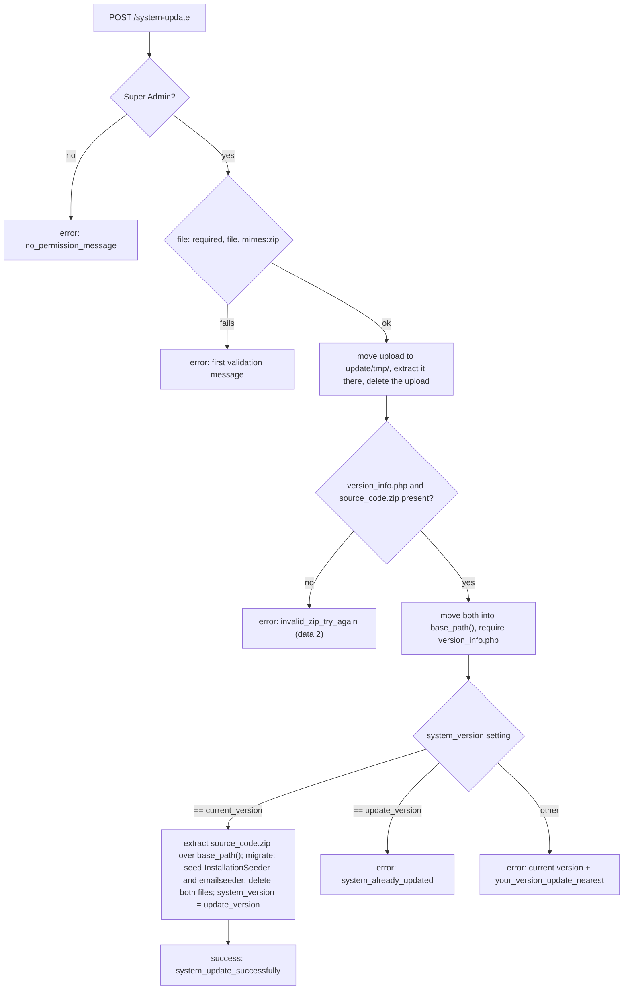

The System Update screen lets a Super Admin upgrade the admin panel by uploading a zip package in the browser. This page documents [SystemUpdateController](https://github.com/ShawnDaPrawn/Eschool/blob/main/admin-panel/app/Http/Controllers/SystemUpdateController.php), its view and routes, the package format, what is checked and what is not, and what `SystemUpdateTest` asserts. If you have SSH access, a git-based update is an alternative; see [Deployment](Deployment#deploying-an-update).

## Routes and access

| Method | URI | Name | Action |
|---|---|---|---|
| GET | `/system-update` | `system-update.index` | `SystemUpdateController@index` |
| POST | `/system-update` | `system-update.update` | `SystemUpdateController@update` |

Both routes are inside the admin group in `routes/web.php`, so they pass the `web` middleware group (including CSRF and `RejectDangerousUploads`) and `Role`, `auth` and `language`. The controller then requires the role itself with `Auth::user()->hasRole('Super Admin')`; there is no permission string for it.

- `index` without the role: redirect to `home` with `no_permission_message`.
- `update` without the role: JSON `{"error": true, "message": "<no_permission_message>"}` (HTTP 200).
- The sidebar entry (`layouts/sidebar.blade.php`) is shown only when the user has the `Super Admin` role.

## The page

[resources/views/system-update/index.blade.php](https://github.com/ShawnDaPrawn/Eschool/blob/main/admin-panel/resources/views/system-update/index.blade.php) extends `layouts.master` and shows:

- the current version (`system_version` setting) as a chip and in the hint "You're currently on version :version. Please install the next sequential update if one is available.";
- a "Backup Your Data" warning;
- the form `id="system-update"`, `POST` to `url('system-update')`, `multipart/form-data`, with only `_token` and a file input `name="file"` (`accept=".zip"`);
- guidelines: updates must be installed in order, and migrations run automatically.

`public/assets/js/custom/system-update.js` adds drag-and-drop and the selected-file display. The submit handler for `#system-update` in `public/assets/js/custom/custom.js` posts the form as `FormData` through `formAjaxRequest()`, shows the returned `message` as a toast, and reloads the page one second after a success. Styles are in `public/assets/css/system-update.css`.

## Package format

The uploaded file is an outer zip containing two entries at its root:

```text
update.zip
├── version_info.php
└── source_code.zip
```

`version_info.php` must return an array:

```php
<?php
return [
    'current_version' => '3.5.0', // the version this package upgrades from
    'update_version'  => '3.5.1', // the version it installs
];
```

`source_code.zip` holds files laid out relative to the `admin-panel/` directory (the application's `base_path()`); every entry is extracted over the running application, overwriting existing files. Files that the new version no longer has are not deleted. Other entries in the outer zip are extracted to `update/tmp/` and left there.

The file name of the outer zip does not matter. The current version is `3.5.0` (set by `InstallationSeeder`).

## What update() does



Step by step:

1. Role check (above).
2. `Validator::make($request->all(), ['file' => 'required|file|mimes:zip'])`. Laravel's `mimes` rule checks the type detected from the file's content.
3. Creates `base_path('update/tmp/')` (mode `0777`, recursive) if needed and moves the upload there under its client file name (Symfony keeps only the base name).
4. Opens it with `ZipArchive`, extracts everything into `update/tmp/`, closes it and deletes the uploaded zip.
5. If `update/tmp/version_info.php` or `update/tmp/source_code.zip` is missing: `invalid_zip_try_again` with `"data": 2`.
6. Renames both into `base_path()` (`version_info.php`, `source_code.zip`). If either rename fails: `invalid_zip_try_again` with `"data": 1`.
7. `require_once base_path('version_info.php')` and compares the `system_version` setting:
   - equal to `current_version`: opens `source_code.zip` (strict `=== true` check), `extractTo(base_path())`, then runs in-process `Artisan::call('migrate --force')`, `Artisan::call('db:seed --class=InstallationSeeder --force')` and `Artisan::call('db:seed --class=emailseeder --force')`, deletes `source_code.zip` and `version_info.php`, sets `system_version` to `update_version`, and returns `{"error": false, "message": "System Updated Successfully"}`. If `source_code.zip` cannot be opened, both files are deleted and the answer is `something_wrong_try_again`.
   - equal to `update_version`: deletes both files, returns `system_already_updated` ("System is already upto date").
   - anything else: deletes both files, returns `"<current version> Please update nearest version first"`.
8. Any `Throwable` is caught and answered with `error_occurred` and `"data"` set to the exception object, which JSON-encodes as `{}`, so no exception details reach the browser.

All answers are JSON with HTTP 200; failures carry `"error": true`.

Because the seeders run from the freshly extracted code, the new version's `InstallationSeeder` creates any new permissions and resets the role permission lists, and it also clears the view, route, config and application caches. The controller does not run `composer install`, so a release that changes PHP dependencies has to ship the updated `vendor/` inside `source_code.zip`.

## Safety checks, and their limits

What is checked:

- Only users with the `Super Admin` role can open the page or post to it.
- The upload must be a file whose detected type is zip. The `RejectDangerousUploads` middleware also inspects the uploaded file's name and detected type (not the zip's contents).
- The package must contain `version_info.php` and `source_code.zip`.
- `current_version` must equal the installed `system_version`, which enforces sequential updates and stops a package being applied twice.
- On PHP 8.3, `ZipArchive::extractTo()` keeps entries named with `../` or a leading `/` inside the target directory (checked against PHP 8.3.6), so neither zip can write outside `update/tmp/` or `base_path()`.
- Exceptions are not shown to the user.

What is not checked:

- There is no signature, checksum or origin check. `version_info.php` is executed with `require_once`, and `source_code.zip` can overwrite any file in the application, including `.env`, `public/index.php` or `vendor/`. Anyone who can sign in as Super Admin can therefore run arbitrary code on the server by design. Only install packages you trust, and protect Super Admin accounts accordingly (see [Security-Model](Security-Model)).
- There is no backup and no rollback. If extraction or a migration fails part-way, the code and database are left half-updated. The page asks the admin to take a backup first; see [Deployment](Deployment#backups).
- There is no maintenance mode while files are replaced; requests served during extraction may see a mix of old and new files.
- When the outer zip cannot be opened, `ZipArchive::open()` returns an error code, which the controller's `if ($zipStatus)` treats as success; `extractTo()` then throws, and the user sees `error_occurred` rather than `something_wrong_try_again`.
- If the outer zip lacks one of the two files, whatever it extracted stays in `update/tmp/`. The `update/` directory is not in `.gitignore`.
- The web server user must be able to write to the whole application directory. With OPcache `validate_timestamps=0`, PHP keeps running the old code until PHP-FPM is reloaded.
- After the update, run `php artisan optimize` again if you use the caches (the seeder cleared them).

## SystemUpdateTest

[tests/Feature/SystemUpdateTest.php](https://github.com/ShawnDaPrawn/Eschool/blob/main/admin-panel/tests/Feature/SystemUpdateTest.php) uses `RefreshDatabase` and seeds like the installer. `tearDown()` deletes the marker file, `base_path('update')` and its temporary work directory.

| Test | Asserts |
|---|---|
| `test_update_package_installs_with_only_the_zip` | Builds a package with `updatePackage('3.5.0', '3.5.1')`: a `source_code.zip` containing one file, `storage/app/system-update-test-marker.txt`, plus a `version_info.php` returning those two versions. Posting it as `file` to `/system-update` as the Super Admin returns 200 with `"error": false`; the `system_version` setting becomes `3.5.1`; the marker file now exists under `base_path()`, which proves `source_code.zip` was extracted over the app. |
| `test_system_update_form_only_asks_for_the_zip` | `GET /system-update` as the Super Admin returns 200, the page contains `<form ... id="system-update">`, and the only named inputs in that form are `_token` and `file` (no purchase code or other licence field). |

Not covered by tests: the version-mismatch and already-updated answers, a package missing one of its files, non-Super Admin access to these routes (although `AdminPagesTest` opens `GET /system-update` as the Super Admin and fails on 403 or 5xx), and migration failures.

## See also

- [Deployment](Deployment)
- [Installation-Wizard](Installation-Wizard)
- [Release-History](Release-History)
- [Security-Model](Security-Model)
- [Testing-and-CI](Testing-and-CI)
