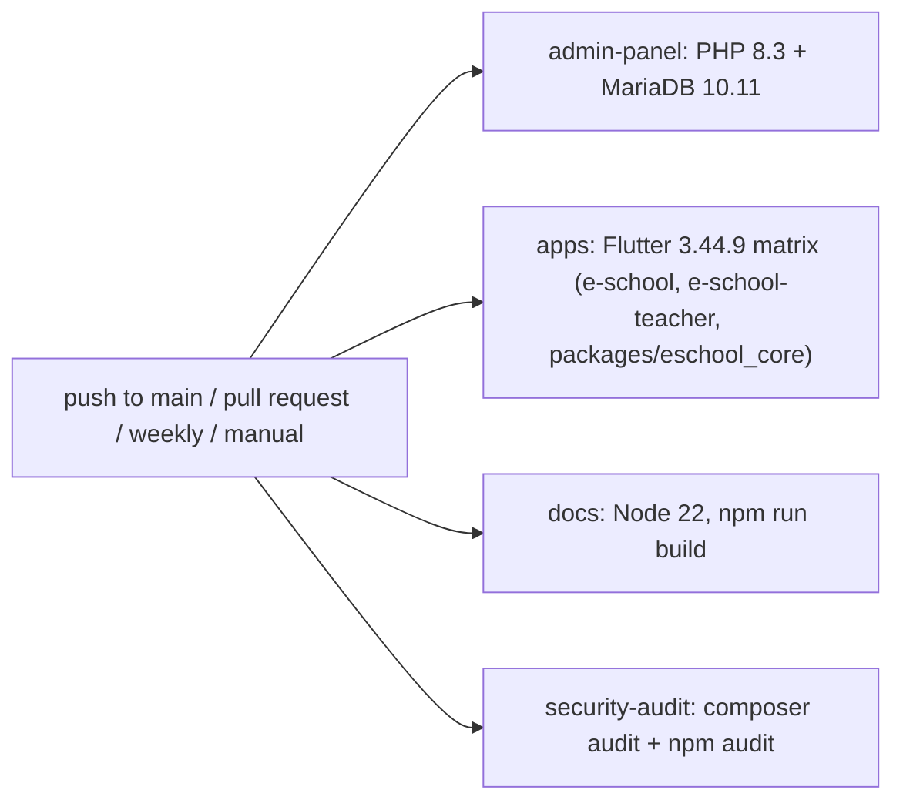

This page covers the automated checks in the repository: the GitHub Actions workflow, the admin panel's PHPUnit setup and feature tests, the Flutter tests in both apps, and how to run each of them on your own machine.

## GitHub Actions workflow

All checks live in one workflow, [.github/workflows/ci.yml](https://github.com/ShawnDaPrawn/Eschool/blob/main/.github/workflows/ci.yml) (name `CI`).

| Setting | Value |
|---|---|
| Triggers | `push` to `main`; every `pull_request`; `schedule` cron `17 5 * * 1` (Mondays 05:17 UTC, so new security advisories surface even without pushes); `workflow_dispatch` (manual run) |
| Permissions | `contents: read` |
| Concurrency | group `ci-${{ github.ref }}` with `cancel-in-progress: true` (a new push to the same branch cancels the running build) |



The four jobs run in parallel and do not depend on each other. A separate workflow, [wiki.yml](https://github.com/ShawnDaPrawn/Eschool/blob/main/.github/workflows/wiki.yml), publishes this wiki (see [Contributing](Contributing#editing-this-wiki)).

### `admin-panel`: Admin panel (PHP tests)

Runs in `admin-panel/` on `ubuntu-latest`.

| Part | Detail |
|---|---|
| Service container | `mariadb:10.11` with `MARIADB_ROOT_PASSWORD: root`, `MARIADB_DATABASE: eschool_test`, port `3306:3306`, health check `healthcheck.sh --connect --innodb_initialized` (5 s interval, 20 retries) |
| Job environment | `DB_CONNECTION=mysql`, `DB_HOST=127.0.0.1`, `DB_PORT=3306`, `DB_DATABASE=eschool_test`, `DB_USERNAME=root`, `DB_PASSWORD=root` |
| PHP | `shivammathur/setup-php@v2`, PHP `8.3`, extensions `mbstring, intl, gd, zip, pdo_mysql, bcmath, exif, fileinfo`, no coverage |

Steps, in order:

1. `composer validate --no-check-publish` – `composer.json` is valid and in step with `composer.lock`.
2. `composer install --no-interaction --prefer-dist --no-progress`
3. `cp .env.example .env && php artisan key:generate --force` – `.env.example` ships with an empty `APP_KEY`, so a key has to be generated before Laravel will boot.
4. **Routes load**: `php artisan route:list > /dev/null` – a smoke test that every route file parses and every controller class referenced by a route can be loaded. A typo in `routes/web.php` or `routes/api.php`, or a missing controller class, fails here before any test runs.
5. **Static analysis (Larastan)**: `vendor/bin/phpstan analyse --memory-limit=2G --no-progress` – [Larastan](https://github.com/larastan/larastan) at level 0, configured in [phpstan.neon](https://github.com/ShawnDaPrawn/Eschool/blob/main/admin-panel/phpstan.neon). [phpstan-baseline.neon](https://github.com/ShawnDaPrawn/Eschool/blob/main/admin-panel/phpstan-baseline.neon) lists the errors that predate it, so only new ones fail (an undefined variable, an unknown class, a call to a missing method). The relation-existence rule is ignored because relation methods have no return types.
6. **Config, routes and views cache**: `php artisan config:cache && php artisan route:cache && php artisan view:cache && php artisan optimize:clear` – production installs may run `php artisan optimize`, so every cache must build. This fails on, for example, two routes with the same name (which breaks `route:cache`) or a Blade view that does not compile. The caches are cleared again before the tests run.
7. `php artisan test` – the PHPUnit suites below.

### `apps`: Flutter app (matrix)

A matrix over `app: [e-school, e-school-teacher, packages/eschool_core]` with `fail-fast: false`, so a failure in one app does not cancel the others. The third leg is the shared package both apps depend on (see [Repository-Layout](Repository-Layout#packageseschool_core)). Each leg runs in its own folder:

1. `subosito/flutter-action@v2` with `flutter-version: '3.44.9'`, `channel: stable`, `cache: true`.
2. `flutter pub get --enforce-lockfile` – fails if `pubspec.lock` does not match `pubspec.yaml`. The apps and the shared package commit their `pubspec.lock` (commit [dd3df94](https://github.com/ShawnDaPrawn/Eschool/commit/dd3df94)), pinned to what was resolved and analysed with Flutter 3.44.9.
3. `flutter analyze --no-fatal-infos` – errors and warnings fail the job; style-only "info" lints are reported but do not.
4. `flutter test` – the tests in each app's `test/` folder.

### `docs`: Documentation build

Runs in `documentation/` with `actions/setup-node@v4`, Node 22, npm cache keyed on `documentation/package-lock.json`:

1. `npm ci`
2. `npm run build` – `docusaurus.config.js` sets `onBrokenLinks: 'throw'`, so any broken internal link fails the job. See [Documentation-Site](Documentation-Site).

### `security-audit`: Dependency security audit

Runs from the repository root.

| Step | Command | Fails on |
|---|---|---|
| PHP packages | `composer audit --locked` in `admin-panel/` (PHP 8.3) | any advisory for a locked package |
| Documentation build tools | `npm audit --audit-level=critical` in `documentation/` (Node 22) | critical advisories only |

`composer audit --locked` reads `composer.lock` without installing anything. The npm audit is limited to critical findings because the remaining advisories are in build tooling; the published site is static HTML (commit [03f9bbb](https://github.com/ShawnDaPrawn/Eschool/commit/03f9bbb)). The Flutter apps have no audit step. The weekly schedule exists mainly for this job: an advisory published against an already-locked version fails the next Monday run even if nobody pushed.

## Admin panel test setup

### phpunit.xml

[admin-panel/phpunit.xml](https://github.com/ShawnDaPrawn/Eschool/blob/main/admin-panel/phpunit.xml) bootstraps `vendor/autoload.php`, defines two suites (`Unit` → `tests/Unit`, checks that read the source and need no database, and `Feature` → `tests/Feature`) and limits source to `app/`. It sets these environment variables:

| Variable | Value | Why |
|---|---|---|
| `APP_ENV` | `testing` | |
| `APP_MAINTENANCE_DRIVER` | `file` | |
| `BCRYPT_ROUNDS` | `4` | Fast password hashing in tests |
| `CACHE_STORE` | `array` | Laravel 12 default name |
| `CACHE_DRIVER` | `array` | `config/cache.php` reads `CACHE_DRIVER`, not `CACHE_STORE`; without this, tests wrote to the real file cache |
| `DB_CONNECTION` | `mysql` | The migrations use MySQL-specific SQL, so tests need MySQL or MariaDB (no SQLite) |
| `DB_DATABASE` | `eschool_test` | `DB_HOST`, `DB_USERNAME` and `DB_PASSWORD` come from `.env` or the environment |
| `DB_PERSISTENT` | `false` | See below |
| `MAIL_MAILER` | `array` | No mail is sent |
| `QUEUE_CONNECTION` | `sync` | |
| `SESSION_DRIVER` | `array` | |
| `PULSE_ENABLED`, `TELESCOPE_ENABLED`, `NIGHTWATCH_ENABLED` | `false` | |

PHPUnit's `<env>` entries do not overwrite a variable that is already set in the process environment, so you can point a local run at another database (for example `DB_DATABASE=mytest_test php artisan test`).

`config/database.php` sets `PDO::ATTR_PERSISTENT => env('DB_PERSISTENT', true)` on the `mysql` connection. Production keeps persistent connections; tests turn them off because every PDO object in one PHP process would share a single MySQL session. When an earlier test's connection object is garbage-collected, PHP rolls back whatever transaction is open on that session, which can be the `RefreshDatabase` transaction of the test currently running. The failures depended on garbage-collection timing, which is why they appeared after unrelated changes (commits [a47f048](https://github.com/ShawnDaPrawn/Eschool/commit/a47f048) and [bfb73dd](https://github.com/ShawnDaPrawn/Eschool/commit/bfb73dd)).

### tests/TestCase.php

[tests/TestCase.php](https://github.com/ShawnDaPrawn/Eschool/blob/main/admin-panel/tests/TestCase.php) is the base class for every test:

| Member | What it does |
|---|---|
| `setUp()` | Disables `dacoto\LaravelWizardInstaller\Middleware\ToInstallMiddleware`. Without `storage/installed` the installer redirects every page to `/install`; tests run against an already-installed app. |
| `createApplication()` | Refuses to run (throws `RuntimeException`) unless the configured database name ends in `_test`. Tests drop every table, so this protects a real database. It runs before any trait connects. |
| `seedLikeInstaller()` | Seeds `InstallationSeeder`, `AddSuperAdminSeeder` and `EmailSeeder`, the same seeders the web installer runs (`config/installer.php`). |
| `superAdmin()` | Returns the seeded user `superadmin@gmail.com`. |

### tests/Concerns/RunsAppServer.php

Many endpoints end the PHP process instead of returning a response: every API controller answers through `App\Services\ResponseService::successResponse()` / `errorResponse()`, which call `->send()` and then `exit()`. Called through Laravel's in-process test client (`$this->get()`, `$this->postJson()`), that `exit()` would end the whole PHPUnit run. The [RunsAppServer](https://github.com/ShawnDaPrawn/Eschool/blob/main/admin-panel/tests/Concerns/RunsAppServer.php) trait therefore serves the app from a separate `php -S` process and talks to it over real HTTP.

| Method | Purpose |
|---|---|
| `freshInstall()` | `migrate:fresh --force`, then `seedLikeInstaller()`. The server process cannot see rows inside a test transaction, so tests using the server commit their data for real (allowed because the database must end in `_test`). |
| `startAppServer(array $env = [])` | Picks a free port on 127.0.0.1, creates a throwaway storage directory under the system temp dir (with `app/public`, `framework/*`, `logs` and an `installed` marker file), and starts `php -d variables_order=EGPCS -S 127.0.0.1:<port> vendor/laravel/framework/src/Illuminate/Foundation/resources/server.php` from `public/`. It passes `APP_ENV=production`, `APP_DEBUG=false`, the test's `APP_KEY`, `APP_URL`, `LARAVEL_STORAGE_PATH`, the test database settings, `SESSION_DRIVER=file`, `CACHE_STORE=array`, `CACHE_DRIVER=array`, `MAIL_MAILER=array`, `QUEUE_CONNECTION=sync`, `LOG_CHANNEL=single`, plus any `$env` overrides. It waits up to 10 seconds for the port to open. |
| `appServerRunning()` | Whether the server is up. Guard `freshInstall()` and `startAppServer()` with it in `setUp()` to start the server once per test class instead of once per test. |
| `stopAppServer()` | Stops the server, deletes its storage directory and resets `RefreshDatabaseState::$migrated` so the next `RefreshDatabase` test starts from a clean migration. It also runs after each class (`tearDownAfterClass()`), so per-class servers need no tear-down. With `TEST_SERVER_LOG=/some/file` set, the server's `laravel.log` is copied there first. |
| `appClient()` | `Http::baseUrl(<server>)` with redirects off and a 60 s timeout |
| `apiClient(?string $token)` | `appClient()->acceptJson()`, optionally with a Sanctum bearer token |
| `adminPanelClient(string $email, string $password)` | Signs in through the admin login form (CSRF token and cookies) and returns a client that sends the CSRF token in a header, like the panel's AJAX calls |
| `appServerStoragePath(string $path)` | A path in the server's storage directory, e.g. to check an uploaded file in `app/public` |
| `serverLog()` | The server's `laravel.log`, for explaining an unexpected response in an assertion message |

Because the server runs with `APP_ENV=production` and `APP_DEBUG=false`, these tests also check what a real visitor would see (no stack traces, production error handling).

Every test that needs the server uses this trait: `AdminPagesTest`, `PermissionsTest`, the three `*ApiSecurityTest` classes, `ApiContractTest` and `ApiRegressionTest`.

### tests/Support

| Class | Purpose |
|---|---|
| [DemoSchool](https://github.com/ShawnDaPrawn/Eschool/blob/main/admin-panel/tests/Support/DemoSchool.php) | `DemoSchool::build()` creates a small but complete school on an installer-seeded database and returns its ids and Sanctum tokens: Grade 5 section A (teacher Tara, students Asha and Ben, parents Farid, Mona and Gina) and Grade 6 (teacher Theo, student Cara), with a timetable, a lesson with topic and files, an assignment and submission, announcements, attendance, a published and an unpublished exam with marks and results, online exams with questions and answers, a holiday, an event, leaves, fees with a payment, the gallery and a notification. Dates are relative to the school's "today" (in the school's timezone, which the app server runs in), so states such as upcoming or ongoing are the same on every run. |
| [ApiShape](https://github.com/ShawnDaPrawn/Eschool/blob/main/admin-panel/tests/Support/ApiShape.php) | `ApiShape::of($json)` reduces a decoded response to its shape: every object's keys and every value's type (`string`, `number`, `bool`, `null`, unions such as `null|string`), with the items of a list merged into one shape and objects that are sometimes `null` marked `(or null)`. |

See also [tests/README.md](https://github.com/ShawnDaPrawn/Eschool/blob/main/admin-panel/tests/README.md).

## Admin panel unit tests

In [admin-panel/tests/Unit](https://github.com/ShawnDaPrawn/Eschool/tree/main/admin-panel/tests/Unit). They read files and need no database.

| Class | What it covers |
|---|---|
| `ControllerMethodCallsTest` | Every `$this->`, `self::` or `static::` call in a controller names a method the class has (Illuminate's base controller accepts any name through `__call`, so Larastan can't see these). |
| `DesignTokensTest` | No stylesheet in `public/assets/css` writes a colour (hex, `rgb()`, `hsl()` or a named colour) outside the generated `m3-tokens.css`, the legacy template bundles and third-party CSS, so the panel and website keep the apps' colours. Skips comments, `data:` URIs and blocks between `/* design-tokens: off */` and `/* design-tokens: on */`. See [UI-Standards](UI-Standards#admin-panel-and-website). |

## Admin panel feature tests

All classes are in [admin-panel/tests/Feature](https://github.com/ShawnDaPrawn/Eschool/tree/main/admin-panel/tests/Feature).

| Class | Database / server | What it covers |
|---|---|---|
| `AccountSecurityTest` | `RefreshDatabase`, installer seed | Signing in with `superadmin` or a teacher's date of birth leads only to the change-password page (AJAX calls get 403) until the password is changed, and it can't be changed back to a default; the session survives the change. A session remembering an old password is signed out, and a password change or reset deletes the app tokens. 10 wrong passwords lock an account (any capitalisation, from any login) and a right password before then resets the count; the panel shows a form error and the apps get `error: true`. The panel and app logins share one per-account limit, and `POST login` has `throttle:login`. `checkPassword` is POST-only with `throttle:password`; `GET /logout` is 405. Reset links use `APP_URL` whatever the request host; `X-Forwarded-Host` and `-Prefix` are ignored. Forgot-password answers the same for unknown addresses. The installer answers 404 once the database has users, except to a browser that started the installation on an empty database. |
| `AcademicAuthorizationTest` | `RefreshDatabase`, installer seed | A Teacher cannot permanently delete a student (Super Admin can), approve online registrations, or remove a class teacher; `/remove-image/{type}` needs the setting permission and only deletes ID-card images (not other `settings` rows); monthly attendance needs its permission; list search text is bound, not spliced into SQL (`"Sean O'Brien"` matches one row, `zz' OR 1=1 -- ` matches none); teachers can only submit marks for their own class sections; a live-class link can only be set by the period's teacher and must be an http(s) URL. |
| `AccessControlTest` | `RefreshDatabase`, installer seed | `CheckChild` only lets a parent reach their own children; Student/Teacher tokens are refused (403) on other roles' API groups; `throttle:login` is on every app login and password-reset route and the `login` limiter allows 5 per account; a user with no staff role is signed out of `/home`; `/register` is gone (404); only `email-setting-create` holders can save email templates; subject deletion needs subject permissions; `EmailTemplateService::render()` escapes values and never runs Blade/PHP; responses carry `X-Frame-Options`, `X-Content-Type-Options` and `Referrer-Policy`. |
| `AdminAuthorizationTest` | `RefreshDatabase`, installer seed | Teachers cannot edit roles; built-in roles cannot be edited or deleted; custom roles only receive assignable permissions; staff cannot be given the Super Admin role; a staff manager cannot edit or delete the Super Admin; Teachers cannot use staff attendance; a language code cannot escape `resources/lang`; changing a password requires the current one; Teachers cannot manage sliders or search parents; settings logo and Firebase service-account uploads are validated. |
| `ApiRequestLimitsTest` | `RunsAppServer` once per class (file cache, so counts last between requests), `DemoSchool` | An online exam that isn't open says so before the key is checked; 5 wrong keys stop that student for that exam (another student isn't affected) and the right key resets the count; events still say which have a day schedule (now one query); parent and teacher chat messages come 100 at a time without a `limit`, and an explicit `limit` is honoured. |
| `ApiContractTest` | `RunsAppServer` once, `DemoSchool` | Calls every endpoint the apps use (about 165 calls: shared, student, parent and teacher; reads first, then changes, then sign-in and sign-out) and compares each response's status, `error`, `message`, `code` and `ApiShape` with `tests/snapshots/api/<app>/<call>.json`. Fails if a response changes shape or a snapshot has no matching call. `UPDATE_API_SNAPSHOTS=1` rewrites the snapshots (review the diff); changed ones are also written to `storage/framework/testing/api-snapshots/`. `API_RESPONSES_DIR=<dir>` saves every full response, to diff the data before and after a refactor. |
| `ApiRegressionTest` | `RunsAppServer` once per class, `DemoSchool` | Bugs found while building the snapshots: profiles and parent sign-in work for people whose `dynamic_fields` is null; the student profile reports whether fees are due; submitting marks saves every student's marks when some already had marks; a lesson can be saved under its own name. Mismatches between what the apps read and what the API sends: event schedules can be fetched with GET; parent and teacher exam timetables carry `starting_time`/`ending_time`; teacher topics include their files; the parent "Assigned" tab (`is_submitted=0`) lists only work the child has not handed in; class announcements reach the notice board of that class only (student and parent), and a parent's request without `type` is limited to what the child may see.; classes carry `include_semesters` as `1`/`0`, as the teacher app reads it. |
| `AdminPagesTest` | `RunsAppServer` (fresh install, real server) | Gives `superadmin@gmail.com` a non-default password (a default one sends every page to the change-password form), logs in through the real login form (CSRF token and cookies) and opens every GET route without parameters. Skips routes with side effects (`storage-link`, `migrate`, `seeder_install`, `delete-chat-message/cron-job`) and the prefixes `api/`, `install`, `_debugbar`, `sanctum/`, `storage/`. Fails on any 403 or any 5xx. |
| `DailyWorkflowsTest` | `RunsAppServer`'s `freshInstall()` once per class (no server), `DemoSchool` | Day-to-day admin work, requested in-process: a new attendance day lists every student as present (a saved day shows what was saved); the Fees Paid list includes students whose class has only optional fees. |
| `ImportRowLimitTest` | `RefreshDatabase` | `RowLimit` counts data rows across sheets (each sheet's heading row excluded); the student, attendance and question imports refuse a file over 5000 rows before saving anything; the attendance upload shows why. |
| `InstallationTest` | `RefreshDatabase` | The installer seeders create the Super Admin and set `system_version` to `3.5.0`; every `db:seed` command in `config('installer.commands')` uses `--force` and `key:generate --force` is present; the installer has exactly the routes `install`, `install/database`, `install/finish`, `install/folders`, `install/keys`, `install/migrations`, `install/server` and the old licence classes and `service_health_logs` table are gone; `.env.example` has `APP_ENV=production`, `APP_DEBUG=false`, an empty `APP_KEY`, and `sanctum.expiration` is set. |
| `LogRedactionTest` | none | A failed welcome email is logged without its body or password fields; a large request makes a log entry of at most about 10 KB. |
| `ParentApiSecurityTest` | `RunsAppServer` per test, `migrate:fresh` | Two families in different class sections. Fee receipts and payment endpoints refuse another family's records; teacher payloads have no date of birth (the default teacher password); child endpoints refuse another family's child and another section's lesson topics; chat only reaches the child's teachers; only the parent's own pending leaves can be deleted. The fixture parents accept the current terms first, so `parent.policy` does not answer 403. |
| `ParentPolicyTest` | `RefreshDatabase`, installer seed | A parent accepts NavigateEd before the school on the first sign-in, a stale version is refused, editing the school terms does not ask again, a teacher accepts once through `teacher/policy-acceptance`, the policy middleware returns HTTP 403 `policy_acceptance_required` until then, and a blank privacy page can be saved and does not block anyone. |
| `PaystackApiUrlTest` | `RefreshDatabase`, installer seed | The fees settings form can't change the Paystack API address, and a stored `paystack_payment_url` or config override is ignored: calls always go to `https://api.paystack.co`. |
| `PaymentWebhookTest` | `RefreshDatabase`, installer seed plus a school fixture | `FeesPaymentService` prices compulsory fees, due charges, installments and optional fees on the server; pending transactions and gateway metadata use server values; Flutterwave cannot be enabled without its webhook secret hash; Razorpay, Stripe, Paystack and Flutterwave webhooks are refused without a valid signature/secret; a payment is recorded once, only from the stored transaction, and only when amount and currency match; a late failure event does not undo a payment; failure then success on the same order is recorded; compulsory payments with due charges record them from the stored total. |
| `PermissionsTest` | `RunsAppServer` per test, with `APP_ENV=webhook-test` (loads `.env.webhook-test`) | A Teacher signed in to the admin panel is refused on 14 admin-only actions and redirects don't carry the protected page; `/api/settings` doesn't expose the Razorpay webhook secret; a Flutterwave webhook without the secret hash changes nothing, with the secret loaded from an env file like a real install. |
| `RoutesTest` | none | Every route whose action is `Controller@method` points to a method that exists (such routes return 500). |
| `SchoolSetupTest` | `RefreshDatabase`, installer seed | Setting up a school from a fresh install: a session year created with installments is flagged as having them, and the repair migration flags existing years; session year names are unique; a new year can be made current when it is created (the panel's year picker follows) or later with make-current, which refuses an ended year; the running year can be edited after its free-app date, while a changed free-app date must still be in the future; class names with spaces and punctuation are accepted and markup is refused; shift names can have spaces and an edit cannot end before it starts; every custom role is offered on the staff page; the class-subject edit link keeps the listed session year; the subject, class and staff forms say what to create first. |
| `RateLimitTest` | none (test routes on the `web` and `api` groups) | A visitor's `X-Forwarded-For` is ignored unless the connection is from a configured proxy; on Cloud Run (`K_SERVICE`) proxies are trusted and rate limit counters use the database. The `web` limiter allows 300 a minute per visitor and doesn't limit webhooks, and a client over its limit gets 429 (checked with a lowered limit). Page sizes and offsets are clamped (also in `$_GET`), array values dropped; JSON bodies over 1 MB get 413. The PDF and import routes have `throttle:heavy` (10 a minute from the apps, 30 in the panel). |
| `SecurityTest` | `RefreshDatabase`, installer seed | `/storage-link`, `/migrate`, `/seeder_install` and `POST /clear` redirect guests to login and are 403 for a Teacher; a Super Admin can clear the cache with a POST but not a GET; `POST /users` is gone (404); expired Sanctum tokens are rejected (checked at the `sanctum` guard because API controllers `exit()`); protected API routes need a token. |
| `SettingsConfigTest` | `RefreshDatabase`, installer seed | No PHP file in `app/`, `bootstrap/`, `database/`, `resources/views/` or `routes/` calls `env()` (comments and Blade comments are ignored), because `env()` returns `null` outside `config/` once config is cached; `SettingsConfigService::apply()` overrides `app.name`, `app.timezone` (and PHP's default timezone), the SMTP settings, `mail.from.address` and the Paystack keys from the `settings` table, and keeps `mail.from.name` following the school name only when it was following `APP_NAME`; empty or invalid settings (an unknown timezone, an empty mail host) keep the `.env` values; saving `/email-settings` leaves `.env` byte-for-byte unchanged and stores a password containing spaces and `#` intact. Needs a `.env` file in `admin-panel/` (it compares the file before and after). |
| `StudentApiSecurityTest` | `RunsAppServer` per test (started on first request), `migrate:fresh` | `/api/settings` contains none of the payment secrets; online-exam questions do not include answers and selecting every option scores nothing; another class's exam cannot be taken; `OnlineExamScoringService` needs exactly the correct options; the student API is only for active student accounts; forgot-password answers the same whether or not the account exists; a password change signs out other devices; chat only goes to the student's teachers and attachments get safe names; fee payments use server amounts and only the caller's transactions; elective subjects must come from the class's groups; other class sections' content is not served. |
| `SystemUpdateTest` | `RefreshDatabase` | `POST /system-update` with a zip built in the expected format (`version_info.php` plus `source_code.zip`) installs it and bumps `system_version` to `3.5.1`; the System Update form has only `_token` and `file` fields. Cleans up `update/` and its marker file afterwards. |
| `SystemUpdateSwitchTest` | `RefreshDatabase` | System updates are off by default when `K_SERVICE` is set (and `SYSTEM_UPDATE_ENABLED` overrides it); when off, the page redirects home and an upload installs nothing. |
| `TeacherApiSecurityTest` | `RunsAppServer` once per class | Two teachers, each class and subject teacher of one section. Only the owner can delete an assignment; student details only for the student's teachers; only the class teacher sees and decides student leaves; only the lesson's teacher can change its files; attendance only for the class teacher's own class; exam marks need the class or subject teacher and their students; only the teacher's own timetable link can be changed; chat is limited to own students and parents, and attachment files never collide; a Teacher-role user without a teacher record gets nothing. |
| `TranslationsTest` | none (session only) | Every `resources/lang/*.json` is a flat map of string labels and `en.json` exists; `GET /common/js/lang` (`common.language.read`) returns `window.languageLabels = <file>` as `text/javascript` for the session language, and falls back to English for a missing file, no session language, or a path such as `../../.env`. |
| `UploadSecurityTest` | none | Registers a test route `api/_upload-test` on the real `api` middleware group. `RejectDangerousUploads` refuses `shell.php`, `SHELL.PHTML`, `photo.php.jpg`, `.user.ini`, PHP content named `notes.txt` and `page.html` (HTTP 422, `error: true`), including files nested in arrays; strips `<script>`, `onload` and `javascript:` from an SVG while keeping its shapes; refuses a PNG whose header declares more than 30 megapixels and an SVG over 2 MB without decoding them; accepts ordinary text and JPEG files. |

The fork's history explains why these exist: see [Security-Model](Security-Model) for the controls they protect and [Release-History](Release-History) for the commits.

## Flutter tests

Each app has two test files. The first is `test/translations_test.dart` ([e-school](https://github.com/ShawnDaPrawn/Eschool/blob/main/e-school/test/translations_test.dart), [e-school-teacher](https://github.com/ShawnDaPrawn/Eschool/blob/main/e-school-teacher/test/translations_test.dart)). The two files differ only in the package import (`package:eschool/...` vs `package:eschool_teacher/...`). They read `assets/languages/*.json` relative to the app folder and the `appLanguages` list from `lib/utils/appLanguages.dart`:

| Test | Checks |
|---|---|
| every language the app offers has a translation file | each `appLanguages` code has `assets/languages/<code>.json` |
| there are no translation files for languages the app does not offer | no orphan JSON files |
| every translation file has exactly the English keys | each file has the same key set as `defaultLanguageCode`'s file (no missing, no extra keys) |

The second, `test/theme_colors_test.dart`, reads every `.dart` file under `lib/` and fails on any colour written out (`Color(0x...)`, `Color.fromARGB`, `Color.fromRGBO`, or `Colors.<name>` other than `Colors.transparent`), listing each offending line. Colours come from the shared theme instead; see [UI-Standards](UI-Standards). The shared package has the same test, which allows colours only in `lib/src/theme/`, and three more: `theme_test.dart` (Material 3 is on, the brand colours are exact, and text on the main colour pairs meets WCAG AA contrast), `goldens/components_test.dart` (a screenshot of the colour scheme and shared widgets compared with `goldens/components.png`) and `web_tokens_test.dart` (the admin panel's `public/assets/css/m3-tokens.css` matches the theme; `UPDATE_WEB_TOKENS=1` rewrites it).

Both apps list `flutter_test` (SDK) and `flutter_lints ^6.0.0` as dev dependencies. `analysis_options.yaml` in each app includes `package:flutter_lints/flutter.yaml` and ignores `file_names` and `use_build_context_synchronously`; no extra lint rules are enabled. See [Localization](Localization) for how translations are loaded.

## Running the checks locally

### Admin panel tests

You need PHP 8.3 with the extensions CI installs (`mbstring, intl, gd, zip, pdo_mysql, bcmath, exif, fileinfo`), Composer, and a MySQL or MariaDB server. SQLite does not work: the migrations use MySQL-specific SQL.

1. Start a database server. To match CI exactly, use the same image:

   ```bash
   docker run -d --name eschool-test-db \
     -e MARIADB_ROOT_PASSWORD=root -e MARIADB_DATABASE=eschool_test \
     -p 3306:3306 mariadb:10.11
   ```

   Or create a database and user on an existing server. The name must end in `_test`; `TestCase` refuses anything else, and the tests drop every table in it.

   ```bash
   sudo mysql <<'SQL'
   CREATE DATABASE eschool_test CHARACTER SET utf8mb4 COLLATE utf8mb4_unicode_ci;
   CREATE USER 'eschool'@'localhost' IDENTIFIED BY 'change-me';
   CREATE USER 'eschool'@'127.0.0.1' IDENTIFIED BY 'change-me';
   GRANT ALL PRIVILEGES ON eschool_test.* TO 'eschool'@'localhost';
   GRANT ALL PRIVILEGES ON eschool_test.* TO 'eschool'@'127.0.0.1';
   SQL
   ```

2. Install dependencies and create `.env` with an application key:

   ```bash
   cd admin-panel
   composer install
   cp .env.example .env
   php artisan key:generate
   ```

3. Put the database host and credentials in `.env` (`DB_HOST`, `DB_PORT`, `DB_USERNAME`, `DB_PASSWORD`), or export them in the shell. `DB_DATABASE` in `.env` is ignored by tests because `phpunit.xml` sets `eschool_test`; override it with an exported `DB_DATABASE` if you use another `_test` name.

   ```bash
   export DB_HOST=127.0.0.1 DB_PORT=3306 DB_USERNAME=root DB_PASSWORD=root   # the docker example
   ```

4. Run the same checks as CI:

   ```bash
   php artisan route:list > /dev/null     # routes load
   php artisan config:cache && php artisan route:cache && php artisan view:cache && php artisan optimize:clear   # every cache builds
   php artisan config:clear               # a cached config would ignore phpunit.xml's variables
   php artisan test                        # or: composer test (runs config:clear, then artisan test)
   ```

   Static analysis, and the API snapshots after an intended API change:

   ```bash
   vendor/bin/phpstan analyse --memory-limit=2G      # add --generate-baseline after fixing baselined errors
   UPDATE_API_SNAPSHOTS=1 php artisan test --filter=ApiContractTest
   ```

   Single class or method:

   ```bash
   php artisan test --filter=UploadSecurityTest
   php artisan test --filter=test_scripts_are_stripped_from_svg
   vendor/bin/phpunit tests/Feature/RoutesTest.php
   ```

The tests that use `RunsAppServer` start `php -S` on a random free port on 127.0.0.1 and write temporary storage under the system temp directory; they need nothing else, but they are the slowest tests because each run migrates the database from scratch.

### Flutter apps

With Flutter 3.44.9 (stable) installed:

```bash
cd e-school            # or e-school-teacher, or packages/eschool_core
flutter pub get --enforce-lockfile
flutter analyze --no-fatal-infos
flutter test
```

`flutter test` must run from the app folder, because the translation test reads `assets/languages/` by relative path. The shared package has its own tests in `packages/eschool_core/test/` (models, helpers, the theme and its screenshot; no assets needed). After an intended visual change to the theme, regenerate the screenshot with `flutter test --update-goldens test/goldens` in that folder and check the image before committing it.

### Documentation build and audits

```bash
cd documentation
npm ci
npm run build                          # fails on broken links

npm audit --audit-level=critical       # the CI audit for the docs
cd ../admin-panel && composer audit --locked   # the CI audit for PHP packages
```

## See also

- [Security-Model](Security-Model) – the controls these tests protect
- [Contributing](Contributing) – conventions and what a pull request should include
- [Documentation-Site](Documentation-Site)
- [Localization](Localization)
- [Getting-Started](Getting-Started)
- [Troubleshooting-and-FAQ](Troubleshooting-and-FAQ)
