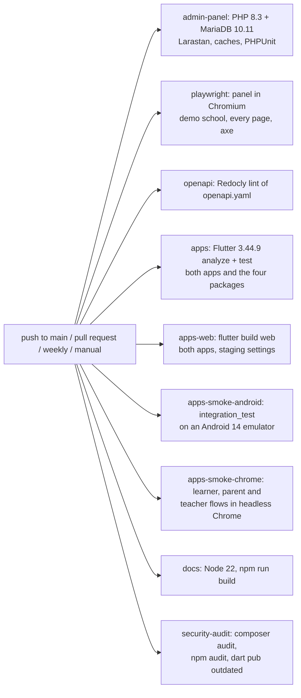

This page covers the automated checks in the repository: the GitHub Actions workflow, the admin panel's PHPUnit setup and feature tests, the Flutter tests in both apps, and how to run each of them on your own machine.

## GitHub Actions workflow

The checks every change must pass live in one workflow, [.github/workflows/ci.yml](https://github.com/ShawnDaPrawn/Eschool/blob/main/.github/workflows/ci.yml) (name `CI`). The secret scan, the wiki sync, the deploys and the k6 smoke test have workflows of their own ([Other workflows](#other-workflows)).

| Setting | Value |
|---|---|
| Triggers | `push` to `main`; every `pull_request`; `schedule` cron `17 5 * * 1` (Mondays 05:17 UTC, so new security advisories surface even without pushes); `workflow_dispatch` (manual run) |
| Permissions | `contents: read` |
| Concurrency | group `ci-${{ github.ref }}` with `cancel-in-progress: true` (a new push to the same branch cancels the running build) |



The nine jobs run in parallel and do not depend on each other; a red job blocks the merge. A separate workflow, [wiki.yml](https://github.com/ShawnDaPrawn/Eschool/blob/main/.github/workflows/wiki.yml), publishes this wiki (see [Contributing](Contributing#editing-this-wiki)).

### `admin-panel`: Admin panel (PHP tests)

Runs in `admin-panel/` on `ubuntu-latest`.

| Part | Detail |
|---|---|
| Service container | `mariadb:10.11` with `MARIADB_ROOT_PASSWORD: root`, `MARIADB_DATABASE: eschool_test`, port `3306:3306`, health check `healthcheck.sh --connect --innodb_initialized` (5 s interval, 20 retries) |
| Job environment | `DB_CONNECTION=mysql`, `DB_HOST=127.0.0.1`, `DB_PORT=3306`, `DB_DATABASE=eschool_test`, `DB_USERNAME=root`, `DB_PASSWORD=root` |
| PHP | `shivammathur/setup-php@v2`, PHP `8.3`, extensions `mbstring, intl, gd, zip, pdo_mysql, bcmath, exif, fileinfo`, no coverage |

Steps, in order:

1. `composer validate --no-check-publish` – `composer.json` is valid and in step with `composer.lock`.
2. `composer install --no-interaction --prefer-dist --no-progress`
3. `cp .env.example .env && php artisan key:generate --force` – `.env.example` ships with an empty `APP_KEY`, so a key has to be generated before Laravel will boot.
4. **Routes load**: `php artisan route:list > /dev/null` – a smoke test that every route file parses and every controller class referenced by a route can be loaded. A typo in `routes/web.php` or `routes/api.php`, or a missing controller class, fails here before any test runs.
5. **Static analysis (Larastan)**: `vendor/bin/phpstan analyse --memory-limit=2G --no-progress` – [Larastan](https://github.com/larastan/larastan) at level 0, configured in [phpstan.neon](https://github.com/ShawnDaPrawn/Eschool/blob/main/admin-panel/phpstan.neon). [phpstan-baseline.neon](https://github.com/ShawnDaPrawn/Eschool/blob/main/admin-panel/phpstan-baseline.neon) lists the errors that predate it, so only new ones fail (an undefined variable, an unknown class, a call to a missing method). The relation-existence rule is ignored because relation methods have no return types.
6. **Config, routes and views cache**: `php artisan config:cache && php artisan route:cache && php artisan view:cache && php artisan optimize:clear` – production installs may run `php artisan optimize`, so every cache must build. This fails on, for example, two routes with the same name (which breaks `route:cache`) or a Blade view that does not compile. The caches are cleared again before the tests run.
7. `php artisan test` – the PHPUnit suites below.
8. **Storage CORS in Apache**: `bash docker/tests/storage-cors.sh` – starts the runner's Apache with `docker/storage-cors.conf` and the origins production allows, and checks that only `GET` and `HEAD` from the panel and portal origins get `Access-Control-Allow-Origin` for files under `/storage`, with `Vary: Origin` always (skipped with a message on a machine without `apache2`, failed in CI).

### `openapi`: OpenAPI contract (lint)

Runs in `admin-panel/` with Node 22: `npx --yes @redocly/cli@2.57.0 lint openapi.yaml`. [redocly.yaml](https://github.com/ShawnDaPrawn/Eschool/blob/main/admin-panel/redocly.yaml) extends `recommended-strict`, so every warning fails, except `no-unused-components` (the shared list parameters and error responses are building blocks for the next endpoints) and `info-license`. The responses themselves are checked by the [Contracts suite](#contracts-suite) in the `admin-panel` job.

### `apps`: Flutter app (matrix)

A matrix over `app: [e-school, e-school-teacher, packages/eschool_core, packages/eschool_api, packages/eschool_session, packages/eschool_notifications, packages/eschool_people]` with `fail-fast: false`, so a failure in one leg does not cancel the others. `eschool_core` is the shared code both apps depend on (see [Repository-Layout](Repository-Layout#packageseschool_core)); `eschool_api` is the Dart client generated from `admin-panel/openapi.yaml`; `eschool_session` holds sign-in, `/me/context`, the child and school switchers, force update and deep links; `eschool_notifications` holds push and local notifications and the Notifications settings screen; `eschool_people` holds the Approvals, Invitation, My school and Profile picture screens. Each leg runs in its own folder:

1. `subosito/flutter-action@v2` with `flutter-version: '3.44.9'`, `channel: stable`, `cache: true`.
2. `flutter pub get --enforce-lockfile` – fails if `pubspec.lock` does not match `pubspec.yaml`. The apps and the shared package commit their `pubspec.lock` (commit [dd3df94](https://github.com/ShawnDaPrawn/Eschool/commit/dd3df94)), pinned to what was resolved and analysed with Flutter 3.44.9.
3. `packages/eschool_api` only: `actions/setup-java@v4` (Temurin 21), then **Generated client matches openapi.yaml**: `tool/generate.sh` regenerates the package and the step fails if `git status --porcelain` shows any change, so a spec change without the regenerated client (or a hand edit to `lib/`) fails.
4. `flutter analyze --no-fatal-infos` – errors and warnings fail the job; style-only "info" lints are reported but do not.
5. `flutter test` – the tests in each app's `test/` folder.

### `apps-web`: Flutter web build (matrix)

A matrix over `app: [e-school, e-school-teacher]`: `flutter pub get --enforce-lockfile`, then `flutter build web --release --dart-define-from-file=config/staging.json`, the same build the deploy workflow makes for the portals.

### `apps-smoke-android`: Flutter smoke flows on Android (matrix)

A matrix over `app: [e-school, e-school-teacher]`, 45-minute limit. With KVM switched on and Java 17, `reactivecircus/android-emulator-runner` starts an API 34 `google_apis` emulator (Pixel 6 profile, x86_64) and runs `flutter test integration_test`: each profile's smoke flow (sign in, reach Home, open a screen) against the fake API in `integration_test/support/` (no server).

### `apps-smoke-chrome`: Flutter smoke flow in Chrome (matrix)

One leg per flow: `learner_smoke_test.dart`, `parent_smoke_test.dart`, `child_switch_smoke_test.dart` (a parent of two switches child and the open screen follows) and `notification_settings_smoke_test.dart` (a parent finds Notifications settings in Settings and turns a channel off) in `e-school`, `teacher_smoke_test.dart` in `e-school-teacher`, 30-minute limit. It starts the runner's chromedriver on port 4444 and runs `flutter drive --driver=test_driver/integration_test.dart --target=integration_test/<flow> -d web-server --browser-name=chrome --headless --no-web-resources-cdn`.

### `docs`: Documentation build

Runs in `documentation/` with `actions/setup-node@v4`, Node 22, npm cache keyed on `documentation/package-lock.json`:

1. `npm ci`
2. `npm run build` – `docusaurus.config.js` sets `onBrokenLinks: 'throw'`, so any broken internal link fails the job. See [Documentation-Site](Documentation-Site).

### `security-audit`: Dependency security audit

Runs from the repository root.

| Step | Command | Fails on |
|---|---|---|
| PHP packages | `composer audit --locked` in `admin-panel/` (PHP 8.3) | any advisory for a locked package |
| Documentation build tools | `npm audit --audit-level=critical` in `documentation/` (Node 22) | critical advisories only |

`composer audit --locked` reads `composer.lock` without installing anything. The npm audit is limited to critical findings because the remaining advisories are in build tooling; the published site is static HTML (commit [03f9bbb](https://github.com/ShawnDaPrawn/Eschool/commit/03f9bbb)). The Flutter apps have no audit step. The weekly schedule exists mainly for this job: an advisory published against an already-locked version fails the next Monday run even if nobody pushed.

### `playwright`: Admin panel (Playwright)

Runs from `admin-panel/` with its own MariaDB 10.11 service (database `eschool_e2e`) and `APP_URL`/`E2E_BASE_URL` `http://127.0.0.1:8000`.

1. PHP 8.3 with the same extensions, `composer install`, `.env` from `.env.example` and `key:generate`.
2. `migrate`, `db:seed --class=InstallationSeeder`, `db:seed --class=DemoSchoolSeeder`, `storage:link`.
3. Starts the panel with `PHP_CLI_SERVER_WORKERS=4 CACHE_DRIVER=array php artisan serve` and waits for `/login`. The array cache keeps the per-account request limits from throttling the sweep; four workers serve the parallel browsers.
4. Node 22, `npm ci` and `npx playwright install --with-deps chromium` in `admin-panel/e2e`.
5. `npx playwright test`. On failure the HTML report, traces and `storage/logs` are uploaded as the `playwright-report` artifact (kept 14 days).

See [Playwright (admin panel)](#playwright-admin-panel) for what it checks.

### Other workflows

| Workflow | Triggers | What it does |
|---|---|---|
| [security.yml](https://github.com/ShawnDaPrawn/Eschool/blob/main/.github/workflows/security.yml) (`gitleaks`) | push to `main`, every pull request, Mondays 04:41 UTC, manual | Secret scan of the whole history with gitleaks and `.gitleaks.toml`; a finding fails the check (`engineering/security/phase-0.md`) |
| [wiki.yml](https://github.com/ShawnDaPrawn/Eschool/blob/main/.github/workflows/wiki.yml) (`publish`) | push to `main` that changes `wiki/`, manual | Copies `wiki/` to the repository's Wiki tab |
| [deploy-staging.yml](https://github.com/ShawnDaPrawn/Eschool/blob/main/.github/workflows/deploy-staging.yml) | push to `main` (when the repository variable `STAGING_DEPLOY_ENABLED` is `true`), manual | Calls `deploy-environment.yml` for `staging` |
| [deploy-production.yml](https://github.com/ShawnDaPrawn/Eschool/blob/main/.github/workflows/deploy-production.yml) (`check`, `deploy`) | a `v*` tag, manual | Checks the ref is a `v*` tag, then calls `deploy-environment.yml` for `production` with a backup first, after a reviewer approves the `production` environment |
| [deploy-environment.yml](https://github.com/ShawnDaPrawn/Eschool/blob/main/.github/workflows/deploy-environment.yml) (`deploy`, `smoke`) | called by the two above | Builds and pushes the image, deploys the panel, the worker and the scheduler job, builds the web portals, deploys Firebase Hosting (docs and portals), then smoke-tests the panel, API, worker and portals ([Deployment](Deployment)) |
| [k6-smoke.yml](https://github.com/ShawnDaPrawn/Eschool/blob/main/.github/workflows/k6-smoke.yml) (`k6`) | manual | Runs `engineering/perf/k6-smoke.js` against an environment and checks our p95 latency budgets |

## Admin panel test setup

### phpunit.xml

[admin-panel/phpunit.xml](https://github.com/ShawnDaPrawn/Eschool/blob/main/admin-panel/phpunit.xml) bootstraps `vendor/autoload.php`, defines two suites (`Unit` → `tests/Unit`, checks that read the source and need no database, and `Feature` → `tests/Feature`) and limits source to `app/`. It sets these environment variables:

| Variable | Value | Why |
|---|---|---|
| `APP_ENV` | `testing` | |
| `APP_MAINTENANCE_DRIVER` | `file` | |
| `BCRYPT_ROUNDS` | `4` | Fast password hashing in tests |
| `CACHE_STORE` | `array` | Laravel 12 default name |
| `CACHE_DRIVER` | `array` | `config/cache.php` reads `CACHE_DRIVER`, not `CACHE_STORE`; without this, tests wrote to the real file cache |
| `DB_CONNECTION` | `mysql` | The migrations use MySQL-specific SQL, so tests need MySQL or MariaDB (no SQLite) |
| `DB_DATABASE` | `eschool_test` | `DB_HOST`, `DB_USERNAME` and `DB_PASSWORD` come from `.env` or the environment |
| `DB_PERSISTENT` | `false` | See below |
| `MAIL_MAILER` | `array` | No mail is sent |
| `QUEUE_CONNECTION` | `sync` | |
| `SESSION_DRIVER` | `array` | |
| `PULSE_ENABLED`, `TELESCOPE_ENABLED`, `NIGHTWATCH_ENABLED` | `false` | |

PHPUnit's `<env>` entries do not overwrite a variable that is already set in the process environment, so you can point a local run at another database (for example `DB_DATABASE=mytest_test php artisan test`).

`config/database.php` sets `PDO::ATTR_PERSISTENT => env('DB_PERSISTENT', true)` on the `mysql` connection. Production keeps persistent connections; tests turn them off because every PDO object in one PHP process would share a single MySQL session. When an earlier test's connection object is garbage-collected, PHP rolls back whatever transaction is open on that session, which can be the `RefreshDatabase` transaction of the test currently running. The failures depended on garbage-collection timing, which is why they appeared after unrelated changes (commits [a47f048](https://github.com/ShawnDaPrawn/Eschool/commit/a47f048) and [bfb73dd](https://github.com/ShawnDaPrawn/Eschool/commit/bfb73dd)).

### tests/TestCase.php

[tests/TestCase.php](https://github.com/ShawnDaPrawn/Eschool/blob/main/admin-panel/tests/TestCase.php) is the base class for every test:

| Member | What it does |
|---|---|
| `setUp()` | Disables `dacoto\LaravelWizardInstaller\Middleware\ToInstallMiddleware`. Without `storage/installed` the installer redirects every page to `/install`; tests run against an already-installed app. |
| `createApplication()` | Refuses to run (throws `RuntimeException`) unless the configured database name ends in `_test`. Tests drop every table, so this protects a real database. It runs before any trait connects. |
| `seedLikeInstaller()` | Seeds `InstallationSeeder`, `AddSuperAdminSeeder` and `EmailSeeder`, the same seeders the web installer runs (`config/installer.php`). |
| `superAdmin()` | Returns the seeded user `superadmin@gmail.com`. |

### tests/Concerns/RunsAppServer.php

The [RunsAppServer](https://github.com/ShawnDaPrawn/Eschool/blob/main/admin-panel/tests/Concerns/RunsAppServer.php) trait serves the app from a separate `php -S` process and talks to it over real HTTP. It exists because `App\Services\ResponseService::successResponse()` / `errorResponse()` used to call `->send()` and then `exit()`, which would have ended the whole PHPUnit run under Laravel's in-process test client. Since Phase 0 they return the response (see [Contributing](Contributing#adding-an-api-endpoint-safely)), so **new API tests use the in-process client**: `RefreshDatabase`, a Sanctum token and `$this->withToken($token)->getJson(...)`, calling `$this->app['auth']->forgetGuards()` before a request made as a different user (the guard otherwise keeps the previous request's user), or `Sanctum::actingAs($user)` when the token itself is not under test. [TeacherApiSecurityTest](https://github.com/ShawnDaPrawn/Eschool/blob/main/admin-panel/tests/Feature/TeacherApiSecurityTest.php) is the worked example. The trait stays for the suites not moved yet, and for checks that need a real server (production error pages, `APP_ENV=production`, the panel's login form and cookies).

| Method | Purpose |
|---|---|
| `freshInstall()` | `migrate:fresh --force`, then `seedLikeInstaller()`. The server process cannot see rows inside a test transaction, so tests using the server commit their data for real (allowed because the database must end in `_test`). |
| `startAppServer(array $env = [])` | Picks a free port on 127.0.0.1, creates a throwaway storage directory under the system temp dir (with `app/public`, `framework/*`, `logs` and an `installed` marker file), and starts `php -d variables_order=EGPCS -S 127.0.0.1:<port> vendor/laravel/framework/src/Illuminate/Foundation/resources/server.php` from `public/`. It passes `APP_ENV=production`, `APP_DEBUG=false`, the test's `APP_KEY`, `APP_URL`, `LARAVEL_STORAGE_PATH`, the test database settings, `SESSION_DRIVER=file`, `CACHE_STORE=array`, `CACHE_DRIVER=array`, `MAIL_MAILER=array`, `QUEUE_CONNECTION=sync`, `LOG_CHANNEL=single`, plus any `$env` overrides. It waits up to 10 seconds for the port to open. |
| `appServerRunning()` | Whether the server is up. Guard `freshInstall()` and `startAppServer()` with it in `setUp()` to start the server once per test class instead of once per test. |
| `stopAppServer()` | Stops the server, deletes its storage directory and resets `RefreshDatabaseState::$migrated` so the next `RefreshDatabase` test starts from a clean migration. It also runs after each class (`tearDownAfterClass()`), so per-class servers need no tear-down. With `TEST_SERVER_LOG=/some/file` set, the server's `laravel.log` is copied there first. |
| `appClient()` | `Http::baseUrl(<server>)` with redirects off and a 60 s timeout |
| `apiClient(?string $token)` | `appClient()->acceptJson()`, optionally with a Sanctum bearer token |
| `adminPanelClient(string $email, string $password)` | Signs in through the admin login form (CSRF token and cookies) and returns a client that sends the CSRF token in a header, like the panel's AJAX calls |
| `appServerStoragePath(string $path)` | A path in the server's storage directory, e.g. to check an uploaded file in `app/public` |
| `serverLog()` | The server's `laravel.log`, for explaining an unexpected response in an assertion message |

Because the server runs with `APP_ENV=production` and `APP_DEBUG=false`, these tests also check what a real visitor would see (no stack traces, production error handling).

These classes still use the trait: `AdminPagesTest`, `PermissionsTest`, `StudentApiSecurityTest`, `ParentApiSecurityTest`, `ApiContractTest`, `ApiRegressionTest` and `ApiRequestLimitsTest` (and `DailyWorkflowsTest` for `freshInstall()` only). `TeacherApiSecurityTest` moved to the in-process client in Phase 0.

### tests/Support

| Class | Purpose |
|---|---|
| [DemoSchool](https://github.com/ShawnDaPrawn/Eschool/blob/main/admin-panel/tests/Support/DemoSchool.php) | `DemoSchool::build()` creates a small but complete school on an installer-seeded database and returns its ids and Sanctum tokens: Grade 5 section A (teacher Tara, students Asha and Ben, parents Farid, Mona and Gina) and Grade 6 (teacher Theo, student Cara), with a timetable, a lesson with topic and files, an assignment and submission, announcements, attendance, a published and an unpublished exam with marks and results, online exams with questions and answers, a holiday, an event, leaves, fees with a payment, the gallery and a notification. Dates are relative to the school's "today" (in the school's timezone, which the app server runs in), so states such as upcoming or ongoing are the same on every run. |
| [ApiShape](https://github.com/ShawnDaPrawn/Eschool/blob/main/admin-panel/tests/Support/ApiShape.php) | `ApiShape::of($json)` reduces a decoded response to its shape: every object's keys and every value's type (`string`, `number`, `bool`, `null`, unions such as `null|string`), with the items of a list merged into one shape and objects that are sometimes `null` marked `(or null)`. |
| [ApiRoute](https://github.com/ShawnDaPrawn/Eschool/blob/main/admin-panel/tests/Support/ApiRoute.php) | `ApiRoute::all($router)` lists every route under `/api` (v1 and v2), one entry per method, with its middleware; `fromFreshApplication()` does the same for a data provider. Each entry knows whether it needs a token, its role group (`role:<Role>`, `staff`, `role.any`) and whether a role gets through it. Used by the Tenancy, Authorization and Contracts suites. |
| [OpenApiSpec](https://github.com/ShawnDaPrawn/Eschool/blob/main/admin-panel/tests/Support/OpenApiSpec.php) | `admin-panel/openapi.yaml` for tests: its operations, the spec path for a request path, and `assertResponseMatches($method, $path, $response)`, which validates status, headers and body with `league/openapi-psr7-validator` and explains each mismatch with where in the body it is. |

Two traits in `tests/Concerns` go with them: [UsesDemoSchool](https://github.com/ShawnDaPrawn/Eschool/blob/main/admin-panel/tests/Concerns/UsesDemoSchool.php) builds one `DemoSchool` per test class on a freshly migrated database (its ids assume one, so it can't be built inside `RefreshDatabase`'s transaction) and runs each test in a transaction that is rolled back; [ValidatesOpenApiResponses](https://github.com/ShawnDaPrawn/Eschool/blob/main/admin-panel/tests/Concerns/ValidatesOpenApiResponses.php) checks every `/api/v2` response the test receives against `openapi.yaml`.

See also [tests/README.md](https://github.com/ShawnDaPrawn/Eschool/blob/main/admin-panel/tests/README.md).

## Admin panel unit tests

In [admin-panel/tests/Unit](https://github.com/ShawnDaPrawn/Eschool/tree/main/admin-panel/tests/Unit). They read files and need no database.

| Class | What it covers |
|---|---|
| `BootstrapFreeTest` | The move off Bootstrap only goes forward: files using Bootstrap classes, `data-toggle` / `data-bs-*` attributes, Bootstrap's jQuery plugins or its CSS and JS must be listed in `tests/bootstrap-baseline.txt`, and a listed file that no longer uses Bootstrap must be removed from it. `UPDATE_BOOTSTRAP_BASELINE=1` removes finished files. See [UI-Standards](UI-Standards#the-material-3-web-library-replacing-bootstrap). |
| `ControllerMethodCallsTest` | Every `$this->`, `self::` or `static::` call in a controller names a method the class has (Illuminate's base controller accepts any name through `__call`, so Larastan can't see these). Every call to a response-building `ResponseService` method in `app/` is returned or thrown (parsed with `nikic/php-parser`, not grepped): a dropped response would answer nothing and let the code after it run. |
| `DeploySeedersTest` | Every seeder `docker/provision-admin.php` and `docker/entrypoint.sh` run exists under exactly that name in `database/seeders` (autoloading is case-sensitive on Linux; `emailseeder` once broke every fresh container install). |
| `DesignTokensTest` | No stylesheet in `public/assets/css` or the Material 3 library in `public/assets/m3` writes a colour (hex, `rgb()`, `hsl()` or a named colour) outside the generated `m3-tokens.css`, the legacy template bundles and third-party CSS, so the panel and website keep the apps' colours. Skips comments, `data:` URIs and blocks between `/* design-tokens: off */` and `/* design-tokens: on */`. See [UI-Standards](UI-Standards#admin-panel-and-website). |

## Admin panel feature tests

All classes are in [admin-panel/tests/Feature](https://github.com/ShawnDaPrawn/Eschool/tree/main/admin-panel/tests/Feature).

| Class | Database / server | What it covers |
|---|---|---|
| `AccountSecurityTest` | `RefreshDatabase`, installer seed | Signing in with `superadmin` or a teacher's date of birth leads only to the change-password page (AJAX calls get 403) until the password is changed, and it can't be changed back to a default; the session survives the change. A session remembering an old password is signed out, and a password change or reset deletes the app tokens. 10 wrong passwords lock an account (any capitalisation, from any login) and a right password before then resets the count; the panel shows a form error and the apps get `error: true`. The panel and app logins share one per-account limit, and `POST login` has `throttle:login`. `checkPassword` is POST-only with `throttle:password`; `GET /logout` is 405. Reset links use `APP_URL` whatever the request host; `X-Forwarded-Host` and `-Prefix` are ignored. Forgot-password answers the same for unknown addresses. The installer answers 404 once the database has users, except to a browser that started the installation on an empty database. |
| `AcademicAuthorizationTest` | `RefreshDatabase`, installer seed | A Teacher cannot permanently delete a student (Super Admin can), approve online registrations, or remove a class teacher; `/remove-image/{type}` needs the setting permission and only deletes ID-card images (not other `settings` rows); monthly attendance needs its permission; list search text is bound, not spliced into SQL (`"Sean O'Brien"` matches one row, `zz' OR 1=1 -- ` matches none); teachers can only submit marks for their own class sections; a live-class link can only be set by the period's teacher and must be an http(s) URL. |
| `AccessControlTest` | `RefreshDatabase`, installer seed | `CheckChild` only lets a parent reach their own children; Student/Teacher tokens are refused (403) on other roles' API groups; `throttle:login` is on every app login and password-reset route and the `login` limiter allows 5 per account; a user with no staff role is signed out of `/home`; `/register` is gone (404); only `email-setting-create` holders can save email templates; subject deletion needs subject permissions; `EmailTemplateService::render()` escapes values and never runs Blade/PHP; responses carry `X-Frame-Options`, `X-Content-Type-Options` and `Referrer-Policy`. |
| `AdminAuthorizationTest` | `RefreshDatabase`, installer seed | Teachers cannot edit roles; built-in roles cannot be edited or deleted; custom roles only receive assignable permissions; staff cannot be given the Super Admin role; a staff manager cannot edit or delete the Super Admin; Teachers cannot use staff attendance; a language code cannot escape `resources/lang`; changing a password requires the current one; Teachers cannot manage sliders or search parents; settings logo and Firebase service-account uploads are validated. |
| `ApiRequestLimitsTest` | `RunsAppServer` once per class (file cache, so counts last between requests), `DemoSchool` | An online exam that isn't open says so before the key is checked; 5 wrong keys stop that student for that exam (another student isn't affected) and the right key resets the count; events still say which have a day schedule (now one query); parent and teacher chat messages come 100 at a time without a `limit`, and an explicit `limit` is honoured. |
| `ApiContractTest` | `RunsAppServer` once, `DemoSchool` | Calls every endpoint the apps use (about 165 calls: shared, student, parent and teacher; reads first, then changes, then sign-in and sign-out) and compares each response's status, `error`, `message`, `code` and `ApiShape` with `tests/snapshots/api/<app>/<call>.json`. Fails if a response changes shape or a snapshot has no matching call. `UPDATE_API_SNAPSHOTS=1` rewrites the snapshots (review the diff); changed ones are also written to `storage/framework/testing/api-snapshots/`. `API_RESPONSES_DIR=<dir>` saves every full response, to diff the data before and after a refactor. The v2 calls (`GET /api/v2/me/context` for each app and without a token) are snapshotted the same way and also validated against `openapi.yaml`. |
| `ApiRegressionTest` | `RunsAppServer` once per class, `DemoSchool` | Bugs found while building the snapshots: profiles and parent sign-in work for people whose `dynamic_fields` is null; the student profile reports whether fees are due; submitting marks saves every student's marks when some already had marks; a lesson can be saved under its own name. Mismatches between what the apps read and what the API sends: event schedules can be fetched with GET; parent and teacher exam timetables carry `starting_time`/`ending_time`; teacher topics include their files; the parent "Assigned" tab (`is_submitted=0`) lists only work the child has not handed in; class announcements reach the notice board of that class only (student and parent), and a parent's request without `type` is limited to what the child may see.; classes carry `include_semesters` as `1`/`0`, as the teacher app reads it. |
| `AdminPagesTest` | `RunsAppServer` (fresh install, real server) | Gives `superadmin@gmail.com` a non-default password (a default one sends every page to the change-password form), logs in through the real login form (CSRF token and cookies) and opens every GET route without parameters. Skips routes with side effects (`delete-chat-message/cron-job`) and the prefixes `api/`, `install`, `_debugbar`, `sanctum/`, `storage/`. Fails on any 403 or any 5xx. |
| `AdminRoleTest` | `RefreshDatabase`, installer seed | No `Admin` role is seeded, and a custom role a school calls "Admin" gets no extra access: a teacher who also has it sees only their own sections in the attendance widget, and `Students::scopeOfTeacher()` gives it no students (Super Admin sees everything). |
| `DailyWorkflowsTest` | `RunsAppServer`'s `freshInstall()` once per class (no server), `DemoSchool` | Day-to-day admin work, requested in-process: a new attendance day lists every student as present (a saved day shows what was saved); the Fees Paid list includes students whose class has only optional fees. |
| `ImportRowLimitTest` | `RefreshDatabase` | `RowLimit` counts data rows across sheets (each sheet's heading row excluded); the student, attendance and question imports refuse a file over 5000 rows before saving anything; the attendance upload shows why. |
| `InstallationTest` | `RefreshDatabase` | The installer seeders create the Super Admin and set `system_version` to `3.5.0`; every `db:seed` command in `config('installer.commands')` uses `--force` and `key:generate --force` is present; the installer has exactly the routes `install`, `install/database`, `install/finish`, `install/folders`, `install/keys`, `install/migrations`, `install/server` and the old licence classes and `service_health_logs` table are gone; `.env.example` has `APP_ENV=production`, `APP_DEBUG=false`, an empty `APP_KEY`, and `sanctum.expiration` is set. |
| `LogRedactionTest` | none | A failed welcome email is logged without its body or password fields; a large request makes a log entry of at most about 10 KB. |
| `ParentApiSecurityTest` | `RunsAppServer` per test, `migrate:fresh` | Two families in different class sections. Fee receipts and payment endpoints refuse another family's records; teacher payloads have no date of birth (the default teacher password); child endpoints refuse another family's child and another section's lesson topics; chat only reaches the child's teachers; only the parent's own pending leaves can be deleted. The fixture parents accept the current terms first, so `parent.policy` does not answer 403. |
| `ParentPolicyTest` | `RefreshDatabase`, installer seed | A parent accepts NavigateEd before the school on the first sign-in, a stale version is refused, editing the school terms does not ask again, a teacher accepts once through `teacher/policy-acceptance`, the policy middleware returns HTTP 403 `policy_acceptance_required` until then, and a blank privacy page can be saved and does not block anyone. |
| `PaymentWebhookTest` | `RefreshDatabase`, installer seed plus a school fixture | `FeesPaymentService` prices compulsory fees, due charges, installments and optional fees on the server; pending transactions and gateway metadata use server values; Stripe webhooks are refused without a configured secret and a valid signature; a payment is recorded once, only from the stored transaction, and only when amount and currency match; a late failure event does not undo a payment; failure then success on the same order is recorded; compulsory payments with due charges record them from the stored total; the removed Razorpay, Paystack and Flutterwave webhook and landing URLs answer 404 while their old transactions still show their gateway in the transaction log. |
| `PermissionsTest` | `RunsAppServer` per test | A Teacher signed in to the admin panel is refused on 14 admin-only actions and redirects don't carry the protected page; `/api/settings` returns the Stripe publishable key but not its secret key or webhook secret. |
| `ResponseServiceTest` | `RefreshDatabase` | `successResponse`, `errorResponse`, `warningResponse` and `validationError` return the `{error, message, data, code}` envelope and the caller carries on; an error with an exception is logged but its text is not shown; a response thrown as `HttpResponseException` passes through `errorResponse()` unchanged and unlogged; the permission guards throw their JSON error. |
| `RemovedFeaturesTest` | `RefreshDatabase`, installer seed | What Phase 0 removed stays gone: `GET`/`POST /system-update` and `/storage-link`, `/migrate`, `/seeder_install` (and the old commented-out `/rollback`) answer 404 for guests, a Teacher and the Super Admin; routes are registered once, from `bootstrap/app.php` (`RouteServiceProvider` no longer loads them). |
| `RoutesTest` | none | Every route whose action is `Controller@method` points to a method that exists (such routes return 500). |
| `SchoolSetupTest` | `RefreshDatabase`, installer seed | Setting up a school from a fresh install: a session year created with installments is flagged as having them, and the repair migration flags existing years; session year names are unique; a new year can be made current when it is created (the panel's year picker follows) or later with make-current, which refuses an ended year; the running year can be edited after its free-app date, while a changed free-app date must still be in the future; class names with spaces and punctuation are accepted and markup is refused; shift names can have spaces and an edit cannot end before it starts; every custom role is offered on the staff page; the class-subject edit link keeps the listed session year; the subject, class and staff forms say what to create first. |
| `RateLimitTest` | none (test routes on the `web` and `api` groups) | A visitor's `X-Forwarded-For` is ignored unless the connection is from a configured proxy; on Cloud Run (`K_SERVICE`) proxies are trusted and rate limit counters use the database. The `web` limiter allows 300 a minute per visitor and doesn't limit webhooks, and a client over its limit gets 429 (checked with a lowered limit). Page sizes and offsets are clamped (also in `$_GET`), array values dropped; JSON bodies over 1 MB get 413. The PDF and import routes have `throttle:heavy` (10 a minute from the apps, 30 in the panel). |
| `SecurityTest` | `RefreshDatabase`, installer seed | `POST /clear` redirects guests to login and is 403 for a Teacher; a Super Admin can clear the cache with a POST but not a GET; `POST /users` is gone (404); expired Sanctum tokens are rejected (checked at the `sanctum` guard); protected API routes need a token. |
| `SettingsConfigTest` | `RefreshDatabase`, installer seed | No PHP file in `app/`, `bootstrap/`, `database/`, `resources/views/` or `routes/` calls `env()` (comments and Blade comments are ignored), because `env()` returns `null` outside `config/` once config is cached; `SettingsConfigService::apply()` overrides `app.name`, `app.timezone` (and PHP's default timezone), the SMTP settings and `mail.from.address` from the `settings` table, and keeps `mail.from.name` following the school name only when it was following `APP_NAME`; empty or invalid settings (an unknown timezone, an empty mail host) keep the `.env` values; saving `/email-settings` leaves `.env` byte-for-byte unchanged and stores a password containing spaces and `#` intact. Needs a `.env` file in `admin-panel/` (it compares the file before and after). |
| `StudentApiSecurityTest` | `RunsAppServer` per test (started on first request), `migrate:fresh` | `/api/settings` contains none of the payment secrets; the removed Razorpay, Paystack and Flutterwave are neither offered in `payment_options` nor accepted as `payment_method` by the student or parent endpoint, even with their old settings rows switched on; online-exam questions do not include answers and selecting every option scores nothing; another class's exam cannot be taken; `OnlineExamScoringService` needs exactly the correct options; the student API is only for active student accounts; forgot-password answers the same whether or not the account exists; a password change signs out other devices; chat only goes to the student's teachers and attachments get safe names; fee payments use server amounts and only the caller's transactions; elective subjects must come from the class's groups; other class sections' content is not served. |
| `TeacherApiSecurityTest` | In-process, `RefreshDatabase`, installer seed, Sanctum tokens, `Storage::fake('public')` | Answers pass back through the response middleware (`X-Content-Type-Options`, `X-RateLimit-Limit`). Two teachers, each class and subject teacher of one section. Only the owner can delete an assignment; student details only for the student's teachers; only the class teacher sees and decides student leaves; only the lesson's teacher can change its files; attendance only for the class teacher's own class; exam marks need the class or subject teacher and their students; only the teacher's own timetable link can be changed; chat is limited to own students and parents, and attachment files never collide; a Teacher-role user without a teacher record gets nothing. |
| `Platform\ContextTest` | In-process, `UsesDemoSchool`, `ValidatesOpenApiResponses` | `GET /api/v2/me/context`: 401 without a token; a learner, parent, guardian, teacher, the Super Admin and a school-created role each get their own user, roles, school, year and terms; a parent gets only their own children, each with their school; an account with no role gets 403; branding is passed on as stored; no current year gives `session_year: null`; the query count stays fixed (7 for a teacher, 10 for a parent) whatever the number of children. |
| `Platform\ApiV2GroundRulesTest` | `RefreshDatabase`, installer seed, test-only routes on the `api` group | v2 routes load under `/api/v2` with the `api` group; the `staff` group admits every role except Parent and Student; `role.any` needs a role; errors come in the envelope with their real status (401, 404, 405, 422 with every message by field, 500 without exception text); a response thrown on purpose and v1 errors are left alone; the `auth` limiter allows 5 a minute per account and 20 per address; the `money` limiter allows 30 a minute per token. |
| `Platform\IdempotencyKeyTest` | `RefreshDatabase`, installer seed, test-only routes | The `Idempotency-Key` middleware: a retry gets the stored answer and the work runs once; the key, user, route, request hash and answer are stored for 24 hours; another payload with the same key gets 422; field order does not matter but the path and uploaded files do; keys are per user and expire; expired rows are pruned; a retry while the first runs gets 409; failures free the key and refusals are kept; reads and keyless writes pass through; `idempotent:required` refuses a write without a key; malformed keys get 400. |
| `Platform\IdempotencyKeysMigrationTest` | none (schema changes) | The `idempotency_keys` migration rolls back and runs again. |
| `TranslationsTest` | none (session only) | Every `resources/lang/*.json` is a flat map of string labels and `en.json` exists; `GET /common/js/lang` (`common.language.read`) returns `window.languageLabels = <file>` as `text/javascript` for the session language, and falls back to English for a missing file, no session language, or a path such as `../../.env`. |
| `UploadSecurityTest` | none | Registers a test route `api/_upload-test` on the real `api` middleware group. `RejectDangerousUploads` refuses `shell.php`, `SHELL.PHTML`, `photo.php.jpg`, `.user.ini`, PHP content named `notes.txt` and `page.html` (HTTP 422, `error: true`), including files nested in arrays; strips `<script>`, `onload` and `javascript:` from an SVG while keeping its shapes; refuses a PNG whose header declares more than 30 megapixels and an SVG over 2 MB without decoding them; accepts ordinary text and JPEG files. |

The fork's history explains why these exist: see [Security-Model](Security-Model) for the controls they protect and [Release-History](Release-History) for the commits. The three suites that walk every API route have their own sections below: [Tenancy](#tenancy-suite), [Authorization](#authorization-matrix) and [Contracts](#contracts-suite).

## Flutter tests

Each app has two test files. The first is `test/translations_test.dart` ([e-school](https://github.com/ShawnDaPrawn/Eschool/blob/main/e-school/test/translations_test.dart), [e-school-teacher](https://github.com/ShawnDaPrawn/Eschool/blob/main/e-school-teacher/test/translations_test.dart)). The two files differ only in the package import (`package:eschool/...` vs `package:eschool_teacher/...`). They read `assets/languages/*.json` relative to the app folder and the `appLanguages` list from `lib/utils/appLanguages.dart`:

| Test | Checks |
|---|---|
| every language the app offers has a translation file | each `appLanguages` code has `assets/languages/<code>.json` |
| there are no translation files for languages the app does not offer | no orphan JSON files |
| every translation file has exactly the English keys | each file has the same key set as `defaultLanguageCode`'s file (no missing, no extra keys) |

The second, `test/theme_colors_test.dart`, reads every `.dart` file under `lib/` and fails on any colour written out (`Color(0x...)`, `Color.fromARGB`, `Color.fromRGBO`, or `Colors.<name>` other than `Colors.transparent`), listing each offending line. Colours come from the shared theme instead; see [UI-Standards](UI-Standards). The shared package has the same test, which allows colours only in `lib/src/theme/`, and three more: `theme_test.dart` (Material 3 is on, the brand colours are exact, and text on the main colour pairs meets WCAG AA contrast), `goldens/components_test.dart` (a screenshot of the colour scheme and shared widgets compared with `goldens/components.png`) and `web_tokens_test.dart` (the admin panel's `public/assets/css/m3-tokens.css` matches the theme; `UPDATE_WEB_TOKENS=1` rewrites it).

Both apps list `flutter_test` (SDK) and `flutter_lints ^6.0.0` as dev dependencies. `analysis_options.yaml` in each app includes `package:flutter_lints/flutter.yaml` and ignores `file_names` and `use_build_context_synchronously`; no extra lint rules are enabled. See [Localization](Localization) for how translations are loaded.

## Playwright (admin panel)

Browser checks of the admin panel live in [admin-panel/e2e](https://github.com/ShawnDaPrawn/Eschool/tree/main/admin-panel/e2e): TypeScript, `@playwright/test` 1.56.1 with Chromium and `@axe-core/playwright` 4.14.0, with their own `package.json` and `package-lock.json` (nothing is added to the panel's own `package.json`). They drive a running panel seeded with the demo school.

### Demo school accounts

`database/seeders/DemoSchoolSeeder.php` creates them; every account's password is `NavigateDemo2026` (`DemoSchoolSeeder::PASSWORD`). They are public demo sign-ins: never seed a production database that people use. The seed also has the unpublished exam "Term 4 test" (a Mathematics paper for both grades dated the day before the seed ran, with `DEMO-A-0001`'s mark) and the assignment "Fractions worksheet" for 5 A, so marks capture and the assignments list work from the seed alone.

| Profile | Signs in with |
|---|---|
| Super Admin | `admin.a@demo.navigateed.test` |
| Teacher (homeroom 5 A, subject teacher) | `teacher.a@demo.navigateed.test` |
| Second teacher (homeroom 6 A) | `teacher2.a@demo.navigateed.test` |
| Staff with the custom Finance role (fees only) | `finance.a@demo.navigateed.test` |
| Parent of two learners (5 A and 6 A) | `parent.a@demo.navigateed.test` |
| Second parent | `parent2.a@demo.navigateed.test` |
| Learner (Grade 5 A), in the app | admission number `DEMO-A-0001` |

The seeder is idempotent (run it again and it updates the same rows), runs `InstallationSeeder` first when the roles are missing, and never replaces a running current year. It gives the school last year and this year with different learners in each homeroom, so the year switcher has something to show, and enough data for Home's setup checklist to be complete.

### What runs

`global-setup.ts` signs in the Super Admin (twice, for separate sessions) and the first teacher, and lists the panel's pages into `.cache/panel-pages.json`: every GET route from `php artisan route:list --json` without parameters (leaving out the API, the installer, sign-out, cron URLs and the health check) that opens with the panel layout for the Super Admin. A new page is checked without anyone adding it.

| Project | What it checks |
|---|---|
| `pages-1280`, `pages-1024` | Every panel page as the Super Admin at 1280 and 1024 px wide: no console errors and no failed requests to the panel, no horizontal scroll, and no serious or critical axe violation (WCAG 2.0/2.1 A and AA) |
| `flows` | Navigation finds "Add a learner", "Terms" and "Notices" (and works from the keyboard); search opens a learner; the year switcher shows the banner, the lists follow the year, write buttons are disabled and the server answers 423 (as the second teacher, in a session of its own) |
| `teacher` | A teacher sees no Money or Settings and no setup checklist, and is refused admin pages (`/settings`, `/roles`, `/staff`, `/fees-type`, `/session-years`, `/new-year`, `/students/create`, `/email-settings`, `/language`) |
| `removed` | `/system-update`, `/migrate`, `/seeder_install` and `/storage-link` answer 404 (they were removed by stream S1; on a branch without that removal these four fail) |
| `wizard` | Runs last: creates next year in the new-year wizard, makes it current in under five minutes, then makes this year current again so the suite can run again on the same database |

[allowlist.json](https://github.com/ShawnDaPrawn/Eschool/blob/main/admin-panel/e2e/allowlist.json) lists known problems on legacy pages that the page sweep tolerates, each with the pages it applies to and a reason (for example filter selects without labels, icon-only row buttons, page-specific contrast). It must only shrink: a page rebuilt on the page pattern loses its entries, and a new page never gets one. Console errors and horizontal scroll have no entries.

### Running it locally

```bash
cd admin-panel
php artisan migrate:fresh --seed --seeder=InstallationSeeder   # a database of its own, not the PHPUnit one
php artisan db:seed --class=DemoSchoolSeeder
php artisan storage:link
PHP_CLI_SERVER_WORKERS=4 CACHE_DRIVER=array php artisan serve --port=8000 &

cd e2e
npm ci
npx playwright install chromium        # once
E2E_BASE_URL=http://127.0.0.1:8000 npx playwright test
npm run test:flows                     # only the flows, teacher and wizard projects
npm run report                         # open the last HTML report
npm run typecheck
```

`E2E_BASE_URL` defaults to `http://127.0.0.1:8000` and `E2E_WORKERS` to 2. Point `PLAYWRIGHT_BROWSERS_PATH` at an existing browser download to skip `playwright install`. Stop the server afterwards. CI retries a failed test once; locally there are no retries.

### PHPUnit tests for the panel shell

The server side of the same features has its own feature tests, which run with the rest of `php artisan test`:

| Class | What it checks |
|---|---|
| `Panel\NavigationTest` | Every page of the old sidebar is in `config/navigation.php` and still opens; a teacher and a custom staff role see only what their permissions open; every label is in every language file; the current section is open and marked |
| `Panel\PageComponentsTest` | The page components render with their escaping, labels, CSRF token, draft key and confirm dialog |
| `Panel\HomeTest` | The setup checklist follows the school's data and is hidden from people who cannot act on it; today's numbers follow the selected year |
| `Panel\SearchTest` | Happy path, a teacher finds nothing they cannot open, escaping in JSON and on the page, limits, the selected year, guests |
| `Panel\ReadOnlyYearsTest` | A past year refuses every write (JSON and plain forms), keeps switching back, sign-out, the profile and year-independent settings working, and lists follow the selected year |
| `Academics\NewYearTest` | Creating next year leaves the current year untouched; the switch runs the chosen transfers once, refuses ended and current years, validates field by field and needs the right permissions |
| `DemoSchoolSeederTest` | A user per profile on an installed and on an empty database, idempotent, never replaces a running current year |

## Running the checks locally

### Admin panel tests

You need PHP 8.3 with the extensions CI installs (`mbstring, intl, gd, zip, pdo_mysql, bcmath, exif, fileinfo`), Composer, and a MySQL or MariaDB server. SQLite does not work: the migrations use MySQL-specific SQL.

1. Start a database server. To match CI exactly, use the same image:

   ```bash
   docker run -d --name eschool-test-db \
     -e MARIADB_ROOT_PASSWORD=root -e MARIADB_DATABASE=eschool_test \
     -p 3306:3306 mariadb:10.11
   ```

   Or create a database and user on an existing server. The name must end in `_test`; `TestCase` refuses anything else, and the tests drop every table in it.

   ```bash
   sudo mysql <<'SQL'
   CREATE DATABASE eschool_test CHARACTER SET utf8mb4 COLLATE utf8mb4_unicode_ci;
   CREATE USER 'eschool'@'localhost' IDENTIFIED BY 'change-me';
   CREATE USER 'eschool'@'127.0.0.1' IDENTIFIED BY 'change-me';
   GRANT ALL PRIVILEGES ON eschool_test.* TO 'eschool'@'localhost';
   GRANT ALL PRIVILEGES ON eschool_test.* TO 'eschool'@'127.0.0.1';
   SQL
   ```

2. Install dependencies and create `.env` with an application key:

   ```bash
   cd admin-panel
   composer install
   cp .env.example .env
   php artisan key:generate
   ```

3. Put the database host and credentials in `.env` (`DB_HOST`, `DB_PORT`, `DB_USERNAME`, `DB_PASSWORD`), or export them in the shell. `DB_DATABASE` in `.env` is ignored by tests because `phpunit.xml` sets `eschool_test`; override it with an exported `DB_DATABASE` if you use another `_test` name.

   ```bash
   export DB_HOST=127.0.0.1 DB_PORT=3306 DB_USERNAME=root DB_PASSWORD=root   # the docker example
   ```

4. Run the same checks as CI:

   ```bash
   php artisan route:list > /dev/null     # routes load
   php artisan config:cache && php artisan route:cache && php artisan view:cache && php artisan optimize:clear   # every cache builds
   php artisan config:clear               # a cached config would ignore phpunit.xml's variables
   php artisan test                        # or: composer test (runs config:clear, then artisan test)
   ```

   Static analysis, and the API snapshots after an intended API change:

   ```bash
   vendor/bin/phpstan analyse --memory-limit=2G      # add --generate-baseline after fixing baselined errors
   UPDATE_API_SNAPSHOTS=1 php artisan test --filter=ApiContractTest
   ```

   Single class or method:

   ```bash
   php artisan test --filter=UploadSecurityTest
   php artisan test --filter=test_scripts_are_stripped_from_svg
   vendor/bin/phpunit tests/Feature/RoutesTest.php
   ```

The tests that use `RunsAppServer` start `php -S` on a random free port on 127.0.0.1 and write temporary storage under the system temp directory; they need nothing else, but they are the slowest tests because each run migrates the database from scratch.

### Flutter apps

With Flutter 3.44.9 (stable) installed:

```bash
cd e-school            # or e-school-teacher, packages/eschool_core, packages/eschool_api
flutter pub get --enforce-lockfile
flutter analyze --no-fatal-infos
flutter test
```

`flutter test` must run from the app folder, because the translation test reads `assets/languages/` by relative path. The shared package has its own tests in `packages/eschool_core/test/` (models, helpers, the theme and its screenshot; no assets needed). After an intended visual change to the theme, regenerate the screenshot with `flutter test --update-goldens test/goldens` in that folder and check the image before committing it. `packages/eschool_api` is generated from `admin-panel/openapi.yaml`: after changing the spec run `tool/generate.sh` there (Java 11 or newer and the Dart SDK) and commit the result, as CI regenerates it and fails on a difference.

### Documentation build and audits

```bash
cd documentation
npm ci
npm run build                          # fails on broken links

npm audit --audit-level=critical       # the CI audit for the docs
cd ../admin-panel && composer audit --locked   # the CI audit for PHP packages
```

## Tenancy suite

[tests/Feature/Tenancy/ApiRouteTenancyTest.php](https://github.com/ShawnDaPrawn/Eschool/blob/main/admin-panel/tests/Feature/Tenancy/ApiRouteTenancyTest.php) is the scaffold of the cross-school suite every API route needs: once there are two schools, a user of one school must never get another school's data from any route (the answer is 403 or 404). It has one case per route and method, v1 and v2, read from the router by `ApiRoute::fromFreshApplication()`, so a new route is covered the moment it is registered. No database, about 8 seconds.

Phase 0 runs one school, so each case asserts what can be asserted today:

| Check | Fails when |
| --- | --- |
| The route exists in the router | never for routes from the provider; guards the lists below |
| It needs a token: `auth:sanctum` is on the route and a request without a token gets 401 | the route answers anonymously and is not on `PUBLIC` |
| It sits in a role group (`role:<Role>`, `staff` or `role.any`) | the route has none and is not on `ANY_PROFILE` |
| The lists are true | a `PUBLIC` route needs a token, an `ANY_PROFILE` route has a role group, or a listed route no longer exists |

`PUBLIC` names the 17 v1 routes anyone may call (the logins, the password resets and the school information the apps show before sign-in), each with its reason; `ANY_PROFILE` names `POST api/logout` and `POST api/change-password` (v1, every app). v2 routes for every profile use the `role.any` group instead, so neither list should grow.

Phase 1 adds School B (`DemoSchoolSeeder`) and replaces the body of `assertIsolated()` with the real request: as a School A user, ask for a School B record through the route (by id, `child_id`, `student_id` and so on) and assert 403 or 404. The cases and the lists stay as they are.

## Authorization matrix

[tests/Feature/Authorization/RoleMatrixTest.php](https://github.com/ShawnDaPrawn/Eschool/blob/main/admin-panel/tests/Feature/Authorization/RoleMatrixTest.php) is the generated matrix of every API route against every role. For each profile (Student, Parent, Teacher, Super Admin, a role the school created, and an account with no role) it signs in with a real Sanctum token and calls every role-grouped route (v1 and v2, from the router) that the profile's role is outside; each must answer 401 or 403. The refusal comes from the role middleware before any controller runs, so nothing changes. 706 requests in all, in-process on one `DemoSchool` (`UsesDemoSchool`), with the rate limits off; under 10 seconds.

- Which roles a group admits is in `ApiRoute::allowsRole()`: `role:A|B` admits A and B, `staff` every role except Parent and Student, `role.any` any role; nobody without a role gets through a role group.
- `test_the_matrix_knows_every_role` fails when the database has a role the matrix does not list (for example when the Phase 1 seeder adds a role): add it to `profiles()`.
- Routes outside role groups are the public and any-profile routes the Tenancy suite lists.

Phase 1 extends it to platform staff and to the profiles Phase 1 adds.

## Contracts suite

[tests/Feature/Contracts/OpenApiContractTest.php](https://github.com/ShawnDaPrawn/Eschool/blob/main/admin-panel/tests/Feature/Contracts/OpenApiContractTest.php) holds API v2 to its contract, [admin-panel/openapi.yaml](https://github.com/ShawnDaPrawn/Eschool/blob/main/admin-panel/openapi.yaml). It uses `league/openapi-psr7-validator` (dev dependency) through `Tests\Support\OpenApiSpec`.

| Test | Fails when |
| --- | --- |
| `test_v2_responses_match_the_spec` (one case per scenario) | a scenario's response (every profile that may call the route, plus 401 and 403) has an undocumented status, header or body: a missing or extra field, a wrong type or format |
| `test_a_rate_limited_answer_matches_the_spec` | the 429 does not match |
| `test_every_v2_route_is_in_the_spec_and_every_operation_is_a_route` | a v2 route has no operation in the spec, or the spec describes one nothing serves |
| `test_every_v2_route_has_a_scenario_here` | a v2 route has no scenario in `scenarios()` |
| `test_the_spec_is_valid_openapi_3_1` | the spec does not parse as OpenAPI 3.1 or its server is not `/api/v2` |
| `test_the_dart_clients_sample_answer_matches_the_spec` | `packages/eschool_api/test/fixtures/me_context_parent.json`, which the Dart client's tests decode, no longer matches |
| `test_a_response_that_breaks_the_spec_fails` | the validator stops catching an extra field, a missing field, a wrong type or an undocumented status |

Any test can opt in with the `ValidatesOpenApiResponses` trait: every `/api/v2` response it receives is validated, whatever the test asserts (`ContextTest` does). `ApiContractTest` also validates its v2 calls. Response schemas set `additionalProperties: false`, so a new field fails here until it is in the spec; then regenerate the Dart client (`packages/eschool_api/tool/generate.sh`), which CI checks. Run the suite with `php artisan test --filter=OpenApiContractTest`; lint the spec locally with `npx --yes @redocly/cli@2.57.0 lint openapi.yaml` in `admin-panel/`.

## See also

- [Security-Model](Security-Model) – the controls these tests protect
- [Contributing](Contributing) – conventions and what a pull request should include
- [Documentation-Site](Documentation-Site)
- [Localization](Localization)
- [Getting-Started](Getting-Started)
- [Troubleshooting-and-FAQ](Troubleshooting-and-FAQ)
